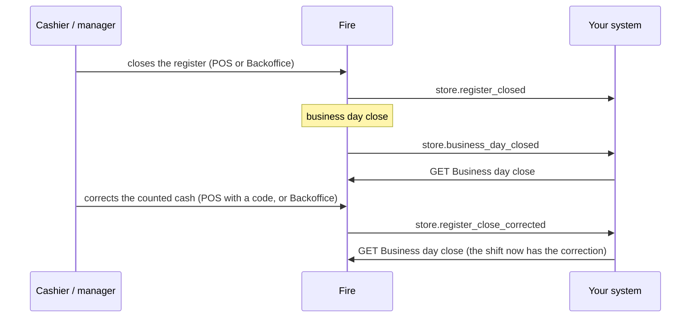

A Fire POS cash register goes through two moments that matter to you as an integrator: it **is closed**, and sometimes the cash counted at that close **is corrected**. This page explains the lifecycle and where you see each step. Field details are on the [`store.register_closed`](/en/events/store-register-closed), [`store.register_close_corrected`](/en/events/store-register-close-corrected) and [Business day close](/en/api-reference/business-day-close) pages.

## 1. Closing the register

There are two ways to close a register:

- **The cashier, from the POS.** They count the drawer and declare the counted cash. Depending on how the store is set up, they may need a **manager code to start the close**: the event reports it in `closeAuthorization`. If the close leaves a shortage that needs authorization, the code that approved it travels in `cash.authorization`.
- **A manager, from the Backoffice**, closing the register by hand. No code is used: `closeAuthorization` and `cash.authorization` come as `null`, and `closedBy.type` is `admin`.

Each close emits **one** [`store.register_closed`](/en/events/store-register-closed) with the whole cash count. Forced closes —when a terminal with an open register is revoked or deleted— don't emit it, because nobody counted the drawer.

Authorizations never carry the code: they carry its id (`tokenId`), its type (`one_time` or `static`), who generated it (`approvedBy`) and when it was used (`approvedAt`). See [Authorizations](/en/events/store-register-closed#authorizations).

## 2. Closing the day

When the business day closes, Fire saves a snapshot of the day: the payments and the cash count of every shift already reported. [Business day close](/en/api-reference/business-day-close) reads **only that snapshot**. So:

- A shift reported **after** the day closed does not appear in the API. You get it in `store.register_closed`, with `postClose: true`.
- The snapshot is not recomputed from orders: what the close didn't save doesn't show up later.

## 3. Correcting the counted cash

If the cashier miscounted —say, took 10 bills as 1s— the close is corrected **without reopening the register**. A correction changes only **the counted cash** (`declaredCash`) and, with it, the difference (`discrepancy`, `discrepancyType`). Expected cash (`systemCash`), sales, withdrawals and change given outside the drawer stay as the close left them.

There are two ways:

| | From the POS | From the Backoffice |
|---|---|---|
| Who | The same cashier who closed the register | A user with the **Correct register close** permission and the store in their scope |
| How it's authorized | With a **manager code** of type **Correct close**, asked for when entering the correction. If the correction leaves a shortage, that same code covers it | No code: the user is accountable. If it leaves a shortage, they must pick the reason |
| Which closes | Those closed by the cashier from the POS | Those closed from the POS and those closed by hand from the Backoffice |
| Window since the close | 24 hours by default (0 to 168; 0 disables it) | 7 days by default (0 to 90; 0 disables it) |
| Limit per close | 3 corrections by default (1 to 10), counting both ways | No limit: it's the way out when the cashier ran out of attempts |
| In the event | `correction.correctedBy.type: "cashier"`, `correction.authorization` with the code | `correction.correctedBy.type: "admin"`, `correction.authorization: null` |

By default the correction code stays valid for 60 minutes after it is used (5 to 240), so the recount fits. The windows, the limit and the code's validity are configured per store in Fire POS.

Both ways work **even after the day is closed**. In that case the correction carries `correction.afterDayClose: true` and Fire updates that day's cash count in the snapshot: the corrected shift, and the day's shortage and overage counts and amounts. The day's sales and payments don't change, and `store.business_day_closed` is **not** emitted again.

Each correction emits one [`store.register_close_corrected`](/en/events/store-register-close-corrected).

## How it shows up in events

| | `store.register_closed` | `store.register_close_corrected` |
|---|---|---|
| When | When the register closes | Every time the counted cash is corrected |
| How many times | Once per register | Zero or more per register |
| Idempotency key | `data.registerSessionId` | `data.correction.id` |
| `cash` | The count at close | The current count, already corrected |
| What it replaced | — | `correction.previous` |
| Order | — | `correction.sequence` (1, 2, 3…) within the same `registerSessionId` |

Both events share `registerSessionId`: that's how you join a close with its corrections. A register's current count is the one from the correction with the highest `sequence` you received or, if there were no corrections, the close's. Arrival order is not guaranteed: order by `sequence`, not by arrival time.

## How it shows up in the Business day close API

Every shift in `cash.shifts[]` carries:

- **The current counted cash.** `declaredCash`, `discrepancy` and `discrepancyType` are already the corrected ones, and `notes` reads `Corrección N: <reason>`.
- **`corrections[]`**, first to last, with the same `id` as the event's `correction.id`, the count before and after, whether it was done from the POS or the Backoffice, and whether it happened after the day closed. `[]` when the shift was not corrected.
- **`closeAuthorization`**, the same code the cashier used to start the close that the event carries.

A correction made before the day closes is already in the day's snapshot. One made after updates it. See the example in [A corrected shift](/en/api-reference/business-day-close#a-corrected-shift).

## Related

<CardGroup cols={3}>
  <Card title="store.register_closed" icon="cash-register" href="/en/events/store-register-closed">
    A register close, with the whole cash count.
  </Card>
  <Card title="store.register_close_corrected" icon="pen-to-square" href="/en/events/store-register-close-corrected">
    Every correction of the counted cash.
  </Card>
  <Card title="Business day close" icon="calendar-check" href="/en/api-reference/business-day-close">
    Every shift's cash count as it stands in the day.
  </Card>
</CardGroup>
