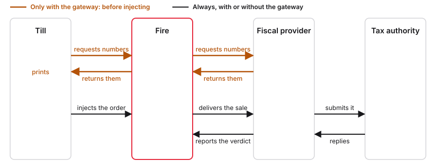
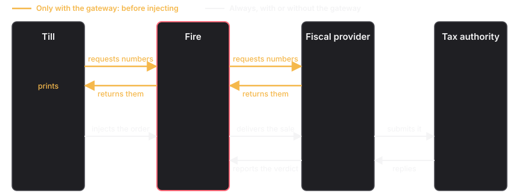

Fire does not talk to the tax authority. Your **fiscal provider** issues the document and gets the verdict: Fire delivers the sale to it, receives the result and publishes it on the order and in the events.

There are two ways to integrate it, and they differ in one thing only: **whether the till needs the fiscal numbers before injecting the order.**

The till only talks to Fire, and Fire to the provider. From injection onward, both paths are the same.

## Without the gateway: the base integration

The till charges and injects the order. It does not need to know anything fiscal.

Fire delivers the sale to the provider through an [Integration Flow](/en/events/integration-flows), and the provider reports the result with the [fiscal callback](/en/api-reference/fiscal-callback), echoing the `event.id` of the event it received.

When charging, the till has no fiscal numbers and `data.fiscalRepresentation` travels as `null`.

**The provider implements:** an endpoint that receives the event, and sending the fiscal callback.

## With the gateway: the same, plus one step before

When the receipt has to be printed with its identifiers at the moment of the sale, the till asks Fire for the numbers and Fire asks the provider. The till prints them and then injects the order with the same `orderCode`. If the order was already open because it is charged later, the till numbers it when charging. The till never talks to the provider.

<Warning>
  **Numbered is not authorized.** The printed numbers say what was printed. The authority's verdict arrives later, through the same callback as the path without the gateway.
</Warning>

**The provider also implements:** the [synchronous numbering endpoint](/en/fiscal-providers/contract), per country. Today Fire supports it in Ecuador and Colombia, and it is enabled per vendor: the same country can have vendors with and without the gateway.

## Online and offline

The path is the same. What changes is the mode the provider reports in `authorizationMode`:

| | Online | Offline (contingency) |
|---|---|---|
| **The authority responds** | Usually in seconds or minutes | Later, even hours, when the connection returns |
| **The receipt** | Printed as usual | Valid, and may carry a legend: `printing.reason` is `ISSUED_OFFLINE` |
| **Till → Fire → provider** | Same | Same |
| **How the verdict returns** | Fiscal callback | Fiscal callback |

## What changes and what does not

| | Without the gateway | With the gateway |
|---|---|---|
| **The till calls numbering** | Not needed. If it calls, it gets `NOT_APPLICABLE` and continues | Yes, before injecting |
| **Numbers available when charging** | No | Yes |
| **The till depends on the provider** | No | Yes. If it fails, the account's policy decides: `CONTINUE` or `REFUND` |
| **`fiscalRepresentation`** | `null` | With the numbering block |
| **How the provider receives the sale** | Integration Flow | Integration Flow |
| **How the verdict returns** | Fiscal callback | Fiscal callback |
| **`data.fiscal.authority` and events** | Same shape | Same shape |

## Cancellation

This does not change in substance either. The order is cancelled in Fire, `order.cancelled` fires, a flow delivers it to the provider, and the provider confirms with a `cancelled` callback carrying its own `eventId`. That produces `order.reversed`.

With the gateway, the till also requests the numbers of the cancellation document with `operation: "CANCEL"`.

## The two blocks on the order

A fiscal document can leave two blocks on the order, and each answers a different question. Most confusion comes from mixing them up.

| | `data.fiscalRepresentation` | `data.fiscal.authority` |
|---|---|---|
| **Question it answers** | *What was printed?* | *What did the authority decide?* |
| **When it appears** | Only with the gateway, when the till numbered | On both paths, when the callback arrives |
| **How it reaches Fire** | [Fiscal numbering](/en/api-reference/fiscal-documents-v2) request | [Fiscal callback](/en/api-reference/fiscal-callback) |
| **Changes later?** | Only when a new document is numbered (a credit note) | Yes: authorized, then cancelled |

<Warning>
  **`fiscalRepresentation` never says the document was authorized.** It holds the numbers printed at the till. The authority's verdict is `fiscal.authority`, and the current status is `fiscal.status` in the fiscal events, `lastKnown.fiscal.status` in every other event. The three can legitimately disagree for a while.
</Warning>

What happens between the callback and the events — which event fires for each outcome, and how every field travels — is in [From the callback to the events](/en/fiscal/callback-to-events).

## Four words for "status"

The same fact is named differently depending on where you read it. They are not interchangeable:

| Where | Field | Values | Describes |
|---|---|---|---|
| Fiscal numbering response | `numberingStatus` | `GENERATED`, `PENDING`, `FAILED_RETRYABLE`, `FAILED_FINAL`, `NOT_APPLICABLE`, `BLOCKED_BY_POLICY` | Whether **numbering** worked |
| Fiscal numbering response | `documentStatus` | `PENDING`, `AUTHORIZED`, `REJECTED`, `CANCELLED` | The document, as the gateway last knew it |
| Fiscal callback (you send it) | `eventType` | `fiscal_graphic`, `authorized`, `cancelled`, `rejected`, `denied`, `error` | What just happened at the authority |
| Fiscal events (`order.invoiced`, `order.cancelled`, `order.reversed`) | `fiscal.status` | `awaiting_payment`, `not_issued`, `pending`, `processing`, `fiscal_graphic`, `authorized`, `cancelling`, `cancelled`, `rejected`, `denied`, `error` | The order's fiscal state stored with the document |
| Every other order event | `lastKnown.fiscal.status` | `pending`, `processing`, `fiscal_graphic`, `authorized`, `cancelling`, `cancelled`, `rejected`, `denied`, `error` | The order's **current** fiscal state |

## Where to go next

<CardGroup cols={2}>
  <Card title="From the callback to the events" icon="arrow-right-arrow-left" href="/en/fiscal/callback-to-events">
    Which event fires for each callback, and where every field lands.
  </Card>
  <Card title="Fiscal callback" icon="arrow-right-to-bracket" href="/en/api-reference/fiscal-callback">
    The contract your provider sends.
  </Card>
  <Card title="Numbering from the till" icon="cash-register" href="/en/guides/fiscal-integration">
    The gateway step, for points of sale and kiosks.
  </Card>
  <Card title="Becoming a fiscal provider" icon="plug" href="/en/fiscal-providers/overview">
    What a provider implements on each path.
  </Card>
</CardGroup>
