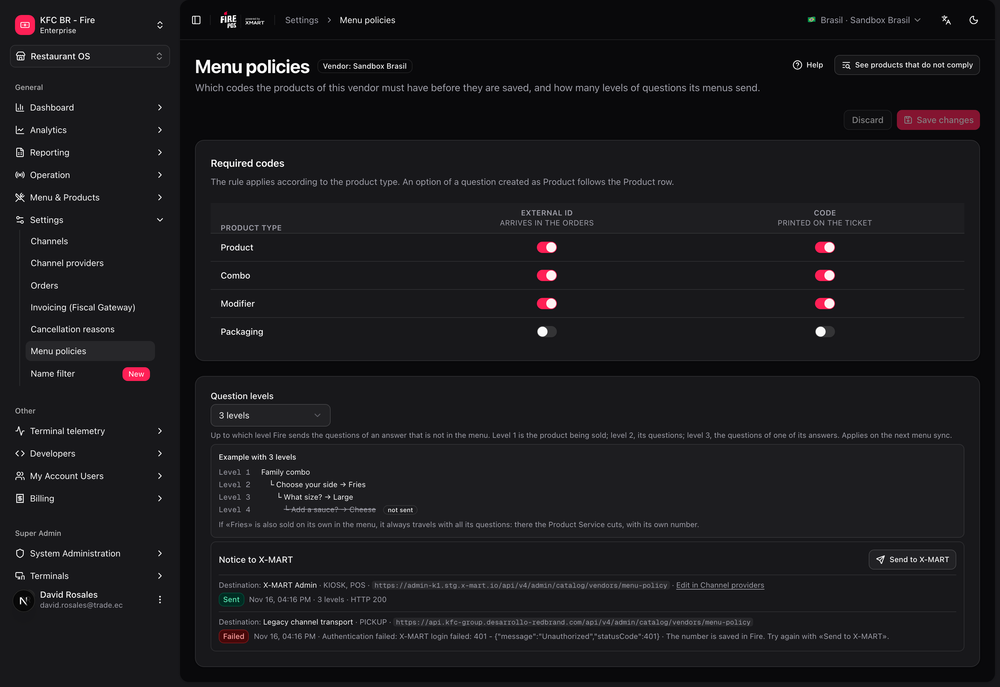
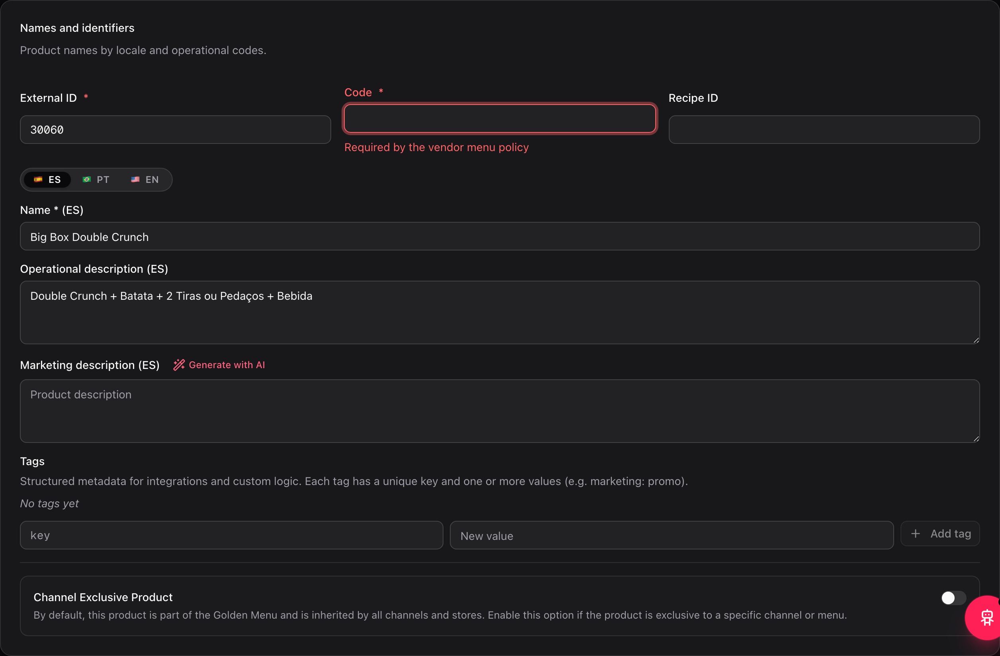
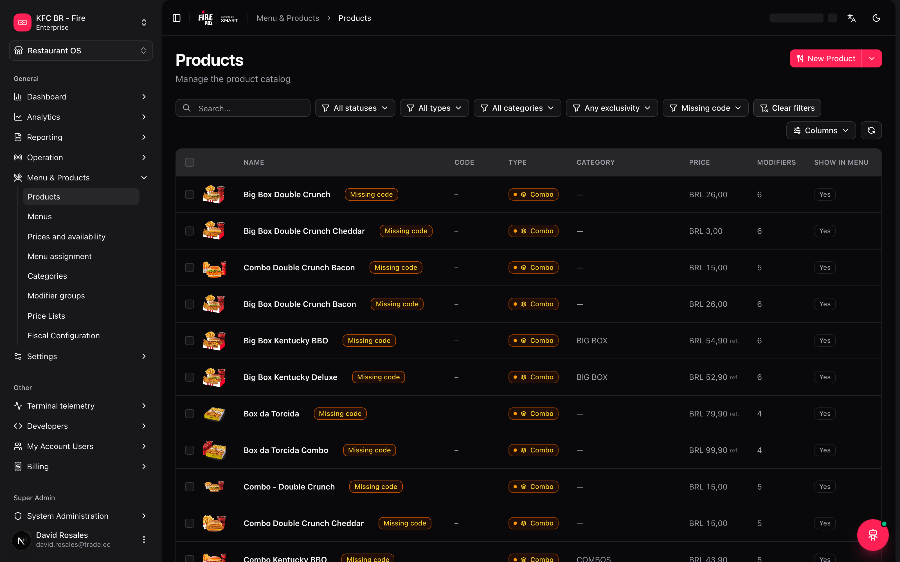
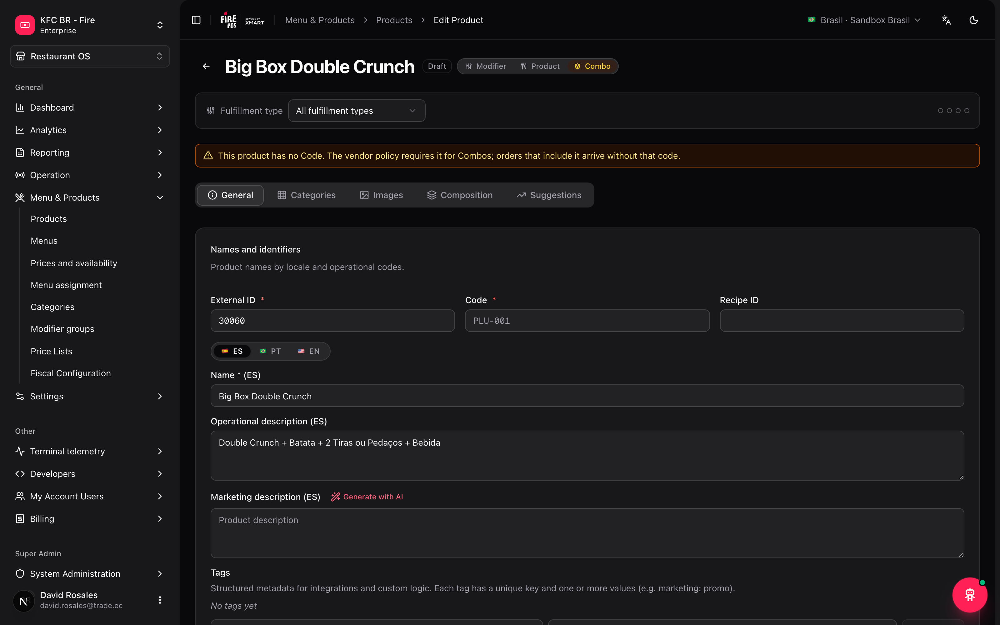
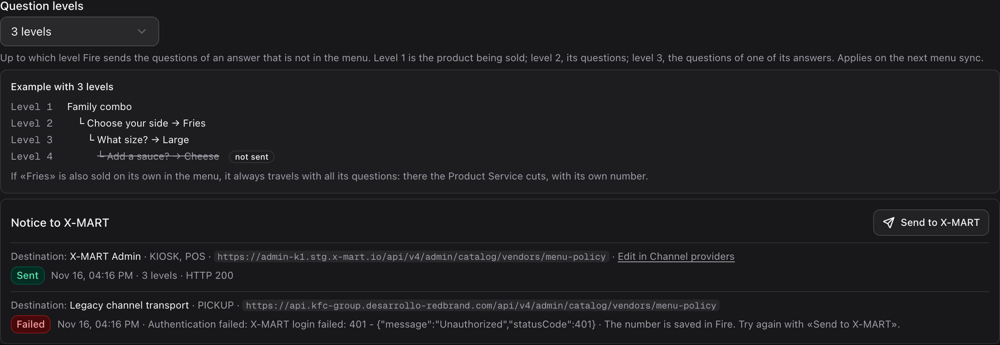
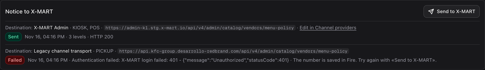

{/* Gap noted: the Restaurant OS Settings menu also has Channels, Channel providers, Orders, Invoicing (Fiscal Gateway) and Cancellation reasons. None of them has a manual yet. This page documents only Menu policies. */}

A product travels to X-MART with its **External ID**, and that's the code with which its orders come back identified. A product that doesn't have it still sells — and its orders arrive without that code, so nobody downstream can match the line to anything. It's found weeks later, when someone reconciles and the numbers don't add up.

This screen exists so the account can say **"no product of this type goes live without its code"**, and Fire enforces it at the moments it can.

It also decides something else: **how many levels of questions** the brand's menus send. An answer can be a product with questions of its own — a sandwich inside a combo that asks which sauce — and this number says how far down Fire follows them. Go to **Restaurant OS → Settings → Menu policies**.

<Frame>
  
</Frame>

---

## The minimum you need to know

<Note>
**1. It comes switched off.** Until someone configures it, nothing changes: no product is required to have any code, and none is flagged.

**2. It's a matrix, and it's per vendor.** The rows are the product types — **Product**, **Combo**, **Modifier**, **Packaging** — and the columns are the two codes, **External ID** and **Code**. Each cell is a switch: on, the code is required for that type; off, it isn't.

**3. It blocks what's new and flags what already exists.** Creating a product or saving its record without a required code is refused. Products that already lack the code are **not** blocked: they keep selling and publishing, and they get a **Missing code** chip so you can fix them.

**4. Question levels come at 2, and at 2 nothing changes.** Raising it makes Fire send the questions of answers that aren't in the menu. It applies on the **next menu sync**, and X-MART has to receive the new number **before** that sync. See [Question levels](#question-levels).
</Note>

---

## The screen

At the top, next to the title, the **Vendor** badge tells you which vendor you're configuring — here, *Sandbox Brasil*. It's the vendor chosen in the selector at the top of the backoffice, and the policy belongs to that vendor alone. The description reads *"Which codes the products of this vendor must have before they are saved, and how many levels of questions its menus send."* On the right, **Help** opens a side panel that explains the screen, and **See products that do not comply** opens the product list already filtered. That button only appears once the policy you **saved** requires some code.

The **Required codes** card holds the matrix. Its note says: *"The rule applies according to the product type. An option of a question created as Product follows the Product row."*

| Column | What it is |
| --- | --- |
| **External ID** — *Arrives in the orders* | The code the product travels to X-MART with, and with which orders come back identified |
| **Code** — *Printed on the ticket* | The point-of-sale operational code (PLU). It's what gets printed |

You change switches and then confirm with **Save changes**. **Discard** drops what you changed. When it saves, Fire confirms with a generic message; if it can't, it shows the server's message as it comes, in English.

<Note>
To see **Menu policies** your role needs access to it — if your role is set up with explicit submenus, an administrator has to grant it. Without it, the item doesn't appear in the menu and opening the address sends you to *access denied*. To **save**, access isn't enough: you also need permission over the **whole vendor**. Someone limited to one store can read the policy but can't change it. The same goes for the **Notice to X-MART** block: seeing it and pressing **Send to X-MART** both need the page's access **and** permission over the whole vendor, so with only some stores you can't see it or send it.
</Note>

<Warning>
**Changing the policy changes nothing in the products.** It doesn't fill codes in or take any product off sale. It only changes what Fire blocks from now on and which products show **Missing code**. The question levels, for their part, change the menu only when it's synced again.
</Warning>

---

## The simple path

Almost every account needs one column: **External ID**, for the types it sells.

1. Open **Restaurant OS → Settings → Menu policies** and check the **Vendor** badge.
2. In the **External ID** column, switch on **Product**. Do the same for **Combo** and **Modifier** if they also travel in orders.
3. Tap **Save changes**.
4. Tap **See products that do not comply** and work through the list.

<Tip>
If your only goal is that no product reaches X-MART without its identifier, this is all you need. **Code** is a different matter — see below.
</Tip>

---

## The two codes are not the same

| | **External ID** | **Code** |
| --- | --- | --- |
| What it's for | It's the code the product **travels to X-MART with**, and with which orders come back identified | The point-of-sale operational code (PLU). **It's what the ticket prints** |
| What happens if it's missing | Orders arrive without that code | The ticket prints the External ID in its place, if the product has one |
| Where you type it | **General** tab of the product | **General** tab of the product. In the **Add option** dialog of a modifier group it's called **PLU** |

<Warning>
**In the spreadsheet, the código column is the External ID, and the plu column is the Code.** In the product record the names are **External ID** and **Code**. It's a real source of confusion: see [Import and export](/en/manuals/backoffice/data-transfers).
</Warning>

---

## What the policy does, and what it doesn't

### Which field gets the asterisk

Without a policy, **External ID** and **Code** carry no asterisk. With one, a field gets the asterisk only if the vendor requires that code **for that product type**. In the capture of the [product record](/en/manuals/backoffice/products#codes-and-the-menu-policy), a *Product* shows both asterisks because, in that environment, the policy requires both codes for **Product**. With a **Fulfillment type** selected on the record, the codes are inherited and locked, so they show no asterisk.

### What it blocks

Fire refuses in these cases, and only when the product's type requires a code it doesn't have:

| When | What happens |
| --- | --- |
| **Creating a product** | The product isn't created until it carries the codes its type requires. |
| **Creating an option** from **Add option** in a modifier group | The same: the option is a new product, born as **Product**, and follows the **Product** row. |
| **Saving the General tab** | The save is refused. The error shows on the empty field. |
| **Saving the record with a type change pending** | The requirement of the **new** type is checked at the next save, **on any tab**: even Pricing or Categories can be refused until the code is filled. |

A code that only has spaces counts as empty. Otherwise the tabs — pricing, categories, images, modifier groups, suggestions and availability — save normally, whether or not the product has its code. Prices, categories and menus don't wait for the code.

Tapping the **Modifier / Product / Combo** pills on the record doesn't trigger anything: it only changes the screen and marks the record **Unsaved**. The asterisks switch to those of the new type right away, but the check happens when you save. **Packaging** has no pills (its type can't be changed), but its row applies when creating and when saving **General**.

**How you see it:**

- **Saving General** marks the empty field in red with *Required by the vendor menu policy*, and a message with the same reason appears too.

<Frame>
  
</Frame>

- **Creating a product** marks every missing field the same way.
- **Add option** marks the fields inside the dialog — no message outside it — and keeps you on the **General** tab of the dialog.
- **Saving another tab** with a type change pending shows the message *"The vendor menu policy requires {fields} for {type}."*, with the hint *"Fill it in on the General tab."* and a **Go to General** button.

### What it only flags

Products that **already existed** without the code are not blocked. They keep selling and publishing, and menu synchronization doesn't look at the policy. They're marked in two places:

- **In the product list**, a **Missing code** chip next to the name. Hover it and the tooltip says what's missing: *Missing: Code*, *Missing: External ID* or *Missing: External ID and Code*. The list also gets a filter, **Any code status**, with a single option, **Missing code**. It only appears when the policy requires something, and **Clear filters** shows up while any filter is active.
- **In the product record**, a notice above the tabs, visible on **every** tab: *"This product has no {fields}. The vendor policy requires it for {type}; orders that include it arrive without that code."* It reads the **saved** data: it stays while you type and goes away when you save. It doesn't show when creating. With a type change pending, it already uses the new type.

<Frame>
  
</Frame>

<Frame>
  
</Frame>

<Info>
**Why it doesn't block the old ones.** Turning the policy on can't take products off sale: a restaurant in the middle of service would lose dishes. The cost of leaving it like that is real, though — those products' orders keep arriving without a code until someone fixes them. The chip and the notice are what keep that visible.
</Info>

### What it doesn't cover

- **Modifier groups.** A group is created without a code and that's fine: it has no row in the matrix. The policy covers the **options** (which are products), not the group.
- **Assigning an existing product as an option.** With **Search and assign product** nothing is validated, so a product that doesn't comply gets assigned without a warning. The rule applies when a product is written, not when it's assigned.
- **Restoring a backup.** It doesn't skip anything: see [Import and export](/en/manuals/backoffice/data-transfers).

---

## Question levels

An answer isn't always a plain item. *Kentucky Salad Bacon*, inside a combo, is a sandwich with questions of its own: **Deseja adicionar algum item no seu sanduíche?**, **Personalize seu sanduíche**, **Escolha o Refrigerante** and **Escolha seu molho**. For those questions to reach the customer inside the combo, Fire has to send them along with the answer — and **Question levels** says how far down it goes.

Below the matrix, **Question levels** is a selector from **2 to 6 levels**, set to **2** unless someone changes it (the default shows as *2 levels (default)*). The number is saved with the same **Save changes** as the matrix of codes. Its note reads *"Up to which level Fire sends the questions of an answer that is not in the menu. Level 1 is the product being sold; level 2, its questions; level 3, the questions of one of its answers. Applies on the next menu sync."*

<Frame>
  
</Frame>

### What a level is

You count from the product being sold:

| Level | What it is | Real example |
| --- | --- | --- |
| **1** | The product being sold | Combo Kentucky Salad Bacon |
| **2** | Its questions | **Escolha seu sanduíche!**, whose answer is Kentucky Salad Bacon |
| **3** | The questions of one of its answers | **Escolha seu molho**, inside Kentucky Salad Bacon |
| **4 to 6** | And so on, one more each time | — |

Under the selector the screen draws a **generic example** that changes with the number: *Family combo → Choose your side → Fries → What size? → Large → …*. It marks with **not sent** the first level that falls outside. Use it to see where your number cuts.

### What it changes

- **At 2, nothing changes.** The menu goes out exactly as before.
- **At 3**, the sandwich in the combo sends its questions inside the combo. Each level you add goes one question further down.
- **It applies to answers that aren't in the menu.** An answer that is **also sold on its own** in the menu always travels with all its questions: there it's the Product Service that cuts, with its own number.
- **It applies on the next menu sync.** Saving doesn't resend any menu.

To see, per product, which questions reach and at which level, see [Questions inside an answer](/en/manuals/backoffice/products#questions-inside-an-answer). In the menu editor they appear in the **Table** view: see [Menus](/en/manuals/backoffice/menus#questions-inside-an-answer).

---

## Notice to X-MART

The number only works if X-MART has it **before** the menu arrives. That's why, under the selector, the **Notice to X-MART** block tells X-MART the number for you.

<Frame>
  
</Frame>

### When it's sent

- **When you save a different number.** Fire compares it with the one saved before (with nothing saved, the previous one counts as **2**). Saving **2** the first time, saving the same number again, or changing only the codes **sends nothing**.
- **When someone presses Send to X-MART**, for the first load and for retrying. The button sends the **saved** number, never the one in the selector.

There are no automatic retries: if it fails, the retry is the button. A failed notice doesn't undo what you saved. Fire doesn't send the menus either: the notice only tells X-MART the number.

### Where it goes and what the status says

Each **Destination** is listed with its address: the **X-MART provider of the brand's channels**, or **Legacy channel transport** if the brand only has that. Channels that share a provider appear together in one row (for example *KIOSK, POS*) and get a single send; legacy channels are grouped by their base address. Next to each row, the status:

| Status | What it means |
| --- | --- |
| **Sent** | X-MART answered with a success code. Shows the date, the number of levels and the HTTP code: *Nov 16, 04:16 PM · 3 levels · HTTP 200*. Whether X-MART then applied the number is on X-MART's side. |
| **Failed** | It didn't arrive. Shows the date and the error, and says *"The number is saved in Fire. Try again with «Send to X-MART»."* The causes: the destination has no integration configured; the login with X-MART failed; X-MART answered with an HTTP error; X-MART didn't answer within 10 seconds (it tries once); or a network error. The error text is technical, in English, and shown as the system returned it. |
| **Incomplete** | A send was left open: it was cut halfway, or it's still running — there's no time limit. *Started on \{date\} and never finished. Send it again.* Pressing the button clears it. |
| **Never sent** | Fire has no recent record of a send to that destination (it looks at the brand's last 20 notices). It also shows when the provider or its base address changed. The screen adds *X-MART keeps the limit it had, set by hand.* — that line is an assumption of the screen: Fire doesn't know what limit X-MART has. |
| **No destination** | No channel of this brand ends up at X-MART: no channels, a channel switched off, no outbound destination or no legacy configuration. Assignments made only at store level don't count. The button is disabled. *No channel of this brand goes to X-MART. Nothing is sent.* |

Destinations are sent one after another. A **Failed** doesn't block the rest, and there's no overall status for the brand. **Send to X-MART** resends to **every** destination, including those already **Sent**: there's no per-destination retry.

In the capture, one destination is **Sent** and the other **Failed**: it's a test environment whose login was rejected (401), shown here to illustrate both states. It's not a product error.

If you change the number and don't save, the block reminds you — the button stays enabled — *"Save to send \{n\} levels. «Send to X-MART» sends the saved number (\{saved\})."* After a successful send it says *"X-MART now has \{n\} levels. Sync this brand's menus so the new questions reach the kiosk."*, with a **Go to Menu assignment** link. It shows after **any** successful send during that visit — one destination in **Sent** is enough, also when you resend the same number or another destination failed — and it disappears when you reload the page. "Now has" only means X-MART answered with a success code.

<Warning>
**The order matters.** First raise the number and save it. Then check that X-MART has it: the destination must say **Sent**. Only then sync the brand's menus from [Menu assignment](/en/manuals/backoffice/menu-assignments). If you sync before X-MART has the number, the kiosk doesn't show the new questions.
</Warning>

---

## Recipes: how the real cases get solved

<AccordionGroup>
  <Accordion title="Making the sandwich in the combo ask its questions">
    1. Open **Menu policies** and check the **Vendor** badge.
    2. In **Question levels**, choose **3 levels**. Use the example to check where it cuts.
    3. Tap **Save changes**. Because the number changed (from 2 to 3), Fire notifies X-MART on its own.
    4. In **Notice to X-MART**, check that each destination says **Sent**. If one says **Failed**, tap **Send to X-MART**.
    5. Tap **Go to Menu assignment** and sync the brand's menus.

    Until you sync, the menu still goes out with the previous number.
  </Accordion>

  <Accordion title="Orders are arriving at X-MART with lines without a code">
    1. Open **Menu policies** and switch on **External ID** for **Product** (and **Combo** or **Modifier** if they also appear in orders).
    2. Tap **Save changes**.
    3. Tap **See products that do not comply**.
    4. Open each product and fill the **External ID** in **General**.
    5. Save and sync the menus that hold them from [Menu assignment](/en/manuals/backoffice/menu-assignments).

    Until you fix a product, its orders keep arriving without a code.
  </Accordion>

  <Accordion title="I can't create or save a product: 'Required by the vendor menu policy'">
    Your account requires a code for that type and the field is empty. Fill the field marked in red and save again. If you typed only spaces, it counts as empty.
  </Accordion>

  <Accordion title="I can't save Pricing, Categories or another tab">
    Check whether you touched the **Modifier / Product / Combo** pills without saving. The record still carries that type change and the policy of the new type is checked on every save. Fill the code on **General** — the **Go to General** button takes you there — or undo the type change.
  </Accordion>

  <Accordion title="A product shows Missing code but it's selling fine">
    It's expected. The policy doesn't block products that already existed. The chip tells you its orders arrive without that code: fill it and the chip goes away.
  </Accordion>

  <Accordion title="I need the PLU on every ticket">
    Switch on **Code** for the types that print. **Code** is what the ticket prints, so require it only where a ticket needs it.
  </Accordion>

  <Accordion title="Find all the products I need to fix">
    On the product list, open the **Any code status** filter and pick **Missing code**. Or tap **See products that do not comply** from **Menu policies**: it opens the list already filtered.
  </Accordion>
</AccordionGroup>

---

## Cases, end to end

With **External ID** switched on for **Product** and **Code** switched off:

| What you do | Result |
| --- | --- |
| Create a **Product** without External ID | Refused: *Required by the vendor menu policy* |
| Create a **Product** with External ID and no Code | Created |
| Edit the price of an existing product that has no External ID | Saved: the **Pricing** tab isn't validated. The product keeps showing **Missing code** |
| Save the **General** tab of that same product without touching External ID | Refused: the policy applies to this tab |
| Tap the **Product** pill on a **Modifier** without External ID, then save any tab | Refused at that save, because the new type requires it |
| Create a **Combo** without External ID | Created: **External ID** isn't switched on for **Combo** |

---

## Errors that cost money

<Warning>
**Assuming a product without its code has stopped selling.** It keeps selling. The risk is the opposite: orders arrive without a code and nothing stops them. Check the list after turning the policy on.
</Warning>

<Warning>
**Requiring Code when you meant External ID.** **Code** is what the ticket prints. If the goal is that X-MART receives the line identified, the column is **External ID**.
</Warning>

<Warning>
**Setting the policy on the wrong vendor.** The matrix is per vendor: check the **Vendor** badge before tapping **Save changes**.
</Warning>

<Warning>
**Raising the question levels and syncing the menus before X-MART has the number.** The sync goes through, but the kiosk doesn't show the new questions. Check that the destination says **Sent** first.
</Warning>

<Warning>
**Assuming that saving the levels resends the menus.** It doesn't. The new number applies on the next sync of each menu, and nobody syncs for you.
</Warning>

<Warning>
**Importing a spreadsheet and assuming it fixes the codes.** With the policy on, rows that create a product without the code, or empty it, are left out. See [Import and export](/en/manuals/backoffice/data-transfers).
</Warning>

---

## Glossary

| Term | What it means |
| --- | --- |
| **Menu policy** | The matrix, per vendor, of which codes each product type requires |
| **External ID** | The code the product travels to X-MART with, and with which orders come back identified |
| **Code** | The point-of-sale operational code (PLU). It's what the ticket prints |
| **Missing code** | Chip on a product that lacks a code its type requires |
| **Any code status** | Product list filter; its option **Missing code** shows only the products that lack a required code |
| **Vendor** | The brand or business inside the account |
| **Question levels** | How many levels of questions the brand's menus send, from 2 to 6 (2 by default). Level 1 is the product being sold, level 2 its questions, level 3 the questions of one of its answers. |
| **Notice to X-MART** | The block that tells X-MART the question levels number, and shows whether each destination received it: **Sent**, **Failed**, **Incomplete**, **Never sent** or **No destination**. |

---

## Frequently asked questions

<AccordionGroup>
  <Accordion title="I raised the levels and the kiosk still doesn't show the questions">
    Two things are usually missing. Check that **Notice to X-MART** says **Sent** for every destination — if it says **Failed**, **Incomplete** or **Never sent**, X-MART may not have the number (and **Sent** only means X-MART answered with a success code). And check that you synced the brand's menus **after** that: saving the levels doesn't resend them, and nothing marks the rows in [Menu assignment](/en/manuals/backoffice/menu-assignments) as out of date, so you sync them by hand. Also confirm the number is high enough: at 2, nothing changes.
  </Accordion>

  <Accordion title="What does Failed mean?">
    Fire saved the number, but that destination didn't take it. Nothing is lost: *"The number is saved in Fire."* The cause is one of these: the destination has no integration configured, the login with X-MART failed, X-MART answered with an HTTP error, X-MART didn't answer within 10 seconds, or there was a network error. The status line shows the error as the system returned it, in English and technical. Fix the cause and tap **Send to X-MART** again. A **Failed** doesn't block the other destinations, and the button resends to **all** of them, also those already **Sent**. Fire doesn't retry on its own.
  </Accordion>

  <Accordion title="Does raising the levels change anything for products that are in the menu?">
    No. A product that is also sold on its own in the menu always travels with all its questions. Question levels only decides how far down Fire goes for answers that **aren't** in the menu.
  </Accordion>

  <Accordion title="Is the policy on by default?">
    No. It comes switched off: nothing is required and nothing is flagged until someone configures it. A vendor with every switch off is the same as one that was never configured.
  </Accordion>

  <Accordion title="Does it apply to products that already exist?">
    It doesn't block them, but it flags them. They keep selling and publishing, with a **Missing code** chip in the list and a notice in the record. They're refused only when someone saves their **General** tab or, with a type change pending, any tab.
  </Accordion>

  <Accordion title="Does it also apply to the modifier group's ID?">
    No. A group is created without a code and it isn't in the matrix. The policy applies to the products behind its options.
  </Accordion>

  <Accordion title="Does it apply if I load products by spreadsheet?">
    Yes, for rows that create a product or empty a code it had: they're left out with a finding. A backup restore doesn't skip anything, it only warns. See [Import and export](/en/manuals/backoffice/data-transfers).
  </Accordion>

  <Accordion title="Why don't I see Menu policies?">
    Your role doesn't have access to it. If it's set up with explicit submenus, an administrator has to grant it. Opening the address directly sends you to *access denied*.
  </Accordion>

  <Accordion title="Why can I see it but not save?">
    Saving needs permission over the whole vendor, not just access to the screen. If you only manage some stores, ask someone with permission over the whole vendor.
  </Accordion>

  <Accordion title="Why don't I see the Any code status filter?">
    It only appears when the policy requires some code. With everything switched off there's nothing to filter.
  </Accordion>
</AccordionGroup>

---

## What it does not do

- It **doesn't fill codes in** or take products off sale: it blocks what's new and flags what already exists.
- It **doesn't validate** the other tabs of the product while the type hasn't changed: pricing, categories, images, modifier groups, suggestions and availability save normally.
- It **doesn't require a code on the modifier group** itself, and it **doesn't check** a product you assign to a group as an option.
- It **doesn't skip anything** when restoring a backup: it only warns.
- Saving the question levels **doesn't resend the menus**: the new number applies on the next sync of each one.
- The **Notice to X-MART** **doesn't retry on its own**: if it fails, the retry is the **Send to X-MART** button.
