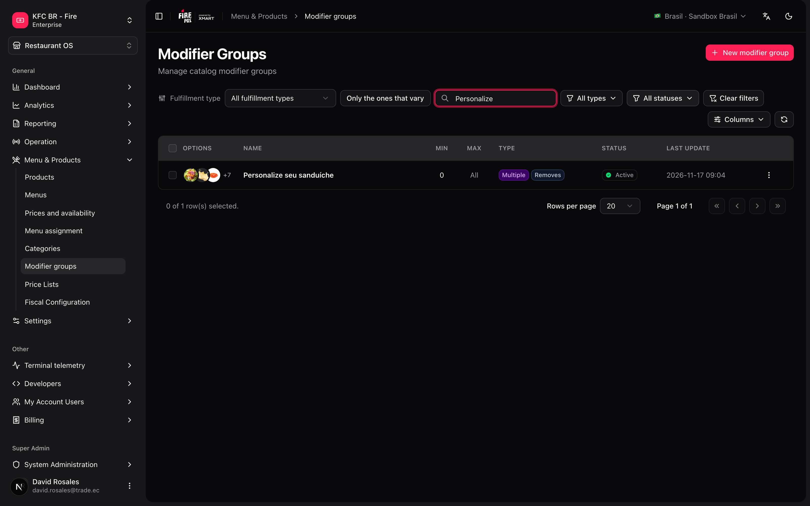
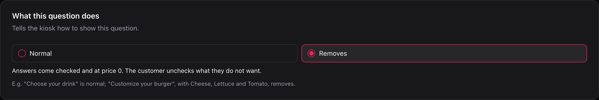
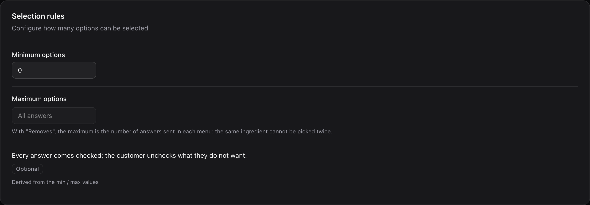
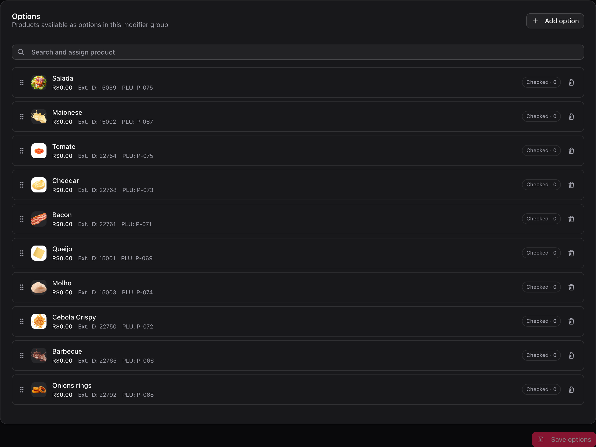
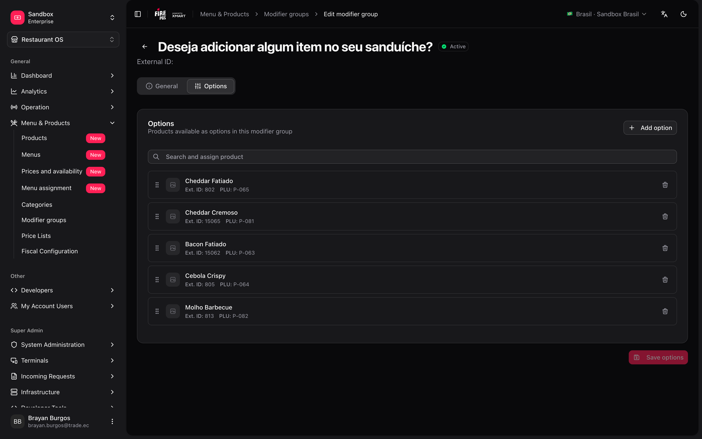
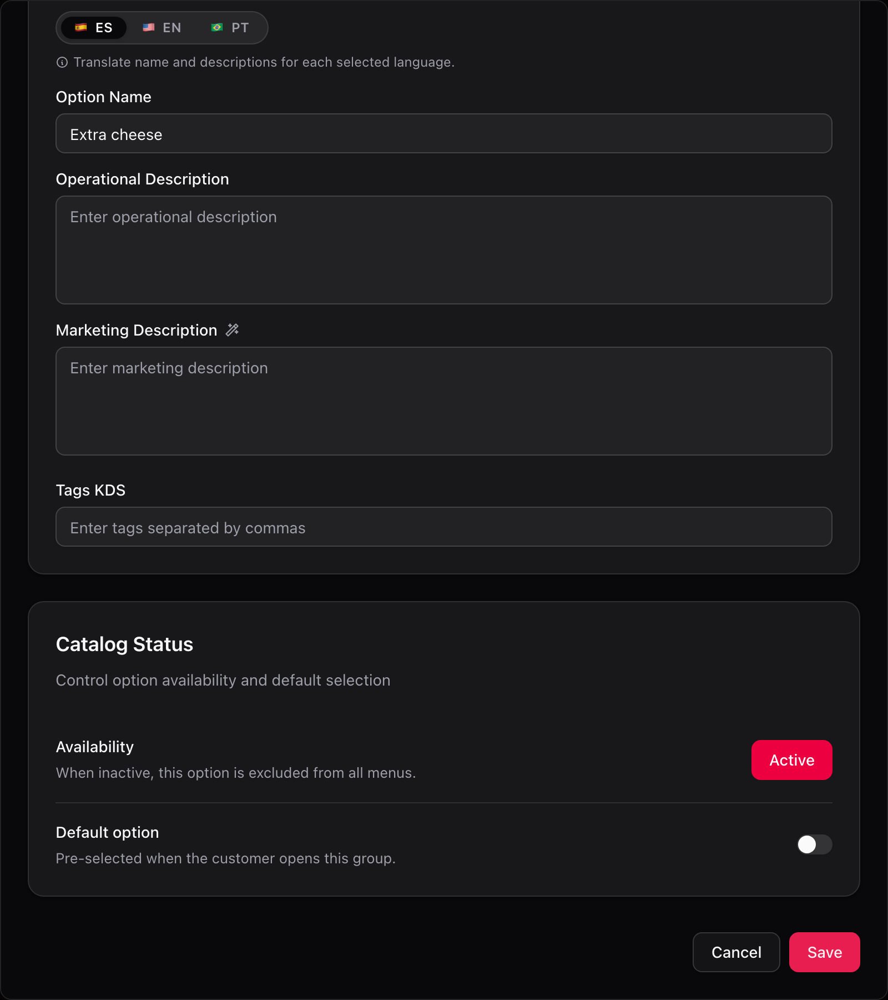
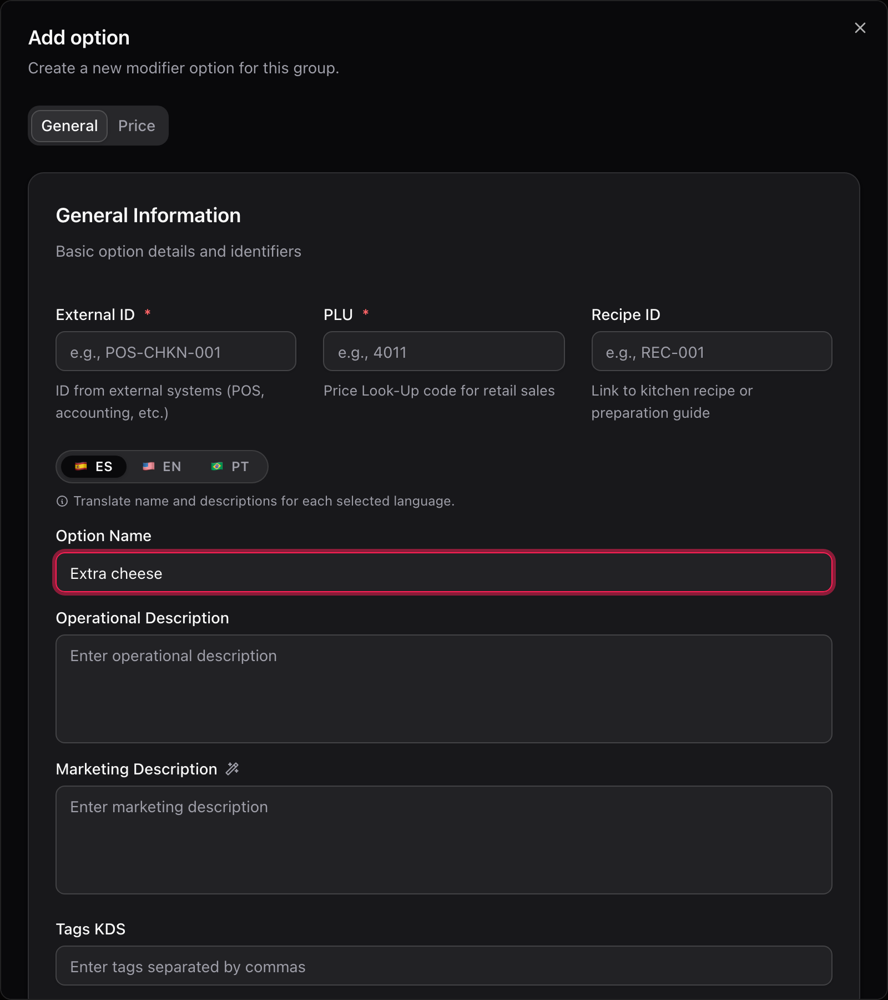

A modifier group is a **question you ask the customer when they order**: *which sauce?*, *what size?*, *anything to add?*. The group defines the question, the possible answers, and how many they can pick.

It's defined once and picked from many places: the same *Sauces* group can serve all ten burgers on the menu without anyone typing the question ten times. But adding it to a product **takes a copy** of the group as it is that day — so the day you add a new sauce to the group, the products that already had it don't change on their own (the one thing that always follows the group is whether the question is Normal or Removes). Go to **Restaurant OS → Menu and Products → Modifier groups**.

<Frame>
  
</Frame>

---

## The minimum you need to know

<Note>
**1. Options are catalog products.** To offer *extra cheese* there has to be an *extra cheese* product. You don't write loose options.

**2. You only set two numbers: the minimum and the maximum.** Whether the group is required, and whether it takes one option or several, **is not chosen** — the screen derives it from those two numbers.

**3. Adding a group to a product copies it.** From then on, editing the group no longer changes what that product asks. The group is the template you pick from, not a parent the products keep following. **One exception: Normal or Removes is not copied.** It's always read from the group, so switching it changes every product that uses the group.

**4. A question is either Normal or Removes.** **Normal** is what every group has always been: the answers come unchecked, with their price, and the customer checks what they want. **Removes** is for ingredients the product already includes: every answer comes checked at price 0 and the customer unchecks what they don't want. If you pick nothing, the question is Normal.
</Note>

---

## The simple path

1. **New modifier group**, give it a name — *Sauces*, *Size*, *Extras*.
2. Leave **What this question does** on **Normal**. Change it only if the customer removes ingredients — see [What the question does](#what-the-question-does-normal-or-removes).
3. Set the **Minimum options** and the **Maximum options** the customer can pick.
4. Save, and on the **Options** tab find the products that will be the options. Confirm with **Save options**.
5. Go to each product that uses this group and add it from its **Modifier Groups** tab (on a combo, the **Composition** tab).

<Tip>
A group does nothing on its own. It starts working when a product uses it. If the question is the same on every fulfillment type, it's a normal question, and you finish the group before adding it to products, you're done.
</Tip>

---

## The selection rules

The **Selection rules** card has **only two fields**: **Minimum options** and **Maximum options**. Nothing else.

Below them the screen tells you, in plain words, what the customer will be able to do — *"The customer picks exactly one option."*, *"The customer picks between 1 and 10 options."* — and shows two badges: **Required** or **Optional**, and **Single** or **Multiple**, with the line *"Derived from the min / max values"*. They are not fields: they are the result of the two numbers you set.

<Info>
**Why it's derived instead of chosen.** A group marked "optional" with a minimum of 1 would be a contradiction, and somebody would discover it when a customer couldn't finish their order. By deriving it from the numbers, that contradiction cannot exist. The rule is: a maximum of 1 makes it **Single**, anything higher **Multiple**; a minimum of 1 or more makes it **Required**.
</Info>

Examples that cover almost everything:

| What you want | Min | Max | You get |
| --- | --- | --- | --- |
| Pick the size, no way around it | 1 | 1 | Required · Single |
| Sauce, optional | 0 | 1 | Optional · Single |
| Up to three optional extras | 0 | 3 | Optional · Multiple |
| Pick two sides from a combo | 2 | 2 | Required · Multiple |

The numbers count **picks**, not different options: a group with two fries and a minimum of 2 is valid.

<Note>
**With Removes you don't choose the maximum.** The box reads **All answers** and can't be edited: the maximum is the number of answers each menu sends, so the same ingredient can't be picked twice. The minimum stays yours, but it changes meaning — see [What the question does](#what-the-question-does-normal-or-removes).
</Note>

The badges are always derived from the numbers that **actually apply** — after any adjustment on the product, per fulfillment type or per menu. If a product raises the maximum of a *Single* group to 3, that product asks it as a multiple choice.

### The maximum can't be 0

The minimum can be 0 — that's how optional questions are made. The **maximum** can't be set to 0, and what happens when you try depends on the screen — always without a message:

| Where | If you type or paste a 0 in the maximum | If you leave the box empty |
| --- | --- | --- |
| **The group** | The box discards it. | With a **Fulfillment type** selected, it goes back to *inherits*. On **All fulfillment types** there's nothing to inherit from: the empty box counts as 0 and saving is refused. |
| **The product** (**Modifier Groups** tab) | It becomes 1. | It goes back to *inherits*. |
| **The menu editor** | It becomes 1 or the minimum, whichever is higher. | Nothing: the box refills with the current value. To go back to inheriting there, use **Back to the base**, explained below. |

The same applies per **Fulfillment type** in each screen.

- **A 0 saved before this rule is shown as it is.** In X-MART a maximum of 0 means *no limit*, and the screen shows the hint **No limit in X-MART**: in the summary of the question on the product (*Selection: Min. 0 · Max. 0 (No limit in X-MART)*), under the box while you edit the product, in the menu editor, and in the group **only with a Fulfillment type selected**.
- **With a maximum of 0 the question is always Multiple.** The minimum alone decides **Required** or **Optional**. The product only shows that last badge.
- **In the menu editor, a new maximum below the minimum is refused** with its own message. The group and the product also refuse it, with a more generic message. A maximum of 0 is exempt from that comparison.
- **A question created before this rule may have its maximum at 0.** While it holds that value in its base configuration, the **General** tab of the group won't let you save it. To change it, edit it from the menu editor.

#### Back to the base, in the menu editor

To make a question inherit again in the menu editor, use **Back to the base**. Hover it and it says: *"Removes what this fulfillment type sets apart; the question goes back to following the base."*

- It only appears when a **Fulfillment type** is selected **and** that question already has its own settings for that type.
- It works **per question**, not for the whole screen.
- It removes **everything** that type sets apart, not just the maximum. It can't be used to go back to inheriting only the maximum.

---

## What the question does: Normal or Removes

Not every question is a choice between things the customer *adds*. *Customize your burger* doesn't offer cheese, lettuce and tomato as extras — the burger already comes with them, and what the customer decides is what to **leave out**. If that question were set up as a normal one, the customer would see three empty boxes and have to tick the ingredients they already expect to get.

The **What this question does** card settles it with two options. The screen describes it as *"Tells the kiosk how to show this question."* **When you create the group**, the card sits between **General information** and **Selection rules** and is saved with **Create modifier group**. **When you edit it**, it's on the **General** tab and is saved with **Save changes**, together with the name, the minimum and the maximum. With a **Fulfillment type** selected, the card is read-only.

<Frame>
  
</Frame>

| | **Normal** | **Removes** |
| --- | --- | --- |
| Answers arrive | Unchecked, with their price | **All checked, at price 0** |
| The customer | Checks what they want | **Unchecks** what they don't want |
| Typical example | *Choose your drink* | *Customize your burger*, with Cheese, Lettuce and Tomato |
| Maximum | You set it | **Not chosen**: *All answers* |
| Minimum | How many they must pick | How many must **stay** checked |

If you choose nothing, the question is **Normal**: everything that existed before keeps working exactly the same.

### What changes when you choose Removes

<Frame>
  
</Frame>

- **The maximum is not yours to set.** It reads **All answers** and is the number of answers each menu sends. The reason is on the screen: *"the same ingredient cannot be picked twice."* If a combo leaves only 2 of the 3 ingredients, in that combo the maximum is 2.
- **The minimum changes meaning.** It's how many ingredients have to **stay** checked — the *"you can't remove everything"* rule. With a minimum of 1, the sentence under the numbers reads *"Every answer comes checked; the customer unchecks what they do not want and keeps at least 1."* With 0, the customer may uncheck them all. If the minimum is higher than the answers a menu actually sends, that menu sends it lowered to that number, and the sync warns you (see [Menu assignment](/en/manuals/backoffice/menu-assignments#it-synced-but-something-was-left-out)).
- **The price of the answers goes out as 0**, even if the product behind the answer has one. If an answer had a price, the sync tells you it was sent at 0.
- **On the Selection rules card, the Single / Multiple badge isn't shown.** It would depend on how many answers each menu sends. Required or Optional still follows the minimum.
- **Every answer goes out as the default.** In the options list, the **Default** switch shows checked and locked **only if the saved question is single choice**; on a multiple-choice question you only see the **Checked · 0** chip. Nothing is written to the saved options: if the question goes back to **Normal**, the defaults that were saved apply again.
- **The Add option dialog doesn't offer Default option.** On a Removes question it says *"With "Removes", every answer goes out checked and at price 0."* in its place, and the option is added without a default.
- **It's the same in every fulfillment type.** With a type selected, the card doesn't let you change it and says *Same in every fulfillment type: change it from "All fulfillment types".*

On the **Options** tab, every answer carries a **Checked · 0** chip. In the list of groups, the **Type** column shows **only** the **Removes** chip (a normal question shows **Single** or **Multiple** instead) and **All** shows in the **Max** column. In the capture, **Personalize seu sanduíche** has ten options.

<Frame>
  
</Frame>

<Tip>
**Removing never changes the price.** If you want to charge for an extra — double cheese — build it as a normal question next to this one.
</Tip>

### Name the answers after the ingredient

With Removes, every answer comes checked. An answer named *Remove lettuce*, checked, reads as "remove lettuce: yes" — the opposite of what you meant. So the answers have to be the **ingredient**: *Lettuce*, not *Remove lettuce*.

Fire warns you, and doesn't block you, when an answer's name **starts** with **Retirar**, **Sem**, **Sin** or **No**: the warning tells you which answers would show up already checked and suggests renaming them or keeping the question as **Normal**. The rule is narrow:

- It looks only at the **first whole word** of the name. It ignores capitals but **not accents** (*Sín* doesn't trigger it).
- *Nota*, *Nuggets*, *Normal* or *Semente* don't trigger it, and neither do other verbs such as *Quitar*, *Remove* or *Without*.
- It reads the name of the product in **Spanish**, and if there isn't one, the English and then the Portuguese name — not the language you're using.
- It shows on the **General** card, with the answers as they were when the page opened (it doesn't update after **Save options**, and it never shows while you're creating the group), and above the list on the **Options** tab, where it does update. It doesn't show in the **Add option** dialog.

A real case: at KFC BR, **Deseja retirar algum item do seu sanduíche?** has the answers **Retirar Salada** and **Retirar Maionese**. It stays a **Normal** question until the answers are renamed to the ingredient (**Salada**, **Maionese**). This warning has no capture because, with names like *Salada*, there is nothing to warn about.

<Info>
**Fire sends it; each channel draws it.** This manual covers what you configure in Fire and what Fire sends: every answer marked as checked, at price 0, with the maximum equal to the number of answers. How a channel shows it — checked boxes at the kiosk, how the removed ingredient appears on a ticket or the kitchen display — depends on that channel reading the mark, and **this manual doesn't state what any channel does with it**. Check it with the channel before promising it to a customer.
</Info>

---

## Options are products

Here's the surprising part: an option is not a loose piece of text. **Behind every option there is a catalog product**, and the **Options** tab offers two ways to get there.

<Frame>
  
</Frame>

| Path | When |
| --- | --- |
| **Search and assign product** | The product already exists. You find it by name and it's assigned. |
| **Add option** | It doesn't exist yet. The form asks for a name, **PLU**, **External ID**, **Recipe ID**, descriptions and price — that's a product record, and that's what gets created. It's born as a **Product** and follows the **Product** row of the [menu policy](/en/manuals/backoffice/menu-policies): if the policy requires a code, you can't create the option without it. |

When the [menu policy](/en/manuals/backoffice/menu-policies) requires a code for **Product**, the dialog marks it with an asterisk — here **External ID** and **PLU**, which is how this dialog names the **Code** — and the option isn't created without them. If one is missing, the fields turn red with *Required by the vendor menu policy* inside the dialog — no message outside it. The server checks again, in case the policy changed while the dialog was open.

<Frame>
  
</Frame>

There's a practical reason: an option has a price, taxes, a PLU code, a kitchen recipe and a name in three languages. All of that already lives in a product, and duplicating it would mean maintaining it twice.

<Info>
**That's why the Modifier product type exists.** In [Products](/en/manuals/backoffice/products) you can create a **Modifier** product — *extra cheese*, *double patty* — that exists to be an option, not to be sold on its own. Just turn off its **Show in menu**: the product doesn't appear on the menu but stays available inside combos and modifiers.
</Info>

If you choose **Search and assign product**, nothing is validated: the product already exists, and one that doesn't comply with the policy is assigned without a warning. And the **group** itself needs no code: a group is created without one, and that's fine. The policy covers the products behind the options, not the group.

Options **are reordered by dragging**, and that's the order the customer sees them in.

Options **are not saved on their own**: when you're done you confirm with **Save options**.

Each row shows the price of the product behind that option, read-only. Hovering it explains: *"Price of the product behind this option. A product that uses this group can give it its own price."*

### What gets defined per option

<Frame>
  
</Frame>

| Control | What it does |
| --- | --- |
| **Availability** | When off, the option **is left out of every menu**. Set when the option is created. |
| **Default option** | Marks the option as the one that should come pre-selected. The menu editor shows it and Fire **sends it to the channels** along with the answer; whether and how a channel pre-selects it is up to that channel. On *Single* groups it can also be switched from the option's row (**Default**). With [Removes](#what-the-question-does-normal-or-removes) every option goes out as the default; on a single-choice question the switch shows locked on. |
| **External ID** · **PLU** · **Recipe ID** | The identifiers for POS, retail and the kitchen. |
| **Tags KDS** | Labels for the kitchen display. |

The dialog's **Price** tab is **read-only**: it shows the net, the gross and the suggested price *of the product you picked*. The screen says so: *"Values from the selected product (read from product detail)."*

<Warning>
**To change what an option costs, you don't do it here.** If extra cheese has to cost something different everywhere, correct the price of the *extra cheese* product on the [price list](/en/manuals/backoffice/price-lists). If it only has to cost something different inside one product or combo, see [Option prices inside a product](#option-prices-inside-a-product).
</Warning>

---

## Adding a group to a product copies it

A group is defined once, but what a product asks lives **in the product**. When you pick a group in the **Search modifier groups...** box of a product's **Modifier Groups** tab (on a combo, **Composition**), the copy is made as you add it. Most of the time it's added right away, with no dialog. The screen stops to tell you only when there's something to warn about: if the group has its own settings per fulfillment type, a dialog titled *"This group is configured per fulfillment type"* says *"It is copied to the product as is: from here on, editing the group no longer changes what this product asks."* and you confirm with **Add a copy**. And if a fulfillment type is selected on the product, the dialog asks *"Where does this question apply?"* instead (see below). The copy happens in every case; what changes is whether a dialog shows.

What gets copied: the group's title, its minimum and maximum, its list of options, and anything the group has configured per fulfillment type.

What that means in practice:

- **Editing the group afterwards doesn't reach that product.** Renaming *Sauces*, raising its maximum or adding a new sauce changes the group — not the burgers that already had it.
- **Every product can now be different without affecting the others.** Changing the copy on the premium burger doesn't touch the group or the other burgers.

**Normal or Removes is the exception: it isn't copied.** The copy keeps the title, the limits, the selected options, the settings per fulfillment type and its frozen state — not whether the question removes. That value is always read from the group. If you switch the group between **Normal** and **Removes**, **every product that uses it changes — copies included** — on the product record, in the menu editor and at the next sync, and the screen doesn't warn you when you switch. The two texts that talk about the copy name this exception: *"Products assigned after the change keep their own copy, except for the type (Normal / Removes): it always follows the group."* and the copy's hint *"Copied from the group when it was assigned. Editing the group no longer changes this product, except for the type (Normal / Removes), which always follows the group."*

Each group on the product's tab shows a small mark that tells you which kind it is:

| Mark | What it means |
| --- | --- |
| **copy** | *"Copied from the group when it was assigned. Editing the group no longer changes this product, except for the type (Normal / Removes), which always follows the group."* |
| **follows the group** | *"Assigned before groups became a catalog: editing the group still changes what this product asks."* |

Both kinds coexist: products that had the group before the copy behavior existed were left as they were, so they still follow the group live.

<Info>
**The group screen tells you who is still reached.** When products still follow the group, a notice at the top says *"N products still follow this group: what you save here reaches them. Products assigned after the change keep their own copy, except for the type (Normal / Removes): it always follows the group."* — with **see which** to list them. No notice means editing the group changes nothing on any product — except **Normal / Removes**, which always changes every product that uses the group, copies included, even when no notice shows.
</Info>

### Bringing a group change to products that have a copy

There is no button that pushes a group change into the copies. It's done product by product, on each product's **Modifier Groups** tab:

- **A new option in the group**: open the group on the product and tick it (**Applies to this product**). Options the group offers but the copy doesn't use appear unticked.
- **A new title, minimum or maximum**: edit them on the product (**Edit overrides for this product**).

Removing an option from the group is the exception: it **does** reach every product, copies included — the option stops being offered everywhere.

### What a product can change

From a product's **Modifier Groups** tab you can change, for that product only:

- the title the group is shown with (**Title for this product**),
- the **Min.** and the **Max.**,
- which of the group's options apply, and their order (drag),
- the order of the groups themselves (drag),
- the **price of each option** — see below.

When the title or limits differ from the group, the summary is marked **Custom for this product**.

The same group can be added **more than once** to the same product — for example *Escolha sua bebida* twice in *Combo para 2*, one per person. Each one is its own copy, with its own limits and prices.

### Option prices inside a product

On the product's tab, each option shows its **Modifier price** (the price of the product behind it). To charge something else inside this product, turn on **Custom price** and type the **Price for this product**; the row shows the **Effective price** and a **Custom** badge. That price is saved on the base price list, as a contextual price for this product — the same price you see in the price list's **By combo** view.

With **Custom price** on, an option can also carry its own offer: **Sale price in this combo**. It has to be lower than the price (*"Must be lower than the price. It will not be saved."*). Without its own price, the option inherits the standalone product's offer.

<Info>
Contextual prices — including per fulfillment type and in child price lists — are explained in [Price lists](/en/manuals/backoffice/price-lists). This tab edits the same data; it doesn't keep a separate price.
</Info>

---

## Different by fulfillment type

The same question can change by **Fulfillment type** — asked differently on delivery than in the store. Both on the group screen and on the product's tab there's a **Fulfillment type** selector: on **All fulfillment types** you edit the base; choose a type and you edit only what's different there. Types that have something of their own show a dot in the selector.

Anything you don't set for a type is inherited from **All fulfillment types**. Each field shows whether it's **custom**, **inherited** or **unsaved**, and **revert to inherited** puts it back.

| Where | What can vary by type |
| --- | --- |
| **The group** | The name, the minimum and maximum, and which options apply in that type and in what order (*"Pick which options apply in Delivery and drag to set their order."*). Adding or removing options is only done on **All fulfillment types**, because it affects every type. |
| **The product** | The title, the minimum and maximum, which options apply and their order, the price of each option (**Price in Delivery**), the order of the questions, and **whether the question is asked at all** in that type. |
| **The menu** | The group name, minimum, maximum and options for that product inside one menu — see [Menus](/en/manuals/backoffice/menus). |

The badges follow the type: with a type selected, the rules card reads *"In Delivery: The customer picks exactly one option."* and the hint says *"Derived from the min / max that apply in Delivery"*. Lowering the maximum to 1 only on delivery makes the question **Single** there and **Multiple** everywhere else.

### Asking a question in only one type

- **On a product that already has it**: select the type and use **Remove group**. The question isn't deleted — it's marked **not asked in Delivery** (*"This question is not sent for this fulfillment type."*), and **Ask it again** brings it back.
- **When adding it**: with a type selected, picking the group in the **Search modifier groups...** box opens a dialog that asks *"Where does this question apply?"* — **In every fulfillment type** or **Only in Delivery**. The second adds it and leaves it out of every other type.

<Note>
When the group has its own configuration per type, that configuration is copied into the product too. From then on, the product's per-type adjustments are the ones that count — changing the group's per-type settings no longer reaches it.
</Note>

---

## Recipes: how the real cases get solved

<AccordionGroup>
  <Accordion title="Offering a choice of sauces, at no charge">
    1. Create the sauce products in [Products](/en/manuals/backoffice/products), type **Modifier**, with **Show in menu** off and price 0.
    2. **New modifier group**, name it *Sauces*.
    3. Minimum **0**, maximum **1**. The group ends up **Optional · Single** on its own.
    4. **Options** tab: add the sauces, order them by dragging and **Save options**.
    5. On each product that carries them, open the **Modifier Groups** tab (on a combo, **Composition**) and pick each group in the **Search modifier groups...** box: it's added right away. Save with **Save modifier groups** (on a combo, **Save composition**).
  </Accordion>

  <Accordion title="Forcing a size choice">
    1. Create the *Small*, *Medium*, *Large* products as **Modifier**, each with its price.
    2. Group *Size*, minimum **1**, maximum **1**. It ends up **Required · Single**.

    With a minimum of 1 the customer can't move on without choosing, which is exactly what you want when the price depends on the size.
  </Accordion>

  <Accordion title="Charging the same extra more on a premium product">
    Don't duplicate the group. Go to the premium product's record, **Modifier Groups** tab, open the group, turn on **Custom price** on that option and type the **Price for this product**.

    The other products keep the option's regular price.
  </Accordion>

  <Accordion title="I added a new option to the group and the products don't show it">
    That's the copy at work. On the group screen, the notice at the top tells you which products still follow the group — those already have it. For every other product, open its **Modifier Groups** tab, open the group and tick the new option (**Applies to this product**), then save.
  </Accordion>

  <Accordion title="Fewer drinks to choose from on delivery">
    1. On the product — say *Combo para 2* — open the **Composition** tab and set **Fulfillment type** to *Delivery*.
    2. Open *Escolha sua bebida* and untick the drinks you don't offer on delivery, or drag them into a different order.
    3. Save. In the store, the combo keeps every drink.
  </Accordion>

  <Accordion title="Letting the customer remove ingredients">
    1. In [Products](/en/manuals/backoffice/products), create the ingredients — *Salada*, *Maionese*, *Bacon* — as **Product** or **Modifier**, named after the ingredient. **Show in menu** doesn't affect what is sent: what keeps an ingredient from being sold on its own is not putting it in a menu category.
    2. **New modifier group**, name it *Personalize seu sanduíche*.
    3. In **What this question does**, choose **Removes**: the maximum becomes **All answers** and can't be edited. Set **Minimum options**: **0** if the customer may remove everything, or a number if some ingredients must stay. Tap **Create modifier group**.
    4. **Options** tab: to use ingredients that already exist, **Search and assign product** (**Add option** *creates* a new product, of type **Product**). Each one shows **Checked · 0**. Confirm with **Save options**.
    5. On each product that carries it, open the **Modifier Groups** tab (on a combo, **Composition**) and find the group in the **Search modifier groups...** box: it's added right away. The **Add a copy** dialog only appears if the group has settings per fulfillment type.
    6. Save with **Save modifier groups** (on a combo, **Save composition**).

    The customer receives every ingredient checked and unchecks what they don't want.
  </Accordion>

  <Accordion title="My question says Retirar Salada">
    Answers that name the action come out already checked, which reads backwards. You have two ways out:

    - **Rename the answers to the ingredient** — *Salada*, *Maionese* — and then choose **Removes**. An answer has no name of its own inside the group, the copy or the menu: you rename it by editing **the product** behind it, and that changes it wherever the product is used. A product can also have its own name per fulfillment type, which wins in that type. Editing the group's title on a product renames the **question**, not the answer. If the product is used elsewhere, assign another product that already carries the ingredient's name.
    - **Leave the question as Normal.** It keeps working as before: the customer checks what they want removed, with each answer at its own price.
  </Accordion>

  <Accordion title="An extra ran out: taking it off everywhere">
    If it's just for a while, don't touch this: use [Out of stock](/en/manuals/backoffice/out-of-stock), which brings it back on its own at the date and time you choose.

    If it's permanent, remove the option from the group (**Options** tab → **Remove** → **Save options**). That one does reach every product that uses the group, copies included.
  </Accordion>
</AccordionGroup>

---

## Mistakes that cost money

<Warning>
**Setting a minimum of 1 on a group you meant to be optional.** The group becomes required and the customer can't finish the order without answering. There is no "optional" switch to contradict it: look at the sentence and the badges under the numbers before saving.
</Warning>

<Warning>
**Trying to cap a group with a maximum of 0.** The screens don't accept it: they discard it or turn it into 1, without a message. A maximum of 0 only exists where it was saved before, and in X-MART it means *no limit*. To limit the picks, type the number you want, at least 1.
</Warning>

<Warning>
**Editing a group and assuming every product changed.** Products that took a copy keep asking the old question. If you added an option for a promotion or changed the limits, the menus keep the old version until you update each product that has a copy. The notice on the group screen tells you which products it did reach.
</Warning>

<Warning>
**Creating options as sellable products.** If a **Modifier** product is left with **Show in menu** on, *extra cheese* appears on the menu as if it were a dish. Turn it off: it keeps working as an option.
</Warning>

<Warning>
**Looking for the option's price on this screen.** It's read-only here. It's corrected on the price list — or, for one product only, with **Custom price** on that product's **Modifier Groups** tab.
</Warning>

<Warning>
**Switching a group between Normal and Removes and assuming only new products change.** That setting isn't copied: it's read from the group, so **every product that uses the group changes — copies included** — on the record, in the menu editor and at the next sync, and nothing on screen warns you when you switch. The two on-screen texts about the copy name this exception (*"…except for the type (Normal / Removes): it always follows the group"*). Before switching, assume it affects every product that uses the group.
</Warning>

<Warning>
**Marking Removes on a question whose answers name the action.** With *Retirar Salada* the answer comes checked, so the customer reads "remove salad: yes" before touching anything. Fire warns you but doesn't block it. Rename the answers to the ingredient, or leave the question as Normal.
</Warning>

<Warning>
**Expecting to charge for removing something.** With Removes, every answer goes out at price 0, even if the product behind it has a price. There's nothing to charge for taking an ingredient out. To charge for an extra, use a normal question.
</Warning>

<Warning>
**Counting on Default option to guarantee an answer.** A pre-selected option can still be unchecked, and each channel decides how it shows it. If the customer must end up with a choice, make the group required (minimum 1).
</Warning>

<Warning>
**Deleting a group that products still use.** The products stop asking that question, without a warning and without an error. Before deleting, remove the group from the products that use it.
</Warning>

---

## Glossary

| Term | What it means |
| --- | --- |
| **Modifier group** | The question the customer is asked when ordering, with its possible answers. |
| **Option** | One possible answer. Always a catalog product. |
| **Normal** | The usual question: answers come unchecked, with their price, and the customer checks what they want. It's what a question is if you choose nothing. |
| **Removes** | A question whose answers are ingredients the product already includes: they come checked at price 0 and the customer unchecks what they don't want. |
| **All answers** | The maximum of a Removes question. It isn't typed: it's the number of answers each menu sends. Shown as **All** in the list and **all** in the menu editor. |
| **Checked · 0** | Chip on every option of a Removes question: it goes out checked and at price 0. |
| **Min / Max** | The only two numbers you configure: how many options can be picked. With Removes only the minimum is yours, and it means how many must stay checked. |
| **Single / Multiple** | Whether the customer picks one or several. Derived from the maximum; not chosen. |
| **Required / Optional** | Derived from the minimum: 1 or more makes it required. Not chosen either. |
| **Modifier** | The product type that exists to be an option, not to be sold on its own. |
| **copy** | A group added to a product that no longer follows the group: editing the group doesn't change it — except **Normal / Removes**, which is always read from the group. |
| **follows the group** | A group added before copies existed: editing the group still changes what the product asks. |
| **Custom for this product** | The mark on a group whose title or limits on that product differ from the group. |
| **Fulfillment type** | Store, delivery, pickup… A question can be asked differently in each one. |

---

## Frequently asked questions

<AccordionGroup>
  <Accordion title="I changed the group and the product still asks the old question">
    The product has a **copy** of the group. Adding a group to a product copies it, and from then on editing the group doesn't change it. Update the product from its **Modifier Groups** tab. Only products marked **follows the group** pick up group changes on their own — except whether the question is **Normal** or **Removes**, which every product reads from the group.
  </Accordion>

  <Accordion title="I can't find the product I want to use as an option">
    **Search and assign product** only shows the ones that already exist. If it isn't there you have two ways out: create it in [Products](/en/manuals/backoffice/products) — usually as type **Modifier** — and search again, or use **Add option** and enter its details from here.
  </Accordion>

  <Accordion title="Where do I change an option's price?">
    On the [price list](/en/manuals/backoffice/price-lists) that destination uses, on the product behind that option. If it only has to change inside one particular product or combo, use **Custom price** on that product's **Modifier Groups** tab, or the price list's **By combo** view — both edit the same price.
  </Accordion>

  <Accordion title="Can an option have a sale price inside a combo?">
    Yes. With **Custom price** on, fill in **Sale price in this combo**; it must be lower than the price. If you don't give the option its own price in the combo, it inherits the offer of the standalone product.
  </Accordion>

  <Accordion title="I added the group and the customer doesn't see it">
    A group doesn't reach the menu on its own. It has to be added to the product (the record's **Modifier Groups** tab), it must not be marked **not asked** for that fulfillment type, and that product has to be in a menu that has been synced in [Menu assignment](/en/manuals/backoffice/menu-assignments).
  </Accordion>

  <Accordion title="I converted a product to Modifier and it lost its groups">
    That's expected, and the screen warns you beforehand: *"A modifier cannot have modifier groups."* A modifier is an answer, not a question, so it can't have groups hanging off it. An answer that needs questions of its own has to be a product that is not a **Modifier**: see [Questions inside an answer](/en/manuals/backoffice/products#questions-inside-an-answer).
  </Accordion>

  <Accordion title="Why can't I type the maximum on this question?">
    Because it's a **Removes** question: the maximum is the number of answers each menu sends, so the same ingredient can't be picked twice. Change the question to **Normal** if you need to set the maximum yourself.
  </Accordion>
</AccordionGroup>

---

## What's coming

- **Editing an answer's questions from the group or the combo**: an answer that is a product with its own questions already travels with them (see [Products](/en/manuals/backoffice/products#questions-inside-an-answer) and [Menu policies](/en/manuals/backoffice/menu-policies#question-levels)), but they're edited on that product's own page.
- **Pushing a group change into every copy at once**: today it's done product by product.
- **Channel behavior for Removes**: Fire sends the answers checked and at price 0; how each channel shows them depends on the channel reading that mark.
