Turning off a product that ran out is easy, and it is covered in [Out of stock](/en/manuals/backoffice/out-of-stock). What costs money is when it runs out **again**: the same fries, in the same store, every Friday at six. As long as each turn-off is seen on its own, nobody notices the pattern.

This screen gathers every turn-off in a period and answers what **Out of stock** cannot: how long you stopped selling, which products repeat, whether a shared ingredient ran out and whether a channel never got the word. Go to **Restaurant OS → Analytics → Out-of-stock analysis**.

<Frame>
  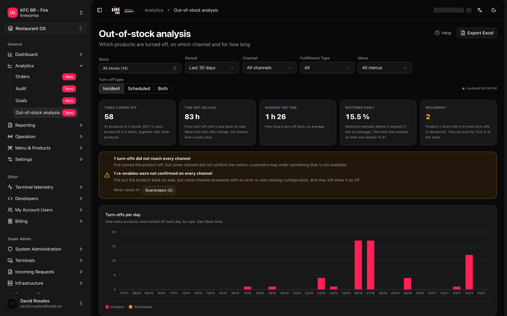
</Frame>

---

## The minimum you need to know

<Note>
**1. It counts turn-offs, not sales.** Every time someone turns a product off in **Out of stock**, a record is created, and this screen counts those records. There are no amounts, currency, taxes or lost sales in any number.

**2. By default you only see incidents.** The **Turn-off type** filter starts on **Incident**: long or scheduled turn-offs (for example, "no ice cream until the 30th") do not appear until you choose **Scheduled** or **Both**. It is the number one cause of "I can't see my turn-off".

**3. A turn-off counts on the day it was created.** A turn-off that started on Monday and lasts until Wednesday counts once, on Monday.

**4. The data arrives about 5 minutes late** and the screen does not refresh on its own. Change a filter or reopen it to see the latest.

**5. You only see your stores.** If your user is limited to some stores, "All" means "all of yours", on screen and in the Excel.
</Note>

---

## The simple path

You want to know how your stores did this month:

1. Pick the account and the country in the Backoffice header.
2. Leave **Period** on **Last 30 days** and **Turn-off type** on **Incident**.
3. Read the five cards at the top and the **Most turned-off products** table.
4. To see each turn-off of a product, click its row.

<Tip>
If you only wanted to know **what gets turned off the most**, you are done: the first product in the table is the answer. What follows is for finding out **why** and **where to act**.
</Tip>

---

## The filters

<Frame>
  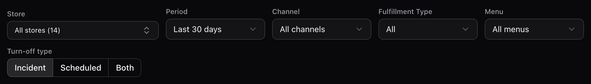
</Frame>

| Filter | Options | Default |
| --- | --- | --- |
| **Store** | All, or one of your stores in the header's account and country | **All** (if you only have one, it is picked for you) |
| **Period** | **Last 7 days**, **Last 30 days**, **Last 90 days** or **Custom** | **Last 30 days** |
| **Channel** | All channels, or one | All |
| **Fulfillment Type** | All, or one | All |
| **Menu** | All menus, or one | All |
| **Turn-off type** | **Incident**, **Scheduled** or **Both** | **Incident** |

- The fixed periods end **today** and include today. "Today" is the day of the chosen store or, if none is chosen, of the most common time zone among your stores. With **Custom**, **From** and **To** appear.
- The maximum range is **92 days**, counting both ends.
- Everything you see (cards, chart, tables, side panel and Excel) uses **exactly the same filters**.
- Changing the account or the country clears **Store**, **Channel** and **Menu**. It does **not** clear **Period**, **Fulfillment Type** or **Turn-off type**.

### Incident, Scheduled and Both

When a turn-off is created, Fire classifies it by when it expires:

- **Incident**: it expires within the store's **operational day** on which it was created. Something ran out mid-service and was solved the same day.
- **Scheduled**: it expires after that day's closing. It is a planned, multi-day turn-off.

The operational day comes from the store's operating hours. If the store has no hours, it runs until 23:59 of the store's day.

**Both** also includes turn-offs with no type.

They are shown separately because scheduled turn-offs last days and would distort the average.

### Channel, Fulfillment Type and Menu

These three filters use what the store had assigned **at the moment of the turn-off**, not today's assignment. If you reassigned a menu last week, old turn-offs stay under the previous menu.

<Warning>
When you pick a channel, a Fulfillment Type or a menu, **turn-offs that had no menu assigned disappear** (in the table they show the **no menu assigned** chip). To see them, leave **Channel**, **Fulfillment Type** and **Menu** on "All". If the total drops suddenly when you filter, check this first.
</Warning>

---

## The five cards

<Frame>
  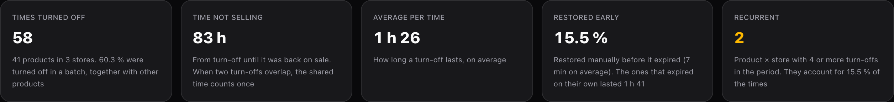
</Frame>

| Card | What it measures |
| --- | --- |
| **Times turned off** | How many turn-off records there are in the period. Below it says how many products and stores, and what percentage was turned off **in a batch** (together with other products in the same operation). |
| **Time not selling** | Hours the product was turned off. If two turn-offs of the same product in the same store overlap, the shared stretch counts **once**. Shown in whole hours. |
| **Average per time** | How long a turn-off lasts, on average. Overlaps are **not** discounted here. |
| **Restored early** | Percentage of turn-offs that someone **restored by hand** before they expired. Below it says how long that took on average and how long the ones that expired on their own lasted. |
| **Recurrent** | **Product × store** pairs with **4 or more** turn-offs in the period. It turns amber when it is greater than 0. |

If a turn-off is still active, it is counted **up to now**: the same filter gives more hours a while later.

---

## Turn-offs per day

<Frame>
  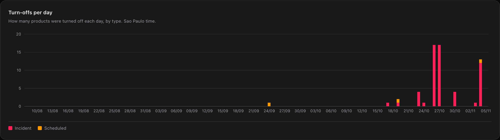
</Frame>

One bar per day in the range, stacked by type (**Incident** and **Scheduled**). Days without turn-offs show zero. **Unclassified** appears only if there are records without a type, which you only see with **Both**.

Hover a bar to see the date and the count by type.

Under the chart it says which time zone is in use (for example, "Sao Paulo time"). Read it: it is the time used to split turn-offs into days.

---

## Most turned-off products

<Frame>
  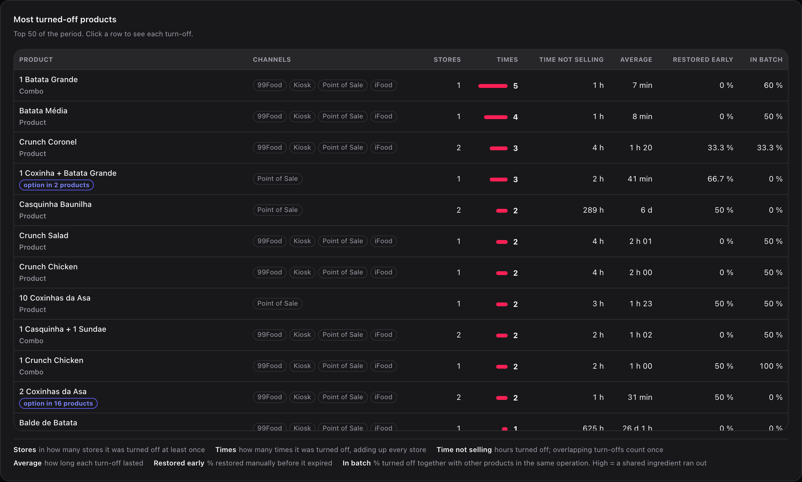
</Frame>

The table shows the **50** most turned-off products, ordered by **Times** and, on a tie, by **Time not selling**.

| Column | What it is |
| --- | --- |
| **Product** | Catalog name. Below it says **Product**, **Combo** or **option in N products**. |
| **Channels** | Channels the turn-off reached. With none, it shows **no menu assigned**. |
| **Stores** | In how many stores it was turned off at least once. |
| **Times** | How many times it was turned off, adding up every store. |
| **Time not selling** | Hours turned off. Overlapping turn-offs count once. |
| **Average** | How long each turn-off lasted. |
| **Restored early** | Percentage restored by hand before it expired. |
| **In batch** | Percentage turned off together with other products in the same operation. |

**How to read In batch.** A high value almost always means a **shared ingredient** ran out: when the combo boxes run out, every product that uses them is turned off. The problem is then the ingredient, not each product.

**What "option in N products" means.** The product is not sold on its own in any menu: it only appears as an option inside combos or other products. N is in how many distinct products it appears.

---

## Recurrent out-of-stock items: the list to act on

<Frame>
  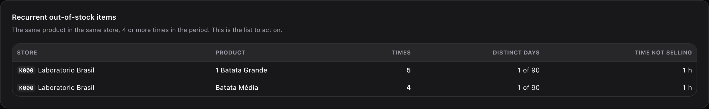
</Frame>

It shows up to **20** product × store pairs with **4 or more** turn-offs in the period, with the columns **Store**, **Product**, **Times**, **Distinct days** (for example, "1 of 90") and **Time not selling**.

Read **Distinct days** next to **Times**: 5 turn-offs on 1 day is a bad day (a delivery that never came). 5 turn-offs on 5 different days is a habit: the restocking order is miscalculated.

If there are none, the screen says: "No product reached 4 turn-offs in the same store."

---

## Stores that turn off the most and the hour map

<Frame>
  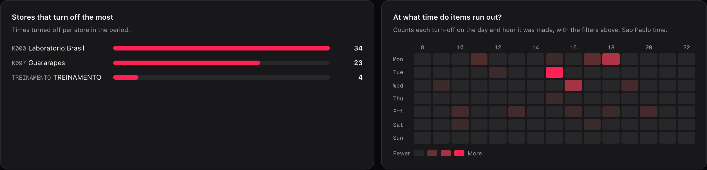
</Frame>

- **Stores that turn off the most**: times turned off per store. The first **10** are shown.
- **At what time do items run out?**: a heat map of weekday by hour (Monday on top). It counts each turn-off on the day and hour it was **created**. Columns run from 8 to 22 h and widen if there are turn-offs outside that range.

With a **store** picked, the store list disappears and the map takes the full width.

<Frame>
  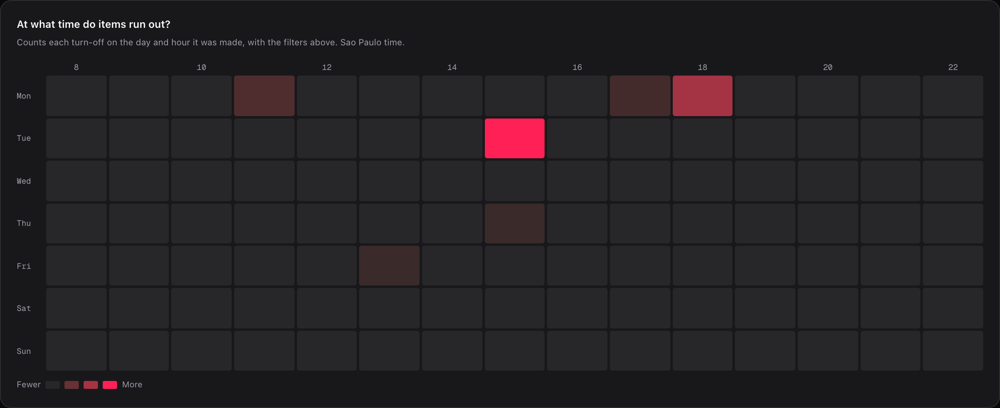
</Frame>

---

## A product's panel

<Frame>
  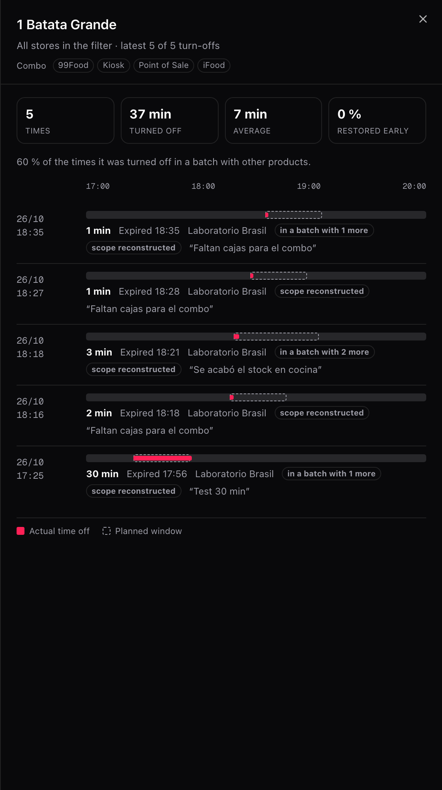
</Frame>

Click a row in **Most turned-off products** (or focus it and press Enter). A panel opens with:

- **Four mini cards**: **Times**, **Turned off**, **Average** and **Restored early**.
- **One line per turn-off**, newest first, 20 at a time with **Load more**. Each line shows the date and time, a bar with the **actual time** (filled) over the **planned window** (dashed), the duration, how it ended, the store and the reason written by whoever turned it off.

How a turn-off can end: **Restored manually**, **Expired**, **Resynced** or **Still off**. **Resynced** only appears on old turn-offs: the product went back on sale because a menu sync turned it back on. It no longer happens.

Turn-offs that were rolled back because the turn-on could not be scheduled never existed for the customer: they do not count on this screen.

Tags you may see on a line:

| Tag | What it means |
| --- | --- |
| **Scheduled** | It is a multi-day turn-off, not an incident. |
| **in a batch with N more** | It was turned off in the same operation as N other products. |
| **turn-off not confirmed** | Fire turned the product off, but a channel did not confirm the notice. |
| **turn-on not confirmed** | Fire put the product back on sale, but a channel did not confirm the notice. |
| **scope reconstructed** | It is a turn-off from before this screen: its channels and menus were filled in later using the assignment of the day the history was loaded. |

<Info>
The timeline uses a **single-day** axis. A turn-off that crosses midnight is cut at the end of the axis.
</Info>

---

## When a channel did not get the word

When a product is turned off or back on, Fire notifies every channel. If a notice was not confirmed, an amber strip appears above the tables. It only appears when there are cases.

- **Turn-offs that did not reach all channels**: Fire turned the product off, but a channel did not confirm. **The customer may order something that is not there.**
- **Turn-ons that were not confirmed**: Fire put the product back on sale, but a channel answered with an error or was missing configuration. **The product may keep showing as off when there is already stock.**

<Frame>
  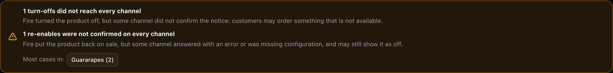
</Frame>

Below, **Most cases in:** lists the 5 stores with the most cases. Each one is a button: click it and the whole screen filters by that store.

<Note>
It is not a failure when a notice was not sent because another turn-off already had that product turned off. Those cases do not count in the strip.
</Note>

<Note>
The **turn-off not confirmed** part can only appear on turn-offs created after this screen launched: that result was not stored before. The **turn-on not confirmed** part also applies to earlier turn-offs.
</Note>

To solve a specific case, go to [Out of stock](/en/manuals/backoffice/out-of-stock), section **When a channel did not get the word**.

---

## Export to Excel

The **Export Excel** button (top right) downloads `agotados_<from>_<to>.xlsx` with the **same filters** you see. While it is generating it says **Generating…**.

| Sheet | What it has | Limit |
| --- | --- | --- |
| **Ranking** | One row per product: type, option in, channels, stores, times, hours not selling, average per time (h), restored early and in batch. | 500 products |
| **Detail** | One row per turn-off: store, turned off, was due, came back, closing, hours not selling, type, products in the batch, notices delivered, reason and scope. | 20,000 rows |

- Hours are a **number with 2 decimals**, so you can add them up.
- Dates are `YYYY-MM-DD HH:mm`, in the screen's time zone.
- If the detail goes over the cap, a row at the end warns about the cut.
- Notice columns read Yes, No, No data or Not applicable (active).
- You can do **10 exports per minute**, and the limit is shared with Fire's other reports. If you go over it, the screen tells you how many seconds to wait.

---

## Recipes: how real cases get solved

<AccordionGroup>
  <Accordion title="I can't see the turn-off we made yesterday">
    1. Check the **Turn-off type** filter. If it says **Incident**, scheduled turn-offs do not appear.
    2. Change it to **Both**.
    3. Check that **Period** includes the date **the turn-off was created**, not the date it expired.
    4. Check **Store**, **Channel** and **Menu**: a turn-off with no menu assigned disappears when you pick any of the three.
    5. Remember the delay of about 5 minutes if the turn-off is very recent.
  </Accordion>

  <Accordion title="Which product do we always run out of">
    1. Leave **Period** on **Last 90 days**.
    2. Pick **Both** if you also want scheduled turn-offs.
    3. Look at **Recurrent out-of-stock items**: they are the store × product pairs with 4 or more turn-offs.
    4. Compare **Times** with **Distinct days**. Many distinct days means a habit, not a bad day.
    5. Take that list to whoever places the restocking orders for that store.
  </Accordion>

  <Accordion title="I think a shared ingredient ran out">
    1. In **Most turned-off products**, look at the **In batch** column.
    2. Look for products with a very high **In batch** that share channels and stores.
    3. Open the panel of one: the **in a batch with N more** tags tell you how many went off together and the reason explains what was missing.
    4. If the reason repeats ("combo boxes missing"), the problem is that ingredient, not each product.
  </Accordion>

  <Accordion title="At what time should we reinforce restocking">
    1. Pick a **store** so the map uses its own time zone.
    2. Look at **At what time do items run out?**: the brighter cells are the hours with the most turn-offs.
    3. Cross the day and hour with your delivery calendar. Running out at 3 p.m. every Tuesday is usually a late delivery.
  </Accordion>

  <Accordion title="A customer ordered something that was turned off">
    1. Check whether the amber strip of **turn-offs that did not reach all channels** is showing.
    2. Click the customer's store in **Most cases in:**.
    3. Open the product: the **turn-off not confirmed** tag marks the exact turn-off.
    4. Solve it from [Out of stock](/en/manuals/backoffice/out-of-stock) and check the configuration of the channel that did not confirm.
  </Accordion>

  <Accordion title="I need the detail for a meeting">
    1. Apply the filters you want to present.
    2. Press **Export Excel**.
    3. The **Detail** sheet has every turn-off with its reason. **Ranking** has the summary per product.
  </Accordion>
</AccordionGroup>

---

## A worked example

Two turn-offs of the **same product in the same store**:

| Turn-off | From | To | Duration |
| --- | --- | --- | --- |
| A | 12:00 | 14:00 | 2 h |
| B | 13:00 | 15:00 | 2 h |

| Number | Value | Why |
| --- | --- | --- |
| **Times** | 2 | There are two records. |
| **Average** | 2 h | Each turn-off lasted 2 h. |
| **Time not selling** | **3 h** | From 12 to 15 h the product was off. The 2 h of overlap (13 to 14 h) count once. |

That is why **Times × Average does not equal Time not selling**: it is not a bug.

A real case from the sample account, **1 Batata Grande**, a combo:

| Where | It shows | Why |
| --- | --- | --- |
| **Most turned-off products** table | **1 h** | The table rounds to whole hours. |
| Side panel | **37 min** | The panel uses minutes. |
| Excel | **0.62 h** (approx.) | The Excel uses hours with 2 decimals. |

It is the same data: 5 turn-offs that added up to 37 minutes.

---

## Mistakes that cost money

<Warning>
**Deciding from the default view.** With **Incident** you do not see scheduled turn-offs. A product "without ice cream until the 30th" may not show up and everything can look fine. Switch to **Both** before drawing conclusions.
</Warning>

<Warning>
**Comparing stores in different time zones without filtering.** With no store picked, the whole screen is read in the most common time zone among your stores. If your stores are in different time zones, pick a store to see its exact days and hours: the ones in other zones get the day and hour shifted in the chart and the map.
</Warning>

<Warning>
**Counting a turn-off across several channels as several problems.** Each channel you turn off counts as one time; if you turn off the whole store, it counts once. Turning it off on 2 specific channels gives 2 times and 100 % **in batch**, even though it was a single action. Time not selling is not doubled, but the times are.
</Warning>

<Warning>
**Using this screen as a lost-sales report.** There are no amounts or quantities sold. It says how long the product was off, not how much you stopped selling.
</Warning>

<Warning>
**Comparing it with Out of stock.** **Out of stock** shows what is turned off **right now** in one store. This screen counts what **was created** in the period, excludes rolled-back turn-offs and has up to 5 minutes of delay. The numbers do not have to match.
</Warning>

---

## What happens in the odd cases

- **A product or store that no longer exists**: its internal identifier shows instead of the name.
- **"All" with a limited user**: it means all **your** stores. If you have stores in another country, you do not see them until you change the header's country.
- **The load fails**: the screen says "The out-of-stock analysis could not be loaded". If there was already data, it keeps showing it with the error on top. Try again by changing a filter.
- **No account picked**: the screen asks you to pick an account and a country at the top.
- **A user with no stores in that account and country**: it says "You do not have stores assigned in this account and country."

<Frame>
  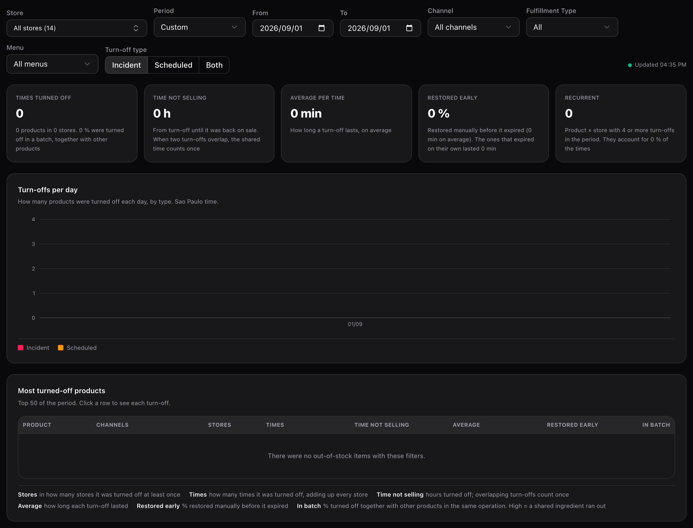
</Frame>

When there are no turn-offs, the cards show zeros and the tables say "There were no out-of-stock items with these filters."

<Frame>
  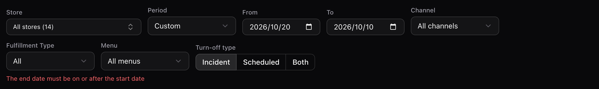
</Frame>

If the range is backwards or goes over 92 days, a red error appears under the filters and the screen queries nothing until you fix it: "The end date must be on or after the start date" or "The period cannot exceed 92 days".

---

## Help inside the screen

<Frame>
  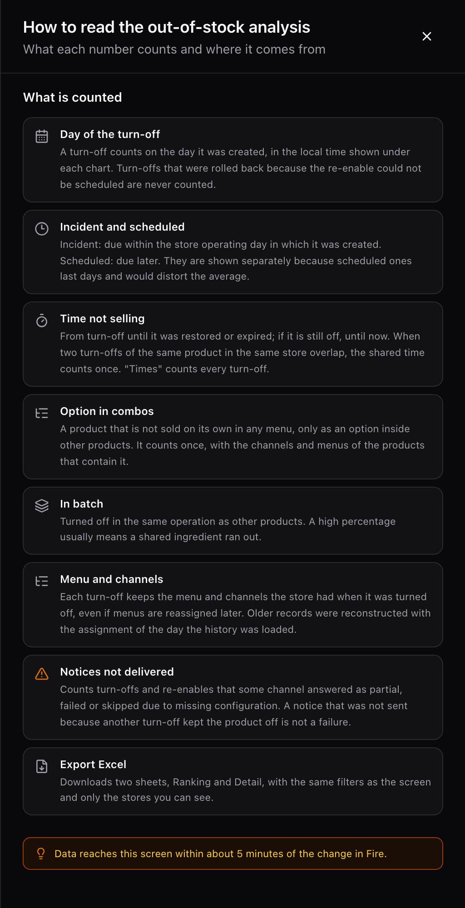
</Frame>

The **Help** button opens a panel with the definition of each number. It uses the same words as this manual.

---

## Glossary

| Term | What it means |
| --- | --- |
| **Turn-off** | Each time someone takes a product off sale in **Out of stock**. It is the unit this screen counts. |
| **Incident** | A turn-off that expires within the operational day of the store on which it was created. |
| **Scheduled** | A turn-off that expires after the close of the operational day on which it was created. |
| **Time not selling** | Hours the product was turned off in a store. If two turn-offs overlap, the shared stretch counts once. |
| **Restored early** | A turn-off that someone restored by hand before it expired. |
| **In batch** | A turn-off made together with other products in the same operation. |
| **Recurrent** | A product turned off 4 or more times in the same store within the period. |
| **Unconfirmed notice** | A turn-off or turn-on notice that a channel did not confirm. |
| **Scope reconstructed** | A turn-off from before this screen, whose channels and menus were filled in later. |
| **Operational day** | The store's working day, with its closing time. It decides whether a turn-off is an incident or scheduled. |
| **Option in N products** | A product that is not sold on its own, only as an option inside N products. |

---

## Frequently asked questions

<AccordionGroup>
  <Accordion title="Why can't I see any turn-off?">
    Almost always it is the **Turn-off type** filter on **Incident**. Change it to **Both**. If it is still empty, check that the period, the store and the other filters include the day the turn-off **was created**.
  </Accordion>

  <Accordion title="Who can see this screen?">
    Whoever has access to **Analytics → Orders**, and only with the stores assigned to them, on screen and in the Excel. It has no permission of its own. If you do not see it, ask your administrator for access.
  </Accordion>

  <Accordion title="Is it live?">
    No. The data arrives about 5 minutes after the change in Fire and the screen does not refresh on its own: it updates when you change a filter or reopen it. **Updated HH:MM** is the time the screen received the data, not the time of the last turn-off.
  </Accordion>

  <Accordion title="Why doesn't Times × Average give Time not selling?">
    Because time not selling discounts the overlaps between turn-offs of the same product and store, and the average does not. There is a worked example above.
  </Accordion>

  <Accordion title="Which day does a multi-day turn-off count on?">
    The day it was created. A scheduled turn-off from Monday to Friday counts once, on Monday, in the chart and in the hour map.
  </Accordion>

  <Accordion title="Why does a product show under a menu I already changed?">
    Because each turn-off's channel, Fulfillment Type and menu are frozen at the moment of the turn-off. Reassigning a menu does not change the history.
  </Accordion>

  <Accordion title="Is there an API for this?">
    Not a public one. The screen uses internal endpoints that are not documented for integrations. If you need the data outside Fire, use **Export Excel**.
  </Accordion>
</AccordionGroup>

---

## What is coming

This does **not** exist today, and there is no committed date for any of it:

- Amounts or **lost sales** per turn-off.
- Automatic screen refresh.
- Alerts when a product reaches 4 turn-offs.
- Exporting more than 500 products in **Ranking** or more than 20,000 turn-offs in **Detail**.
- A public API with this data.
- Saving the filters in the screen's link so it can be shared.
