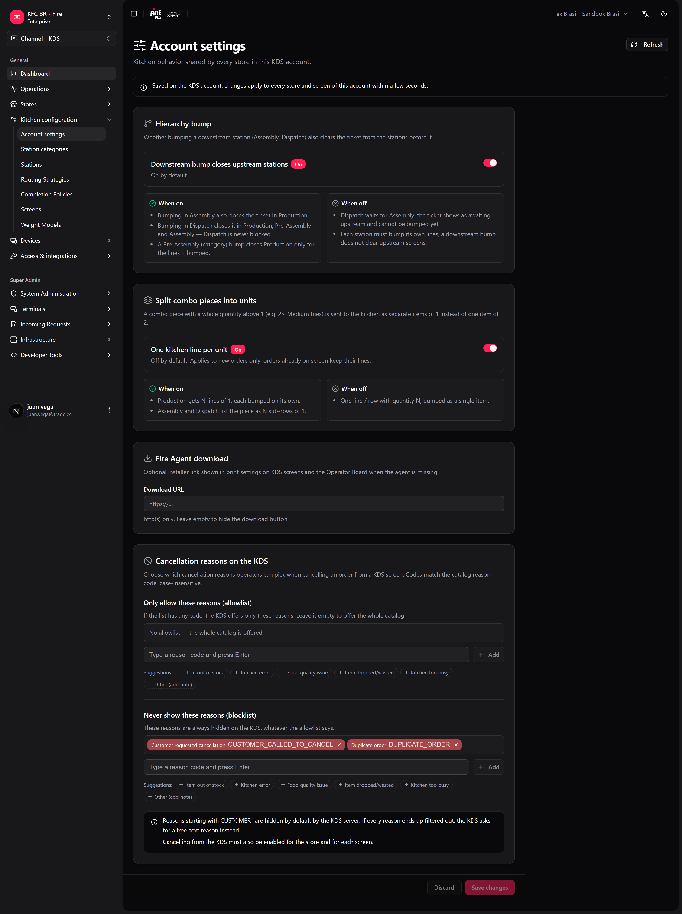

Some kitchen rules should not change from one store to the next. If one store lets Dispatch close a ticket that Assembly has not finished and another does not, the same order behaves differently across the chain — and support cannot tell which rule a store follows. These settings live once, on the KDS account, and apply to every store and screen of that account.

**Where you work:** **KDS → Account settings** (`/kds/admin/account-settings`) in the backoffice. Store admins also see the same settings in **fire-kds → Settings → KDS account**.

<Note>
  **The minimum you need to know**

  - Saving here changes **every store** of the account within a few seconds. There is no per-store override (except combo grouping on one station, set by support).
  - **Hierarchy bump** is **on** by default: a downstream bump (Assembly, Dispatch) also clears the ticket from the stations before it.
  - The cancellation reason lists only filter what operators can pick. Cancelling still has to be enabled per store and per screen.
</Note>

## The simple path

Most accounts keep the defaults and only set the Fire Agent link.

<Steps>
  <Step title="Open Account settings">
    In the backoffice, go to **KDS → Account settings**.
  </Step>
  <Step title="Review Hierarchy bump">
    Leave **Downstream bump closes upstream stations** on unless your kitchen needs Dispatch to wait for Assembly.
  </Step>
  <Step title="Paste the Fire Agent download link">
    Under **Fire Agent download**, paste the installer link in **Download URL** (http or https). Leave it empty to hide the button.
  </Step>
  <Step title="Save changes">
    Click **Save changes**. The bar at the bottom tells you when there are unsaved changes; **Discard** goes back to what is saved.
  </Step>
</Steps>

<Frame>
  
</Frame>

<Tip>
  If your stores run one assembly screen and no dispatch, the defaults are right. You are done.
</Tip>

## Hierarchy bump

Decides whether a station later in the flow can close a ticket that an earlier station has not bumped.

| | On (default) | Off |
|---|---|---|
| Bump in **Assembly** | Also closes the ticket in Production. | Production keeps its own lines. |
| Bump in **Dispatch** | Closes it in Production, Pre-assembly and Assembly. Dispatch is never blocked. | Dispatch waits for Assembly: the ticket shows **awaiting upstream** and cannot be bumped. |
| Bump in **Pre-assembly** | Closes in Production only the lines it bumped. | Each station bumps its own lines. |

The order and its webhooks do not change: what changes is which screens still show the ticket.

## Split combo pieces into units

A combo piece with a whole quantity above 1 (for example, 2× Medium fries) can reach the kitchen as two items of 1 instead of one item of 2.

| | On | Off (default) |
|---|---|---|
| Production | N lines of 1, each bumped on its own. | One line with quantity N. |
| Assembly / Dispatch | The piece is listed as N sub-rows of 1. | One sub-row with quantity N. |

Only new orders change. Orders already on screen keep their lines.

## Group combo pieces on pre-assembly

On a **pre-assembly** station, the pieces of a combo are shown under the combo name (`1 Big Box`, with its pieces as blue sub-lines) instead of as loose lines. It is **on** by default.

This one is set in **fire-kds → Settings → KDS account** (**Group combo pieces on pre-assembly**). Turn it off and pre-assembly lists pieces loose, like production.

## Cancellation reasons on the KDS

When an operator cancels from a kitchen screen, they pick a reason from the Fire cancellation catalog. Here you narrow that list:

- **Only allow these reasons (allowlist)** — if it has any code, the KDS offers only those. Empty = the whole catalog.
- **Never show these reasons (blocklist)** — always hidden, whatever the allowlist says.

Type a reason code (letters, digits and `_ . : -`, for example `KITCHEN_ERROR`) and press **Enter**, or pick one of the suggestions. A code cannot be in both lists.

<Info>
  Codes that start with `CUSTOMER_` are hidden by default by the KDS: a cook should not cancel on the customer's behalf. If every reason ends up filtered out, the KDS asks for a free-text reason instead.
</Info>

## Fire Agent download

**Download URL** is the link to the Fire Agent installer your team uses. When it is set, the print settings on KDS screens and the Operator board show a **Download Fire Agent** button, so whoever sets up a new PC or tablet installs the right version without asking for the file.

## Recipes

<AccordionGroup>
  <Accordion title="Dispatch must not close an order Assembly has not finished">
    1. Open **KDS → Account settings**.
    2. Turn off **Downstream bump closes upstream stations**.
    3. **Save changes**.
    4. Test: an order that Assembly has not bumped shows **awaiting upstream** on Dispatch.
  </Accordion>
  <Accordion title="Each fries portion must be bumped separately">
    1. Turn on **One kitchen line per unit** under **Split combo pieces into units**.
    2. **Save changes**.
    3. Send a new combo with 2× fries: Production shows two lines of 1.
  </Accordion>
  <Accordion title="Cooks should only cancel for kitchen reasons">
    1. In **Only allow these reasons**, add `ITEM_OUT_OF_STOCK`, `KITCHEN_ERROR` and `KITCHEN_TOO_BUSY` (use the codes of your catalog).
    2. **Save changes**.
    3. Check that cancellation is enabled for the store and the screen ([Peripherals, printing and validation](/en/manuals/kds/peripherals-printing#2-order-cancellation)).
  </Accordion>
  <Accordion title="A new store needs Fire Agent">
    1. Paste the installer link in **Download URL** once.
    2. On the new device, open the printer settings on the KDS screen and tap **Download Fire Agent**.
    3. Follow [Fire Agent installation](/en/manuals/fire-agent/installation) or [Android](/en/manuals/fire-agent/android).
  </Accordion>
</AccordionGroup>

## Worked example

A Combo with 2× Medium fries, in a kitchen with Production, Assembly and Dispatch:

| Setting | Production shows | Dispatch bump before Assembly |
|---|---|---|
| Defaults (hierarchy on, split off) | `2 Medium fries` (one bump) | Closes the ticket everywhere |
| Hierarchy off, split on | `1 Medium fries` twice (two bumps) | Blocked: **awaiting upstream** |

## Errors that cost money

<Warning>
  **Turning hierarchy bump off in a kitchen where Assembly is often late.** Dispatch stops being able to close orders and they pile up while the courier waits. Turn it off only if Assembly always bumps.
</Warning>

<Warning>
  **Changing a setting "for one store".** It applies to every store of the account. Agree on it with operations before saving.
</Warning>

<Warning>
  **An allowlist with codes that do not exist in the catalog.** The KDS has nothing to offer and falls back to free text, so the reports lose the reason. Copy the codes from the cancellation catalog.
</Warning>

## Glossary

| Term | Meaning |
|---|---|
| **Hierarchy bump** | A downstream station closes the ticket in the stations before it. |
| **Upstream / downstream** | Earlier / later stages of the flow: Production → Pre-assembly → Assembly → Dispatch. |
| **Combo piece** | A product inside a combo that is routed to the kitchen as its own line. |
| **Allowlist / blocklist** | Reasons that are the only ones offered / never offered. |

## FAQ

<AccordionGroup>
  <Accordion title="Can one store use a different rule?">
    No. These settings are per account. Store-level behaviour (display, printing, waitlist, cancellation on/off) lives in each store's settings.
  </Accordion>
  <Accordion title="How long until the screens pick up the change?">
    A few seconds. Screens do not need to be reloaded.
  </Accordion>
  <Accordion title="Does hierarchy bump change the order status sent to integrations?">
    No. It only changes which kitchen screens still show the ticket.
  </Accordion>
  <Accordion title="Why don't I see Account settings in the menu?">
    It needs an admin role with access to the KDS account.
  </Accordion>
</AccordionGroup>

## What this page does not do

- It does not turn cancellation on: that is per store and per screen.
- It does not install Fire Agent: it only shows the link.
- It does not change orders already on screen.
