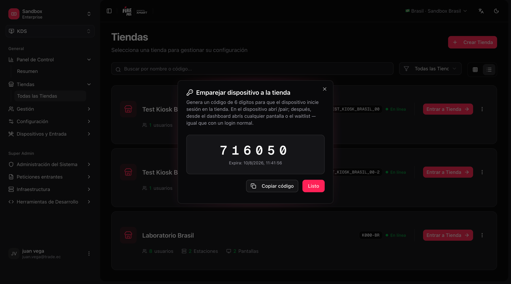
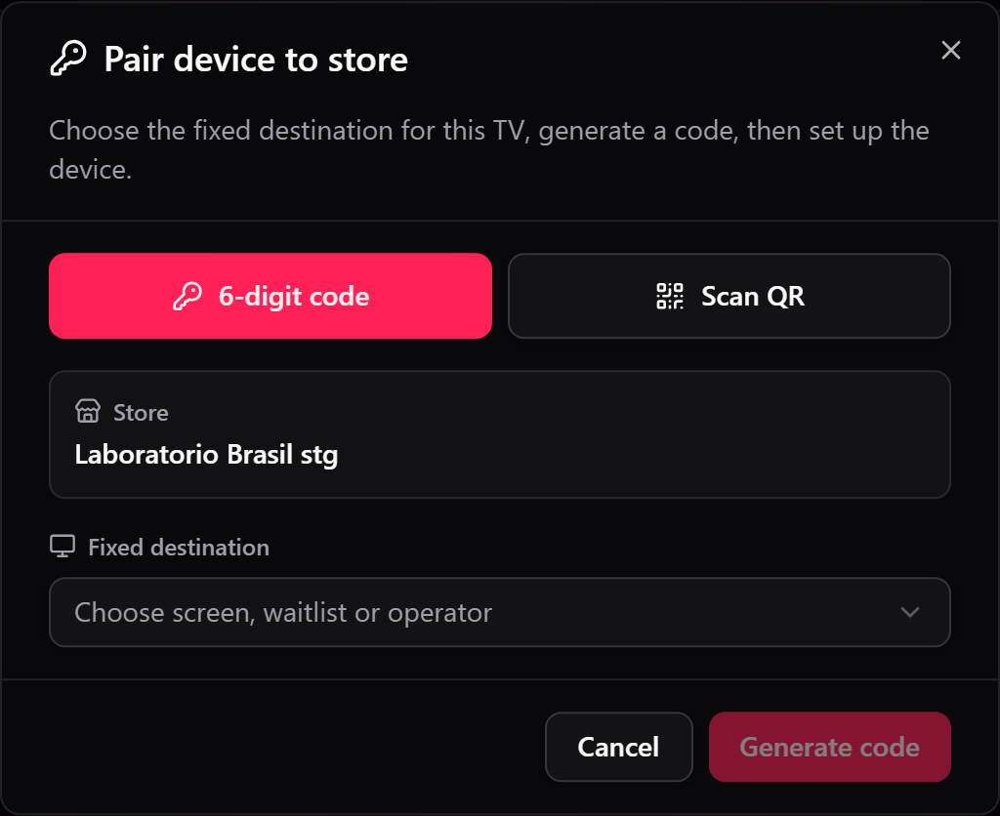
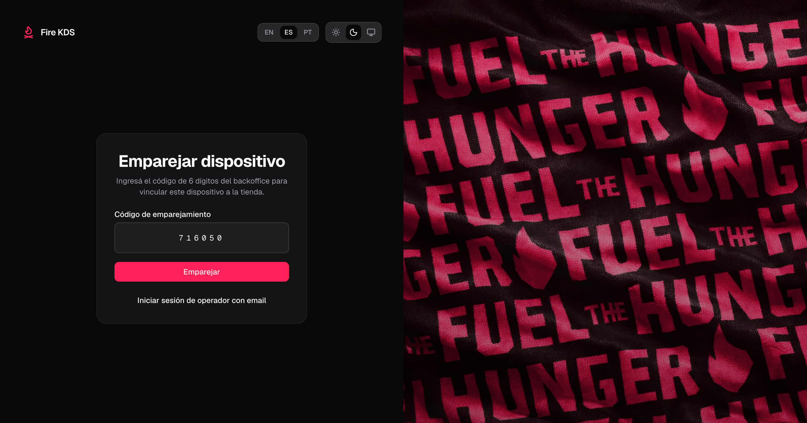
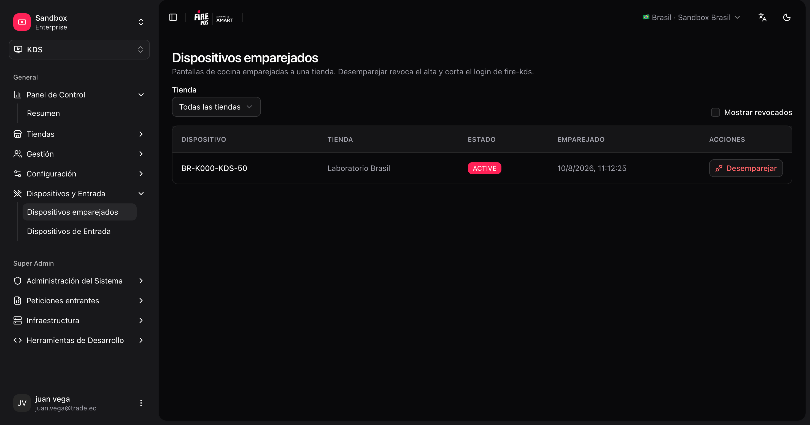

Kitchen screens (TVs / tablets running **fire-kds**) join a store by **scanning a QR** or with a short **pairing code**, without an email invite. The device becomes a kitchen terminal for that store and opens the screen, order display or operator board you chose for it.

This flow is for **kitchen devices only**. Human operators who need email access keep using the normal login. POS terminals and kiosks use their own pairing flows.

## What you need

| Requirement | Detail |
|---|---|
| KDS store already created | The store must exist under **KDS → All Stores**. |
| Access in the backoffice | Permission to open the store menu and generate a pairing code. |
| Device with a browser | Open fire-kds on the TV or tablet (full screen recommended). |

## Two ways to pair

| Method | In the backoffice | On the TV |
|---|---|---|
| **Scan QR** (recommended) | **Pair device** → **Scan QR** with the phone camera, or paste the **Device ID** | `/pair` shows a QR and its Device ID. After you scan it, tap **Already linked**. |
| **6-digit code** | **Pair device** → **Generate code** | `/pair` → **Use 6-digit code** and type it. |

Both methods give the same result. QR saves typing on a TV with no keyboard.

## Pair a device

<Steps>
  <Step title="Open Pair device">
    In the backoffice, go to **KDS → All Stores**, open the store's **⋮** menu and choose **Pair device**. You can also pair straight from **KDS → Screens**: each screen card has a pair action that already points at that screen.

    <Frame>
      
    </Frame>
  </Step>
  <Step title="Choose the fixed destination">
    In **Fixed destination**, pick what this device will open every time:

    | Destination | Opens |
    |---|---|
    | A KDS screen | That kitchen screen (`/kds/{screenId}`). |
    | **Waitlist** | The customer order display (`/waitlist/{storeId}`). |
    | **Delivery waitlist** | The delivery board (`/waitlist/{storeId}/delivery`). |
    | **Store operator** | The [Operator board](/en/manuals/kds/operator-board) (`/operator/{storeId}`). |

    <Frame>
      
    </Frame>
  </Step>
  <Step title="Scan the QR or generate a code">
    - **Scan QR:** point the camera at the QR on the TV, or paste its **Device ID**. The dialog then waits for the TV: on the TV, tap **Already linked**.
    - **6-digit code:** click **Generate code**. It expires after a short time; generate a new one if needed. On the TV, tap **Use 6-digit code** and enter it.

    <Frame>
      
    </Frame>
  </Step>
  <Step title="Confirm the device is ready">
    After a successful pair, the device opens its destination on its own. You do not reload the page.
  </Step>
</Steps>

<Tip>
  On `/pair` you can switch to **Operator sign in with email** if a person needs the full admin session. From `/login`, use **Pair a kitchen device** to go back to pairing.
</Tip>

<Warning>
  Scanning the QR of the wrong TV pairs that TV to your store. Check the Device ID on the screen in front of you before confirming.
</Warning>

## Manage paired devices

Open **KDS → Paired devices** (`/kds/admin/paired-terminals`) to see every kitchen terminal linked to your account: store, terminal name, and status.

From that list you can **unpair** a device. After unpair, the TV loses its kitchen session and returns to `/pair` the next time it loads.

<Frame>
  
</Frame>

## Sign out from the device

Signing out from a **paired kitchen session** revokes the terminal enrollment. The TV goes back to the pairing screen and must be paired again.

Signing out from an **email/password** operator session does **not** revoke the kitchen device.

## After pairing

1. Open each kitchen screen from the dashboard (or the bookmarked `/kds/{screenId}` URL). **Open** always opens a new tab, so the dashboard stays behind it.
2. Open the [order display](/en/manuals/kds/waitlist) on the pickup TV, and the delivery board on the courier TV, if you use them.
3. Optionally open the [operator board](/en/manuals/kds/operator-board) for supervisors.

<Check>
  Your kitchen device is paired to the store and ready to run Fire KDS screens.
</Check>
