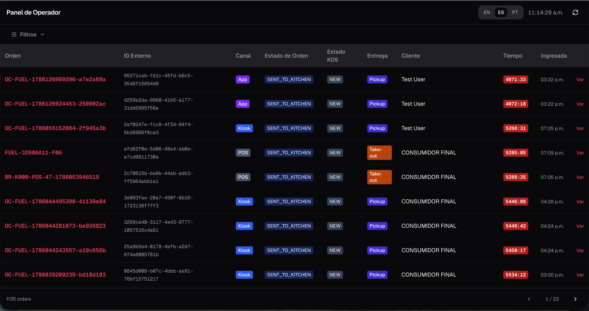
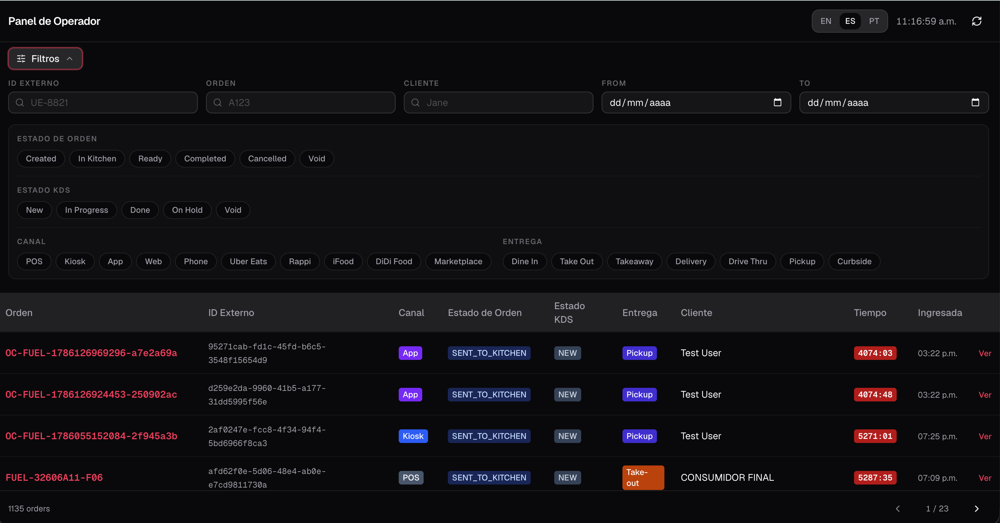
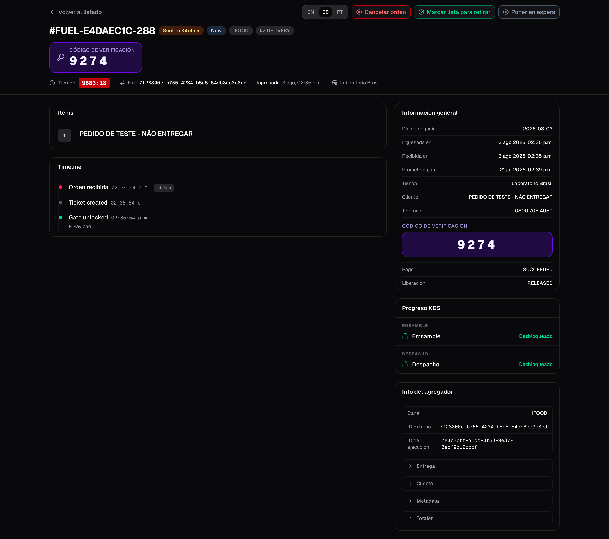
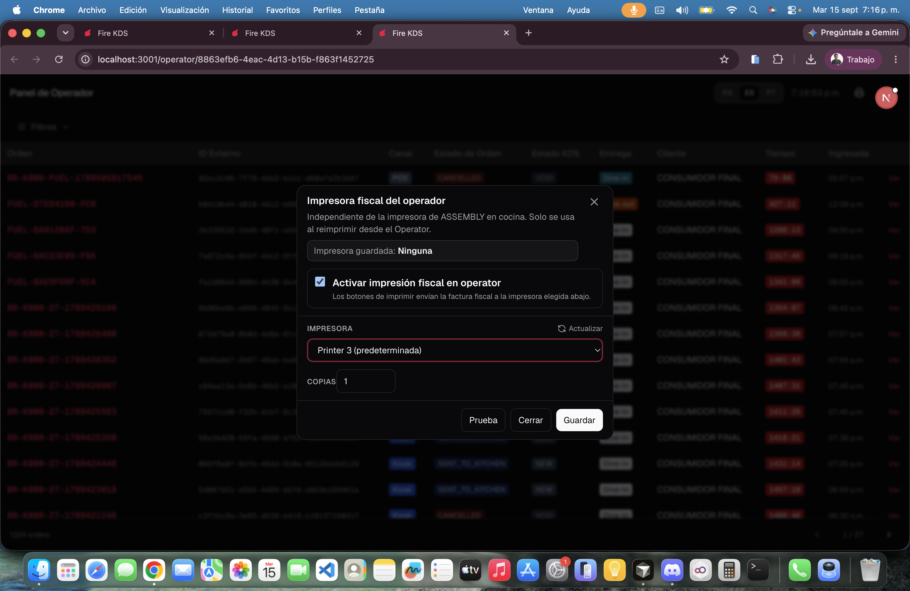

The **operator board** is a full-screen supervisor view for a store. It lists every order with live timers, filters, and a detail page where you can cancel an order, mark it ready for pickup, or complete dispatch — even when the kitchen path needs a manual override.

**Where you open it:** from the store dashboard in fire-kds, or directly at `/operator/{storeId}`. Leave it running in its own tab.

## Order list

The list shows active and recent orders with:

- **Name / code** — the same `#…` label the kitchen TVs show (buzzer or short code), then the order code
- Channel and fulfillment badges with the **store's colors**, order status and kitchen status
- A **live elapsed timer** (green → amber → red) while the order is in the kitchen. Once it is ready, dispatched or cancelled, the timer shows **—**
- The order date and time, in the **store timezone** (not the browser’s)

**Operational day** (on by default) shows only today's business day of the store. Turn it off to see earlier days. The list pages with previous / next and shows a loader while the next page loads.

<Frame>
  
</Frame>

Use the header **language switcher** (EN / ES / PT) the same way as on KDS screens.

## Filters

Open the filter panel to narrow the list:

- Text: **Order code**, **Code** (the short `#…` code on the kitchen card), external ID, customer name. A text search without dates looks at the last 7 days.
- Date range (business day)
- Chips: order status, KDS status, channel, fulfillment type

Active filters appear as removable chips. Clearing filters resets pagination to page 1.

<Frame>
  
</Frame>

## Order detail

Click a row to open the order in a window over the list, so you do not lose your place. The detail includes:

- Header with status badges and prominent **collect / verification code** when the aggregator provides one
- General info (channel, fulfillment, timestamps in store timezone)
- Order lines / items
- **Kitchen progress**: where each part of the ticket should appear and which stations already completed it. **Refresh** reloads it
- Timeline of kitchen and status events
- Aggregator payload extras when present

<Frame>
  
</Frame>

What each station shows in **Kitchen progress**:

| Status | Meaning |
|---|---|
| **On screen** | The station has the order now. |
| **Waiting** / **Next** | The order has not reached that station yet. |
| **Completed** | The station bumped it. It stays completed even if its screen goes off later. |
| **Screen offline** | The order is on a station with no screen online, or moved because the screen dropped. |
| **Completed · no screen** | The order finished while that station had no screen. |
| **Cancelled** | The order was cancelled. |

## Supervisor actions

From the detail page you can run operational overrides (each asks for confirmation):

| Action | When it applies | What it does |
|---|---|---|
| **Cancel** | Order not already completed / cancelled | Cancels through Fire with a reason from the cancellation catalog |
| **Ready for pickup** | Order is still in kitchen (`SENT_TO_KITCHEN`) | Advances the order to ready and syncs KDS tickets / gates |
| **Dispatch** | Order is already ready | Completes the order and closes the kitchen cycle |
| **Hold / Unhold** | As needed | Same global hold used on kitchen screens |
| **Print fiscal invoice** | Fire Agent on this PC + store **Operator Board printer** | Reprints the fiscal slip. Not the kitchen printer. |
| **Print delivery ticket** | Delivery order with a kitchen ticket | Reprints the courier ticket on the same printer. One copy; not queued if it fails. |

<Frame>
  
</Frame>

## Printing from the Operator board

The printer icon opens the Operator board printer. Enable it, pick the Fire Agent printer on **this** computer, set the copies and test. It can also be set in the backoffice, store settings → **Printing** → **Operator Board printer**. Kitchen bump printing is a different printer on the KDS tablet or expo PC. If Fire Agent is missing, **Download Fire Agent** appears when your account has the [download link](/en/manuals/kds/account-settings#fire-agent-download).

<Frame>
  
</Frame>

### Auto print

**Auto print** prints by itself when an order enters a status, so the supervisor does not reprint order by order. Choose:

| Option | Values |
|---|---|
| **Order status** | **In kitchen**, **Ready for pickup** or **Dispatched**. |
| **What to print** | **Kitchen ticket** and/or **Fiscal invoice**. Delivery orders always print the delivery ticket as well. |
| **Channels** / **Fulfillment** | Empty = all. |
| **Operational day only** | Skips orders from earlier days. |

The header shows the active rule; **Configure** opens the printer window. Turning auto print on also turns **Live** on, and turning **Live** off turns auto print off. Jobs print one at a time; a document that already printed is not printed again on a retry. If a job fails, auto print **stays on** and shows the error. The **Print log** keeps a history of what printed.

<Warning>
  The auto print rule is saved **in this browser**, not on the server. Another PC, or this one after clearing its data, starts with auto print off. The printer and copies are saved for the store.
</Warning>

<Warning>
  If Fire Agent is offline on the supervisor PC, reprint fails even when the kitchen printer works.
</Warning>

<Warning>
  Ready and dispatch from the operator board **fast-forward** the kitchen state (lines done, gates unlocked, ticket closed as needed). Use them when the floor needs a supervisor override — not as a substitute for normal bumps on every order.
</Warning>

## How it differs from the kitchen screen

| | Kitchen screen | Operator board |
|---|---|---|
| Audience | Cooks / expo | Supervisors |
| Scope | Stations assigned to that screen | Whole store |
| Main job | Bump / hold / strike lines | Monitor + override |
| Customer display | No | No (use the [order display](/en/manuals/kds/waitlist)) |

## Session menu

The gear in the header has **Turn off automatic startup…** (for a PC that opens the board on boot) and **Sign out** / **Unpair device** on a paired device, the same as on KDS screens. A long-open tab reloads by itself when a new version is published.

<Check>
  You can monitor the store’s orders live and apply cancel, ready, or dispatch overrides when service needs them.
</Check>
