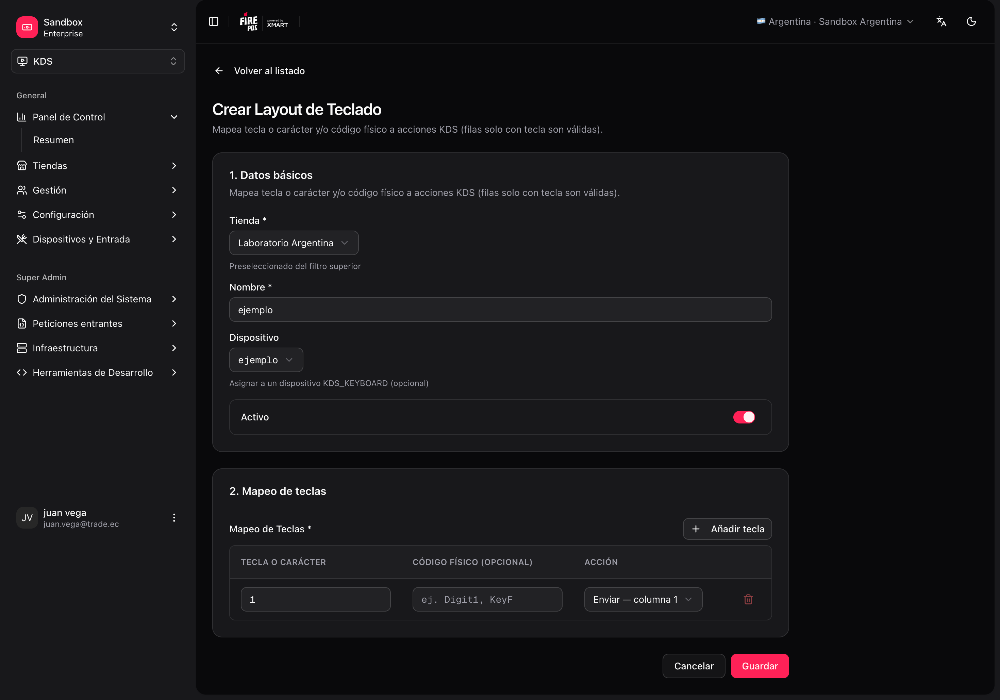
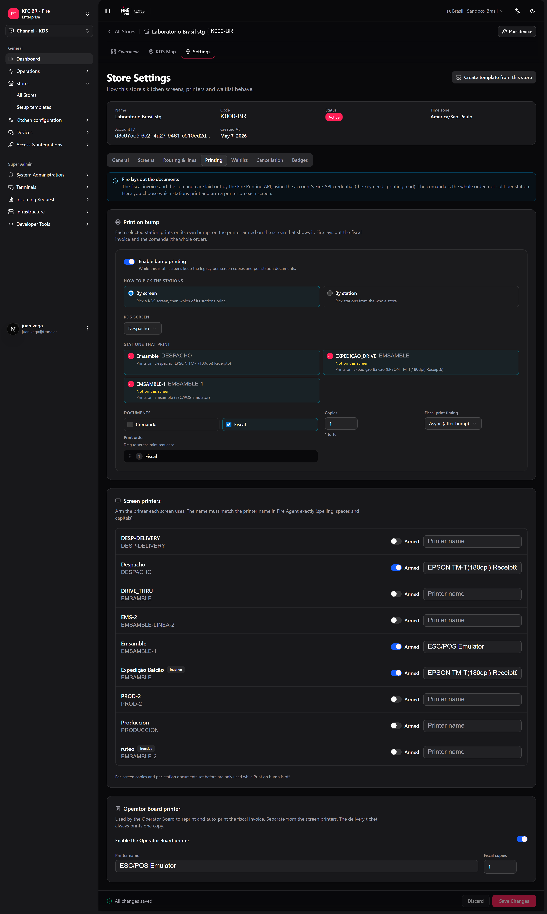
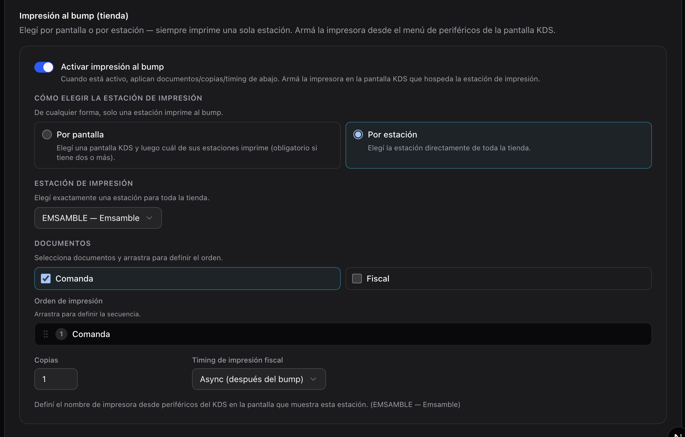
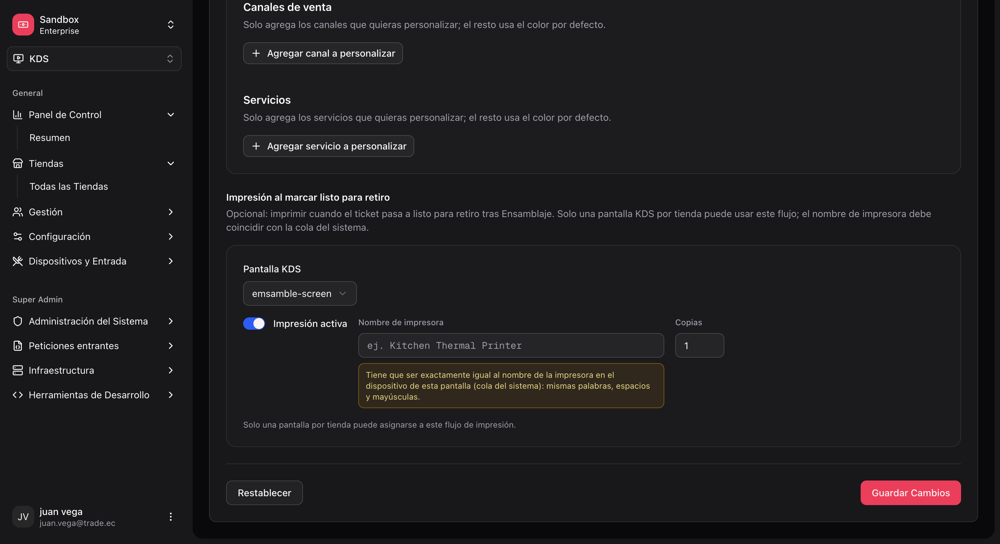
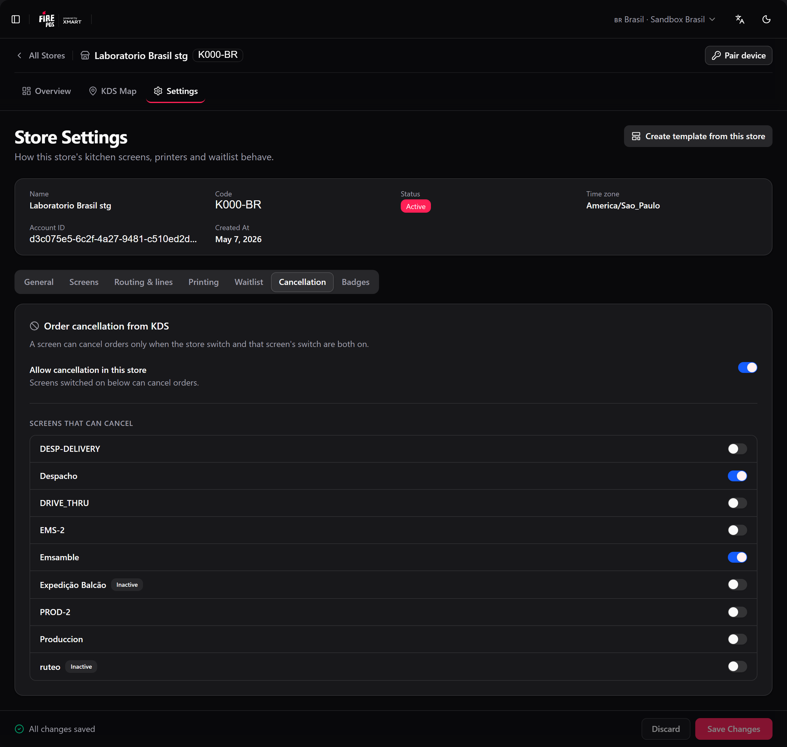
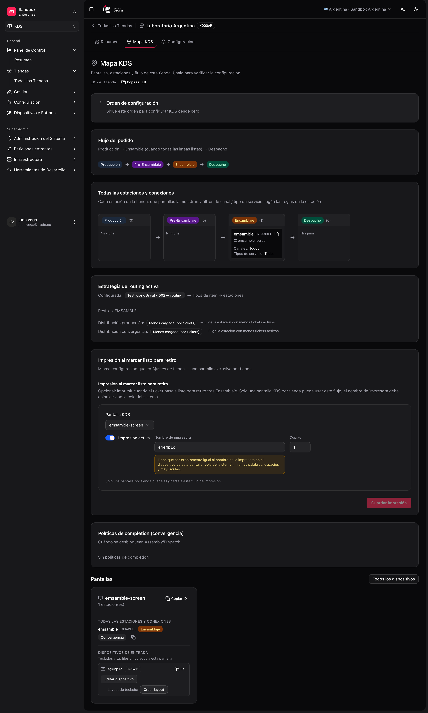

This page covers the remaining configuration — keyboards, printing, and cancellation — and how to validate the store before opening the kitchen.

## Keyboards and input devices

Physical keys (bump, change page, recall) let operators work without touching the screen.

```text
Screen
 └── Input device (type KDS_KEYBOARD, linked to the screen)
      └── Keyboard layout (key → action mapping)
```

### Actions available in the backoffice

When you create or edit a layout, each key can trigger actions such as:

| Action | Typical use |
|---|---|
| `BUMP_COLUMN_1` … `BUMP_COLUMN_8` | Complete column N on the screen. |
| `NEXT_PAGE` / `PREV_PAGE` | Paginate tickets. |
| `REFRESH` | Refresh the queue. |
| `HOLD_TICKET` / `RECALL_TICKET` | Hold / recover a ticket. |
| `PRINT_PENDING_FISCAL_INVOICES` | Trigger pending fiscal printing (depends on the country integration). |
| `SELECT_*` / `BUMP_SELECTED` | Move the highlight and send the highlighted ticket (button pad). |
| `FOCUS_*` / `TOGGLE_STATION_SOLO` | Station focus and **zoom** (station / ticket trail). |

### Configure a keyboard

<Steps>
  <Step title="Create the input device">
    **KDS → Input devices → Create** (`/kds/admin/devices/new`). Type: KDS keyboard. Link it to the correct **screen**.
  </Step>
  <Step title="Create the keyboard layout">
    **KDS → Keyboard layouts → Create** (`/kds/admin/keyboard-layouts/new`). Choose the store and device, then map keys to actions.
  </Step>
  <Step title="Save" />
</Steps>

<Frame>
  
</Frame>

You can also create or duplicate a layout from **Store → KDS Map** (`/kds/admin/stores/{storeId}/kds-map`). If a template includes a keyboard, applying it can create the device `{deviceIdentifier}-kbd` and layout automatically.

## Printing and cancellation

Printing and cancellation are set in the store settings: **KDS → All Stores → [store] → Settings** (`/kds/admin/stores/{storeId}/settings`). The page has seven tabs — **General**, **Screens**, **Routing & lines**, **Printing**, **Waitlist**, **Cancellation** and **Badges** — and one save bar for all of them: a tab with changes shows a dot, and **Save settings** saves every tab at once. **Discard** goes back to what is saved.

<Warning>
  The save bar does not warn you if you leave through a menu link with unsaved changes. Save before you move to another page.
</Warning>

### 1. Print on bump (store)

**What it does:** when a cook bumps on a **print station**, fire-kds prints the **Comanda** (kitchen ticket), the **Fiscal invoice**, or both.

**Where the rule lives:** **Printing** tab → **Print on bump**, or **fire-kds → Settings → KDS store** (admins only). Pick the stations **By screen** (choose a screen, then which of its stations print) or **By station** (any station of the store), the documents, **Print order**, **Copies** (1 to 10) and **Fiscal timing** (`Async (bump first)` or `Sync (wait for print)`).

<Frame>
  
</Frame>

You can choose **more than one station**: each one prints on its own bump. A store can print the comanda at Assembly and the fiscal invoice at Dispatch, for example.

<Frame>
  
</Frame>

**Where the printer is armed:** on each screen that shows a print station — either in the **Printing** tab, **Screen printers** (switch **Armed** and type the printer name), or on the KDS device itself, **Printer for this screen**. Under each print station the tab tells you **Prints on** which screen, or warns **No printer armed on its screens** / **Not shown on any screen**.

<Warning>
  The printer name must match the name in Fire Agent **exactly** — spelling, spaces and capitals. A different name prints nothing, and the bump still goes through.
</Warning>

**Fire lays out the documents.** The fiscal invoice and the comanda come already laid out from Fire (the [Fire Printing API](/en/api-reference/print-order-document)); the KDS only sends them to the printer. That means:

- The comanda is the **whole order**, not only the station's lines, and its labels follow the **store's country**, not the screen language.
- A change of template or a new country does not need a KDS update.
- The invoice prints even while the fiscal document is still pending.

<Warning>
  The account's [Fire credential](/en/manuals/kds/fire-credentials) must have the **`printing:read`** scope (shown as **Printing Read** in API management). Without it Fire answers `403` and **nothing prints** — neither comanda nor invoice.
</Warning>

<Note>
  Stores that still run the old per-screen rule see **Legacy printing rules still in use** until you turn on **Print on bump**. Do not assume both policies are off.
</Note>

**What it needs to work:**

1. At least one print station and one document.
2. An **active** KDS screen that shows each print station, with a printer armed.
3. Fire Agent running on that device — [Windows](/en/manuals/fire-agent/installation) or [Android](/en/manuals/fire-agent/android). fire-kds tries the platform URL first and **falls back to the other**. If the agent is missing, the print settings show **Download Fire Agent** when the account has a [download link](/en/manuals/kds/account-settings#fire-agent-download).
4. The Fire credential with `printing:read`.

<Frame>
  
</Frame>

<Info>
  A screen can be left **without a printer**: save the printer field empty and that screen stops printing on bump. On macOS, Fire Agent answers "ok" for a printer that is not a real network printer; the KDS now treats that as **not printed**, so the ticket does not look printed when nothing came out.
</Info>

### 2. Order cancellation

**What it does:** lets the operator cancel an order from the KDS (icon on the ticket → confirmation).

**Where it is configured:** **Cancellation** tab in the store settings, or **fire-kds → Order cancellation…** on the device.

<Frame>
  
</Frame>

| Level | Setting | Effect |
|---|---|---|
| Store | **Allow cancellation in this store** | If off, no screen can cancel, whatever its own switch says. |
| Screen | **Screens that can cancel** | Each screen is enabled separately. |

Several screens can cancel at once. Which **reasons** operators can pick is set once for the whole account, in [Account settings](/en/manuals/kds/account-settings#cancellation-reasons-on-the-kds). The order also needs its external XMART ID, and the operator a valid store role.

### 3. Queued fiscal invoices

When the printer fails after a bump, the fiscal invoice is queued. **Print queued invoices** (KDS menu, or the `PRINT_PENDING_FISCAL_INVOICES` key) prints the queue of the **current business day** only: leftovers from previous days stay stored but are not printed from there. To reprint an older invoice, use the [Operator board](/en/manuals/kds/operator-board).

### 4. Operator board printer

The **Printing** tab also holds the **Operator Board printer**: the printer the supervisor PC uses to reprint and auto-print the fiscal invoice and the delivery ticket. It is separate from the screen printers. See [Operator board](/en/manuals/kds/operator-board#printing-from-the-operator-board).

## Validate the configuration: KDS Map

After configuring (by template or manually), open:

**KDS → All Stores → [your store] → KDS Map** (`/kds/admin/stores/{storeId}/kds-map`).

The map shows:

- Screens and linked stations.
- Stations with no screen (alerts).
- Input devices and keyboard layouts.
- **Screen printers**: which screens have a printer armed.
- Overall config health.

<Frame>
  
</Frame>

## Go-live checklist

- [ ] KDS store created and active.
- [ ] Stations with unique **codes** and coherent stages.
- [ ] Screens with the **device identifier** agreed with the hardware.
- [ ] Each screen has assigned stations (correct sort order).
- [ ] **One** active routing strategy.
- [ ] **Simple kitchen (prod):** `ASSEMBLY` station + **Production required = No** + one screen; test order display and bump-first printing.
- [ ] **Simple kitchen (alternative):** one `KITCHEN` station + fallback; **Production required = Yes**; no mappings.
- [ ] **Multi-line kitchen:** mappings only to **production** stations; ASSEMBLY/DISPATCH via convergence, not in mappings.
- [ ] (Optional) Keyboard: device + layout per screen that uses it.
- [ ] (Optional) **Print on bump:** print stations and documents selected, a printer armed on an active screen for each one, and the Fire credential with `printing:read`.
- [ ] (Optional) Cancellation: enabled for the store and the screens that need it (**Cancellation** tab).
- [ ] KDS Map with no critical alerts.
- [ ] Test with a real or seeded order: items reach the expected screen/station.

## Reference routes (backoffice)

| Section | Base URL |
|---|---|
| KDS home | `/kds/admin` |
| Stores | `/kds/admin/stores` |
| Store initial setup | `/kds/admin/stores/initial-setup/{storeId}` |
| Templates | `/kds/admin/setup-templates` |
| Stations | `/kds/admin/stations` |
| Station categories | `/kds/admin/station-categories` |
| Fire credentials | `/kds/admin/fire-credentials` |
| Screens | `/kds/admin/screens` |
| Routing | `/kds/admin/routing` |
| Devices | `/kds/admin/devices` |
| Keyboard layouts | `/kds/admin/keyboard-layouts` |
| Store KDS Map | `/kds/admin/stores/{storeId}/kds-map` |
| Store settings | `/kds/admin/stores/{storeId}/settings` |
| Account settings | `/kds/admin/account-settings` |
| Store orders | `/kds/admin/store-orders` |

<Check>
  With the KDS Map clean and the checklist done, the store is ready to open fire-kds in the kitchen.
</Check>
