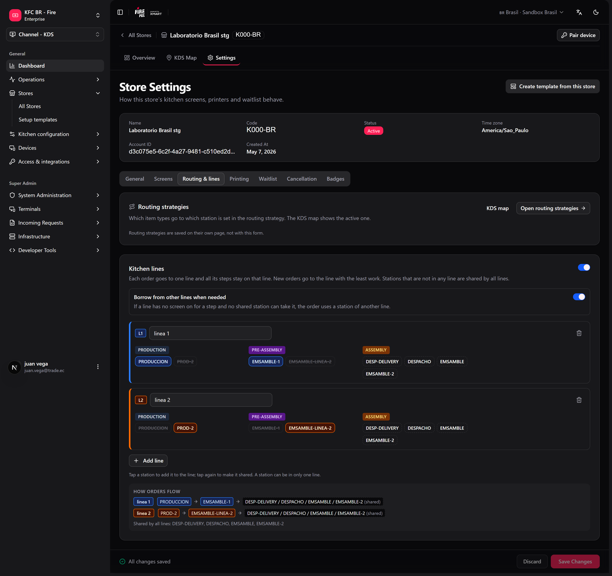
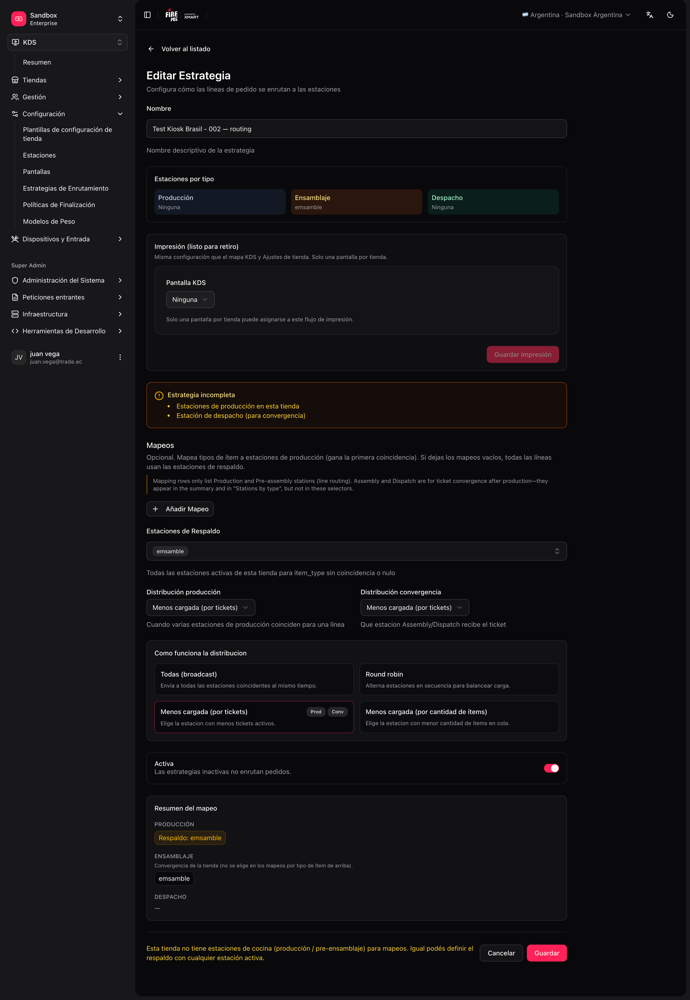

The **routing strategy** decides, for each order line, **which station(s)** it goes to.

<Note>
  There can be only **one active strategy** per store. Activating a new one automatically deactivates the others for that store.
</Note>

## Default vs custom mappings

<Tabs>
  <Tab title="Default — assembly-only (production)">
    - **Production required = No** in Store settings.
    - **One** `ASSEMBLY` station + **one** screen.
    - Active routing (empty mappings); item mappings are not used because there is no prior production.
  </Tab>
  <Tab title="Default — KITCHEN station">
    - **One** `PRODUCTION` station (e.g. `KITCHEN`) + **one** screen.
    - Routing **with no mappings**; **fallback** = that station (or "all active" if there is only one).
    - **Production required = Yes**; everything lands in the default station.
  </Tab>
  <Tab title="Custom — multiple production lines">
    - Several `PRODUCTION` / `PRE_ASSEMBLY` stations.
    - Mappings **item_type → kitchen stations** (production only).
    - Optional: `ASSEMBLY` / `DISPATCH` stations + **convergence distribution** for expo/dispatch.
  </Tab>
</Tabs>

If there is no mapping for an `item_type`, the line goes to **fallback** (ideally a production station, not assembly).

## Decision order

1. **Routing (layer 1):** picks candidate **production** stations by `item_type` + fallback.
2. **Station rules (layer 2):** channel and service type (`DINE_IN`, `DELIVERY`…) — can **reject** the line. Station **item types are ignored** (they belong only to the strategy / [station categories](/en/manuals/kds/station-categories)).
3. **Distribution (layer 3):** if several production candidates remain, picks one according to the mode.
4. **Convergence (runtime):** when production advances, the **ticket** appears in ASSEMBLY/DISPATCH according to gates and **convergence distribution**; there, channel/service station filters apply.

<Tip>
  Layer 2 example: routing sends an item to `GRILL`, but the station has **Exclude channels: UBER_EATS** → that line is not shown on the grill even though the mapping includes it.
</Tip>

## How production routing works

Line routing (layers 1–3) applies only to **production** stations:

1. Reads the line's **`item_type`**.
2. Looks for a **mapping** (production stations only in the form).
3. If no match → **fallback stations** (your default station).
4. Applies station **rules** (channel, service).
5. If several candidates → **distribution**.

**Assembly and dispatch** do not take part in these steps. They receive the ticket when the matching production is completed (convergence), not because you put `BURGER` → `ASSEMBLY` in a mapping.

## Distribution modes (when 2+ candidate stations)

| Mode | Behavior |
|---|---|
| **ALL** | Sends to all candidates (broadcast). |
| **ROUND_ROBIN** | Picks a station from the order number. Over many orders it spreads them, but two orders in a row can land on the same station — it is not a strict turn. |
| **LEAST_LOADED** | Prefers the station with fewer active tickets. Use it to split evenly between equivalent stations. |
| **LEAST_LOADED_ITEMS** | Prefers the station with fewer queued items. |

If the mapping has a **single** station, the distribution mode does not change the result.

When a category is mapped to a **production** and a **pre-assembly** station (for example, `HAM` → `GRILL` and `PRE-ASSEMBLY-1`), the line goes to **one station of each**: distribution runs separately inside each stage.

In fire-kds these modes appear as **All**, **Take turns**, **Fewest orders** and **Fewest items**.

## Combos and their pieces

A combo can be split into its pieces so each one reaches its own station: the burger to the grill, the fries to the fryer. A piece is split off when its product has a [station category](/en/manuals/kds/station-categories) **and** that category is mapped in the store's active strategy. Without a mapping, the combo arrives whole.

- **Production** gets each piece as its own line.
- **Assembly** and **Dispatch** see the combo as it was sold, with its pieces as sub-lines that are struck as Production finishes them.
- The Operator board, the fiscal invoice and the delivery ticket show the combo as sold, not the pieces.

See [Screen actions → Combos on the screen](/en/manuals/kds/screen-actions#combos-on-the-screen).

## Kitchen lines (optional)

In a kitchen with two parallel lines (Grill 1 → Assembly 1, Grill 2 → Assembly 2), balancing each stage on its own can send an order made on Grill 1 to Assembly 2, at the other end of the kitchen. **Kitchen lines** keep each order inside one line from start to finish.

**Where:** store settings, **Routing & lines** tab, or **fire-kds → Settings → Lines & routing → Kitchen lines**.

<Frame>
  
</Frame>

<Steps>
  <Step title="Turn on Use kitchen lines" />
  <Step title="Add the lines">
    **Add line** for each one. Give it a name (optional, e.g. "Line 1") and pick its stations by stage. A station can belong to one line only.
  </Step>
  <Step title="Leave shared stations out of every line">
    A station in no line is **shared by every line** — for example, a single dispatch.
  </Step>
  <Step title="Decide what happens if a line is missing a station">
    **Use another line if a station is missing**: on, the order uses the other line's station; off, it waits in its line until the station is back.
  </Step>
  <Step title="Save lines" />
</Steps>

How an order picks its line: first the lines whose stations accept the order (channel and service rules) and can make every item, then lines with every stage online, then the least loaded. Inside the line, several stations of the same stage are balanced with the store's distribution mode.

With at least two lines in use, the store dashboard in fire-kds draws a diagram: one row per line, one column per stage, and a merged cell where the lines join.

<Warning>
  With fewer than two lines that have stations, kitchen lines change nothing. A line with no stations is ignored.
</Warning>

## Lines & routing in fire-kds

Store admins can review routing on the device: **fire-kds → Settings → Lines & routing**. It explains how an order reaches each screen, shows the active strategy's category → station map (still edited in the backoffice), and lets you change:

- **Distribution between production stations** and **Distribution between assembly and dispatch**.
- **Production required**.
- **Kitchen lines** (see above).

## When a screen goes offline

- Tickets on a screen that goes offline move to another **online** screen of the same stage, if there is one. If there is none, they stay and come back when the screen reconnects.
- When screens reconnect at different times, each one gets back the orders it is missing; a stage that already bumped is never added again.
- If Assembly bumps while every Dispatch screen is offline, the order closes at Assembly and does not reappear on Dispatch later.
- Recovery only moves recent orders: it follows the store's **Recovery and business day** settings (**General** tab).
- A [paused](/en/manuals/kds/screen-actions#pause-a-screen) screen does not release its tickets; it only stops receiving new ones.

## Multi-station example

**Stations:**

| Code | Stage | Role |
|---|---|---|
| `GRILL` | PRODUCTION | Burgers — **item_type routable** |
| `FRY` | PRODUCTION | Fries — **item_type routable** |
| `ASSEMBLY` | ASSEMBLY | Assembly — **whole ticket**, no item mapping |
| `DISPATCH` | DISPATCH | Dispatch — **whole ticket**; e.g. `DELIVERY` rule only |

**Screens:**

| Screen | Assigned stations |
|---|---|
| "Grill" | `GRILL`, `FRY` |
| "Assembly" | `ASSEMBLY` |
| "Delivery dispatch" | `DISPATCH` (rules: fulfillment `DELIVERY`) |

**Routing strategy — production only in mappings:**

| item_type | Target stations | Distribution |
|---|---|---|
| `BURGER` | `GRILL` | — |
| `FRIES` | `FRY`, `GRILL` | `LEAST_LOADED` |
| *(fallback)* | `GRILL` | Unlisted types → grill (default production station) |

**Convergence (outside mappings):** when the lines in `GRILL`/`FRY` complete, the ticket appears in `ASSEMBLY` and then `DISPATCH` according to **convergence distribution** and those stations' channel/service rules.

<Frame>
  
</Frame>

## Create the strategy

<Steps>
  <Step title="Open the routing form">
    **KDS → Routing → Create** (`/kds/admin/routing/new`).
  </Step>
  <Step title="Choose store and name">
    For example, "Default routing".
  </Step>
  <Step title="Simple kitchen">
    One `KITCHEN` station, fallback = `KITCHEN`, no mappings, **Active**.
  </Step>
  <Step title="Advanced kitchen">
    Mappings only to **production** stations; **convergence distribution** if there are ASSEMBLY/DISPATCH stations; fallback = default production station.
  </Step>
  <Step title="Save" />
</Steps>

In the routing list you can see the **active strategy** card and a conceptual station ↔ screen map.

<Warning>
  A product without a station category, or a category with no mapping, is not split out of its combo and goes to fallback. Check [Station categories](/en/manuals/kds/station-categories) before blaming the routing.
</Warning>

Next: [Peripherals, printing and validation](/en/manuals/kds/peripherals-printing).
