The KDS screen is the kitchen display where operators see live orders and mark them as prepared. It runs full screen on a touch device and updates in real time, so every screen in the store stays in sync.

This guide covers the actions you can perform during service. For how a KDS is set up and linked, ask your administrator.

## The screen at a glance

Orders are grouped into **station columns** — one column per station assigned to the screen (for example, *Fry* and *Sandwich*). Each order is a **ticket card** that shows:

- A short order code in the header (for example, `#A7F2C`).
- **Channel** and **fulfillment** badges (such as the sales channel and pickup or delivery).
- The list of items to prepare.
- A **timer** that changes color as the order ages: green, then amber, then red. Past an hour it reads `h:mm:ss`.

Each station header shows the station's rules as chips: **Only** (for example, only `DELIVERY`) or **Except**, with the channel and service badges. No chips means the station takes every order.

<Frame>
  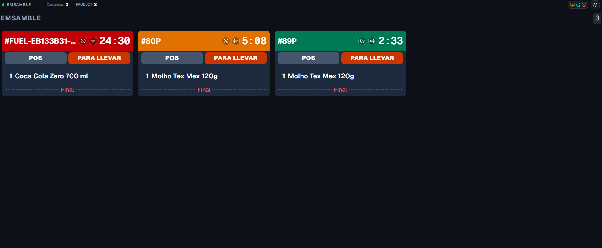
</Frame>

## Send an order (bump)

When you finish preparing the items on a card, **tap the card once** to send it. The ticket is marked as done and leaves the queue.

<Frame>
  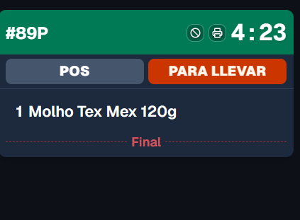
</Frame>

<Note>
  On screens with a USB button panel or keyboard, you can also send the order with the assigned key instead of tapping. See [Keyboard and button panel](#keyboard-and-button-panel).
</Note>

## Combos on the screen

When the kitchen splits combos into pieces, each station sees what it has to do:

- **Production** gets each piece as its own line (for example, `1 Medium fries` on the fryer).
- **Assembly** and **Dispatch** show the combo as it was sold (`1 Big Box`), with its pieces as **blue sub-lines**. A sub-line is struck through when Production bumps that piece.
- **Pre-assembly** shows the combo name with only the pieces routed to that station as blue sub-lines. Striking the combo line strikes all of them. Your administrator can turn this grouping off in [Account settings](/en/manuals/kds/account-settings#group-combo-pieces-on-pre-assembly).

A combo piece arrives with the quantity of the order: two combos with 2 sandwiches each show `4`, not `8`. If the account [splits pieces into units](/en/manuals/kds/account-settings#split-combo-pieces-into-units), Production shows one line per unit.

## Strike lines before send (optional)

When **line strike** is enabled for the store (or overridden on this screen), you must **tap each parent line** on the ticket before you can send it. Struck lines show as crossed out. When every required line is struck, the card shows a ready state (green ring) — then tap the card body to bump.

If lines are still pending, tapping the card body does nothing. The strike appears immediately on this screen (optimistic); other screens catch up when the server confirms. Undo / recall after a bump clears the strikes for that ticket on the station.

<Frame>
  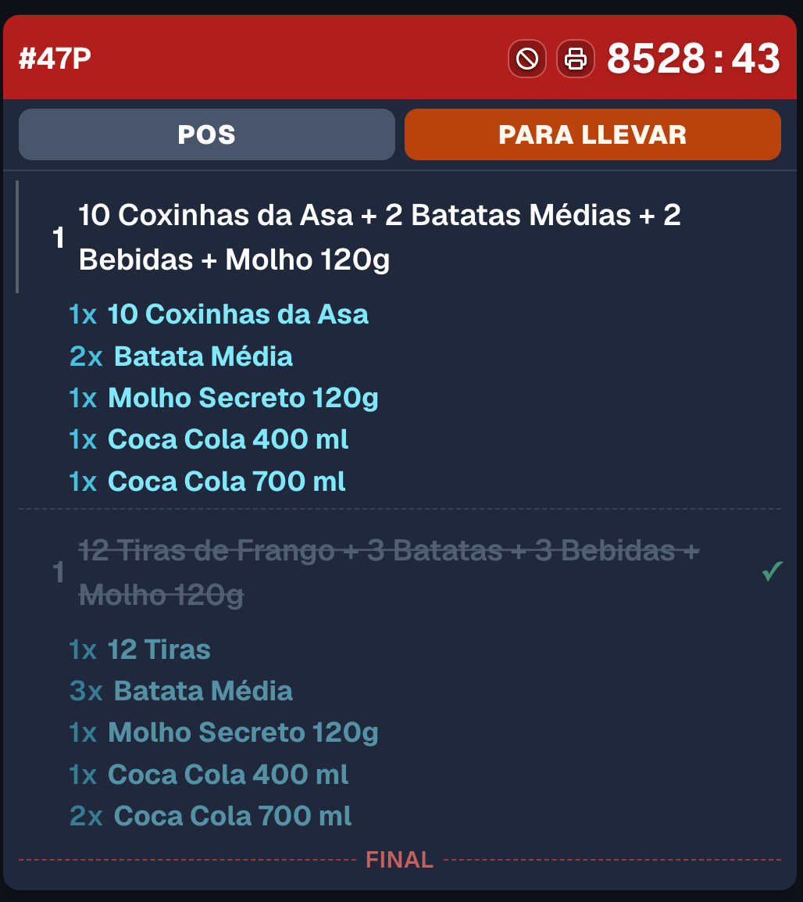
</Frame>

Your administrator chooses which stations require line strike. You can also open the **line strike** settings from the top bar when a local screen override is allowed.

## Waiting for assembly (dispatch)

On a **DISPATCH** column, a ticket can be visible while assembly (or pre-assembly) is still working. With **hierarchy bump** on (the default), you can bump it anyway: it closes the ticket in Assembly and Production too. With hierarchy bump off, the bump stays blocked and the card shows an **awaiting upstream** hint until assembly finishes. See [Account settings](/en/manuals/kds/account-settings#hierarchy-bump).

<Frame>
  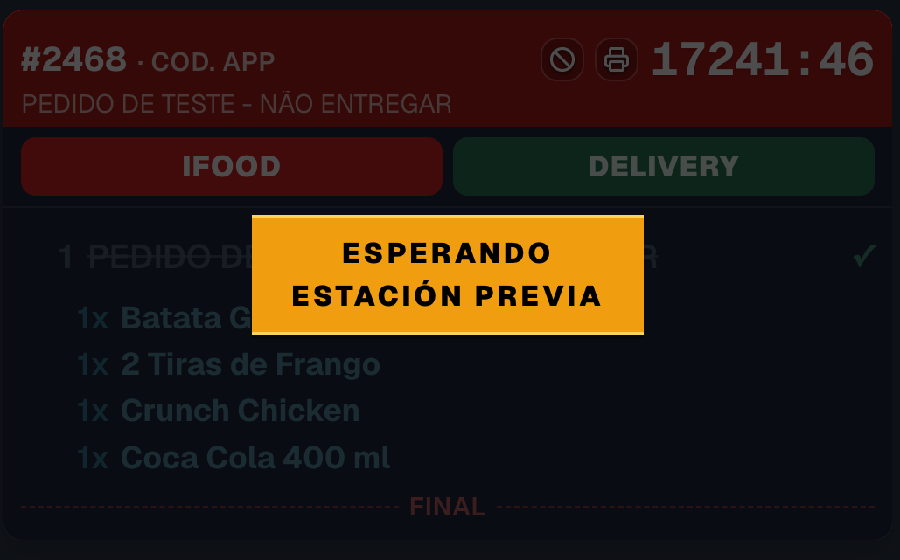
</Frame>

## Put an order on hold and release it

If an order needs to wait (the customer is not ready, an item is missing), **press and hold the card** until the progress bar fills. The card turns gray, shows an **ON HOLD** label, and moves to the end of the queue.

A held order is paused on **every** screen in the store, not only yours. To release it, **press and hold it again** — it returns to its normal position in the queue.

<Frame>
  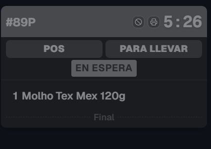
</Frame>

## Undo a send (recall)

Sent an order by mistake? Right after sending, an **Undo** bar appears at the bottom of the column showing the order code. Tap **Undo** to bring the ticket back to the queue.

<Frame>
  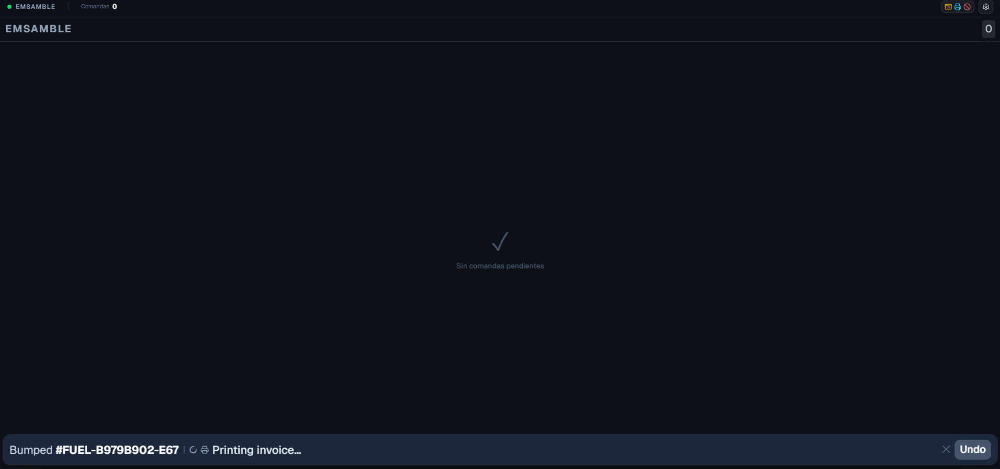
</Frame>

The Undo bar disappears on its own after **10 seconds** at most, or you can dismiss it with the **✕**. The recall window on the server is longer (set per station): after the bar is gone, the `Z` key still undoes the last send in the first column.

## Cancel an order

When order cancellation is enabled for the store, each ticket header shows a **ban** icon (<Icon icon="ban" />). Tap it to cancel the order and confirm in the dialog. A status bar at the bottom of the column shows **Cancelling** and then **Cancelled**.

<Frame>
  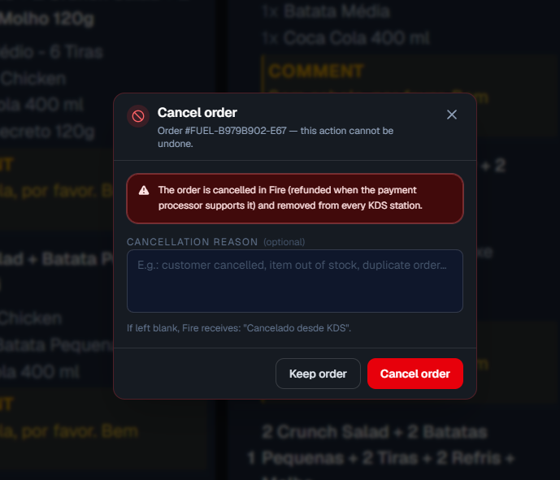
</Frame>

If Fire rejects the request, the bar does **not** say **Cancelled**. The operator sees **Fire rejected the cancellation** plus the policy detail Fire returned (reason and, when present, the time threshold). The job stays failed. The ticket remains in the kitchen until a later cancel succeeds or someone bumps it.

<Frame>
  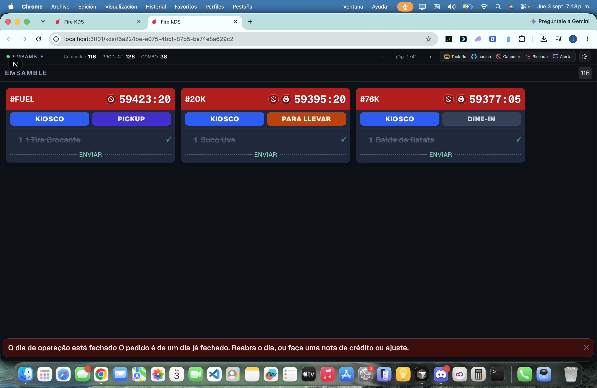
</Frame>

<Warning>
  Cancelling removes the order from the kitchen. Confirm the order code before continuing. A rejection is not a cancel: the guest can still be waiting for that plate.
</Warning>

## Change pages

When there are more orders than fit on screen, the orders split into pages. All columns change page together. You can move between pages in three ways:

- **Top bar arrows:** tap **←** / **→** next to the page indicator (`page N/M`).
- **Swipe:** drag left or right across a column to go to the next or previous page.
- **Double tap:** double-tap an empty area to jump to the first or last page.

<Frame>
  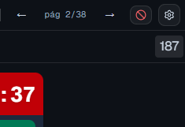
</Frame>

## New-order alert

When a new ticket arrives, the screen can show a **visual bubble** and optionally play a sound. Your store’s KDS display defaults control this; each screen can follow the store default or keep a local override in **Settings → Display**.

<Frame>
  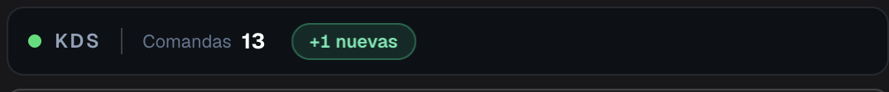
</Frame>

## Settings menu

The gear button (<Icon icon="gear" />) in the top-right corner opens the operator tools:

- **Display:** typography, card size, **Ticket rows** (1–3), new-order alert, and whether to show the customer name (optionally limited by fulfillment type or channel). Screens can follow **store defaults** or keep local values. More rows show more tickets; tall tickets (modifiers and **notes**) continue in the next column on the same row so the note is not clipped.
- **Button panel (keyboard):** map the physical keys of a USB button panel to actions.
- **Printer for this screen:** the printer this screen uses for [print on bump](#print-on-bump). If Fire Agent is missing, **Download Fire Agent** appears when your account has the link.
- **Print queued invoices:** print the fiscal invoices that failed today (current business day only).
- **Theme:** **Screen** (what the backoffice set for this screen), **Dark** or **Light**. Saved on this device only.
- **Pause screen…:** stop new orders without signing out (see [Pause a screen](#pause-a-screen)).
- **Language:** switch the interface between English, Spanish, and Portuguese. On first open the screen follows the browser language.
- **Sign out** (or **Unpair device** on a paired TV).

<Frame>
  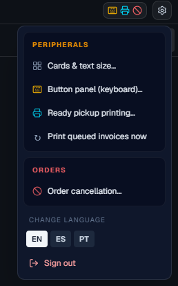
</Frame>

<Frame>
  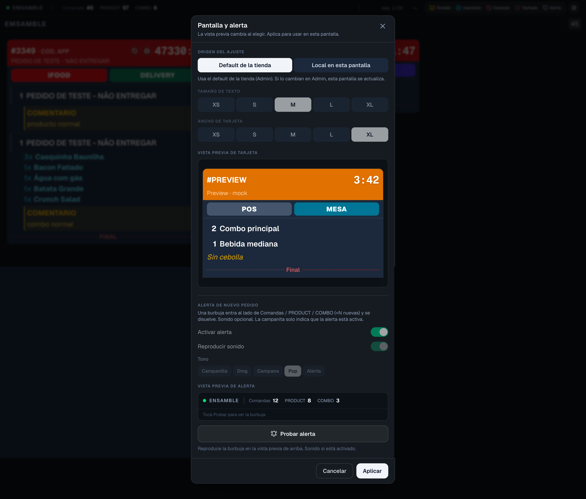
</Frame>

<Frame>
  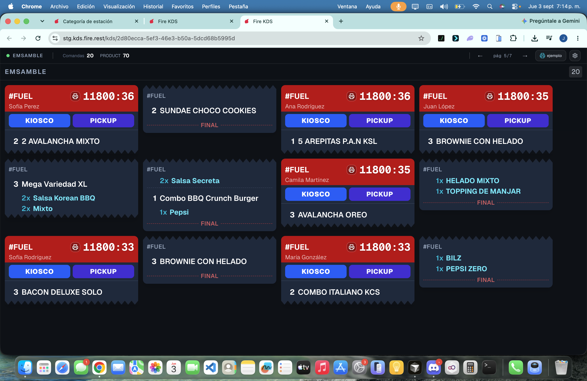
</Frame>

## Pause a screen

To take a screen out of service for a while (a station closes early, a cook goes on break), open the gear menu and choose **Pause screen…**. The screen stays signed in and online, but **new orders stop landing on it**; the tickets already on it stay so the kitchen can finish them. A **Screen paused** banner shows how many tickets are left.

Other screens of the same station keep receiving orders. If the paused screen was the only one, new orders wait for a screen of that stage. Tap **Resume** (or the pause key, if your button panel has one) to go live again. The store dashboard shows paused screens with a **Paused** badge.

<Warning>
  Do not turn the TV off to stop orders. A screen that goes offline releases its tickets to other screens; with pause, the tickets stay where they are and you do not need to pair or sign in again.
</Warning>

## Zoom a station or a ticket

Double-tap the **ticket timer** to zoom that ticket. Tap the **station header** (or the zoom key, default **Q**) to zoom the station. A **Back** banner and the **Screen / Station / Ticket** trail show where you are. Hold applies to the **highlighted** ticket, not the first card on the page.

<Frame>
  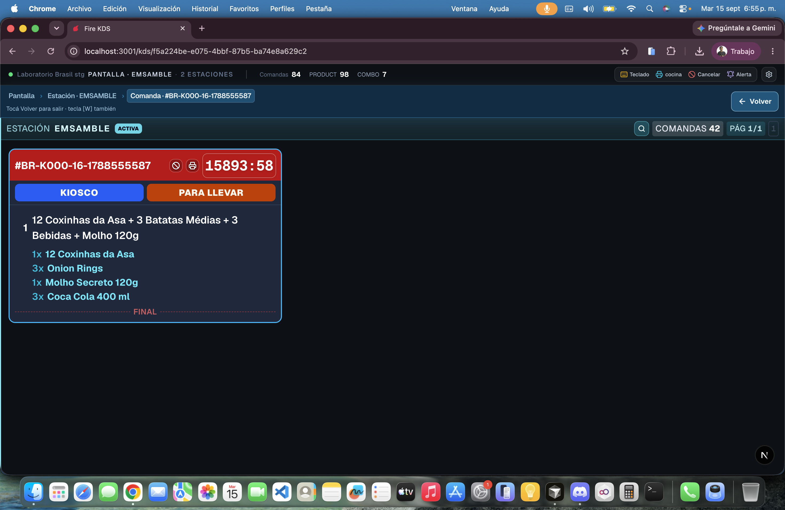
</Frame>

## Print on bump

The store rule **Print on bump** decides whether a send prints **Comanda**, **Fiscal invoice**, or both. On this screen you only **arm the printer** (**Printer for this screen**). A snackbar shows **Printing kitchen ticket…** / **Printing fiscal invoice…** or **Print failed**.

If the fiscal payload is ready but the printer fails, the bump still completes and the ticket shows **Queued: printer failed. Use “Print queued invoices”.** Delivery tickets are not queued.

The **Printer** chip in the top bar shows whether Fire Agent is **Connected** or **Disconnected** on this device, before a bump fails.

<Frame>
  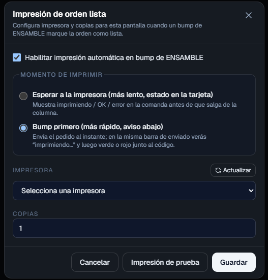
</Frame>

<Frame>
  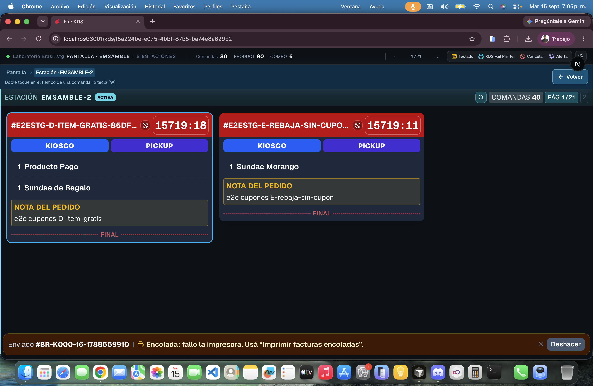
</Frame>

See [Peripherals, printing and validation](/en/manuals/kds/peripherals-printing) and [Android Fire Agent](/en/manuals/fire-agent/android) if the kitchen runs on a tablet.

## Keyboard and button panel

Screens can use a physical keyboard or USB button panel for faster, no-touch operation. Without any setup, these default keys work:

| Key | Action |
|---|---|
| `1`–`8` | Send the order in column 1–8 |
| `→` / `←` | Next page / previous page |
| `Z` | Undo the last send |
| `F5` | Reload the screen |
| `Q` | Zoom the station / ticket |

To customize the keys, open **Settings → Button panel (keyboard)**, tap an action, press the key you want to assign, and save.

<Frame>
  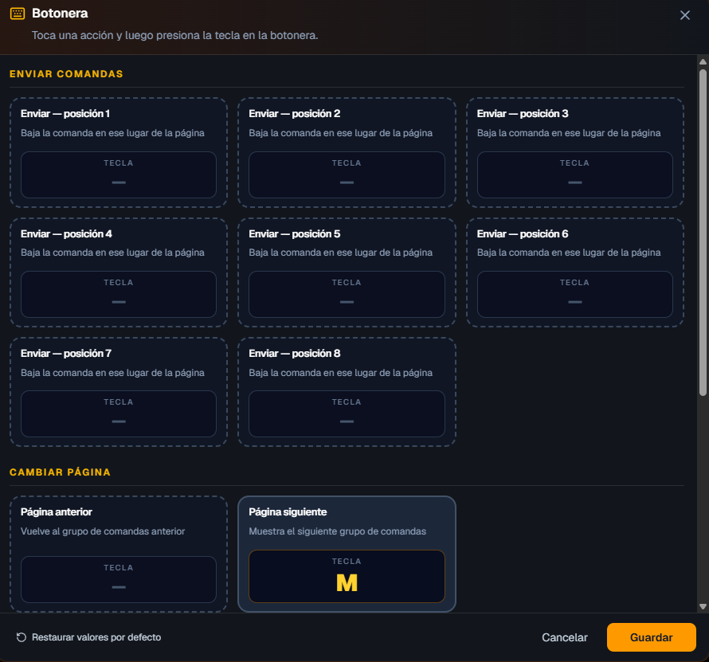
</Frame>

## Updates and disabled screens

- **New version:** when a new version of Fire KDS is published, the screen reloads by itself. You do not need to press `F5`.
- **Disabled screen:** if an administrator deactivates the screen, it shows **Screen inactive** and stops receiving orders; its tickets move to other screens. When it is reactivated, it comes back on its own.

<Check>
  You can now run the KDS during service: send, hold, undo, and cancel orders, move between pages, and adjust the screen to your kitchen.
</Check>
