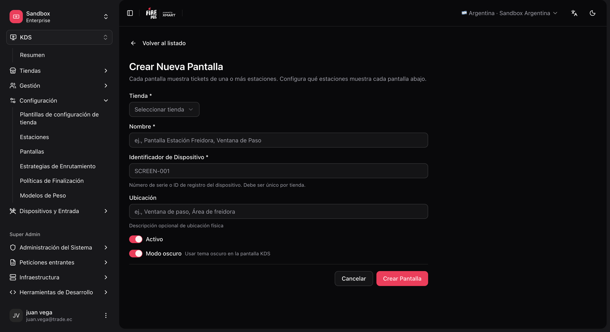
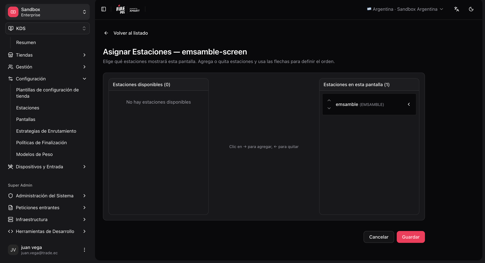

A **screen** is a KDS device (monitor + fire-kds app). Each screen has a **Device ID** that is unique within the store.

## Important fields

| Field | What it is for |
|---|---|
| **Store** | The store. |
| **Name** | Admin name (e.g. "Grill screen"). |
| **Device identifier** | The ID the fire-kds app uses to register. **It cannot be changed** after creation. It must match the device exactly. |
| **Location** | Optional physical location (operational reference). |
| **Active** | If disabled, the screen shows **Screen inactive**, stops receiving orders and its tickets move to other screens. It comes back on its own when reactivated. |
| **Dark mode** | Default light/dark theme in fire-kds. The operator can override it on the device (**Theme → Dark / Light**); **Screen** follows this field. |

<Warning>
  The **device identifier** cannot be changed after the screen is created. Agree on it with the hardware team before saving.
</Warning>

<Frame>
  
</Frame>

## Create a screen

<Steps>
  <Step title="Open the screen form">
    **KDS → Screens → Create** (`/kds/admin/screens/new`).
  </Step>
  <Step title="Fill store, name and device identifier">
    For example, device identifier `KDS-GRILL-01`.
  </Step>
  <Step title="Save">
    The system redirects to **Assign stations**.
  </Step>
  <Step title="Assign stations">
    - Add the stations this screen should show (e.g. `GRILL` and `FRY`).
    - Set the **sort order** (column order in the UI).

    <Frame>
      
    </Frame>
  </Step>
  <Step title="Save the assignment" />
</Steps>

<Note>
  Key relationship: a screen can show **several stations**, and a station can appear on **several screens** (e.g. assembly visible on both the expo and the dispatch monitor).
</Note>

<Tip>
  Each card in **KDS → Screens** has a pair action: it opens [Pair device](/en/manuals/kds/device-pairing) already pointing at that screen.
</Tip>

Next: [Routing](/en/manuals/kds/routing).
