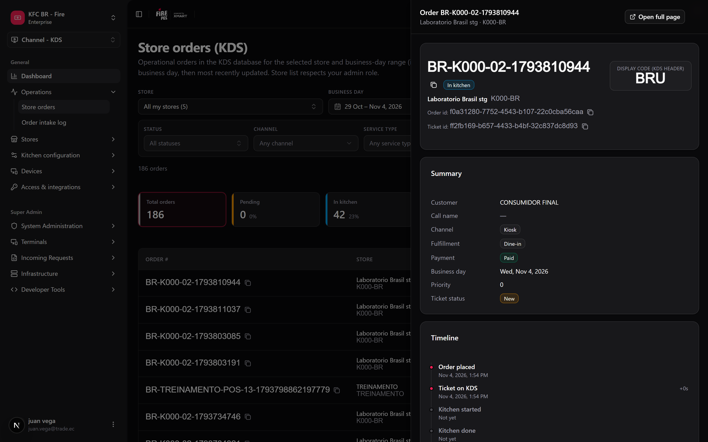
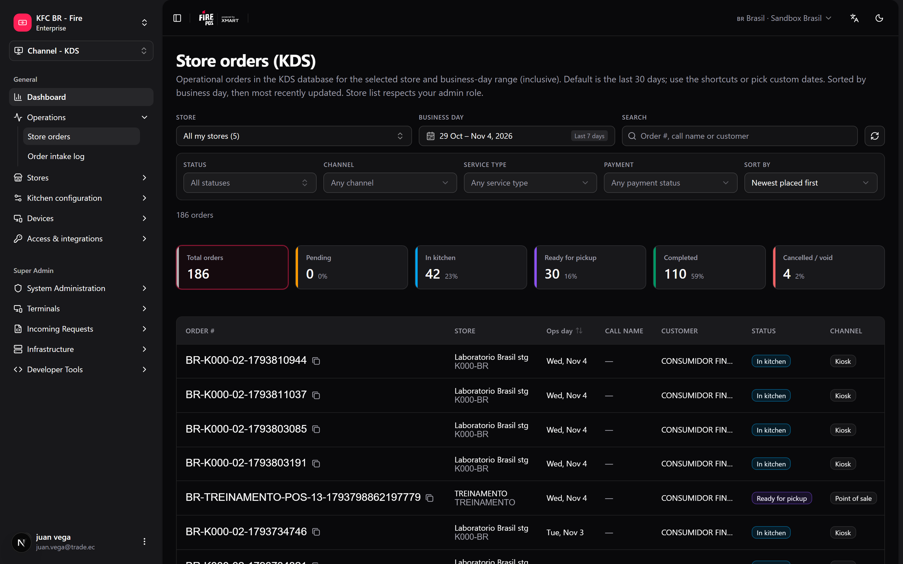

When a customer says their order never came out, or a store asks why the kitchen was slow on Friday, the answer is in the orders the KDS received. **Store orders** lets you look them up from the backoffice, without asking the store for a screenshot of the kitchen TV. It is read-only: nothing you do here changes an order.

**Where you work:** **KDS → Store orders** (`/kds/admin/store-orders`) in the backoffice.

<Note>
  **The minimum you need to know**

  - Dates are **business days** of the store, not calendar days: an order placed at 1:00 a.m. can belong to the previous day.
  - You can search one store or **All my stores** (up to 100 stores, up to 93 days).
  - The KPI cards are also filters: click **In kitchen** to see only those orders.
</Note>

## The simple path

<Steps>
  <Step title="Open Store orders">
    Go to **KDS → Store orders**. It opens with the **last 7 days**.
  </Step>
  <Step title="Pick the store">
    Use the store picker (it has a search). Choose **All my stores** to search every store you can see; the table then shows a store column.
  </Step>
  <Step title="Find the order">
    Type the order number, the call name, or the customer name in the search box.
  </Step>
  <Step title="Open it">
    Click the order number. The detail opens in a side panel over the list: summary, ticket timeline (in the store time zone), lines with modifiers, and totals. **Open full page** gives you a link to share.

    <Frame>
      
    </Frame>
  </Step>
</Steps>

<Tip>
  The whole view lives in the address bar. Copy the URL and whoever opens it sees the same store, dates, filters and open order.
</Tip>

## Filters

| Filter | What it does |
|---|---|
| **Business day** | Calendar with presets (today, last 7 / 30 days, this week, this month, last month). |
| **Status** | One or several: Created, In kitchen, Ready for pickup, Completed, Cancelled, Void. |
| **Channel**, **Fulfillment**, **Payment** | Narrow by where the order came from, how it is served, and its payment status. |
| **Search** | Order number, call name or customer. |

Active filters show as chips; **Clear filters** removes them all.

## What the table shows

<Frame>
  
</Frame>

| Column | Meaning |
|---|---|
| **Order #** | The code the team sees on tickets and screens. Click to open, or copy it. |
| **Ops day** | The store's business day for that order. |
| **Call name** | The name or pager number given to the customer, when there is one. |
| **Status** | Stage of the order in the kitchen flow. |
| **Channel** / **Service type** | Sales channel and fulfillment type. |
| **Placed** / **Last change** | Relative time, with the exact time in the store time zone on hover. |
| **Kitchen time** | From when the kitchen started (or received) the ticket until it was bumped as done. |

The KPI cards above the table (**Total orders**, **Pending**, in kitchen, ready for pickup, completed, cancelled / void) count the orders that match every filter except status, with their percentage. Click one to filter by it.

## Recipes

<AccordionGroup>
  <Accordion title="A customer says their order never came out">
    1. Pick the store and today's business day.
    2. Search by the customer's name or the call name.
    3. Open the order and read the timeline: which station had it and when it was bumped.
    4. If it is still **In kitchen**, the [Operator board](/en/manuals/kds/operator-board) can mark it ready.
  </Accordion>
  <Accordion title="How many orders were cancelled this week, across the chain">
    1. Choose **All my stores** and **This week**.
    2. Click the **Cancelled** card.
    3. The store column shows where they happened.
  </Accordion>
  <Accordion title="Orders from a store that is already closed">
    Store and account admins also see inactive stores in the picker, so the history of a closed store is still there.
  </Accordion>
  <Accordion title="Send a supervisor the exact order">
    1. Open the order.
    2. Click **Open full page** and copy the link.
  </Accordion>
</AccordionGroup>

## Errors that cost money

<Warning>
  **Searching by calendar date after midnight.** A store that closes at 2:00 a.m. files those orders under the previous business day. If you search "today" you will not find them and conclude they were lost.
</Warning>

<Warning>
  **Reading "Completed" as "delivered to the customer".** It means the kitchen closed the order. Whether the courier picked it up is in the channel, not here.
</Warning>

## FAQ

<AccordionGroup>
  <Accordion title="Why can't I pick a range longer than 93 days?">
    To keep the search fast. Run two searches if you need more.
  </Accordion>
  <Accordion title="Why does All my stores give an error?">
    It covers up to 100 stores. If you have access to more, pick one store or narrow the store context in the header.
  </Accordion>
  <Accordion title="Can I cancel or mark an order ready from here?">
    No. This screen is read-only. Use the [Operator board](/en/manuals/kds/operator-board).
  </Accordion>
</AccordionGroup>

## What this page does not do

- It does not change orders.
- It does not export to a file.
- It does not show orders that never reached the KDS.
