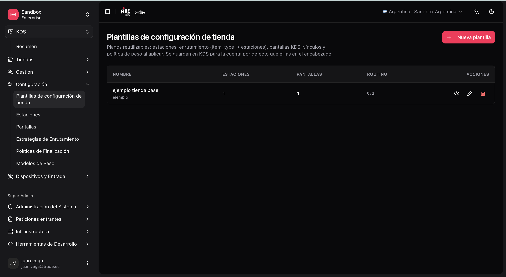
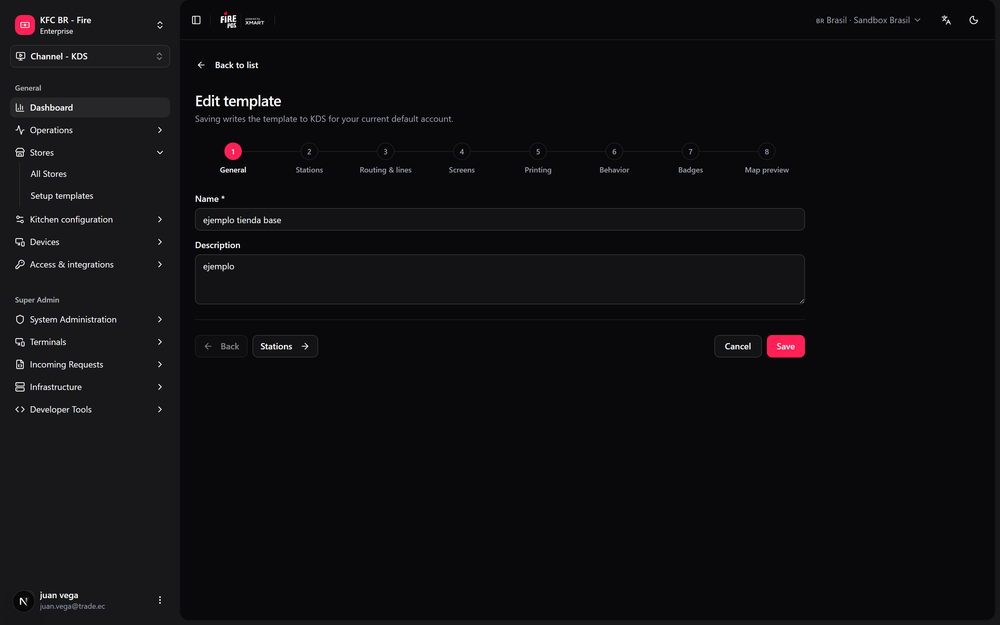
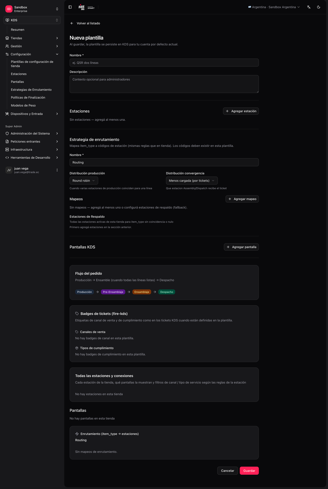

There are two ways to configure a KDS store: apply a **template** (recommended when you repeat the same layout) or configure everything **from scratch**.

## Option A — Use a template

Ideal when you already have a proven layout (same chain, same kitchen type).

<Steps>
  <Step title="Open Setup templates">
    Go to **KDS → Setup templates** (`/kds/admin/setup-templates`).
  </Step>
  <Step title="Create a template">
    Choose an **empty template** or **Seed from store** (copy the config of a store that already works).

    <Frame>
      
    </Frame>
  </Step>
  <Step title="Go through the steps">
    The editor is a stepper: **General → Stations → Routing & lines → Screens → Printing → Behavior → Badges → Map preview**.

    <Frame>
      
    </Frame>

    - **Stations**, **Routing & lines** and **Screens**: the kitchen layout, the screen ↔ station links and, if you use them, the [kitchen lines](/en/manuals/kds/routing#kitchen-lines-optional).
    - **Printing**: print on bump (stations, documents, copies, fiscal timing) and the printer armed on each screen.
    - **Behavior**: the store defaults — production required, customer name, waitlist, display, line strike, recovery, cancellation and the Operator Board printer.
    - **Map preview**: check everything before saving.
  </Step>
  <Step title="Save the template" />
</Steps>

### Apply a template to a new store (initial wizard)

<Steps>
  <Step title="Create the store">
    **KDS → All Stores → Create**.
  </Step>
  <Step title="Open the initial setup">
    If the store is empty (no stations, screens, or routing), open `/kds/admin/stores/initial-setup/{storeId}`.
  </Step>
  <Step title="Use a blueprint">
    Choose **Use a blueprint** → select the template → review/edit → **Apply to store**.

    <Frame>
      
    </Frame>
  </Step>
  <Step title="Review the progress">
    The wizard shows progress by phase (stations, screens, links, routing, store settings, kitchen lines, printing, keyboards). Only the phases the template uses run.
  </Step>
</Steps>

<Tip>
  You can also **save an existing store as a template** from that store's **Store settings** ("Save as template"). The template now carries the store's behaviour, kitchen lines and print on bump too, so a new store comes out ready to print.
</Tip>

<Note>
  Templates saved before this change still open: the editor upgrades them and fills the new steps with defaults. Review **Printing** and **Behavior** before applying an old template.
</Note>

## Option B — Configure manually (from scratch)

Recommended order when you do not use a template:

| Step | Backoffice menu | Route |
|---|---|---|
| 1 | All Stores → create store | `/kds/admin/stores/new` |
| 2 | Stations → create stations | `/kds/admin/stations/new` |
| 3 | Screens → create screens | `/kds/admin/screens/new` |
| 4 | Assign stations to each screen | `/kds/admin/screens/{id}/assign-stations` |
| 5 | Routing → active strategy | `/kds/admin/routing/new` |
| 6 | (Optional) Input devices + Keyboard layouts | `/kds/admin/devices`, `/kds/admin/keyboard-layouts` |
| 7 | Validate in the store **KDS Map** | `/kds/admin/stores/{storeId}/kds-map` |

The **initial setup** wizard also offers **Create from scratch**: it opens the same editor as templates, but applied directly to the empty store.

<Note>
  Each step has its own page in this section: [Stations](/en/manuals/kds/stations), [Screens](/en/manuals/kds/screens), [Routing](/en/manuals/kds/routing), and [Peripherals, printing and validation](/en/manuals/kds/peripherals-printing).
</Note>
