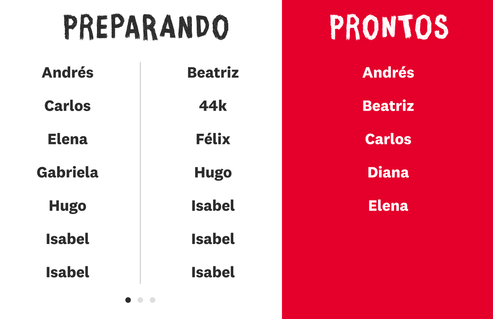
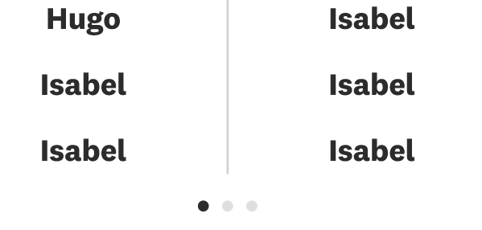
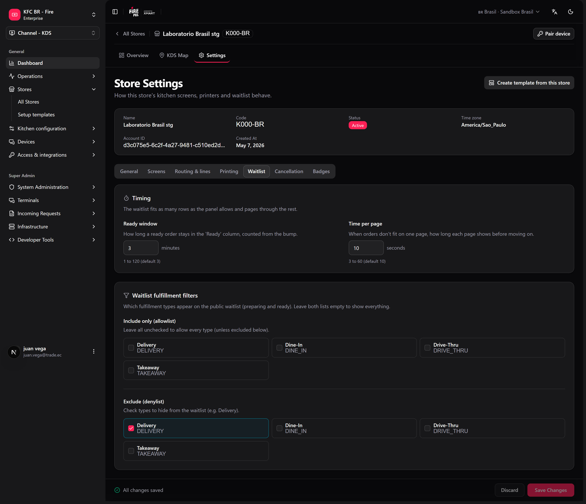
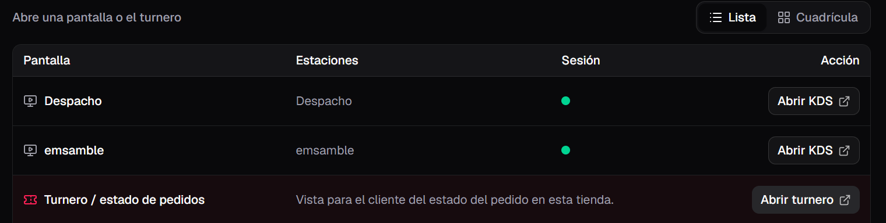

The order display (also called the *waitlist* or *turnero*) is a customer-facing screen that shows order numbers in two states: **being prepared** and **ready for pickup**. It is meant to run on a TV or tablet in the pickup area so customers can see when their order is ready.

Unlike the KDS screen, the order display has no operator controls — it only shows information. It updates in real time as the kitchen works through orders.

## What the screen shows

The display is split into two areas:

- **Being prepared:** orders that the kitchen has received and is still working on, shown oldest first.
- **Ready for pickup:** orders that are finished and waiting to be collected. Each order stays in this area for the **ready window** — **3 minutes** by default — counted from the bump that made it ready.

Which bump makes an order "ready" depends on the kitchen:

- **With a Dispatch screen online:** the order moves to ready when Dispatch bumps it. Assembly's bump keeps it in preparing while it is still on Dispatch.
- **Without Dispatch:** the Assembly bump moves it to ready.

Turning a Dispatch screen on does not send orders that Assembly already finished back to preparing.

The store name or campaign title appears at the top as a banner.

<Frame>
  
</Frame>

## When an order is ready

When an order moves to ready, the screen highlights it so the customer notices: the order code is shown large in a **highlight overlay** for a moment before settling into the ready list.

<Frame>
  
</Frame>

## Which code is shown

Each order shows a short, public label so customers can match it to their receipt or buzzer:

1. A **buzzer or pager name** if the order has one.
2. Otherwise, the **public order code**.
3. As a fallback, the last characters of the order code.

This is the same label that appears in the KDS ticket header.

## Pagination and rotation

Each page shows only the rows that fit whole on the screen, and spreads them to fill the panel — the list never scrolls and the last row is never cut. When there are more orders than fit, the lists rotate through pages on their own (**Time per page**, 10 seconds by default). **Pagination dots** below the lists show how many pages there are and which one is visible.

The screen decides how many codes fit from its own height: there is no "codes per page" setting anymore.

<Frame>
  
</Frame>

## Which orders appear

By default the display includes every preparing and ready order **except delivery**: delivery orders always go to the [delivery board](#delivery-board). Your administrator can also **hide other fulfillment types** (for example, show only dine-in). Filters apply to both the preparing and ready lists.

When the store has **business day** recovery on, preparing shows only today's orders; leftovers from previous days do not stay on the TV.

## Settings

In the backoffice, store settings → **Waitlist** tab (or **fire-kds → Settings → KDS store**):

<Frame>
  
</Frame>

| Setting | Range | Default |
|---|---|---|
| **Ready window** | 1–120 minutes | 3 |
| **Time per page** | 3–60 seconds | 10 |
| **Include only** / **Exclude** | Fulfillment types | Show everything (except delivery) |

## Delivery board

The **delivery board** is a separate screen for the area where couriers pick up. It has three columns — **Preparing**, **Ready** and **Delivered** — and shows only delivery orders. Each code carries the channel's abbreviation (for example, `1234-KE` for an order from Keeta), so the courier spots their app's orders.

- Open it from the store dashboard with **Open delivery queue**, or at `/waitlist/{storeId}/delivery`. You can also [pair a TV](/en/manuals/kds/device-pairing) straight to **Delivery waitlist**.
- **Time on ready (delivery)** (default 3 minutes) and **Time on delivered** (default 10 minutes) are set in **fire-kds → Settings → KDS store → Delivery board timing**.
- These times count from the order's status change (the same moment the webhooks are sent), not from the kitchen bump.

<Warning>
  If you used to show delivery on the main display, it is not there anymore. Put the delivery board on its own screen, or couriers will not see their orders.
</Warning>

## How to open it

The order display opens in its own browser tab from the store dashboard, separate from the KDS operator screens. Open it on the device in the pickup area and leave it running full screen. Kitchen devices can also be [paired](/en/manuals/kds/device-pairing) first so the dashboard opens on the right store.

<Frame>
  
</Frame>

<Info>
  If the display ever fails, it reloads itself after 15 seconds. After 5 failures in 10 minutes it waits 5 minutes between tries, so a broken TV does not keep reloading.
</Info>

<Check>
  The order display is now showing live order status to your customers.
</Check>
