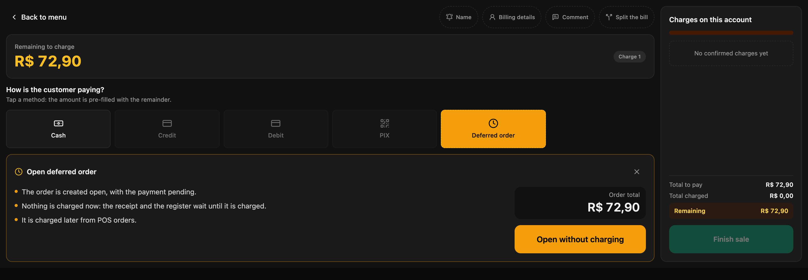
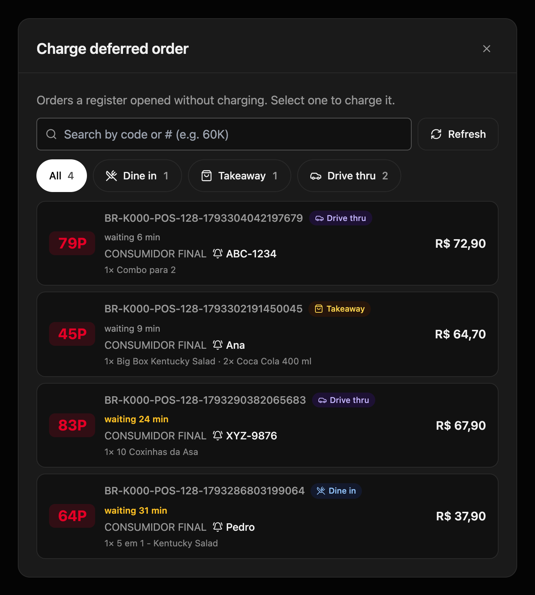
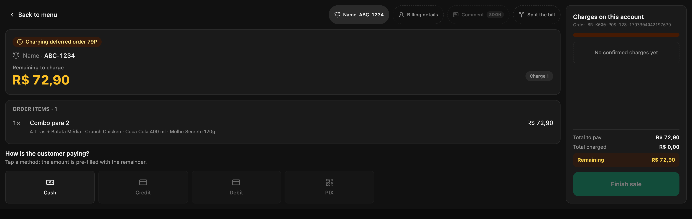

At the drive thru, or when the customer pays at the end, the order is taken before it is charged. If the cashier charges it "on account" to record it, or writes it down separately, the register comes out off or the order is entered twice. A **deferred order** records the order without charging it and keeps it waiting in **POS orders** until the customer pays.

<Note>
  **The minimum you need to know**

  - Opening it charges nothing, prints no receipt and adds nothing to the register. All of that happens when it is charged.
  - The kitchen prepares it before payment only if the account has **Deferred payment** for that channel; otherwise, it waits until it is charged.
  - It is charged from **POS orders**, with any payment method, at any register in the store.
</Note>

## Prerequisites

- **Deferred order** turned on for the channel in the backoffice: **Fire POS → Store config → Channels**, inside the channel's card. See [Store configuration](/en/manuals/pos/store-config).
- For the kitchen to prepare it before payment, **Deferred payment** set on the account for that channel and service type. The Fire team configures it.
- The register open. See [Open the register](/en/manuals/pos/open-register).

## 1. Open the order without charging

Build the order as usual and tap **Charge**. On the payment screen, tap **Deferred order** and then **Open without charging**.

<Frame>
  
</Frame>

The POS shows **Deferred order opened**: the order is recorded with its number and its locator. Hand the customer the number or the buzzer, as in any sale.

## 2. Charge it from POS orders

When the customer is ready to pay, tap **POS orders** (the clock icon) in the right-hand bar. Each order shows its short number, the channel, the locator, the items and how many minutes it has been waiting; from 20 minutes, in amber. Filter by channel with the buttons at the top or search for it by its number.

<Frame>
  
</Frame>

Tap the order: it opens on the payment screen with its items. Charge it in cash, by card or with several methods, and tap **Finish sale**. That is when the receipt prints and the sale adds to your register.

<Frame>
  
</Frame>

<Tip>
  If the order disappeared from **POS orders**, you are done: it was charged.
</Tip>

## If the customer does not come back

Cancel it from **Cancel order**, like any order. Since it was not charged, there is no money to return and no credit note. See [Cancel an order](/en/manuals/pos/cancellations).

## Costly mistakes

<Warning>
  **Entering the order again when the customer comes back to pay.** The kitchen prepares it twice and the deferred order stays pending. Always charge it from **POS orders**.
</Warning>

<Warning>
  **Handing over the order without charging it.** The order stays open and the sale never enters the register. Charge it before handing it over, or at the payment window for the drive thru.
</Warning>

## Frequently asked questions

<AccordionGroup>
  <Accordion title="I don't see «Deferred order» on the payment screen">
    The order's channel doesn't have it turned on in the store config. If the button says **Void the charges first**, you already recorded a charge on that account: void it before opening the order without charging.
  </Accordion>

  <Accordion title="The kitchen doesn't get the order until it is charged">
    The account doesn't have **Deferred payment** for that channel and service type, so the order is treated as prepaid. Ask the Fire team to configure it.
  </Accordion>

  <Accordion title="I don't see the POS orders button">
    It only appears if the store has deferred orders turned on in some channel.
  </Accordion>

  <Accordion title="Can I change the items of a deferred order?">
    No. The items are fixed when it is opened. If the customer changes the order, cancel it and build a new one.
  </Accordion>
</AccordionGroup>
