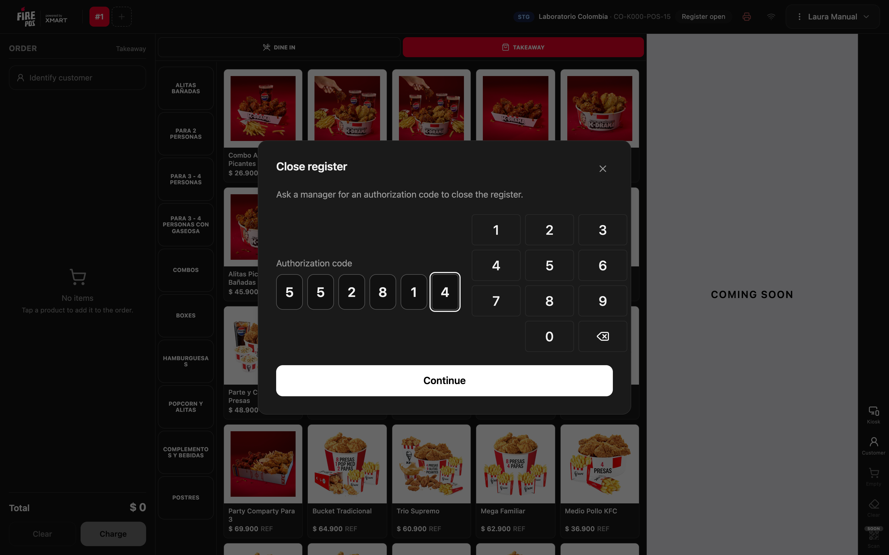
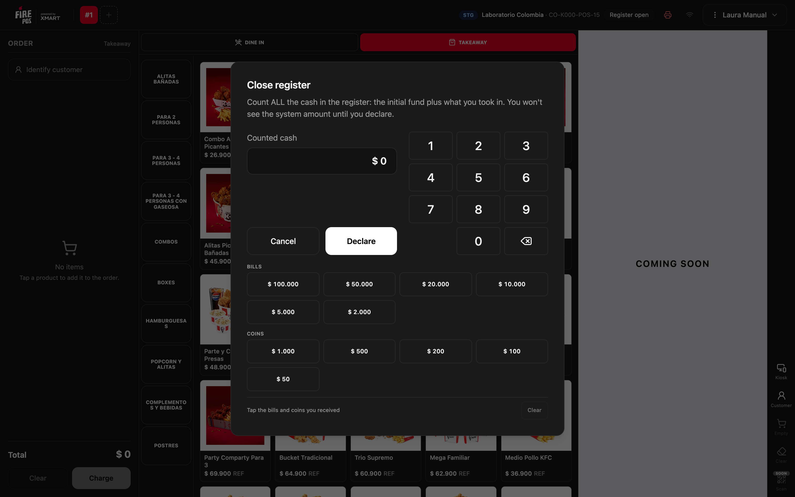
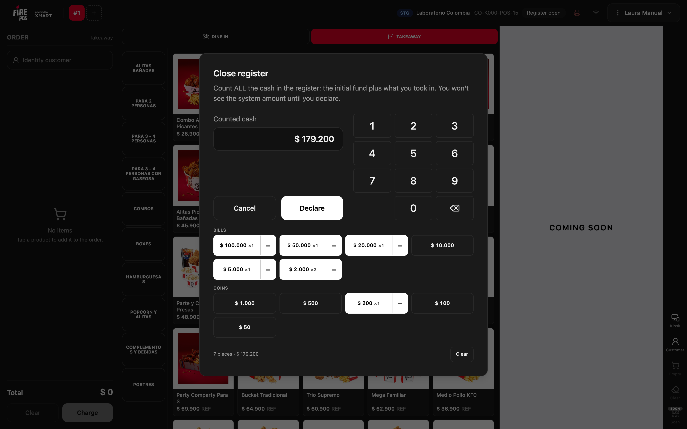
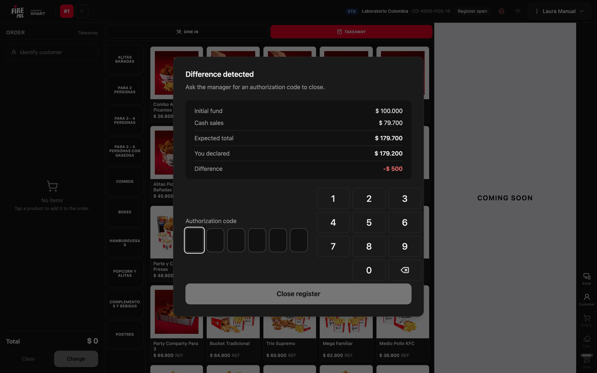
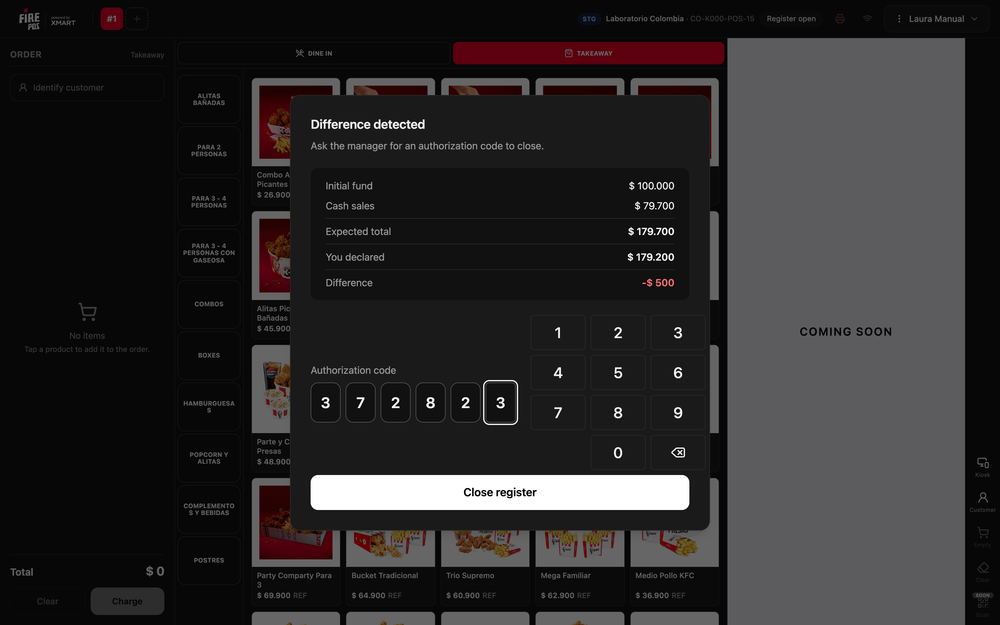
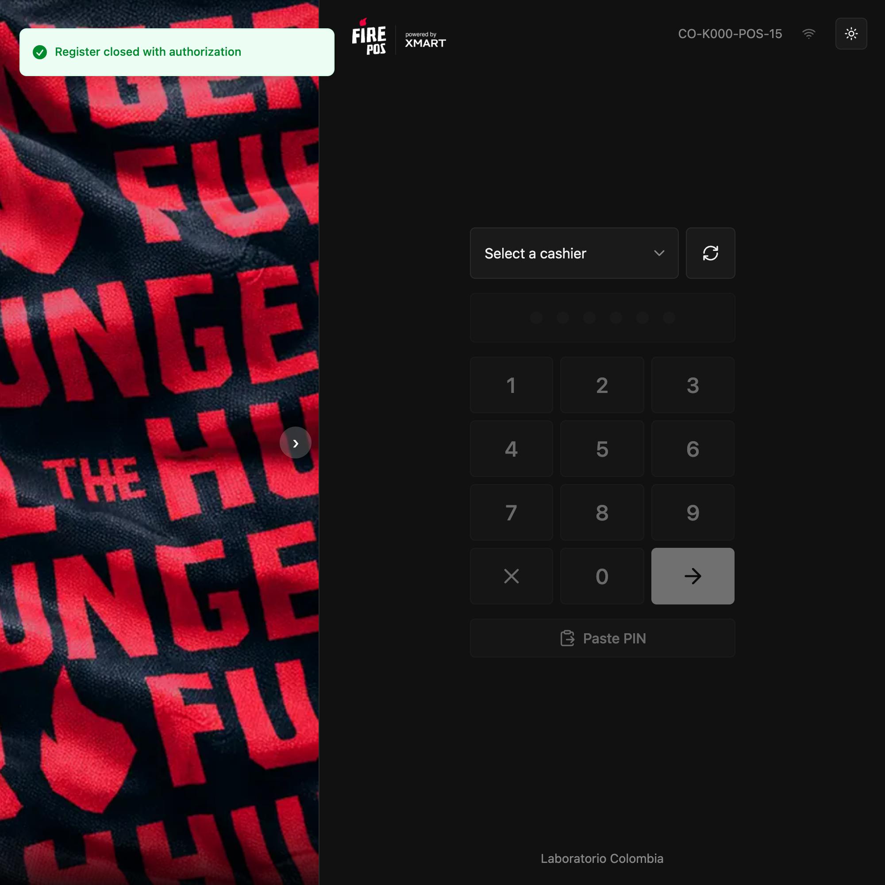
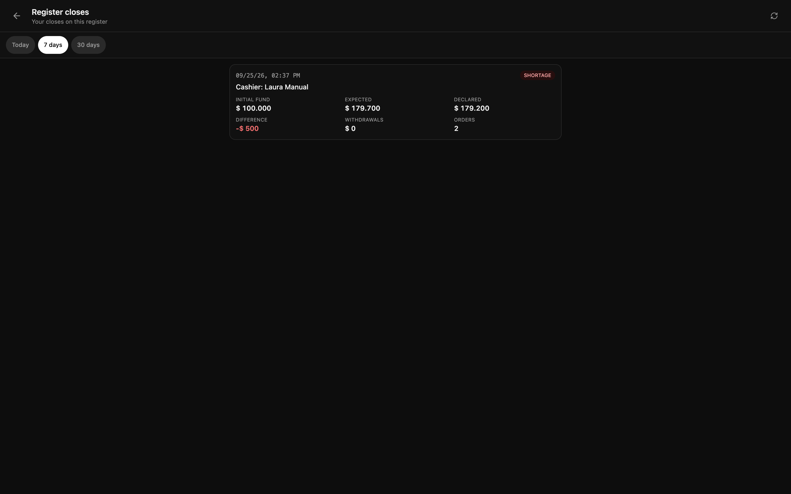

The close is the moment when the shift's cash is reconciled against sales. If the count is rushed, the shortage goes under the cashier's name; if the register is closed without counting, nobody knows how much there was. That is why the close is **blind**: the cashier counts and declares without seeing how much there should be, and the manager authorizes entering the close and any shortage.

<Note>
  **The minimum you need to know**

  - Closing the register requires a manager's code from **Access → Close register**.
  - The count is **blind**: the expected amount appears only after you tap **Declare**, and what you declared can no longer be changed in the close: a counting mistake is corrected afterwards, with [Correct a register close](#correct-a-register-close).
  - If there is a **shortage**, you need a second code, from **Close with shortage**, with the reason the manager chooses.
  - When the register closes, the cashier's shift ends and the POS goes back to the sign-in screen.
</Note>

## Prerequisites

- An open register, with the shift of the cashier who opened it.
- A manager to generate the codes. See [Authorization codes](/en/manuals/pos/authorization-codes).

## 1. Enter the code to close

Tap your name at the top right to open **Settings** and choose **Close register**. Ask the manager for a code from **Access → Close register**, type the 6 digits and tap **Continue**.

<Frame>
  
</Frame>

## 2. Count the cash

Count **all** the cash in the register: the initial fund you opened with plus what you took in. The screen does not show how much there should be.

<Frame>
  
</Frame>

Tap each bill and coin you count and the total adds up on its own. With **−** you remove one and with **Clear** you go back to zero. You can also type the total with the keypad, but then the close does not save the bill-by-bill count.

<Frame>
  
</Frame>

Before moving on, count again: what you declare stays in the close, and correcting it later takes a manager's code.

## 3. Declare

Tap **Declare**. Only now does the POS show the initial fund, cash sales, the **Expected total**, what **You declared** and the **Difference**. If there were withdrawals during the shift, the **Withdrawals** also appear, already deducted from the expected amount: see [Partial cash withdrawal](/en/manuals/pos/cash-withdrawal).

| Result | What you see | What you do |
|--------|--------------|-------------|
| Balanced | **The register balances** | Tap **Close register** |
| Overage | **Cash overage**. The overage is recorded as a positive balance for the company | Tap **Close register** |
| Shortage | **Difference detected** and the **Authorization code** field | Go on to step 4 |

## 4. If there is a shortage, enter the second code

With a shortage, the difference shows in red and the POS asks for another code.

<Frame>
  
</Frame>

The manager generates a **Close with shortage** code in the backoffice and chooses the reason, for example **Wrong change given**. See [Authorization codes](/en/manuals/pos/authorization-codes). Type the 6 digits and tap **Close register**.

<Frame>
  
</Frame>

## 5. The register is closed

The POS prints the close report, ends your shift and goes back to the sign-in screen with the **Register closed** or **Register closed with authorization** notice.

<Frame>
  
</Frame>

<Tip>
  If the POS went back to the sign-in screen, you are done. The next cashier signs in with their PIN and opens their own register.
</Tip>

---

## See your closes in the POS

In **Settings → Register closes** you have your closes on this register, with the expected amount, what was declared and the difference for each one. At the top you choose **Today**, **7 days** or **30 days**.

<Frame>
  
</Frame>

In the backoffice, the closes of every register in the store are in **Fire POS → Register closes**. See [Register closes](/en/manuals/pos/register-closes).

## Correct a register close

If after closing a bill turns up that you did not count, or you counted one bill as another, the close's shortage or overage is wrong. **Correct count** fixes the counted cash without reopening the register.

- **Who**: the cashier who did the close, on the same register, with a manager's code from **Access → Correct close**.
- **Until when**: while the store's operating day is still open. Once the day closes, the close stays as it is.
- **How many times**: as many as needed. Each correction needs a new code.

### 1. Open the correction

Sign in with your PIN on the register where you closed; you do not need to open the register. Tap your name at the top right, open **Settings → Register closes** and, on the close's card, tap **Correct count**.

### 2. Enter the code

In the **Correct close** window, type the 6 digits of the code from **Access → Correct close** and tap **Continue**. The code is used at that moment: from then on you have 1 hour to save the correction.

### 3. Count again and write the reason

In **Correct count** you see what was **Counted at close**. Count the cash of that close again with the bills and coins buttons, as in the close. In **Correction reason** write what happened, for example "a 50 bill was left in the bag", and tap **Save correction**.

If the correction leaves a shortage, you do not need a **Close with shortage** code: the **Correct close** code already authorizes it.

### 4. Check the result

The POS shows **Close corrected** with **Expected**, **Counted before**, **Counted now**, **Difference before** and **Difference now**, and prints the **CIERRE CORREGIDO** slip (**FECHAMENTO CORRIGIDO** in Brazil): the correction number, the date, the declared amount and the difference before and now, and the reason. **Reprint** prints another copy and **Done** closes the window.

In **Register closes** the close is marked **Corrected**, or **Corrected ×2** if it was corrected twice.

<Tip>
  If you see **Close corrected**, you are done. The register stays closed.
</Tip>

### What changes

The counted cash, with its bill-by-bill count, and the difference change. The expected amount is the same one the register was closed with. With the shortage example above:

| | At close | After the correction |
|---|---|---|
| Expected | $ 179.700 | $ 179.700 |
| Counted | $ 179.200 | $ 179.700 |
| Difference | −$ 500 | $ 0 |

The register's reconciliation is updated with the new count. Each correction is recorded with the before, the now, the reason and who authorized it: in the backoffice, **Fire POS → Register closes** marks the close **Corrected** and the detail shows the history. See [Register closes](/en/manuals/pos/register-closes#corrected-closes).

## Forced close

If the register is still open when the operating day ends, the POS makes you close it before going on: the window warns that the day is over and has no **Cancel**. The close is the same, with the manager's code.

If the cashier is not around and the register was left open, the manager can close it from the backoffice. See [Terminal administration](/en/manuals/pos/terminal-admin).

## Recipes

<AccordionGroup>
  <Accordion title="End-of-shift close with no difference">
    1. Open **Settings → Close register** and type the code from **Access → Close register**.
    2. Count with the bills and coins buttons.
    3. Tap **Declare**.
    4. When you see **The register balances**, tap **Close register**.
  </Accordion>

  <Accordion title="Close with a shortage">
    1. Declare what you counted.
    2. When you see **Difference detected**, tell the manager the amount.
    3. The manager generates a **Close with shortage** code with the reason.
    4. Type the code and tap **Close register**.
  </Accordion>

  <Accordion title="Money turned up after closing">
    1. The manager counts the cash of the close again with the cashier.
    2. They generate a code from **Access → Correct close**.
    3. The cashier signs in with their PIN on the same register and opens **Settings → Register closes**.
    4. They tap **Correct count** on that close and type the code.
    5. They enter the recount and the reason, and tap **Save correction**.
  </Accordion>
</AccordionGroup>

## Mistakes that cost money

<Warning>
  **Declaring without counting twice.** What you declare stays in the close: if you missed a bill in the count, the close comes out with a shortage even though the money is in the register, and correcting it takes a manager's code before the day closes. Count again before tapping **Declare**.
</Warning>

<Warning>
  **Giving the correction code without recounting.** When correcting, the cashier already knows the expected amount: they saw it when closing. If the manager gives the code without counting with them, the count can be adjusted to the number and cover up a real shortage.
</Warning>

<Warning>
  **Leaving the correction for the next day.** Once the operating day closes, the close can no longer be corrected and the shortage or overage stays as it is.
</Warning>

<Warning>
  **Counting without the initial fund.** The expected amount includes the initial fund the register was opened with. If you leave it out, the close comes out with a shortage equal to the initial fund.
</Warning>

<Warning>
  **Asking for another code after an error when closing.** If the POS says the register closed but something failed afterwards, the register is already closed. Do not ask for another code: tell the manager.
</Warning>

## Frequently asked questions

<AccordionGroup>
  <Accordion title="It says “Invalid or already used code”">
    The code was already used, expired, or is for another operation. To enter the close you need one from **Access → Close register**; for the shortage, one from **Close with shortage**.
  </Accordion>

  <Accordion title="I reloaded the page after declaring">
    The POS goes straight back to the result, with what you already declared. Continue from there.
  </Accordion>

  <Accordion title="It says “Register closed, but the report did not print”">
    The register is closed. Check the printer; the close is saved in **Settings → Register closes** and in the backoffice.
  </Accordion>

  <Accordion title="It says “Register closed, but the reconciliation failed to sync”">
    The register is closed. The POS sends the reconciliation again the next time a close is opened on that terminal. Check the internet connection.
  </Accordion>

  <Accordion title="Why does it ask me for a code if the register balances?">
    The **Access → Close register** code is for entering the close, whether it balances or not. The second code only appears with a shortage.
  </Accordion>

  <Accordion title="“Correct count” does not appear">
    It appears on your closes done in the POS while the operating day is still open. It does not appear if the day already closed, or if the register was not closed in the POS: it was closed from the backoffice or when the terminal was revoked. You cannot correct another cashier's close either: in **Register closes** each cashier sees only their own, on the register where they closed.
  </Accordion>

  <Accordion title="It says “The business day is closed: this close can no longer be corrected”">
    The store's operating day closed before you saved the correction. From that moment the close stays as it is.
  </Accordion>

  <Accordion title="It says “The code expired”">
    There are two time limits. The code has to be typed before it expires, 3 or 30 minutes after it was generated. After typing it, you have 1 hour to save the correction. Ask the manager for a new one from **Access → Correct close** and start again.
  </Accordion>

  <Accordion title="It says “The correction was saved, but the reconciliation was not updated”">
    The correction is done and the slip prints with the new values, but the register's reconciliation kept the previous count and is not retried on its own. Tell the manager.
  </Accordion>
</AccordionGroup>
