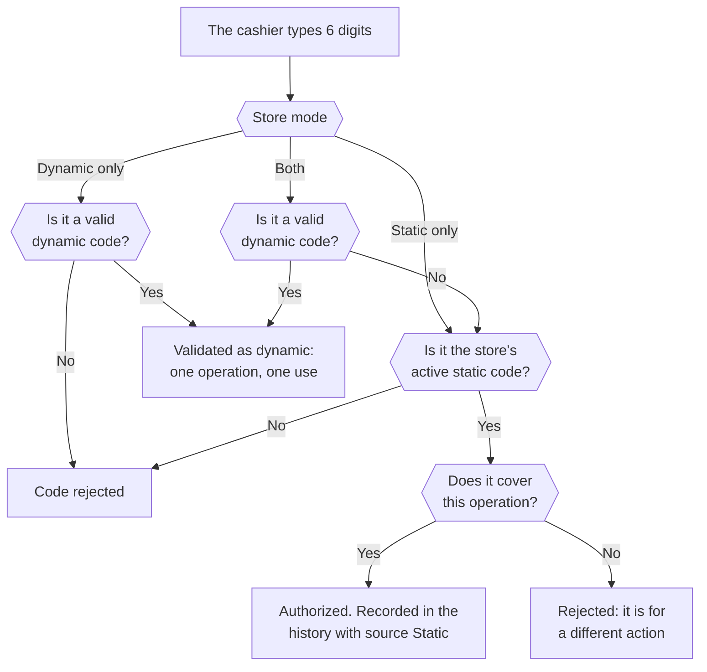
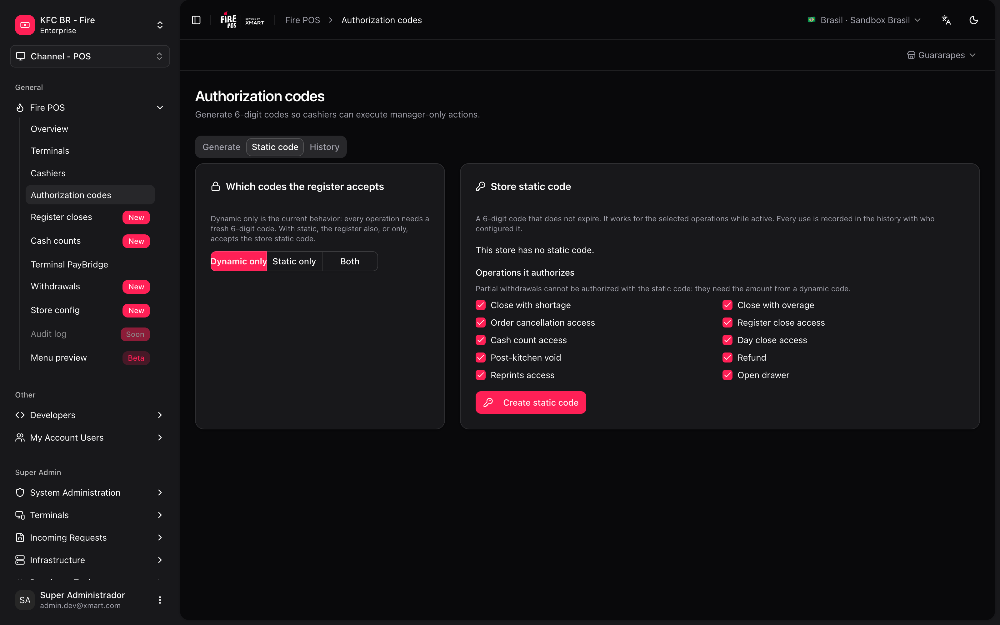
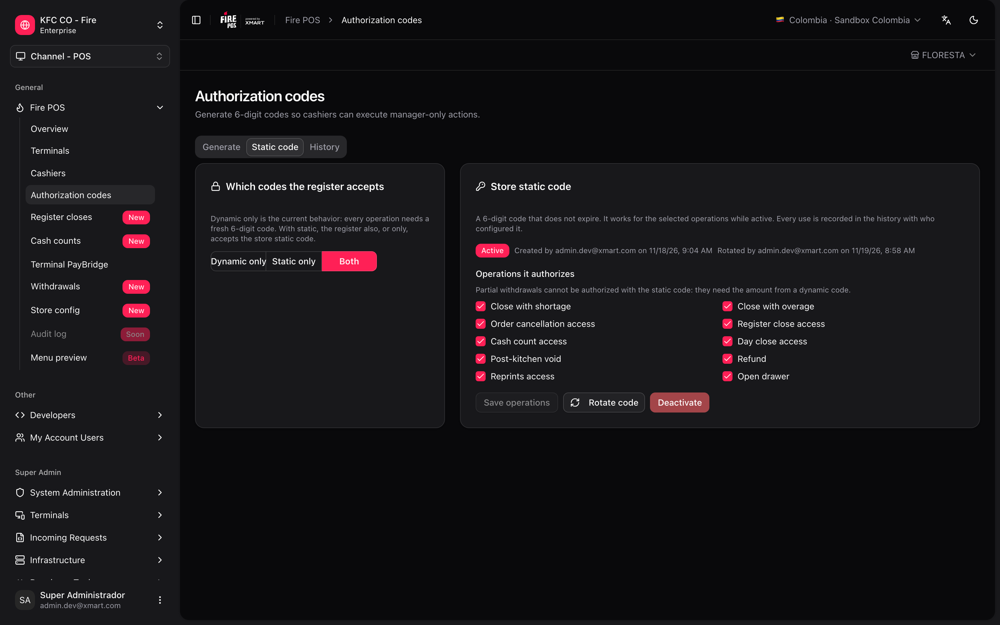
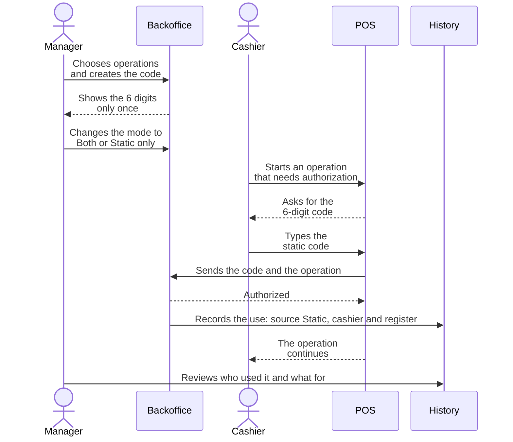
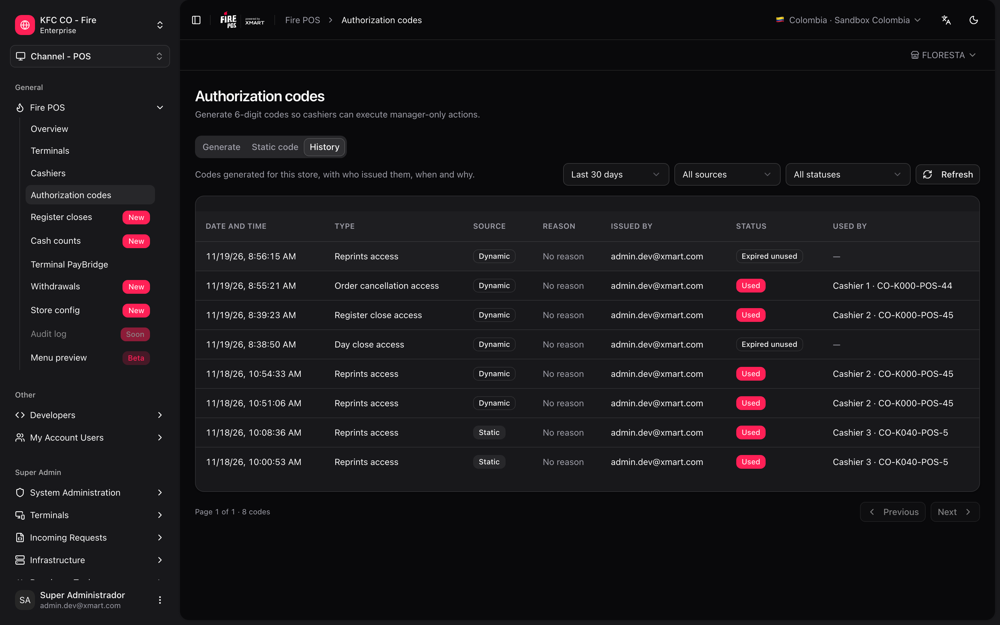

A dynamic code forces the manager to have the backoffice at hand every time the register asks for authorization. At peak time, with the manager in the kitchen or with no signal on the phone, the line stops for a cash count or a drawer that will not open. The **static code** solves that: the store has a single 6-digit code that does not expire and that the register accepts for the operations you choose. In exchange, security now depends on who knows that code, which is why every use is recorded in the history.

<Note>
  **The minimum you need to know**

  - Each store has **only one** static code. It does not expire and is not used up: it works while it is **Active**.
  - It is shown **only once**, when you create it or rotate it. If it is lost, you have to rotate it.
  - Nothing changes until you decide so: every store starts in **Dynamic only**. A **Partial withdrawal** always needs a dynamic code.
</Note>

## Prerequisites

- Access to the Fire backoffice at **[app.fire.rest](https://app.fire.rest)**, with permissions on the store.
- **Channel - POS** and the store selected in the header. The static code is set up store by store.
- Familiarity with dynamic codes. See [Authorization codes](/en/manuals/pos/authorization-codes).

## Static code or dynamic code

| | Dynamic code | Static code |
|---|---|---|
| **Does it expire?** | Yes: after 3 or 30 minutes | No. It works until you rotate or deactivate it |
| **Is it used up?** | Yes: it is used once | No. It works as many times as needed |
| **Who generates it?** | The manager, a new one for each operation | The manager, once per store |
| **Which operations does it work for?** | Only one, the one you choose when generating it | All the ones you check in the list, except partial withdrawals |
| **Where does it work?** | In the account where it was generated | Only on the registers of its store |
| **What is recorded?** | Who generated it, the reason and who used it | Who set up the code and who used it, on every use |

## The three store modes

The **Which codes the register accepts** card decides what the cashier types when the POS asks for authorization.

| Mode | What the register accepts | When it fits |
|------|---------------------------|--------------|
| **Dynamic only** | Only dynamic codes. It is the initial mode and the behavior you already know. | You want to approve each operation one by one. |
| **Both** | Both. It first tries the code as a dynamic one; if there is no valid one, it tries it as the static code. | You want the static code for everyday operations and dynamic codes for the rest, such as withdrawals. |
| **Static only** | Only the store static code. Dynamic codes are not accepted. | Stores where nobody generates dynamic codes. |

The **Both** and **Static only** modes require the store to have an **Active** static code. Without it, the backoffice answers "Create and activate a static code before choosing that mode."

<Warning>
  **In Static only there are no partial withdrawals.** A partial withdrawal needs a dynamic code, and in that mode the register does not accept them. If your store withdraws cash in the middle of the shift, use **Both**.
</Warning>

---

## 1. Open the Static code tab

In the side menu, open **Fire POS → Authorization codes** and choose the **Static code** tab. On the left is the **Which codes the register accepts** card; on the right, **Store static code**.

If you see "Choose a store to set up its static code.", select the store in the header.

<Frame>
  
</Frame>

## 2. Choose the operations it authorizes

In **Operations it authorizes** all of them come checked. Uncheck the ones you want to keep approving one by one with a dynamic code. At least one has to stay checked.

## 3. Create the code and write it down

Tap **Create static code**. A window opens with the 6 digits and the notice "Write it down now: it will not be shown again. If it is lost, rotate it."

Copy it or write it down before tapping **Close**. Fire does not store the code in readable form: after you close the window, nobody can see it again, not even support.

The card now shows the **Active** status, who created the code and when.

<Frame>
  
</Frame>

<Info>
  Creating the code changes nothing on the register. While the store stays in **Dynamic only**, the POS does not accept it.
</Info>

## 4. Change the store mode

In **Which codes the register accepts**, choose **Both** or **Static only**. The change is saved when you tap the option and applies from the next authorization: there is no need to restart or update the POS.

<Tip>
  If the code is **Active** and the store is in **Both** or **Static only**, you are done. The register already accepts the static code.
</Tip>

---

## Keep the code up to date

### Change the operations

Check or uncheck the boxes and tap **Save operations**. The button is enabled only when there are changes. The code stays the same.

### Rotate the code

Tap **Rotate code** and confirm. The window opens with the new code, again only once. The previous code stops working immediately; previous uses stay in the history. The card shows who rotated it and when.

### Deactivate and reactivate

Tap **Deactivate** and confirm. The status changes to **Deactivated** and the register stops accepting it. To use it again, tap **Activate**: it is the same code as before, and it is not shown again.

<Warning>
  **Deactivating the code while the store is in Static only leaves the register with no working codes.** No operation that needs authorization can be done until you activate it again or change the mode. Change the mode to **Dynamic only** first.
</Warning>

---

## Which operations it covers

| Checkbox | What it authorizes on the POS |
|----------|-------------------------------|
| **Close with shortage** | Confirming a register close where the count is lower than expected |
| **Close with overage** | Confirming a register close where the count is higher than expected |
| **Order cancellation access** | Entering the cancellation panel |
| **Register close access** | Entering the close and counting the register |
| **Cash count access** | Doing a cash count |
| **Day close access** | Printing the day close |
| **Post-kitchen void** | Voiding an order that was already sent to the kitchen |
| **Refund** | Making a refund |
| **Reprints access** | Entering the reprints list |
| **Open drawer** | Opening the drawer outside a sale |

**Partial withdrawals are not in the list.** A withdrawal code carries the register and the amount the manager authorized, and a static code cannot carry a different amount on each use. That is why a withdrawal always needs a dynamic code. See [Partial cash withdrawal](/en/manuals/pos/cash-withdrawal).

## On the POS: how the cashier uses it

The POS did not change. The screens that ask for authorization are the same, and the static code is typed just like a dynamic one: 6 digits on the same keypad.

1. The cashier starts the operation, for example **Settings → Cash count**.
2. The POS asks for the authorization code.
3. Whoever knows the static code types the 6 digits.
4. The operation continues. The code keeps working for the next time.

A register close with a shortage still asks for authorization twice: when entering the close and when approving the shortage. With the static code you type the same code both times, if it covers both operations.

## Review the history

Every use of the static code leaves a row in the **History** tab, next to the dynamic codes. The **Source** column says **Dynamic** or **Static**, and the **Source** filter lets you see only one of the two.

<Frame>
  
</Frame>

A row with source **Static** shows:

| Column | What it shows |
|--------|---------------|
| **Date and time** | When the code was used |
| **Type** | The operation it authorized |
| **Reason** | **No reason**. The static code carries no reason |
| **Source** | **Static** |
| **Issued by** | Who set up the code: whoever created it or last rotated it |
| **Status** | **Used** |
| **Used by** | The cashier and the register where it was typed |

Rotating or deactivating the code deletes nothing: the rows of previous uses stay in the history.

## Recipes

<AccordionGroup>
  <Accordion title="Use the static code for cash counts and the drawer, and dynamic codes for the rest">
    1. Open **Fire POS → Authorization codes → Static code**.
    2. Leave only **Cash count access** and **Open drawer** checked.
    3. Tap **Create static code** and write it down.
    4. Change the mode to **Both**.
    5. For closes, cancellations and withdrawals, keep generating dynamic codes in the **Generate** tab.
  </Accordion>

  <Accordion title="Someone who knew the code left the team">
    1. Open the store's **Static code** tab.
    2. Tap **Rotate code** and confirm.
    3. Write down the new code and give it only to those who should have it.
    4. In **History**, filter by source **Static** and review the uses of the last few days.
  </Accordion>

  <Accordion title="Stop using the static code in a store">
    1. In **Which codes the register accepts**, choose **Dynamic only**.
    2. In **Store static code**, tap **Deactivate** and confirm.
    3. The history of uses is kept.
  </Accordion>

  <Accordion title="The code was lost and nobody remembers it">
    1. Tap **Rotate code** and confirm.
    2. Write down the new code before closing the window.
    3. The mode and the checked operations do not change.
  </Accordion>

  <Accordion title="Audit what the code was used for this week">
    1. Open the **History** tab and choose the period.
    2. In the sources filter, choose **Static**.
    3. Review **Type** and **Used by**: which operation, which cashier and on which register.
  </Accordion>
</AccordionGroup>

## Security best practices

- **Rotate it when staff leave** who knew it, and whenever you suspect it leaked.
- **Do not share it over chat** or leave it written down near the register. Hand it over in person.
- **Limit who knows it.** The code replaces the manager's approval: whoever has it can authorize on their own.
- **Check only the operations you need.** The ones that move the most money can stay on dynamic codes.
- **Deactivate it if it is not used**, after switching the store to **Dynamic only**.
- **Review the history** by source **Static** regularly.

## Mistakes that cost money

<Warning>
  **Giving the static code to every cashier.** If the cashier doing the operation is the same person authorizing it, there is no longer a second person approving. A shortage can be closed or a drawer opened without anyone else knowing until the history is reviewed.
</Warning>

<Warning>
  **Leaving Close with shortage checked out of habit.** With a dynamic code you choose the discrepancy reason every time. With the static code, the history row has no reason. If you want every shortage to carry its reason, uncheck that box.
</Warning>

<Warning>
  **Closing the window without writing the code down.** It is not shown again. You have to rotate it, and the code someone already had stops working.
</Warning>

<Warning>
  **Not rotating it when the team changes.** The code does not expire on its own. Whoever learned it six months ago still has it until you rotate it.
</Warning>

## Glossary

| Term | What it means |
|------|---------------|
| **Dynamic code** | A 6-digit code the manager generates for one operation. It expires and is used once. |
| **Static code** | The store's 6-digit code. It does not expire and is not used up. |
| **Mode** | Which codes a store's register accepts: **Dynamic only**, **Static only** or **Both**. |
| **Rotate** | Replacing the static code with a new one. The previous one stops working immediately. |
| **Deactivate** | Making the register stop accepting the static code without replacing it. It can be activated again. |
| **Source** | History column that says whether a row comes from a **Dynamic** code or from the **Static** one. |

## Frequently asked questions

<AccordionGroup>
  <Accordion title='The POS says "Code not found. Check the 6 digits."'>
    The register did not recognize the code. Check, in this order: that the digits were typed correctly, that the code is **Active**, that the store is in **Both** or **Static only**, and that the register belongs to the code's store. If someone rotated it, the previous one no longer works.
  </Accordion>

  <Accordion title='The POS says "That code is for a different action"'>
    The static code does not cover that operation. Check the box in **Operations it authorizes** and tap **Save operations**, or generate a dynamic code for that operation.
  </Accordion>

  <Accordion title='The backoffice says "Create and activate a static code before choosing that mode."'>
    You chose **Both** or **Static only** and the store has no **Active** static code. Create it, or tap **Activate** if it is **Deactivated**, and choose the mode again.
  </Accordion>

  <Accordion title="Can I see the code again?">
    No. It is shown only when you create it or rotate it. If it was lost, rotate it.
  </Accordion>

  <Accordion title="Can I have a different static code for each operation?">
    No. There is one code per store, with the list of operations it covers.
  </Accordion>

  <Accordion title="Why does a partial withdrawal not accept the static code?">
    Because the withdrawal code carries the register and the authorized amount. Generate a **Partial withdrawal** dynamic code; the store has to be in **Both** or **Dynamic only**.
  </Accordion>

  <Accordion title="In Both mode, do dynamic codes still work?">
    Yes. The register tries the dynamic code first. If there is no valid one with those digits, it tries the static code.
  </Accordion>

  <Accordion title="What happens to the history if I rotate or deactivate the code?">
    It is kept. Previous uses stay in the **History** tab with source **Static**.
  </Accordion>

  <Accordion title="Does one store's static code work in another store?">
    No. Each store has its own and only its registers accept it.
  </Accordion>

  <Accordion title="Do I need to update the POS?">
    No. The cashier uses the same screens as always.
  </Accordion>
</AccordionGroup>

## What it does not do

- It does not authorize **partial withdrawals**.
- There is no static code per cashier or per operation: it is one per store.
- It does not expire or rotate on its own: you rotate it.
- You cannot choose the code: Fire generates the 6 digits.
