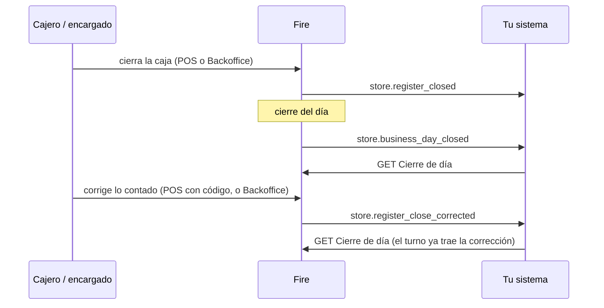

Una caja de Fire POS pasa por dos momentos que te interesan como integrador: **se cierra**, y a veces **se corrige** lo contado en ese cierre. Esta página explica el ciclo y dónde ves cada paso. El detalle de los campos está en las páginas de [`store.register_closed`](/es/events/store-register-closed), [`store.register_close_corrected`](/es/events/store-register-close-corrected) y [Cierre de día](/es/api-reference/business-day-close).

## 1. Cerrar la caja

Hay dos formas de cerrar una caja:

- **El cajero, desde el POS.** Cuenta el cajón y declara lo contado. Según cómo esté configurada la tienda, puede necesitar un **código del encargado para entrar a cerrar**: el evento lo informa en `closeAuthorization`. Si el cierre deja un faltante que requiere autorización, el código que lo aprobó viaja en `cash.authorization`.
- **Un encargado, desde el Backoffice**, cerrando la caja a mano. No usa código: `closeAuthorization` y `cash.authorization` vienen en `null`, y `closedBy.type` es `admin`.

Cada cierre emite **un** [`store.register_closed`](/es/events/store-register-closed) con el cuadre completo. Los cierres forzados —cuando se revoca o se borra una terminal con la caja abierta— no lo emiten, porque nadie contó el cajón.

Las autorizaciones nunca traen el código: traen su id (`tokenId`), su tipo (`one_time` o `static`), quién lo generó (`approvedBy`) y cuándo se usó (`approvedAt`). Ver [Autorizaciones](/es/events/store-register-closed#autorizaciones).

## 2. Cerrar el día

Al cerrar el día de negocio, Fire guarda una foto del día: los cobros y el cuadre de caja de cada turno que ya estaba reportado. [Cierre de día](/es/api-reference/business-day-close) lee **solo esa foto**. Por eso:

- Un turno reportado **después** del cierre del día no aparece en la API. Lo recibes en `store.register_closed`, con `postClose: true`.
- La foto no se recalcula desde las órdenes: lo que el cierre no guardó no aparece después.

## 3. Corregir lo contado

Si el cajero contó mal —por ejemplo, tomó billetes de 10 como de 1—, el cierre se corrige **sin reabrir la caja**. Una corrección cambia solo **lo contado** (`declaredCash`) y, con eso, la diferencia (`discrepancy`, `discrepancyType`). Lo esperado (`systemCash`), las ventas, los retiros y el vuelto fuera de caja quedan como los dejó el cierre.

Hay dos vías:

| | Desde el POS | Desde el Backoffice |
|---|---|---|
| Quién | El mismo cajero que cerró la caja | Un usuario con el permiso **Corregir cierre de caja** y la tienda a su alcance |
| Cómo se autoriza | Con un **código del encargado** de tipo **Corregir cierre**, que se pide al entrar a la corrección. Si la corrección deja un faltante, ese mismo código lo cubre | Sin código: responde el usuario. Si deja un faltante, tiene que elegir el motivo |
| Qué cierres | Los cerrados por el cajero desde el POS | Los cerrados desde el POS y los cerrados a mano desde el Backoffice |
| Plazo desde el cierre | 24 horas por defecto (de 0 a 168; 0 lo deshabilita) | 7 días por defecto (de 0 a 90; 0 lo deshabilita) |
| Tope por cierre | 3 correcciones por defecto (de 1 a 10), contando las de las dos vías | Sin tope: es la salida cuando el cajero agotó sus intentos |
| En el evento | `correction.correctedBy.type: "cashier"`, `correction.authorization` con el código | `correction.correctedBy.type: "admin"`, `correction.authorization: null` |

El código de corrección sirve, por defecto, durante 60 minutos después de usarlo (de 5 a 240), para que alcance el recuento. Los plazos, el tope y la vigencia del código se configuran por tienda en Fire POS.

Las dos vías funcionan **también con el día ya cerrado**. En ese caso la corrección queda con `correction.afterDayClose: true` y Fire actualiza el cuadre de caja de ese día en la foto: el turno corregido, y los conteos y montos de faltantes y sobrantes del día. Las ventas y los cobros del día no cambian, y `store.business_day_closed` **no** se vuelve a emitir.

Cada corrección emite un [`store.register_close_corrected`](/es/events/store-register-close-corrected).

## Cómo se ve en los eventos

| | `store.register_closed` | `store.register_close_corrected` |
|---|---|---|
| Cuándo | Al cerrar la caja | Cada vez que se corrige lo contado |
| Cuántas veces | Una por caja | Cero o más por caja |
| Llave de idempotencia | `data.registerSessionId` | `data.correction.id` |
| `cash` | Lo contado al cerrar | El cuadre vigente, ya corregido |
| Lo que reemplazó | — | `correction.previous` |
| Orden | — | `correction.sequence` (1, 2, 3…) dentro del mismo `registerSessionId` |

Los dos eventos comparten `registerSessionId`: así juntas un cierre con sus correcciones. El cuadre vigente de una caja es el de la corrección con el `sequence` más alto que recibiste o, si no hubo correcciones, el del cierre. El orden de llegada no está garantizado: ordena por `sequence`, no por hora de llegada.

## Cómo se ve en la API de Cierre de día

Cada turno de `cash.shifts[]` trae:

- **Lo contado vigente.** `declaredCash`, `discrepancy` y `discrepancyType` ya son los corregidos, y `notes` dice `Corrección N: <motivo>`.
- **`corrections[]`**, de la primera a la última, con el mismo `id` que `correction.id` del evento, lo contado antes y después, si se hizo desde el POS o el Backoffice y si fue con el día cerrado. `[]` si el turno no se corrigió.
- **`closeAuthorization`**, el mismo código con que el cajero entró a cerrar que trae el evento.

Una corrección hecha antes del cierre del día ya entra en la foto del día. Una hecha después la actualiza. Ver el ejemplo en [Un turno corregido](/es/api-reference/business-day-close#un-turno-corregido).

## Relacionados

<CardGroup cols={3}>
  <Card title="store.register_closed" icon="cash-register" href="/es/events/store-register-closed">
    El cierre de una caja, con el cuadre completo.
  </Card>
  <Card title="store.register_close_corrected" icon="pen-to-square" href="/es/events/store-register-close-corrected">
    Cada corrección de lo contado.
  </Card>
  <Card title="Cierre de día" icon="calendar-check" href="/es/api-reference/business-day-close">
    El cuadre de cada turno tal como quedó en el día.
  </Card>
</CardGroup>
