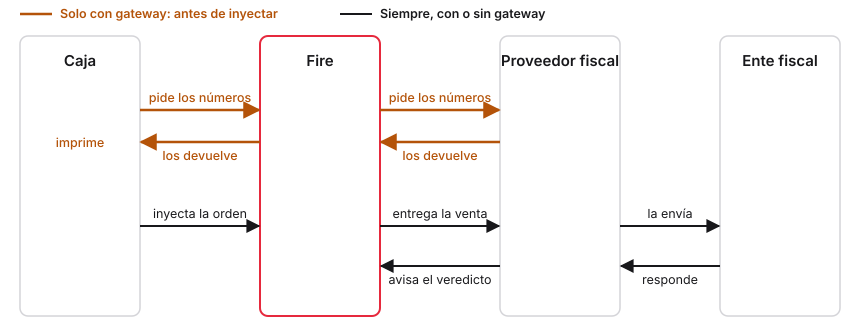
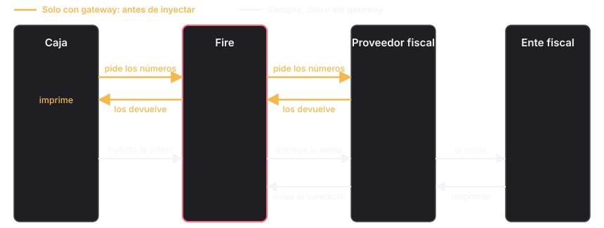

Fire no le habla al ente fiscal. Quien emite y obtiene el veredicto es tu **proveedor fiscal**: Fire le entrega la venta, recibe el resultado y lo publica en la orden y en los eventos.

Hay dos formas de integrarlo, y se diferencian en una sola cosa: **si la caja necesita los números fiscales antes de inyectar la orden.**

La caja solo le habla a Fire, y Fire al proveedor. De la inyección en adelante, los dos caminos son iguales.

## Sin gateway: la integración base

La caja cobra e inyecta la orden. No necesita saber nada fiscal.

Fire le entrega la venta al proveedor con un [Integration Flow](/es/events/integration-flows), y el proveedor reporta el resultado con el [callback fiscal](/es/api-reference/fiscal-callback), repitiendo el `event.id` del evento que recibió.

Al cobrar, la caja no tiene números fiscales y `data.fiscalRepresentation` viaja en `null`.

**El proveedor implementa:** un endpoint que recibe el evento y el envío del callback fiscal.

## Con gateway: lo mismo, más un paso antes

Cuando el comprobante tiene que salir impreso con sus identificadores en el momento de la venta, la caja le pide los números a Fire y Fire se los pide al proveedor. La caja los imprime y después inyecta la orden con el mismo `orderCode`. Si la orden ya estaba abierta porque se cobra después, la caja numera al cobrar. La caja nunca habla con el proveedor.

<Warning>
  **Numerado no es autorizado.** Los números impresos dicen qué se imprimió. El veredicto del ente llega después, por el mismo callback del camino sin gateway.
</Warning>

**El proveedor implementa además:** el [endpoint síncrono de numeración](/es/fiscal-providers/contract), por país. Hoy Fire lo soporta en Ecuador, Colombia y Argentina, y se activa por vendor: en un mismo país puede haber vendors con y sin gateway.

## Online y offline

El recorrido es el mismo. Cambia el modo que informa el proveedor en `authorizationMode`:

| | Online | Offline (contingencia) |
|---|---|---|
| **El ente responde** | Normalmente en segundos o minutos | Más tarde, incluso horas, cuando vuelve la conexión |
| **El comprobante** | Se imprime normal | Es válido y puede llevar leyenda: `printing.reason` es `ISSUED_OFFLINE` |
| **Caja → Fire → proveedor** | Igual | Igual |
| **Cómo vuelve el veredicto** | Callback fiscal | Callback fiscal |

## Qué cambia y qué no

| | Sin gateway | Con gateway |
|---|---|---|
| **La caja llama a numeración** | No hace falta. Si llama, recibe `NOT_APPLICABLE` y sigue | Sí, antes de inyectar |
| **Números disponibles al cobrar** | No | Sí |
| **La caja depende del proveedor** | No | Sí. Si falla, decide la política de la cuenta: `CONTINUE` o `REFUND` |
| **`fiscalRepresentation`** | `null` | Con el bloque de numeración |
| **Cómo recibe la venta el proveedor** | Integration Flow | Integration Flow |
| **Cómo vuelve el veredicto** | Callback fiscal | Callback fiscal |
| **`data.fiscal.authority` y eventos** | Misma forma | Misma forma |

## Anulación

Tampoco cambia de fondo. La orden se cancela en Fire, sale `order.cancelled`, un flow se lo entrega al proveedor y este confirma con un callback `cancelled`, con su propio `eventId`. Eso produce `order.reversed`.

Con gateway, la caja además pide los números del documento de anulación con `operation: "CANCEL"`.

## Los dos bloques de la orden

Un documento fiscal puede dejar dos bloques en la orden, y cada uno responde una pregunta distinta. La mayor parte de la confusión viene de mezclarlos.

| | `data.fiscalRepresentation` | `data.fiscal.authority` |
|---|---|---|
| **Pregunta que responde** | *¿Qué se imprimió?* | *¿Qué decidió el ente?* |
| **Cuándo aparece** | Solo con gateway, cuando la caja numeró | En los dos caminos, cuando llega el callback |
| **Cómo llega a Fire** | Petición de [numeración fiscal](/es/api-reference/fiscal-documents-v2) | [Callback fiscal](/es/api-reference/fiscal-callback) |
| **¿Cambia después?** | Solo cuando se numera un documento nuevo (una nota de crédito) | Sí: autorizado, luego cancelado |

<Warning>
  **`fiscalRepresentation` nunca dice que el documento fue autorizado.** Guarda los números impresos en la caja. El veredicto del ente es `fiscal.authority`, y el estado actual es `fiscal.status` en los eventos fiscales y `lastKnown.fiscal.status` en todos los demás. Los tres pueden discrepar legítimamente durante un tiempo.
</Warning>

Lo que pasa entre el callback y los eventos — qué evento sale para cada resultado y cómo viaja cada campo — está en [Del callback a los eventos](/es/fiscal/callback-to-events).

## Cuatro palabras para "estado"

El mismo hecho se nombra distinto según dónde lo leas. No son intercambiables:

| Dónde | Campo | Valores | Describe |
|---|---|---|---|
| Respuesta de numeración fiscal | `numberingStatus` | `GENERATED`, `PENDING`, `FAILED_RETRYABLE`, `FAILED_FINAL`, `NOT_APPLICABLE`, `BLOCKED_BY_POLICY` | Si la **numeración** funcionó |
| Respuesta de numeración fiscal | `documentStatus` | `PENDING`, `AUTHORIZED`, `REJECTED`, `CANCELLED` | El documento, según lo último que supo el gateway |
| Callback fiscal (lo envías tú) | `eventType` | `fiscal_graphic`, `authorized`, `cancelled`, `rejected`, `denied`, `error` | Lo que acaba de pasar en el ente |
| Eventos fiscales (`order.invoiced`, `order.cancelled`, `order.reversed`) | `fiscal.status` | `awaiting_payment`, `not_issued`, `pending`, `processing`, `fiscal_graphic`, `authorized`, `cancelling`, `cancelled`, `rejected`, `denied`, `error` | El estado fiscal de la orden guardado con el documento |
| Todos los demás eventos de orden | `lastKnown.fiscal.status` | `pending`, `processing`, `fiscal_graphic`, `authorized`, `cancelling`, `cancelled`, `rejected`, `denied`, `error` | El estado fiscal **actual** de la orden |

## Adónde seguir

<CardGroup cols={2}>
  <Card title="Del callback a los eventos" icon="arrow-right-arrow-left" href="/es/fiscal/callback-to-events">
    Qué evento sale para cada callback y dónde cae cada campo.
  </Card>
  <Card title="Callback fiscal" icon="arrow-right-to-bracket" href="/es/api-reference/fiscal-callback">
    El contrato que envía tu proveedor.
  </Card>
  <Card title="Numeración desde la caja" icon="cash-register" href="/es/guides/fiscal-integration">
    El paso del gateway, para puntos de venta y kioscos.
  </Card>
  <Card title="Convertirse en proveedor fiscal" icon="plug" href="/es/fiscal-providers/overview">
    Lo que implementa un proveedor en cada camino.
  </Card>
</CardGroup>
