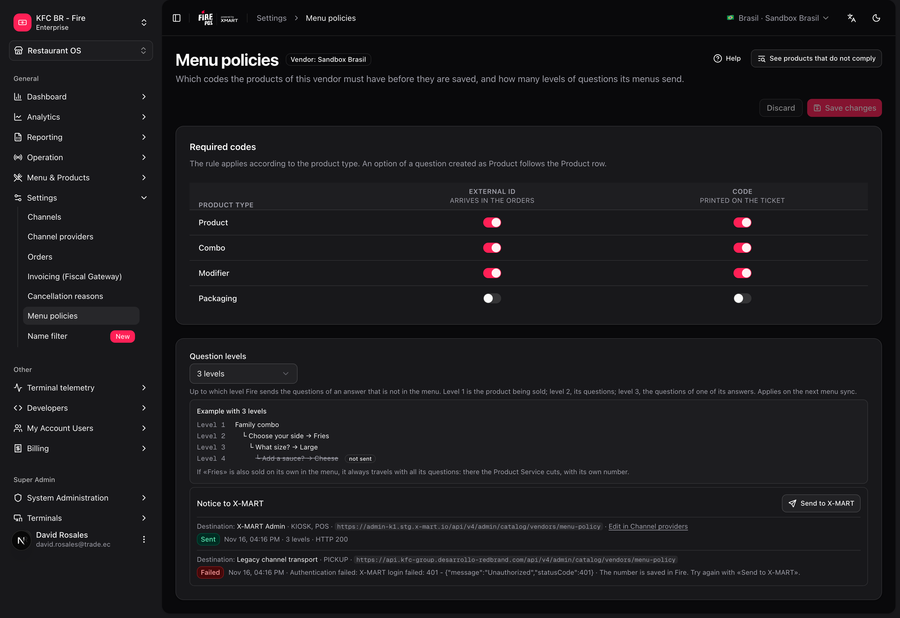
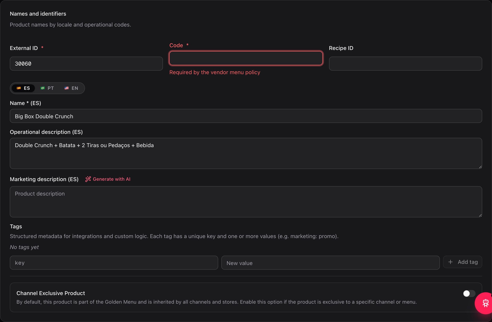
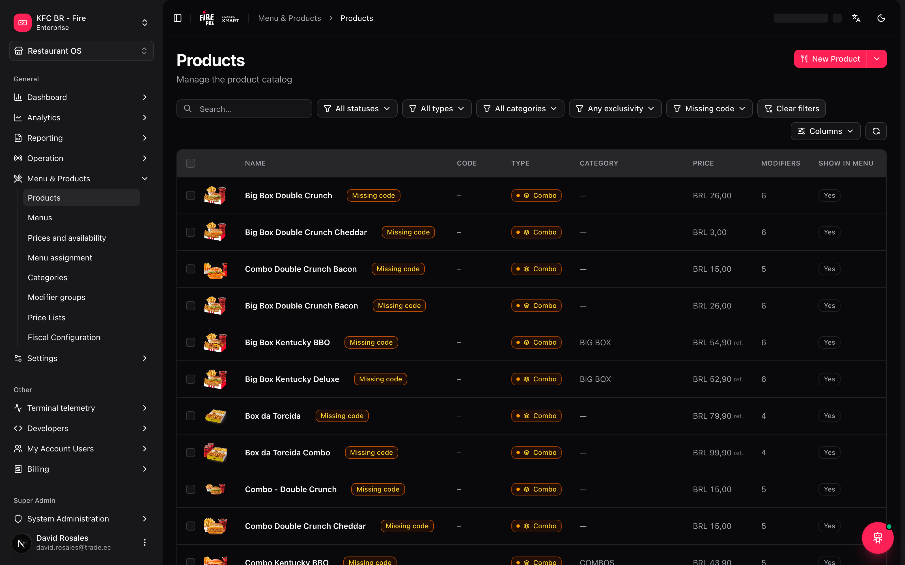
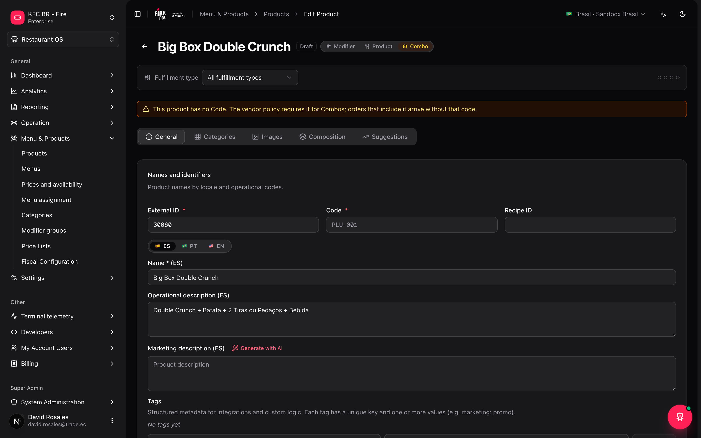
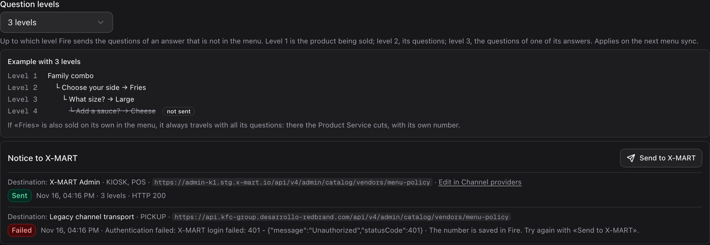
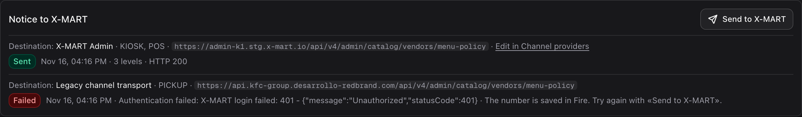

{/* Hueco anotado: el menú Settings de Restaurant OS también tiene Channels, Channel providers, Orders, Invoicing (Fiscal Gateway) y Cancellation reasons. Ninguna tiene manual todavía. Esta página documenta solo Menu policies. */}

Un producto viaja a X-MART con su **External ID**, y ese es el código con el que sus órdenes vuelven identificadas. Un producto que no lo tiene se vende igual — y sus órdenes llegan sin ese código, así que nadie, aguas abajo, puede asociar la línea a nada. Se descubre semanas después, cuando alguien concilia y los números no cuadran.

Esta pantalla existe para que la cuenta pueda decir **"ningún producto de este tipo sale sin su código"**, y para que Fire lo haga cumplir en los momentos en que puede.

También decide otra cosa: **cuántos niveles de preguntas** envían los menús de la marca. Una respuesta puede ser un producto con preguntas propias —un sándwich dentro de un combo que pregunta qué salsa— y este número dice hasta dónde las sigue Fire. Ve a **Restaurant OS → Settings → Menu policies**.

<Frame>
  
</Frame>

---

## Lo mínimo que hay que saber

<Note>
**1. Viene apagada.** Mientras nadie la configure, nada cambia: ningún producto está obligado a tener un código y ninguno se marca.

**2. Es una matriz, y es por vendor.** Las filas son los tipos de producto —**Product**, **Combo**, **Modifier**, **Packaging**— y las columnas son los dos códigos, **External ID** y **Code**. Cada casilla es un interruptor: encendido, el código es obligatorio para ese tipo; apagado, no lo es.

**3. Bloquea lo nuevo y marca lo que ya existe.** Crear un producto o guardar su ficha sin un código obligatorio se rechaza. Los productos que ya no tenían el código **no** se bloquean: siguen vendiéndose y publicándose, y reciben un chip **Missing code** para que los corrijas.

**4. Los niveles de preguntas vienen en 2, y con 2 no cambia nada.** Subirlo hace que Fire envíe las preguntas de las respuestas que no están en el menú. Se aplica en la **próxima sincronización del menú**, y X-MART tiene que recibir el número nuevo **antes** de esa sincronización. Mira [Niveles de preguntas](#niveles-de-preguntas).
</Note>

---

## La pantalla

Arriba, junto al título, la insignia **Vendor** te dice qué vendor estás configurando — aquí, *Sandbox Brasil*. Es el vendor elegido en el selector de la parte superior del backoffice, y la política pertenece solo a ese vendor. La descripción dice *"Qué códigos deben tener los productos de este vendor para poder guardarlos, y cuántos niveles de preguntas envían sus menús."* A la derecha, **Help** abre un panel lateral que explica la pantalla, y **See products that do not comply** abre el listado de productos ya filtrado. Ese botón solo aparece cuando la política que **guardaste** exige algún código.

La tarjeta **Required codes** contiene la matriz. Su nota dice: *"La regla se aplica según el tipo del producto. Una opción de una pregunta creada como Producto sigue la fila Producto."*

| Columna | Qué es |
| --- | --- |
| **External ID** — *Llega en las órdenes* | El código con el que el producto viaja a X-MART y con el que las órdenes vuelven identificadas |
| **Code** — *Se imprime en el ticket* | El código operativo del punto de venta (PLU). Es el que se imprime |

Cambias los interruptores y luego confirmas con **Save changes**. **Discard** descarta lo que cambiaste. Al guardar, Fire confirma con un mensaje genérico; si no puede, muestra el mensaje del servidor tal como llega, en inglés.

<Note>
Para ver **Menu policies** tu rol necesita acceso a la pantalla — si tu rol está configurado con submenús explícitos, un administrador tiene que concedérselo. Sin acceso, el ítem no aparece en el menú y, si abres la dirección, te lleva a *acceso denegado*. Para **guardar** no basta el acceso: también necesitas permiso sobre **todo el vendor**. Quien está limitado a una tienda puede ver la política, pero no cambiarla. Lo mismo vale para el bloque **Notice to X-MART**: verlo y tocar **Send to X-MART** exige el mismo permiso de la página y alcance sobre **toda la marca**; con solo algunas tiendas no puedes ver el bloque ni enviar el aviso.
</Note>

<Warning>
**Cambiar la política no cambia nada en los productos.** No completa códigos ni saca ningún producto de la venta. Solo cambia lo que Fire bloquea de ahora en adelante y qué productos muestran **Missing code**. Los niveles de preguntas, en cambio, cambian el menú solo cuando se vuelve a sincronizar.
</Warning>

---

## El camino simple

Casi todas las cuentas necesitan una sola columna: **External ID**, para los tipos que venden.

1. Abre **Restaurant OS → Settings → Menu policies** y revisa la insignia **Vendor**.
2. En la columna **External ID**, enciende **Product**. Haz lo mismo con **Combo** y **Modifier** si también viajan en las órdenes.
3. Toca **Save changes**.
4. Toca **See products that do not comply** y recorre el listado.

<Tip>
Si tu único objetivo es que ningún producto llegue a X-MART sin su identificador, con esto ya terminaste. **Code** es otro tema — mira abajo.
</Tip>

---

## Los dos códigos no son lo mismo

| | **External ID** | **Code** |
| --- | --- | --- |
| Para qué sirve | Es el código con el que el producto **viaja a X-MART**, y con el que las órdenes vuelven identificadas | El código operativo del punto de venta (PLU). **Es el que imprime el ticket** |
| Qué pasa si falta | Las órdenes llegan sin ese código | El ticket imprime en su lugar el External ID, si el producto lo tiene |
| Dónde lo escribes | Pestaña **General** del producto | Pestaña **General** del producto. En el diálogo **Add option** de un grupo de modificadores se llama **PLU** |

<Warning>
**En la planilla, la columna código es el External ID, y la columna plu es el Code.** En la ficha del producto los nombres son **External ID** y **Code**. Es una confusión real: mira [Importar y exportar](/es/manuals/backoffice/data-transfers).
</Warning>

---

## Qué hace la política y qué no

### Qué campo lleva el asterisco

Sin política, **External ID** y **Code** no llevan asterisco. Con una, un campo lleva asterisco solo si el vendor exige ese código **para ese tipo de producto**. En la captura de la [ficha del producto](/es/manuals/backoffice/products#los-códigos-y-la-política-de-menú), un *Product* muestra los dos asteriscos porque, en ese entorno, la política exige ambos códigos para **Product**. Con un **Fulfillment type** seleccionado en la ficha, los códigos se heredan y están bloqueados, así que no muestran asterisco.

### Qué bloquea

Fire rechaza en estos casos, y solo cuando el tipo del producto exige un código que no tiene:

| Cuándo | Qué pasa |
| --- | --- |
| **Crear un producto** | El producto no se crea hasta que lleve los códigos que su tipo exige. |
| **Crear una opción** desde **Add option** en un grupo de modificadores | Lo mismo: la opción es un producto nuevo, nace como **Product** y sigue la fila **Product**. |
| **Guardar la pestaña General** | El guardado se rechaza. El error aparece en el campo vacío. |
| **Guardar la ficha con un cambio de tipo pendiente** | La exigencia del tipo **nuevo** se revisa en el siguiente guardado, **en cualquier pestaña**: incluso Pricing o Categories pueden rechazarse hasta que completes el código. |

Un código hecho solo de espacios cuenta como vacío. Fuera de eso, las pestañas —precios, categorías, imágenes, grupos de modificadores, sugerencias y disponibilidad— guardan normalmente, tenga o no el producto su código. Precios, categorías y menús no esperan al código.

Tocar las pastillas **Modifier / Product / Combo** de la ficha no dispara nada: solo cambia la pantalla y marca la ficha como **Unsaved**. Los asteriscos pasan enseguida a los del tipo nuevo, pero la revisión ocurre al guardar. **Packaging** no tiene pastillas (su tipo no se puede cambiar), pero su fila aplica al crear y al guardar **General**.

**Cómo lo ves:**

- **Guardar General** marca el campo vacío en rojo con *Obligatorio según la política de menú del vendor*, y además aparece un mensaje con la misma razón.

<Frame>
  
</Frame>

- **Crear un producto** marca cada campo faltante de la misma manera.
- **Add option** marca los campos dentro del diálogo — sin mensaje fuera de él — y te mantiene en la pestaña **General** del diálogo.
- **Guardar otra pestaña** con un cambio de tipo pendiente muestra el mensaje *"La política de menú del vendor exige {fields} para {type}."*, con la pista *"Complételo en la pestaña General."* y un botón **Go to General**.

### Qué solo marca

Los productos que **ya existían** sin el código no se bloquean. Siguen vendiéndose y publicándose, y la sincronización de menús no mira la política. Se marcan en dos lugares:

- **En el listado de productos**, un chip **Missing code** junto al nombre. Pasa el cursor encima y el tooltip dice qué falta: *Falta: Código*, *Falta: ID externo* o *Falta: ID externo y Código*. El listado también tiene un filtro, **Any code status**, con una sola opción, **Missing code**. Solo aparece cuando la política exige algo, y **Clear filters** aparece mientras haya algún filtro activo.
- **En la ficha del producto**, un aviso encima de las pestañas, visible en **todas** ellas: *"Este producto no tiene {fields}. La política del vendor lo exige para {type}; las órdenes que lo incluyan llegan sin ese código."* Se basa en los datos **guardados**: se mantiene mientras escribes y desaparece al guardar. No aparece al crear. Con un cambio de tipo pendiente, ya usa el tipo nuevo.

<Frame>
  
</Frame>

<Frame>
  
</Frame>

<Info>
**Por qué no bloquea a los antiguos.** Encender la política no puede sacar productos de la venta: un restaurante en plena operación perdería platos. Dejarlo así tiene un costo real, sin embargo — las órdenes de esos productos siguen llegando sin código hasta que alguien los corrija. El chip y el aviso son lo que mantiene eso a la vista.
</Info>

### Qué no cubre

- **Los grupos de modificadores.** Un grupo se crea sin código y está bien: no tiene fila en la matriz. La política cubre las **opciones** (que son productos), no el grupo.
- **Asignar un producto que ya existe como opción.** Con **Search and assign product** no se valida nada, así que un producto que no cumple se asigna sin ningún aviso. La regla aplica cuando se escribe un producto, no cuando se asigna.
- **Restaurar un respaldo.** No omite nada: mira [Importar y exportar](/es/manuals/backoffice/data-transfers).

---

## Niveles de preguntas

Una respuesta no siempre es un ítem simple. *Kentucky Salad Bacon*, dentro de un combo, es un sándwich con preguntas propias: **Deseja adicionar algum item no seu sanduíche?**, **Personalize seu sanduíche**, **Escolha o Refrigerante** y **Escolha seu molho**. Para que esas preguntas lleguen al cliente dentro del combo, Fire tiene que enviarlas junto con la respuesta — y **Question levels** (en la interfaz en español, *Niveles de preguntas*) dice hasta dónde baja.

Debajo de la matriz, **Question levels** es un selector de **2 a 6 niveles**, en **2** mientras nadie lo cambie (el valor por defecto se muestra como *2 niveles (por defecto)*). Se guarda con el mismo **Save changes** que la matriz de códigos. Su nota dice *"Hasta qué nivel envía Fire las preguntas de una respuesta que no está en el menú. El nivel 1 es el producto que se vende; el 2, sus preguntas; el 3, las preguntas de una de sus respuestas. Se aplica en la próxima sincronización del menú."*

<Frame>
  
</Frame>

### Qué es un nivel

Cuentas desde el producto que se vende:

| Nivel | Qué es | Ejemplo real |
| --- | --- | --- |
| **1** | El producto que se vende | Combo Kentucky Salad Bacon |
| **2** | Sus preguntas | **Escolha seu sanduíche!**, cuya respuesta es Kentucky Salad Bacon |
| **3** | Las preguntas de una de sus respuestas | **Escolha seu molho**, dentro de Kentucky Salad Bacon |
| **4 a 6** | Y así, uno más cada vez | — |

Debajo del selector la pantalla dibuja un **ejemplo genérico** que cambia con el número: *Combo familiar → Elige tu acompañante → Papas → ¿Qué tamaño? → Grandes → …*. Marca con **no se envía** el primer nivel que queda afuera. Úsalo para ver dónde corta tu número.

### Qué cambia

- **Con 2, no cambia nada.** El menú sale exactamente igual que antes.
- **Con 3**, el sándwich del combo envía sus preguntas dentro del combo. Cada nivel que sumas baja una pregunta más.
- **Aplica a las respuestas que no están en el menú.** Una respuesta que **también se vende suelta** en el menú siempre viaja con todas sus preguntas: ahí corta el Product Service, con su propio número.
- **Se aplica en la próxima sincronización del menú.** Guardar no reenvía ningún menú.

Para ver, producto por producto, qué preguntas llegan y en qué nivel, mira [Preguntas dentro de una respuesta](/es/manuals/backoffice/products#preguntas-dentro-de-una-respuesta). En el editor de menús aparecen en la vista **Table**: mira [Menús](/es/manuals/backoffice/menus#preguntas-dentro-de-una-respuesta).

---

## Aviso a X-MART

El número solo funciona si X-MART lo tiene **antes** de que llegue el menú. Por eso, debajo del selector, el bloque **Notice to X-MART** (en la interfaz en español, *Aviso a X-MART*) le avisa a X-MART el número por ti.

<Frame>
  
</Frame>

### Cuándo se envía

- **Cuando guardas un número distinto del anterior.** Si el vendor no tenía un número guardado, el anterior cuenta como 2. Por eso **no** se envía nada al guardar 2 por primera vez, al guardar el mismo número otra vez o al cambiar solo los códigos. Subir de 2 a 3 sí envía.
- **Cuando alguien aprieta Send to X-MART**, para la carga inicial y para reintentar. El botón envía el número **guardado**, nunca el del selector: si cambiaste el número y no guardaste, el botón no se deshabilita, pero envía el número guardado.

Un aviso que falla **no deshace** el guardado: el número queda guardado en Fire. No hay reintentos automáticos: si falla, el reintento es el botón. Fire tampoco envía los menús: el aviso solo le dice el número a X-MART.

### A dónde va y qué dice el estado

Cada **Destino** aparece con su dirección: el **proveedor X-MART de los canales de la marca**, o **Transporte legado del canal** si la marca solo tiene ese. Cada fila agrupa por proveedor de canal: los canales que comparten proveedor salen juntos en una sola fila (por ejemplo, *KIOSK, POS*) y reciben un solo envío. El transporte legado se agrupa por su URL base. Junto a cada destino, el estado:

| Estado (en la captura en inglés: *Sent*, *Failed*, *Incomplete*, *Never sent*, *No destination*) | Qué significa |
| --- | --- |
| **Enviado** | X-MART respondió que lo recibió (una respuesta 2xx). Muestra la fecha, la cantidad de niveles y el código HTTP: *\{fecha\} · 3 niveles · HTTP 200*. Que X-MART haya aplicado el número depende de su lado: Fire solo sabe que respondió bien. |
| **Falló** | No llegó. Las causas posibles: el destino no tiene configuración de integración; falló el inicio de sesión con X-MART; X-MART respondió con un error HTTP; X-MART no respondió en 10 segundos (se intenta una sola vez); o hubo un error de red. Muestra la fecha y el error, y dice *"El número quedó guardado en Fire. Reintente con «Enviar a X-MART»."* El texto del error es técnico, está en inglés y sale tal como lo devolvió el sistema. |
| **Incompleto** | Un envío quedó abierto: *Empezó el \{fecha\} y no terminó. Vuelva a enviarlo.* Pasa si el envío se cortó a la mitad, y también aparece mientras otro envío sigue en curso: no hay un tiempo límite. Se sale tocando **Send to X-MART**. |
| **Nunca enviado** | Fire no tiene un registro reciente de un envío a ese destino: mira los últimos 20 avisos de la marca. También sale si cambió el proveedor o la URL base del destino. La pantalla agrega *X-MART tiene el tope que se le configuró a mano*, pero es una suposición: Fire no sabe qué tope tiene X-MART. |
| **Sin destino** | Ningún canal de la marca termina en X-MART (no hay canales para el país, el canal está apagado, no tiene destino de salida o no tiene configuración legada). Las asignaciones hechas solo a nivel de tienda no cuentan. El botón **Send to X-MART** queda deshabilitado. La pantalla dice: *Ningún canal de esta marca va a X-MART. No se envía nada.* |

En la captura, un destino está **Enviado** y el otro **Falló**: es un ambiente de pruebas cuyo inicio de sesión fue rechazado (401), mostrado aquí para ilustrar los dos estados. No es un error del producto.

Los destinos se envían uno tras otro. Un destino que **Falló** no bloquea a los demás, y no hay un estado global de la marca: cada destino tiene el suyo. **Send to X-MART** reenvía a **todos** los destinos, también a los que ya están **Enviado**: no hay reintento por destino.

Si cambias el número y no guardas, el bloque te lo recuerda: *"Guarde para avisar \{n\} niveles. «Enviar a X-MART» envía el número guardado (\{saved\})."* Después de un envío correcto dice *"X-MART ya tiene \{n\} niveles. Sincronice los menús de esta marca para que las preguntas nuevas lleguen al kiosco."*, con el enlace **Ir a Asignación de menús**. Ese mensaje aparece tras cualquier envío correcto en la visita actual: basta con un destino en **Enviado**, también si reenvías el mismo número y aunque otro destino haya fallado. Se pierde al recargar la página. «Ya tiene» solo significa que X-MART respondió 2xx.

<Warning>
**El orden importa.** Primero sube el número y guárdalo. Luego verifica que X-MART lo tenga: el destino tiene que decir **Enviado**. Recién ahí sincroniza los menús de la marca desde [Asignación de menús](/es/manuals/backoffice/menu-assignments). Si sincronizas antes de que X-MART tenga el número, el kiosco no muestra las preguntas nuevas.
</Warning>

---

## Recetas: cómo se resuelven los casos reales

<AccordionGroup>
  <Accordion title="Hacer que el sándwich del combo pregunte sus cosas">
    1. Abre **Menu policies** y revisa la insignia **Vendor**.
    2. En **Question levels**, elige **3 levels**. Usa el ejemplo para verificar dónde corta.
    3. Toca **Save changes**. Como el número cambió de 2 a 3, Fire le avisa a X-MART por su cuenta.
    4. En **Notice to X-MART**, verifica que cada destino diga **Enviado**. Si alguno dice **Falló**, corrige la causa y toca **Send to X-MART**: reenvía a todos los destinos.
    5. Toca **Ir a Asignación de menús** y sincroniza los menús de la marca.

    Mientras no sincronices, el menú sigue saliendo con el número anterior.
  </Accordion>

  <Accordion title="Las órdenes están llegando a X-MART con líneas sin código">
    1. Abre **Menu policies** y enciende **External ID** para **Product** (y para **Combo** o **Modifier** si también aparecen en las órdenes).
    2. Toca **Save changes**.
    3. Toca **See products that do not comply**.
    4. Abre cada producto y completa el **External ID** en **General**.
    5. Guarda y sincroniza los menús que los contienen desde [Asignación de menús](/es/manuals/backoffice/menu-assignments).

    Mientras no corrijas un producto, sus órdenes siguen llegando sin código.
  </Accordion>

  <Accordion title="No puedo crear ni guardar un producto: 'Required by the vendor menu policy'">
    Tu cuenta exige un código para ese tipo y el campo está vacío. Completa el campo marcado en rojo y guarda de nuevo. Si escribiste solo espacios, cuenta como vacío.
  </Accordion>

  <Accordion title="No puedo guardar Pricing, Categories u otra pestaña">
    Revisa si tocaste las pastillas **Modifier / Product / Combo** sin guardar. La ficha sigue con ese cambio de tipo y la política del tipo nuevo se revisa en cada guardado. Completa el código en **General** — el botón **Go to General** te lleva ahí — o deshaz el cambio de tipo.
  </Accordion>

  <Accordion title="Un producto muestra Missing code pero se vende bien">
    Es lo esperado. La política no bloquea los productos que ya existían. El chip te dice que sus órdenes llegan sin ese código: complétalo y el chip desaparece.
  </Accordion>

  <Accordion title="Necesito el PLU en todos los tickets">
    Enciende **Code** para los tipos que imprimen. **Code** es lo que imprime el ticket, así que exígelo únicamente donde un ticket lo necesite.
  </Accordion>

  <Accordion title="Encontrar todos los productos que tengo que corregir">
    En el listado de productos, abre el filtro **Any code status** y elige **Missing code**. O toca **See products that do not comply** desde **Menu policies**: abre el listado ya filtrado.
  </Accordion>
</AccordionGroup>

---

## Casos, de punta a punta

Con **External ID** encendido para **Product** y **Code** apagado:

| Qué haces | Resultado |
| --- | --- |
| Crear un **Product** sin External ID | Rechazado: *Obligatorio según la política de menú del vendor* |
| Crear un **Product** con External ID y sin Code | Creado |
| Editar el precio de un producto existente que no tiene External ID | Guardado: la pestaña **Pricing** no se valida. El producto sigue mostrando **Missing code** |
| Guardar la pestaña **General** de ese mismo producto sin tocar el External ID | Rechazado: la política aplica a esta pestaña |
| Tocar la pastilla **Product** en un **Modifier** sin External ID y luego guardar cualquier pestaña | Rechazado en ese guardado, porque el tipo nuevo lo exige |
| Crear un **Combo** sin External ID | Creado: **External ID** no está encendido para **Combo** |

---

## Errores que salen caros

<Warning>
**Dar por hecho que un producto sin su código dejó de venderse.** Sigue vendiéndose. El riesgo es el contrario: las órdenes llegan sin código y nada las detiene. Revisa el listado después de encender la política.
</Warning>

<Warning>
**Exigir Code cuando querías External ID.** **Code** es lo que imprime el ticket. Si el objetivo es que X-MART reciba la línea identificada, la columna es **External ID**.
</Warning>

<Warning>
**Configurar la política en el vendor equivocado.** La matriz es por vendor: revisa la insignia **Vendor** antes de tocar **Save changes**.
</Warning>

<Warning>
**Subir los niveles de preguntas y sincronizar los menús antes de que X-MART tenga el número.** La sincronización pasa, pero el kiosco no muestra las preguntas nuevas. Verifica primero que el destino diga **Enviado**.
</Warning>

<Warning>
**Dar por hecho que guardar los niveles reenvía los menús.** No lo hace. El número nuevo se aplica en la próxima sincronización de cada menú, y nadie sincroniza por ti.
</Warning>

<Warning>
**Importar una planilla y dar por hecho que arregla los códigos.** Con la política activa, las filas que crean un producto sin el código, o lo vacían, se omiten. Mira [Importar y exportar](/es/manuals/backoffice/data-transfers).
</Warning>

---

## Glosario

| Término | Qué significa |
| --- | --- |
| **Política de menú** | La matriz, por vendor, de qué códigos exige cada tipo de producto |
| **External ID** | El código con el que el producto viaja a X-MART y con el que las órdenes vuelven identificadas |
| **Code** | El código operativo del punto de venta (PLU). Es el que imprime el ticket |
| **Missing code** (en la interfaz en español: *Falta código*) | Chip en un producto al que le falta un código que su tipo exige |
| **Any code status** (en la interfaz en español: *Cualquier código*) | Filtro del listado de productos; su opción **Missing code** muestra solo los productos a los que les falta un código exigido |
| **Vendor** | La marca o negocio dentro de la cuenta |
| **Niveles de preguntas** (*Question levels*) | Cuántos niveles de preguntas envían los menús de la marca, de 2 a 6 (2 por defecto). El nivel 1 es el producto que se vende, el 2 sus preguntas, el 3 las preguntas de una de sus respuestas. |
| **Aviso a X-MART** (*Notice to X-MART*) | El bloque que le dice a X-MART el número de niveles de preguntas y muestra si cada destino lo recibió: **Enviado**, **Falló**, **Incompleto**, **Nunca enviado** o **Sin destino**. |

---

## Preguntas frecuentes

<AccordionGroup>
  <Accordion title="Subí los niveles y el kiosco sigue sin mostrar las preguntas">
    Normalmente falta una de dos cosas. Verifica que **Aviso a X-MART** diga **Enviado** en cada destino — si dice **Falló**, **Incompleto** o **Nunca enviado**, X-MART no tiene el número. Ten en cuenta que **Enviado** solo significa que X-MART respondió 2xx. Y verifica que sincronizaste los menús de la marca **después**: guardar los niveles no los reenvía, y nada marca las filas como desactualizadas, así que hay que sincronizar a mano. Confirma también que el número sea suficiente: con 2, no cambia nada.
  </Accordion>

  <Accordion title="¿Qué significa Falló?">
    Fire guardó el número, pero ese destino no lo aceptó. Las causas posibles son: el destino no tiene configuración de integración, falló el inicio de sesión con X-MART, X-MART respondió con un error HTTP, no respondió en 10 segundos o hubo un error de red. La línea de estado muestra el error tal como lo devolvió el sistema: es un texto técnico y está en inglés. No se pierde nada: *"El número quedó guardado en Fire."* Corrige la causa y toca **Send to X-MART** de nuevo. Un destino que falló no bloquea a los demás, y el botón reenvía a **todos** los destinos, también a los que ya estaban **Enviado**. Fire no reintenta por su cuenta.
  </Accordion>

  <Accordion title="¿Subir los niveles cambia algo para los productos que están en el menú?">
    No. Un producto que también se vende suelto en el menú siempre viaja con todas sus preguntas. Los niveles de preguntas solo deciden hasta dónde baja Fire en las respuestas que **no** están en el menú.
  </Accordion>

  <Accordion title="¿La política viene activa por defecto?">
    No. Viene apagada: nada es obligatorio y nada se marca hasta que alguien la configure. Un vendor con todos los interruptores apagados es igual a uno que nunca se configuró.
  </Accordion>

  <Accordion title="¿Aplica a los productos que ya existen?">
    No los bloquea, pero los marca. Siguen vendiéndose y publicándose, con un chip **Missing code** en el listado y un aviso en la ficha. Solo se rechazan cuando alguien guarda su pestaña **General** o, con un cambio de tipo pendiente, cualquier pestaña.
  </Accordion>

  <Accordion title="¿Aplica también al ID del grupo de modificadores?">
    No. Un grupo se crea sin código y no está en la matriz. La política aplica a los productos que están detrás de sus opciones.
  </Accordion>

  <Accordion title="¿Aplica si cargo productos por planilla?">
    Sí, para las filas que crean un producto o vacían un código que tenía: se omiten con una observación. Restaurar un respaldo no omite nada, solo avisa. Mira [Importar y exportar](/es/manuals/backoffice/data-transfers).
  </Accordion>

  <Accordion title="¿Por qué no veo Menu policies?">
    Tu rol no tiene acceso. Si está configurado con submenús explícitos, un administrador tiene que concedérselo. Si abres la dirección directamente, te lleva a *acceso denegado*.
  </Accordion>

  <Accordion title="¿Por qué la veo pero no puedo guardar?">
    Guardar requiere permiso sobre todo el vendor, no solo acceso a la pantalla. Si administras solo algunas tiendas, pídele a alguien con permiso sobre todo el vendor que lo haga.
  </Accordion>

  <Accordion title="¿Por qué no veo el filtro Any code status?">
    Solo aparece cuando la política exige algún código. Con todo apagado no hay nada que filtrar.
  </Accordion>
</AccordionGroup>

---

## Lo que no hace

- **No completa códigos** ni saca productos de la venta: bloquea lo nuevo y marca lo que ya existe.
- **No valida** las demás pestañas del producto mientras el tipo no haya cambiado: precios, categorías, imágenes, grupos de modificadores, sugerencias y disponibilidad guardan normalmente.
- **No exige un código en el grupo de modificadores** en sí, y **no revisa** un producto que asignas a un grupo como opción.
- **No omite nada** al restaurar un respaldo: solo avisa.
- Guardar los niveles de preguntas **no reenvía los menús**: el número nuevo se aplica en la próxima sincronización de cada uno.
- El **Aviso a X-MART** **no reintenta por su cuenta**: si falla, el reintento es el botón **Send to X-MART**.
