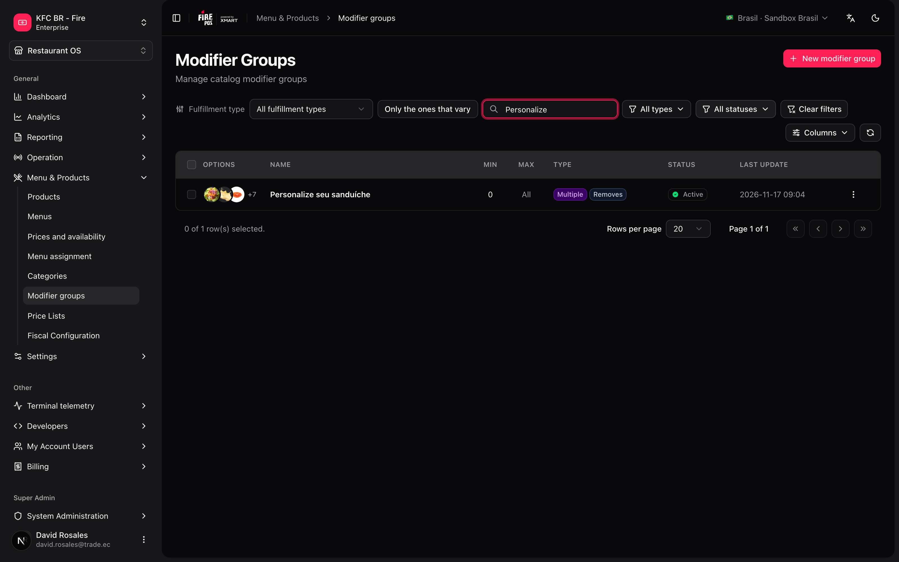
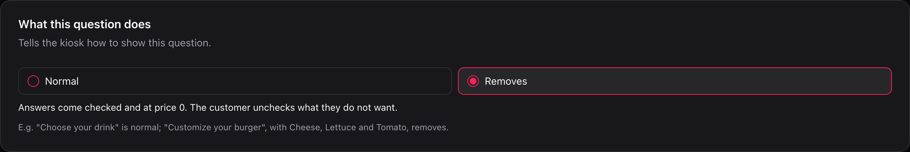
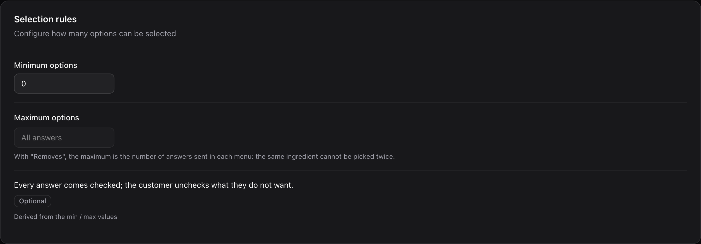
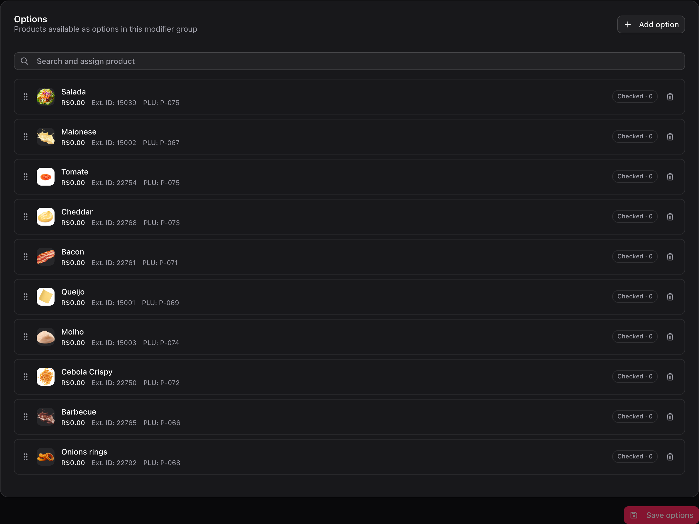
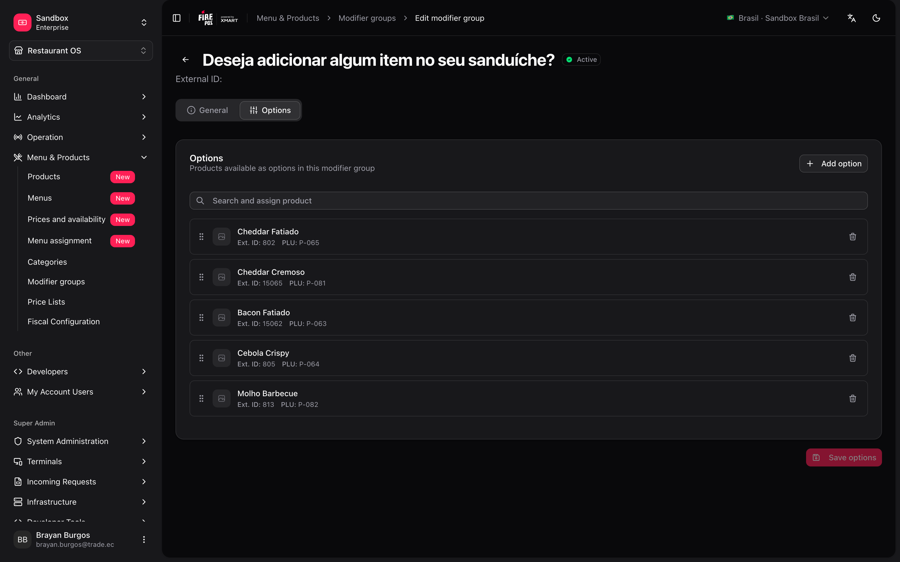
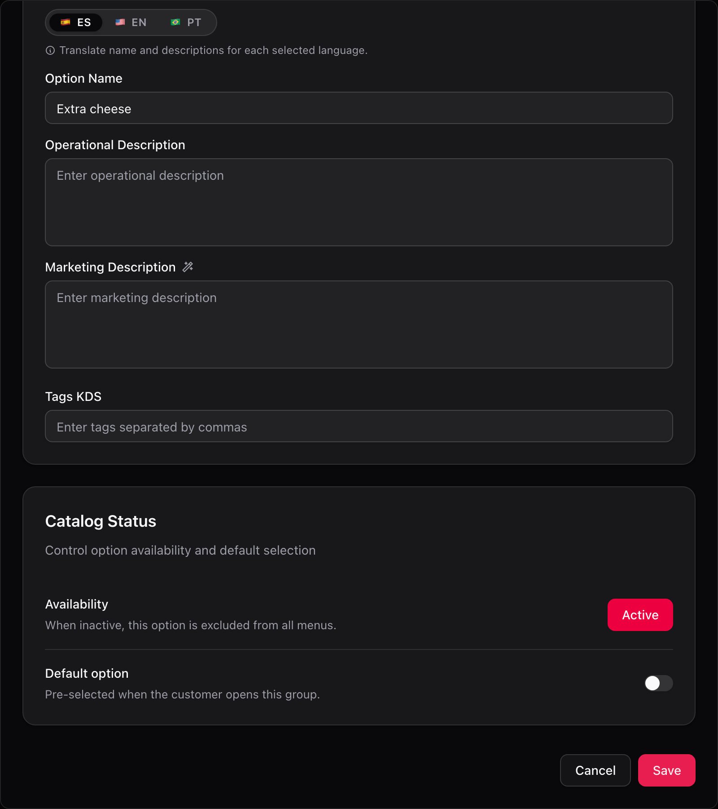
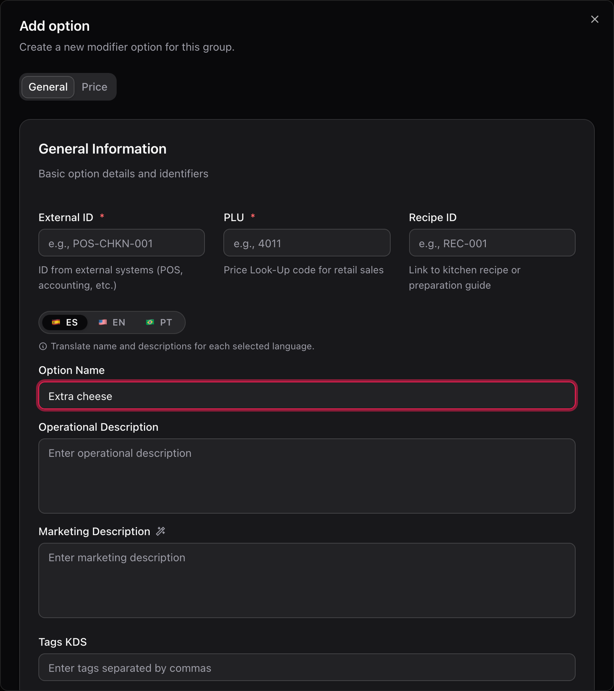

Un grupo de modificadores es una **pregunta que le haces al cliente cuando pide**: *¿qué salsa?*, *¿qué tamaño?*, *¿le agregas algo?*. El grupo define la pregunta, las respuestas posibles y cuántas puede elegir.

Se define una vez y se elige desde muchos lugares: el mismo grupo *Salsas* puede servir para las diez hamburguesas de la carta sin que nadie escriba la pregunta diez veces. Pero agregarlo a un producto **toma una copia** del grupo tal como está ese día — así que el día que agregues una salsa nueva al grupo, los productos que ya lo tenían no cambian solos. Navega a **Restaurant OS → Menú y Productos → Grupos de modificadores**.

<Frame>
  
</Frame>

---

## Lo mínimo que hay que saber

<Note>
**1. Las opciones son productos del catálogo.** Para ofrecer *queso extra* tiene que existir un producto *queso extra*. No se escriben opciones sueltas.

**2. Solo pones dos números: el mínimo y el máximo.** Si el grupo es obligatorio y si es de una o de varias opciones **no se elige** — la pantalla lo deduce de esos dos números.

**3. Agregar un grupo a un producto lo copia.** A partir de ahí, editar el grupo ya no cambia lo que pregunta ese producto. El grupo es la plantilla de la que eliges, no un padre al que los productos siguen. **Una excepción:** que la pregunta sea Normal o Quita no se copia — se lee siempre del grupo.

**4. Una pregunta es Normal o Quita.** **Normal** es lo de siempre: las respuestas llegan sin marcar, con su precio, y el cliente marca lo que quiere. **Quita** (**Removes** en la interfaz en inglés) es para ingredientes que el producto ya trae: todas las respuestas llegan marcadas a precio 0 y el cliente desmarca lo que no quiere. Si no eliges nada, la pregunta es Normal.
</Note>

---

## El camino simple

1. **Nuevo grupo de modificadores**, ponle nombre —*Salsas*, *Tamaño*, *Extras*—.
2. Deja **What this question does** en **Normal**. Cámbialo solo si el cliente quita ingredientes — mira [Qué hace la pregunta](#qué-hace-la-pregunta-normal-o-quita).
3. Pon el **Minimum options** y el **Maximum options** que puede elegir.
4. Guarda, y en la pestaña **Options** busca los productos que van a ser las opciones. Confirma con **Save options**.
5. Ve a la ficha de cada producto que use este grupo y agrégalo desde su pestaña **Modifier Groups** (en un combo, la pestaña **Composition**).

<Tip>
Un grupo no hace nada por sí solo. Empieza a funcionar cuando un producto lo usa. Si la pregunta es la misma en todos los Tipos de Fulfillment, es una pregunta normal y terminas el grupo antes de agregarlo a los productos, ya está.
</Tip>

---

## Las reglas de selección

La tarjeta **Selection rules** tiene **solo dos campos**: **Minimum options** y **Maximum options**. Nada más.

Debajo, la pantalla te dice en palabras simples qué va a poder hacer el cliente —*"The customer picks exactly one option."*, *"The customer picks between 1 and 10 options."*— y muestra dos etiquetas: **Required** u **Optional**, y **Single** o **Multiple**, con la leyenda *"Derived from the min / max values"*. No son campos: son el resultado de los dos números que pusiste.

<Info>
**Por qué se deduce en vez de elegirse.** Un grupo marcado "opcional" con mínimo 1 sería una contradicción, y alguien la descubriría cuando un cliente no pudiera terminar el pedido. Al derivarlo de los números, esa contradicción no puede existir. La regla es: un máximo de 1 lo hace **Single**, cualquier valor mayor **Multiple**; un mínimo de 1 o más lo hace **Required**.
</Info>

Ejemplos que cubren casi todo:

| Lo que quieres | Min | Max | Queda |
| --- | --- | --- | --- |
| Elegir el tamaño, sí o sí | 1 | 1 | Required · Single |
| Salsa, opcional | 0 | 1 | Optional · Single |
| Hasta tres extras, opcionales | 0 | 3 | Optional · Multiple |
| Elegir dos acompañamientos de un combo | 2 | 2 | Required · Multiple |

Los números cuentan **elecciones**, no opciones distintas: un grupo con dos papas fritas y mínimo 2 es válido.

<Note>
**Con Quita no eliges el máximo.** La caja dice **Todas las respuestas** y no se puede editar: el máximo es el número de respuestas que envía cada menú, para que no se pueda elegir dos veces el mismo ingrediente. El mínimo sigue siendo tuyo, pero cambia de sentido — mira [Qué hace la pregunta](#qué-hace-la-pregunta-normal-o-quita).
</Note>

Las etiquetas siempre se deducen de los números que **realmente aplican** — después de cualquier ajuste en el producto, por Tipo de Fulfillment o por menú. Si un producto sube a 3 el máximo de un grupo *Single*, ese producto lo pregunta como elección múltiple.

### El máximo no puede ser 0

El mínimo puede ser 0 — así se hacen las preguntas opcionales. El **máximo** no se puede poner en 0, y lo que pasa cuando lo intentas depende de la pantalla — siempre sin mensaje:

| Dónde | Si escribes o pegas un 0 en el máximo | Si dejas la caja vacía |
| --- | --- | --- |
| **El grupo** | La caja lo descarta. | Con un **Fulfillment type** seleccionado, vuelve a *hereda*. En **All fulfillment types** no hay de dónde heredar: la caja vacía cuenta como 0 y el guardado se rechaza. |
| **El producto** (pestaña **Modifier Groups**) | Pasa a 1. | Vuelve a *hereda*. |
| **El editor de menú** | Pasa a 1 o al mínimo, el que sea mayor. | Nada: la caja se vuelve a llenar con el valor actual. Para volver a heredar ahí, usa **Volver a la base**, que se explica abajo. |

Lo mismo aplica por cada **Fulfillment type** en cada pantalla.

- **Un 0 guardado antes de esta regla se muestra tal como está.** En X-MART un máximo de 0 significa *sin tope*, y la pantalla muestra la pista **No limit in X-MART** (*«Sin tope en X-MART»* en la interfaz en español): en el resumen de la pregunta en el producto (*Selección: Mín. 0 · Máx. 0 (Sin tope en X-MART)*), debajo de la caja mientras editas el producto, en el editor de menú, y en el grupo **solo con un Fulfillment type seleccionado**.
- **Con un máximo de 0 la pregunta es siempre Múltiple.** Solo el mínimo decide **Obligatoria** u **Opcional**. El producto solo muestra esa última insignia.
- **En el editor de menú, un máximo nuevo menor que el mínimo se rechaza** con su propio mensaje. El grupo y el producto también lo rechazan, con un mensaje más genérico. Un máximo de 0 queda exento de esa comparación.
- **Una pregunta creada antes de esta regla puede tener el máximo en 0.** Mientras tenga ese valor en su configuración base, la pestaña **General** del grupo no la deja guardar. Para modificarla, edítala desde el editor de menú.

#### Volver a la base, en el editor de menú

Para que una pregunta vuelva a heredar en el editor de menú, usa **Volver a la base**. Al pasar el cursor dice: *«Quita lo que este Tipo de Fulfillment aparta; la pregunta vuelve a seguir la base.»*

- Solo aparece cuando hay un **Tipo de Fulfillment** seleccionado **y** esa pregunta ya tiene ajustes propios para ese tipo.
- Funciona **por pregunta**, no para toda la pantalla.
- Quita **todo** lo que ese tipo aparta, no solo el máximo. No sirve para volver a heredar únicamente el máximo.

---

## Qué hace la pregunta: Normal o Quita

No toda pregunta es una elección entre cosas que el cliente *agrega*. *Personaliza tu hamburguesa* no ofrece queso, lechuga y tomate como extras — la hamburguesa ya los trae, y lo que el cliente decide es qué **dejar afuera**. Si esa pregunta estuviera armada como una normal, el cliente vería tres casillas vacías y tendría que marcar los ingredientes que ya espera recibir.

La tarjeta **What this question does** (en la interfaz en español, *Qué hace esta pregunta*), justo debajo del nombre, lo resuelve con dos opciones. La pantalla la describe así: *"Le dice al kiosco cómo mostrar esta pregunta."*

Dónde está: **al crear** el grupo, la pantalla no tiene pestañas y la tarjeta va entre **General information** y **Selection rules**; se guarda con **Create modifier group**. **Al editar**, está en la pestaña **General** y se guarda con **Save changes**, junto con el nombre, el mínimo y el máximo. Con un **Fulfillment type** seleccionado, la tarjeta es de solo lectura.

<Frame>
  
</Frame>

| | **Normal** | **Quita** (*Removes* en la captura) |
| --- | --- | --- |
| Las respuestas llegan | Sin marcar, con su precio | **Todas marcadas, a precio 0** |
| El cliente | Marca lo que quiere | **Desmarca** lo que no quiere |
| Ejemplo típico | *Elige tu bebida* | *Personaliza tu hamburguesa*, con Queso, Lechuga y Tomate |
| Máximo | Tú lo pones | **No se elige**: *Todas las respuestas* |
| Mínimo | Cuántas tiene que elegir | Cuántas tienen que **quedar** marcadas |

Si no eliges nada, la pregunta es **Normal**: todo lo que existía antes sigue funcionando exactamente igual.

### Qué cambia cuando eliges Quita

<Frame>
  
</Frame>

- **El máximo no lo pones tú.** Dice **Todas las respuestas** y es el número de respuestas que envía cada menú. La razón está en la pantalla: *"no se puede elegir dos veces el mismo ingrediente."* Si un combo deja solo 2 de los 3 ingredientes, en ese combo el máximo es 2.
- **El mínimo cambia de sentido.** Es cuántos ingredientes tienen que **quedar** marcados — la regla de *"no le puedes quitar todo"*. Con mínimo 1, la frase debajo de los números dice *"Todas las respuestas llegan marcadas; el cliente desmarca lo que no quiere y conserva al menos 1."* Con 0, el cliente puede desmarcarlos todos. Si el mínimo es mayor que las respuestas que un menú realmente envía, ese menú lo envía bajado a ese número, y el sync te avisa (mira [Asignación de menús](/es/manuals/backoffice/menu-assignments#sincronizó-pero-algo-quedó-afuera)).
- **El precio de las respuestas sale en 0**, aunque el producto que está detrás de la respuesta tenga uno. Si alguna respuesta tenía precio, el sync te avisa que se envió en 0.
- **La etiqueta Single / Multiple no se muestra en la tarjeta Selection rules.** Dependería de cuántas respuestas envía cada menú. Required u Optional sigue el mínimo. En el listado de grupos, en cambio, la columna **Type** sigue mostrando la etiqueta Single / Multiple guardada junto a **Quita**, pero en una pregunta Quita esa etiqueta no significa nada.
- **El interruptor de respuesta por defecto** sale encendido y bloqueado **solo si la pregunta guardada es de selección única**; si es de varias opciones, solo aparece el chip **Marcada · 0**. Con Quita, cada respuesta sale como por defecto, pero no se escribe nada en los datos: si la pregunta vuelve a Normal, vuelven a valer los valores por defecto que estaban guardados.
- **Es igual en todos los tipos de fulfillment.** Con un tipo seleccionado, la tarjeta no te deja cambiarlo y dice *Es igual en todos los Tipos de Fulfillment: se cambia desde «Todos los tipos de fulfillment».*

En la pestaña **Options**, cada respuesta lleva un chip **Marcada · 0**, y el listado de grupos suma un chip **Quita** en la columna **Type**, con **Todas** en la columna **Max**. En la captura, **Personalize seu sanduíche** tiene diez opciones.

<Frame>
  
</Frame>

<Tip>
**Quitar nunca cambia el precio.** Si quieres cobrar un extra —doble queso—, arma una pregunta normal al lado de esta.
</Tip>

### Pon a las respuestas el nombre del ingrediente

Con Quita, todas las respuestas llegan marcadas. Una respuesta llamada *Quitar lechuga*, marcada, se lee como "quitar lechuga: sí" — lo contrario de lo que querías. Por eso las respuestas tienen que ser el **ingrediente**: *Lechuga*, no *Quitar lechuga*.

Fire te avisa, sin bloquearte, cuando el nombre de una respuesta empieza por **Retirar**, **Sem**, **Sin** o **No**: el aviso te dice cuáles respuestas se verían ya marcadas y te propone renombrarlas o dejar la pregunta en **Normal**. La regla es estricta:

- Mira solo la **primera palabra entera** del nombre. No distingue mayúsculas, pero sí tildes. «Nota», «Nuggets», «Normal» o «Semente» no la activan.
- Otros verbos —«Quitar», «Remove», «Without»— tampoco la activan.
- Revisa el nombre del producto **en español** y, si no hay, en inglés y luego en portugués. No mira el idioma que tienes activo.
- Sale en la tarjeta de la pestaña **General**, con las respuestas cargadas al abrir la página: no se actualiza después de **Save options**, y al **crear** el grupo nunca aparece. También sale encima de la lista de la pestaña **Options**, y ahí sí se actualiza. No sale en el diálogo **Add option**. Nunca bloquea el guardado.

Un caso real: en KFC BR, **Deseja retirar algum item do seu sanduíche?** tiene las respuestas **Retirar Salada** y **Retirar Maionese**. Sigue como pregunta **Normal** hasta que las respuestas se renombren al ingrediente (**Salada**, **Maionese**). Este aviso no tiene captura porque, con nombres como *Salada*, no hay nada que avisar.

<Info>
**Fire lo envía; cada canal lo muestra.** Este manual cubre lo que configuras en Fire y lo que Fire envía: cada respuesta marcada como seleccionada, a precio 0, con el máximo igual al número de respuestas. Cómo lo muestra un canal — casillas marcadas en el kiosco, cómo aparece el ingrediente quitado en un ticket o en la pantalla de cocina — depende de que ese canal lea la marca. Confírmalo con el canal antes de prometérselo a un cliente: este manual no afirma qué hace ningún canal con esa marca.
</Info>

---

## Las opciones son productos

Esta es la parte que sorprende: una opción no es un texto suelto. **Detrás de cada opción hay un producto del catálogo**, y la pestaña **Options** ofrece dos caminos para llegar ahí.

<Frame>
  
</Frame>

| Camino | Cuándo |
| --- | --- |
| **Search and assign product** | El producto ya existe. Lo buscas por nombre y queda asignado. |
| **Add option** | No existe todavía. El formulario te pide nombre, **PLU**, **External ID**, **Recipe ID**, descripciones y precio — es la ficha de un producto, y eso es lo que se crea. Nace como **Product** y sigue la fila **Product** de la [política de menú](/es/manuals/backoffice/menu-policies): si la política exige un código, no puedes crear la opción sin él. |

Cuando la [política de menú](/es/manuals/backoffice/menu-policies) exige un código para **Product**, el diálogo lo marca con un asterisco —aquí **External ID** y **PLU**, que es como este diálogo llama al **Code**— y la opción no se crea sin ellos. Si falta alguno, los campos se ponen en rojo con *Obligatorio según la política de menú del vendor* dentro del diálogo, sin ningún mensaje fuera de él. El servidor lo revisa de nuevo, por si la política cambió mientras el diálogo estaba abierto.

<Frame>
  
</Frame>

Tiene una razón práctica: una opción tiene precio, impuestos, código de PLU, receta de cocina y nombre en tres idiomas. Todo eso ya vive en un producto, y duplicarlo sería mantenerlo dos veces.

<Info>
**Por eso existe el tipo de producto Modifier.** En [Productos](/es/manuals/backoffice/products) puedes crear un producto de tipo **Modifier** —*queso extra*, *doble carne*— que existe para ser opción y no para venderse suelto. Basta con apagarle **Show in menu**: el producto no aparece en la carta pero sigue disponible dentro de combos y modificadores.
</Info>

Si eliges **Search and assign product**, no se valida nada: el producto ya existe, y uno que no cumple la política se asigna sin ningún aviso. Y el **grupo** en sí no necesita código: un grupo se crea sin él, y está bien. La política cubre los productos que están detrás de las opciones, no el grupo.

Las opciones **se reordenan arrastrando**, y ese es el orden en que el cliente las ve.

Las opciones **no se guardan solas**: al terminar hay que confirmar con **Save options**.

Cada fila muestra el precio del producto que está detrás de esa opción, de solo lectura. Al pasar el cursor encima lo explica: *"Price of the product behind this option. A product that uses this group can give it its own price."*

### Lo que se define por opción

<Frame>
  
</Frame>

| Control | Qué hace |
| --- | --- |
| **Availability** | Si se apaga, la opción **queda fuera de todos los menús**. Se define al crear la opción. |
| **Default option** | Marca la opción como la que debería venir preseleccionada. El editor de menús la muestra y Fire **la envía a los canales** junto con la respuesta; si un canal la preselecciona y cómo lo hace depende de ese canal. En grupos *Single* también se puede cambiar desde la fila de la opción (**Default**). Con [Quita](#qué-hace-la-pregunta-normal-o-quita) todas las opciones son por defecto y el interruptor queda fijo. |
| **External ID** · **PLU** · **Recipe ID** | Los identificadores para POS, retail y cocina. |
| **Tags KDS** | Etiquetas para la pantalla de cocina. |

La pestaña **Price** del diálogo es **de solo lectura**: muestra el neto, el bruto y el sugerido *del producto que elegiste*. La propia pantalla lo dice: *"Values from the selected product (read from product detail)."*

<Warning>
**Para cambiar cuánto cuesta una opción, no se hace aquí.** Si el extra de queso tiene que costar distinto en todos lados, corrige el precio del producto *queso extra* en la [lista de precios](/es/manuals/backoffice/price-lists). Si solo tiene que costar distinto dentro de un producto o combo, mira [Precios de opciones dentro de un producto](#precios-de-opciones-dentro-de-un-producto).
</Warning>

---

## Agregar un grupo a un producto lo copia

Un grupo se define una vez, pero lo que pregunta un producto vive **en el producto**. Cuando agregas un grupo desde la pestaña **Modifier Groups** de un producto, la pantalla te avisa antes de hacerlo —*"It is copied to the product as is: from here on, editing the group no longer changes what this product asks."*— y confirmas con **Add a copy**.

Lo que se copia: el título del grupo, su mínimo y su máximo, su lista de opciones y lo que el grupo tenga configurado por Tipo de Fulfillment.

**Lo que no se copia:** que la pregunta sea **Normal** o **Quita**. Esa opción se lee siempre del grupo, y no se puede cambiar en la copia, en el menú ni por Tipo de Fulfillment. Si cambias el grupo entre Normal y Quita, cambian **todos** los productos que lo usan, copias incluidas, en la ficha, en el editor de menús y en la próxima sincronización.

Lo que eso significa en la práctica:

- **Editar el grupo después no llega a ese producto.** Renombrar *Salsas*, subir su máximo o agregar una salsa nueva cambia el grupo — no las hamburguesas que ya lo tenían.
- **Cada producto puede ser distinto sin afectar a los demás.** Cambiar la copia en la hamburguesa premium no toca el grupo ni las otras hamburguesas.

Cada grupo en la pestaña del producto muestra una pequeña marca que te dice de qué tipo es:

| Marca | Qué significa |
| --- | --- |
| **copy** | *"Copied from the group when it was assigned. Editing the group no longer changes this product."* |
| **follows the group** | *"Assigned before groups became a catalog: editing the group still changes what this product asks."* |

Los dos tipos conviven: los productos que tenían el grupo antes de que existiera el comportamiento de copia quedaron como estaban, así que siguen al grupo en vivo.

<Info>
**La pantalla del grupo te dice a quién sigue llegando.** Cuando hay productos que todavía siguen al grupo, un aviso arriba dice *"N products still follow this group: what you save here reaches them. Products assigned after the change keep their own copy."* —con **see which** para listarlos—. Si no hay aviso, editar el grupo no cambia nada en ningún producto, salvo el cambio entre Normal y Quita, que llega a todos y no avisa.
</Info>

### Llevar un cambio del grupo a los productos que tienen una copia

No hay un botón que empuje un cambio del grupo a las copias. Se hace producto por producto, en la pestaña **Modifier Groups** de cada uno:

- **Una opción nueva en el grupo**: abre el grupo en el producto y márcala (**Applies to this product**). Las opciones que el grupo ofrece pero la copia no usa aparecen sin marcar.
- **Un título, mínimo o máximo nuevo**: edítalos en el producto (**Edit overrides for this product**).

Quitar una opción del grupo es la excepción: **sí** llega a todos los productos, copias incluidas — la opción deja de ofrecerse en todos lados.

### Lo que un producto puede cambiar

Desde la pestaña **Modifier Groups** de un producto puedes cambiar, solo para ese producto:

- el título con el que se muestra el grupo (**Title for this product**),
- el **Min.** y el **Max.**,
- cuáles de las opciones del grupo aplican, y su orden (arrastrando),
- el orden de los propios grupos (arrastrando),
- el **precio de cada opción** — ver abajo.

Cuando el título o los límites difieren del grupo, el resumen queda marcado como **Custom for this product**.

El mismo grupo se puede agregar **más de una vez** al mismo producto — por ejemplo *Escolha sua bebida* dos veces en *Combo para 2*, una por persona. Cada una es su propia copia, con sus propios límites y precios.

### Precios de opciones dentro de un producto

En la pestaña del producto, cada opción muestra su **Modifier price** (el precio del producto que está detrás). Para cobrar otra cosa dentro de este producto, enciende **Custom price** y escribe el **Price for this product**; la fila muestra el **Effective price** y una etiqueta **Custom**. Ese precio se guarda en la lista de precios base, como precio contextual para este producto — el mismo precio que ves en la vista **By combo** de la lista de precios.

Con **Custom price** encendido, una opción también puede llevar su propia oferta: **Sale price in this combo**. Tiene que ser menor que el precio (*"Must be lower than the price. It will not be saved."*). Sin precio propio, la opción hereda la oferta del producto suelto.

<Info>
Los precios contextuales —incluidos los por Tipo de Fulfillment y los de listas de precios hijas— se explican en [Listas de precios](/es/manuals/backoffice/price-lists). Esta pestaña edita los mismos datos; no guarda un precio aparte.
</Info>

---

## Distinto según el Tipo de Fulfillment

La misma pregunta puede cambiar según el **Fulfillment type** — hacerse de otra forma en delivery que en el local. Tanto en la pantalla del grupo como en la pestaña del producto hay un selector **Fulfillment type**: en **All fulfillment types** editas la base; elige un tipo y editas solo lo que es distinto ahí. Los tipos que tienen algo propio muestran un punto en el selector.

Lo que no definas para un tipo se hereda de **All fulfillment types**. Cada campo muestra si es **custom**, **inherited** o **unsaved**, y **revert to inherited** lo devuelve.

| Dónde | Qué puede variar por tipo |
| --- | --- |
| **El grupo** | El nombre, el mínimo y el máximo, y qué opciones aplican en ese tipo y en qué orden (*"Pick which options apply in Delivery and drag to set their order."*). Agregar o quitar opciones solo se hace en **All fulfillment types**, porque afecta a todos los tipos. |
| **El producto** | El título, el mínimo y el máximo, qué opciones aplican y su orden, el precio de cada opción (**Price in Delivery**), el orden de las preguntas y **si la pregunta se hace o no** en ese tipo. |
| **El menú** | El nombre del grupo, el mínimo, el máximo y las opciones para ese producto dentro de un menú — ver [Menús](/es/manuals/backoffice/menus). |

Las etiquetas siguen al tipo: con un tipo seleccionado, la tarjeta de reglas dice *"In Delivery: The customer picks exactly one option."* y la leyenda dice *"Derived from the min / max that apply in Delivery"*. Bajar el máximo a 1 solo en delivery hace que la pregunta sea **Single** ahí y **Multiple** en todos los demás.

### Hacer una pregunta en un solo tipo

- **En un producto que ya la tiene**: selecciona el tipo y usa **Remove group**. La pregunta no se borra — queda marcada **not asked in Delivery** (*"This question is not sent for this fulfillment type."*), y **Ask it again** la recupera.
- **Al agregarla**: con un tipo seleccionado, **Add group** pregunta *"Where does this question apply?"* — **In every fulfillment type** u **Only in Delivery**. La segunda la agrega y la deja fuera de todos los demás tipos.

<Note>
Cuando el grupo tiene su propia configuración por tipo, esa configuración también se copia al producto. A partir de ahí, los ajustes por tipo del producto son los que cuentan — cambiar la configuración por tipo del grupo ya no le llega.
</Note>

---

## Recetas: cómo se resuelven los casos reales

<AccordionGroup>
  <Accordion title="Ofrecer salsas a elección, sin costo">
    1. Crea los productos de las salsas en [Productos](/es/manuals/backoffice/products), tipo **Modifier**, con **Show in menu** apagado y precio 0.
    2. **Nuevo grupo de modificadores**, nombre *Salsas*.
    3. Mínimo **0**, máximo **1**. El grupo queda **Optional · Single** solo.
    4. Pestaña **Options**: agrega las salsas, ordénalas arrastrando y **Save options**.
    5. En cada producto que las lleve, pestaña **Modifier Groups** → **Add group** → **Add a copy**.
  </Accordion>

  <Accordion title="Obligar a elegir el tamaño">
    1. Crea los productos *Pequeño*, *Mediano*, *Grande* como **Modifier**, cada uno con su precio.
    2. Grupo *Tamaño*, mínimo **1**, máximo **1**. Queda **Required · Single**.

    Con mínimo 1 el cliente no puede avanzar sin elegir, que es exactamente lo que quieres cuando el precio depende del tamaño.
  </Accordion>

  <Accordion title="Cobrar el mismo extra más caro en un producto premium">
    No dupliques el grupo. Ve a la ficha del producto premium, pestaña **Modifier Groups**, abre el grupo, enciende **Custom price** en esa opción y escribe el **Price for this product**.

    Los demás productos siguen con el precio normal de la opción.
  </Accordion>

  <Accordion title="Agregué una opción nueva al grupo y los productos no la muestran">
    Es la copia funcionando. En la pantalla del grupo, el aviso de arriba te dice qué productos siguen todavía al grupo — esos ya la tienen. Para cada uno de los demás productos, abre su pestaña **Modifier Groups**, abre el grupo y marca la opción nueva (**Applies to this product**), y luego guarda.
  </Accordion>

  <Accordion title="Menos bebidas para elegir en delivery">
    1. En el producto —digamos *Combo para 2*— abre la pestaña **Composition** y pon **Fulfillment type** en *Delivery*.
    2. Abre *Escolha sua bebida* y desmarca las bebidas que no ofreces en delivery, o arrástralas a otro orden.
    3. Guarda. En el local, el combo mantiene todas las bebidas.
  </Accordion>

  <Accordion title="Dejar que el cliente quite ingredientes">
    1. En [Productos](/es/manuals/backoffice/products), crea los ingredientes como productos de tipo **Product** o **Modifier**, con el nombre del ingrediente —*Salada*, *Maionese*, *Bacon*—. **Show in menu** no influye en lo que se envía: lo que evita que el ingrediente se venda suelto es no ponerlo en una categoría del menú.
    2. **Nuevo grupo de modificadores**, nombre *Personalize seu sanduíche*.
    3. En **What this question does**, elige **Quita**. El máximo queda bloqueado en **Todas las respuestas**. Pon el **Minimum options**: **0** si el cliente puede quitarlo todo, o un número si algunos ingredientes tienen que quedar. Confirma con **Create modifier group**.
    4. Pestaña **Options**: para ingredientes que ya existen, usa **Search and assign product** (**Add option** *crea* un producto nuevo, de tipo **Product**). Cada opción muestra **Marcada · 0**. Confirma con **Save options**.
    5. En cada producto que lo lleve, pestaña **Modifier Groups** (en un combo, **Composition**): el buscador *"Buscar grupos de modificadores..."* agrega el grupo directo. El diálogo **Agregar copia** aparece solo si el grupo tiene configuración por **Fulfillment type**.
    6. Guarda con **Save modifier groups** (en un combo, **Save composition**).

    El cliente recibe todos los ingredientes marcados y desmarca los que no quiere.
  </Accordion>

  <Accordion title="Mi pregunta dice Retirar Salada">
    Las respuestas que nombran la acción salen ya marcadas, y eso se lee al revés. Tienes dos salidas:

    - **Renombrar las respuestas al ingrediente** —*Salada*, *Maionese*— y luego elegir **Quita**. La respuesta no tiene un nombre propio dentro del grupo, de la copia ni del menú: se renombra **editando el producto** que está detrás de la opción, y eso lo cambia en todos los lugares donde se use ese producto. Si también se usa en otro lado, asigna en su lugar un producto que ya lleve el nombre del ingrediente. Ten en cuenta que un producto puede tener un nombre por **Fulfillment type**, que en ese tipo manda sobre el general. Y el título que editas en la pestaña del producto renombra la **pregunta**, no la respuesta.
    - **Dejar la pregunta como Normal.** Sigue funcionando como antes: el cliente marca lo que quiere quitar, con cada respuesta a su propio precio.
  </Accordion>

  <Accordion title="Se acabó un extra: sacarlo de todos lados">
    Si es por un rato, no toques esto: usa [Agotados](/es/manuals/backoffice/out-of-stock), que lo devuelve solo en la fecha y hora que elijas.

    Si es definitivo, quita la opción del grupo (pestaña **Options** → **Remove** → **Save options**). Eso sí llega a todos los productos que usan el grupo, copias incluidas.
  </Accordion>
</AccordionGroup>

---

## Errores que salen caros

<Warning>
**Poner mínimo 1 en un grupo que querías opcional.** El grupo pasa a ser obligatorio y el cliente no puede terminar el pedido sin responder. No hay un interruptor de "opcional" que lo contradiga: mira la frase y las etiquetas debajo de los números antes de guardar.
</Warning>

<Warning>
**Intentar limitar un grupo con un máximo de 0.** Las pantallas no lo aceptan: lo descartan o lo convierten en 1, sin mensaje. Un máximo de 0 solo existe donde ya se había guardado, y en X-MART significa *sin tope*. Para limitar las elecciones, escribe el número que quieres, de 1 en adelante.
</Warning>

<Warning>
**Editar un grupo y dar por hecho que todos los productos cambiaron.** Los productos que tomaron una copia siguen haciendo la pregunta vieja. Si agregaste una opción para una promoción o cambiaste los límites, los menús mantienen la versión vieja hasta que actualices cada producto que tiene una copia. El aviso en la pantalla del grupo te dice a qué productos sí llegó.
</Warning>

<Warning>
**Crear las opciones como productos vendibles.** Si un producto de tipo **Modifier** queda con **Show in menu** encendido, *queso extra* aparece en la carta como si fuera un plato. Apágalo: sigue funcionando como opción.
</Warning>

<Warning>
**Buscar el precio de la opción en esta pantalla.** Aquí es de solo lectura. Se corrige en la lista de precios — o, solo para un producto, con **Custom price** en la pestaña **Modifier Groups** de ese producto.
</Warning>

<Warning>
**Marcar Quita en una pregunta cuyas respuestas nombran la acción.** Con *Retirar Salada* la respuesta llega marcada, así que el cliente lee "retirar ensalada: sí" antes de tocar nada. Fire te avisa pero no lo bloquea. Renombra las respuestas al ingrediente, o deja la pregunta como Normal.
</Warning>

<Warning>
**Esperar cobrar algo por quitar.** Con Quita, todas las respuestas salen a precio 0, aunque el producto que está detrás tenga precio. No hay nada que cobrar por sacar un ingrediente. Para cobrar un extra, usa una pregunta normal.
</Warning>

<Warning>
**Cambiar un grupo entre Normal y Quita y suponer que solo cambian los productos nuevos.** Que la pregunta sea Normal o Quita se lee siempre del grupo, no de la copia: el cambio llega a **todos** los productos que usan el grupo, copias incluidas, en la ficha, en el editor de menús y en la próxima sincronización, y la pantalla no avisa. Dos textos de la pantalla dicen lo contrario y **no valen para esta opción**: el aviso *"Los productos asignados después del cambio se quedan con su copia."* y la marca de la copia *"Se copió del grupo al asignarlo. Editar el grupo ya no cambia este producto."* Antes de cambiarlo, piensa en todos los productos que lo usan.
</Warning>

<Warning>
**Contar con Default option para garantizar una respuesta.** Una opción preseleccionada se puede desmarcar, y cada canal decide cómo la muestra. Si el cliente tiene que terminar con una elección, haz el grupo obligatorio (mínimo 1).
</Warning>

<Warning>
**Borrar un grupo que todavía usan productos.** Los productos dejan de hacer esa pregunta, sin aviso y sin error. Antes de borrarlo, quita el grupo de los productos que lo usan.
</Warning>

---

## Glosario

| Término | Qué significa |
| --- | --- |
| **Grupo de modificadores** | La pregunta que se le hace al cliente al pedir, con sus respuestas posibles. |
| **Opción** | Una respuesta posible. Siempre es un producto del catálogo. |
| **Normal** | La pregunta de siempre: las respuestas llegan sin marcar, con su precio, y el cliente marca lo que quiere. Es lo que es una pregunta si no eliges nada. |
| **Quita** (*Removes* en la interfaz en inglés) | Una pregunta cuyas respuestas son ingredientes que el producto ya trae: llegan marcadas a precio 0 y el cliente desmarca lo que no quiere. |
| **Todas las respuestas** (*All answers*) | El máximo de una pregunta Quita. No se escribe: es el número de respuestas que envía cada menú. Se ve como **Todas** en el listado y **todas** en el editor de menús. |
| **Marcada · 0** (*Checked · 0*) | Chip en cada opción de una pregunta Quita: sale marcada y a precio 0. |
| **Min / Max** | Los dos únicos números que se configuran: cuántas opciones puede elegir. Con Quita solo el mínimo es tuyo, y significa cuántas tienen que quedar marcadas. |
| **Single / Multiple** | Si el cliente elige una o varias. Se deduce del máximo; no se elige. |
| **Required / Optional** | Se deduce del mínimo: 1 o más lo hace obligatorio. Tampoco se elige. |
| **Modifier** | El tipo de producto que existe para ser opción y no para venderse suelto. |
| **copy** | Un grupo agregado a un producto que ya no sigue al grupo: editar el grupo no lo cambia, salvo que sea Normal o Quita, que se lee siempre del grupo. |
| **follows the group** | Un grupo agregado antes de que existieran las copias: editar el grupo todavía cambia lo que pregunta el producto. |
| **Custom for this product** | La marca de un grupo cuyo título o límites en ese producto difieren del grupo. |
| **Tipo de Fulfillment** | Local, delivery, retiro… Una pregunta se puede hacer distinto en cada uno. |

---

## Preguntas frecuentes

<AccordionGroup>
  <Accordion title="Cambié el grupo y el producto sigue haciendo la pregunta vieja">
    El producto tiene una **copy** del grupo. Agregar un grupo a un producto lo copia, y a partir de ahí editar el grupo no lo cambia. Actualiza el producto desde su pestaña **Modifier Groups**. Solo los productos marcados **follows the group** toman los cambios del grupo por sí solos. La excepción es que la pregunta sea Normal o Quita: eso se lee siempre del grupo y cambia en todos los productos.
  </Accordion>

  <Accordion title="No encuentro el producto que quiero poner como opción">
    Con **Search and assign product** solo aparecen los que ya existen. Si no está, tienes dos salidas: crearlo en [Productos](/es/manuals/backoffice/products) —normalmente de tipo **Modifier**— y volver a buscarlo, o usar **Add option** y cargarlo desde aquí con sus datos.
  </Accordion>

  <Accordion title="¿Dónde cambio el precio de una opción?">
    En la [lista de precios](/es/manuals/backoffice/price-lists) que use ese destino, en el producto que está detrás de esa opción. Si solo tiene que cambiar dentro de un producto o combo en particular, usa **Custom price** en la pestaña **Modifier Groups** de ese producto, o la vista **By combo** de la lista de precios — las dos editan el mismo precio.
  </Accordion>

  <Accordion title="¿Una opción puede tener precio de oferta dentro de un combo?">
    Sí. Con **Custom price** encendido, completa **Sale price in this combo**; tiene que ser menor que el precio. Si no le das a la opción su propio precio en el combo, hereda la oferta del producto suelto.
  </Accordion>

  <Accordion title="Agregué el grupo y el cliente no lo ve">
    Un grupo no llega solo al menú. Tiene que estar agregado al producto (pestaña **Modifier Groups** de la ficha), no puede estar marcado **not asked** para ese Tipo de Fulfillment, y ese producto tiene que estar en un menú que se haya sincronizado en [Asignación de menús](/es/manuals/backoffice/menu-assignments).
  </Accordion>

  <Accordion title="Convertí un producto a Modifier y perdió sus grupos">
    Es lo esperado y la pantalla lo avisa antes: *"A modifier cannot have modifier groups."* Un modificador es una respuesta, no una pregunta, así que no puede tener grupos colgando. Una respuesta que necesita preguntas propias tiene que ser un producto que no sea **Modifier**: mira [Preguntas dentro de una respuesta](/es/manuals/backoffice/products#preguntas-dentro-de-una-respuesta).
  </Accordion>

  <Accordion title="¿Por qué no puedo escribir el máximo en esta pregunta?">
    Porque es una pregunta **Quita**: el máximo es el número de respuestas que envía cada menú, para que no se pueda elegir dos veces el mismo ingrediente. Cambia la pregunta a **Normal** si necesitas poner el máximo tú.
  </Accordion>
</AccordionGroup>

---

## Lo que viene

- **Editar las preguntas de una respuesta desde el grupo o el combo**: una respuesta que es un producto con preguntas propias ya viaja con ellas (mira [Productos](/es/manuals/backoffice/products#preguntas-dentro-de-una-respuesta) y [Políticas de menú](/es/manuals/backoffice/menu-policies#niveles-de-preguntas)), pero se editan en la ficha de ese producto.
- **Llevar un cambio del grupo a todas las copias de una vez**: hoy se hace producto por producto.
- **El comportamiento de los canales con Quita**: Fire envía las respuestas marcadas y a precio 0; cómo las muestra cada canal depende de que ese canal lea esa marca.
