Apagar un producto que se acabó es fácil, y está resuelto en [Agotados](/es/manuals/backoffice/out-of-stock). Lo caro es que se acabe **otra vez**: la misma papa, en la misma tienda, todos los viernes a las seis. Mientras cada apagado se vea solo, nadie nota el patrón.

Esta pantalla junta todos los apagados de un período y responde lo que **Agotados** no puede: cuánto tiempo dejaste de vender, qué productos se repiten, si se acabó un insumo compartido y si algún canal no se enteró. Ve a **Restaurant OS → Analítica → Análisis de agotados**.

<Frame>
  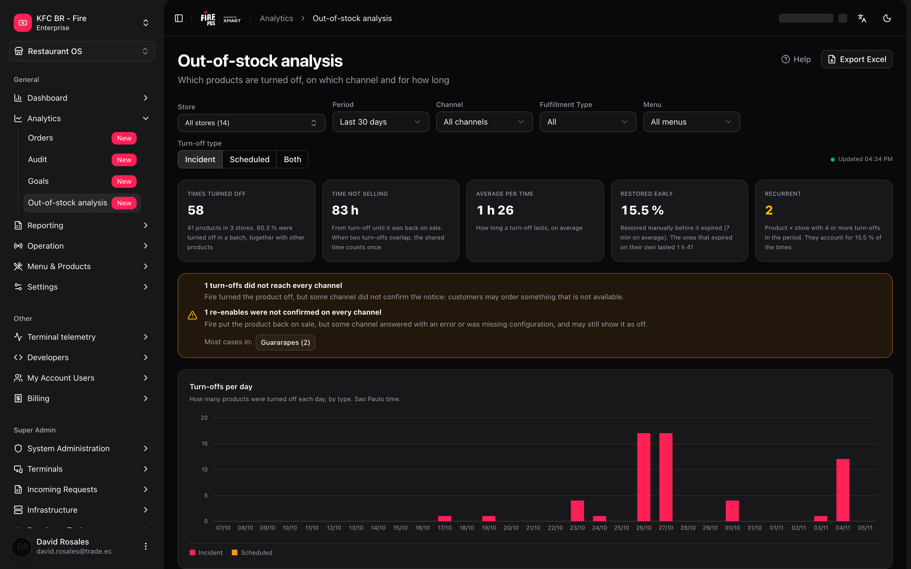
</Frame>

---

## Lo mínimo que hay que saber

<Note>
**1. Cuenta apagados, no ventas.** Cada vez que alguien apaga un producto en **Agotados** se crea un registro, y esta pantalla cuenta esos registros. No hay montos, moneda, impuestos ni ventas perdidas en ningún número.

**2. Por defecto solo ves los incidentes.** El filtro **Tipo de apagado** arranca en **Incidente**: los apagados largos o programados (por ejemplo, "sin helado hasta el 30") no aparecen hasta que eliges **Programado** o **Ambos**. Es la causa número uno de "no veo mi apagado".

**3. El apagado cuenta el día en que se creó.** Un apagado que empezó el lunes y dura hasta el miércoles suma una vez, el lunes.

**4. Los datos llegan con unos 5 minutos de retraso** y la pantalla no se refresca sola. Cambia un filtro o vuelve a abrirla para ver lo último.

**5. Solo ves tus tiendas.** Si tu usuario está limitado a algunas tiendas, "Todas" significa "todas las tuyas", en la pantalla y en el Excel.
</Note>

---

## El camino simple

Quieres saber cómo les fue a tus tiendas este mes:

1. Elige la cuenta y el país en el encabezado del Backoffice.
2. Deja **Período** en **Últimos 30 días** y **Tipo de apagado** en **Incidente**.
3. Mira las cinco tarjetas de arriba y la tabla **Productos más apagados**.
4. Si quieres ver cada apagado de un producto, haz clic en su fila.

<Tip>
Si solo querías saber **qué se apaga más**, ya terminaste: el primer producto de la tabla es la respuesta. Lo que sigue sirve para saber **por qué** y **dónde actuar**.
</Tip>

---

## Los filtros

<Frame>
  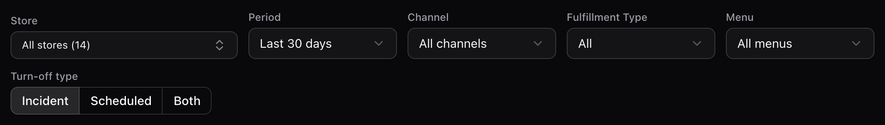
</Frame>

| Filtro | Opciones | Por defecto |
| --- | --- | --- |
| **Tienda** | Todas, o una de tus tiendas en la cuenta y el país del encabezado | **Todas** (si solo tienes una, queda elegida sola) |
| **Período** | **Últimos 7 días**, **Últimos 30 días**, **Últimos 90 días** o **Personalizado** | **Últimos 30 días** |
| **Canal** | Todos los canales, o uno | Todos |
| **Tipo de Fulfillment** | Todos, o uno | Todos |
| **Menú** | Todos los menús, o uno | Todos |
| **Tipo de apagado** | **Incidente**, **Programado** o **Ambos** | **Incidente** |

- Los períodos fijos terminan **hoy** e incluyen hoy. "Hoy" es el día de la tienda elegida o, si no hay una, el de la zona horaria más común entre tus tiendas. Con **Personalizado** aparecen **Desde** y **Hasta**.
- El rango máximo es de **92 días**, contando ambos extremos.
- Todo lo que ves —tarjetas, gráfico, tablas, panel lateral y Excel— usa **exactamente los mismos filtros**.
- Al cambiar de cuenta o de país se limpian **Tienda**, **Canal** y **Menú**. **No** se limpian **Período**, **Tipo de Fulfillment** ni **Tipo de apagado**.

### Incidente, Programado y Ambos

Cuando se crea un apagado, Fire lo clasifica según cuándo vence:

- **Incidente**: vence dentro del **día operativo** de la tienda en que se creó. Se acabó algo a mitad del servicio y se resolvió el mismo día.
- **Programado**: vence después del cierre de ese día. Es un apagado planeado de varios días.

El día operativo sale del horario de operación de la tienda. Si la tienda no tiene horario, se toma hasta las 23:59 del día de la tienda.

**Ambos** también incluye los apagados sin clasificar.

Se muestran por separado porque los programados duran días y distorsionarían el promedio.

### Canal, Tipo de Fulfillment y Menú

Estos tres filtros usan lo que la tienda tenía asignado **en el momento de apagar**, no la asignación de hoy. Si la semana pasada reasignaste un menú, los apagados viejos siguen bajo el menú anterior.

<Warning>
Al elegir un canal, un Tipo de Fulfillment o un menú, **desaparecen los apagados que no tenían ningún menú asignado** (en la tabla aparecen con el chip **sin menú asignado**). Para verlos, deja **Canal**, **Tipo de Fulfillment** y **Menú** en "Todos". Si el total baja de golpe al filtrar, revisa esto primero.
</Warning>

---

## Las cinco tarjetas

<Frame>
  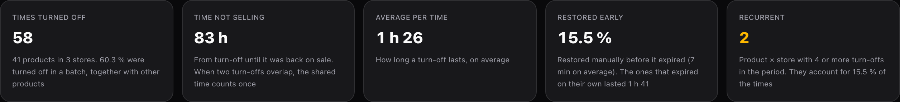
</Frame>

| Tarjeta | Qué mide |
| --- | --- |
| **Veces apagado** | Cuántos registros de apagado hay en el período. Abajo dice cuántos productos y tiendas, y qué porcentaje se apagó **en lote** (junto con otros productos en la misma operación). |
| **Tiempo sin vender** | Horas en que el producto estuvo apagado. Si dos apagados del mismo producto en la misma tienda se cruzan, el tramo en común cuenta **una sola vez**. Se muestra en horas enteras. |
| **Promedio por vez** | Cuánto dura un apagado, en promedio. Aquí **no** se descuentan los cruces. |
| **Volvieron antes** | Porcentaje de apagados que alguien **restauró a mano** antes de que vencieran. Abajo dice cuánto tardaron en promedio y cuánto duraron los que vencieron solos. |
| **Recurrentes** | Pares **producto × tienda** con **4 o más** apagados en el período. Se pinta de ámbar cuando es mayor que 0. |

Si un apagado sigue vigente, se cuenta **hasta este momento**: el mismo filtro da más horas un rato después.

---

## Apagados por día

<Frame>
  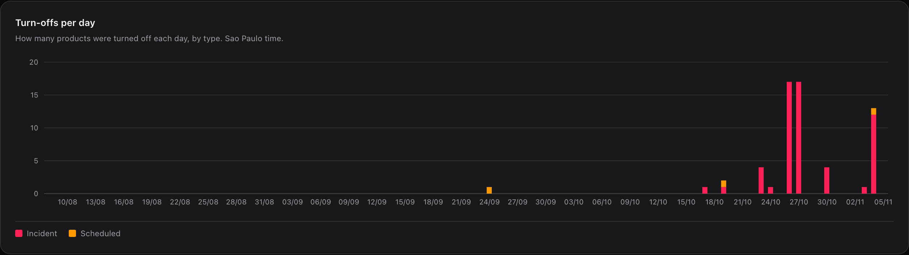
</Frame>

Una barra por día del rango, apilada por tipo (**Incidente** y **Programado**). Los días sin apagados salen en cero. Aparece **Sin clasificar** solo si hay registros sin tipo, algo que solo ves con **Ambos**.

Al pasar el mouse por una barra ves la fecha y el conteo por tipo.

Bajo el gráfico dice la zona horaria que se está usando (por ejemplo, "Hora de Sao Paulo"). Léelo: es la hora con la que se reparten los apagados por día.

---

## Productos más apagados

<Frame>
  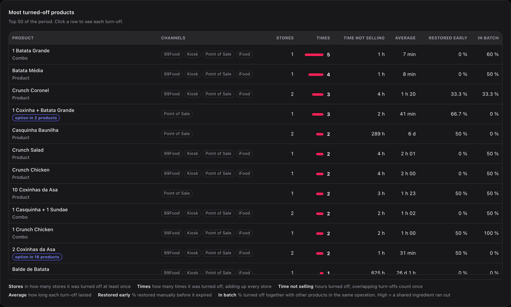
</Frame>

La tabla muestra los **50** productos más apagados, ordenados por **Veces** y, si empatan, por **Tiempo sin vender**.

| Columna | Qué es |
| --- | --- |
| **Producto** | Nombre del catálogo. Debajo dice **Producto**, **Combo** u **opción en N productos**. |
| **Canales** | Canales a los que llegó el apagado. Sin canales aparece **sin menú asignado**. |
| **Tiendas** | En cuántas tiendas se apagó al menos una vez. |
| **Veces** | Cuántas veces se apagó, sumando todas las tiendas. |
| **Tiempo sin vender** | Horas apagado. Los apagados que se cruzan cuentan una vez. |
| **Promedio** | Cuánto duró cada apagado. |
| **Volvió antes** | Porcentaje restaurado a mano antes de que venciera. |
| **En lote** | Porcentaje apagado junto con otros productos en la misma operación. |

**Cómo leer En lote.** Un valor alto casi siempre significa que se acabó un **insumo compartido**: cuando se terminan las cajas del combo, se apagan todos los productos que las usan. En ese caso, el problema no es cada producto sino el insumo.

**Qué es "opción en N productos".** El producto no se vende solo en ningún menú: solo aparece como opción dentro de combos u otros productos. N es en cuántos productos distintos está.

---

## Agotados recurrentes: la lista para actuar

<Frame>
  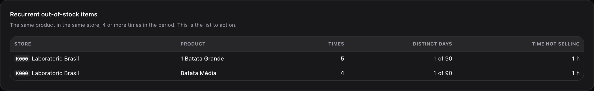
</Frame>

Muestra hasta **20** pares producto × tienda con **4 o más** apagados en el período, con las columnas **Tienda**, **Producto**, **Veces**, **Días distintos** (por ejemplo, "1 de 90") y **Tiempo sin vender**.

Lee **Días distintos** junto con **Veces**: 5 apagados en 1 solo día es un mal día (una entrega que no llegó). 5 apagados en 5 días distintos es un hábito: el pedido de reposición está mal calculado.

Si no hay ninguno, la pantalla dice: "Ningún producto llegó a 4 apagados en la misma tienda."

---

## Tiendas que más apagan y mapa de horas

<Frame>
  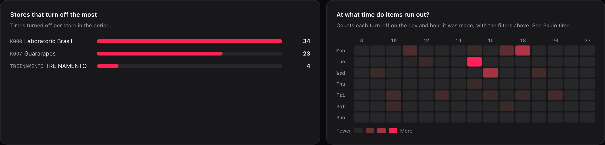
</Frame>

- **Tiendas que más apagan**: veces apagado por tienda. Se muestran las **10** primeras.
- **¿A qué hora se agota?**: un mapa de calor de día de la semana por hora (lunes arriba). Cuenta cada apagado en el día y la hora en que **se creó**. Las columnas van de 8 a 22 h y se amplían si hay apagados fuera de esa franja.

Con una **tienda** elegida, la lista de tiendas desaparece y el mapa ocupa todo el ancho.

<Frame>
  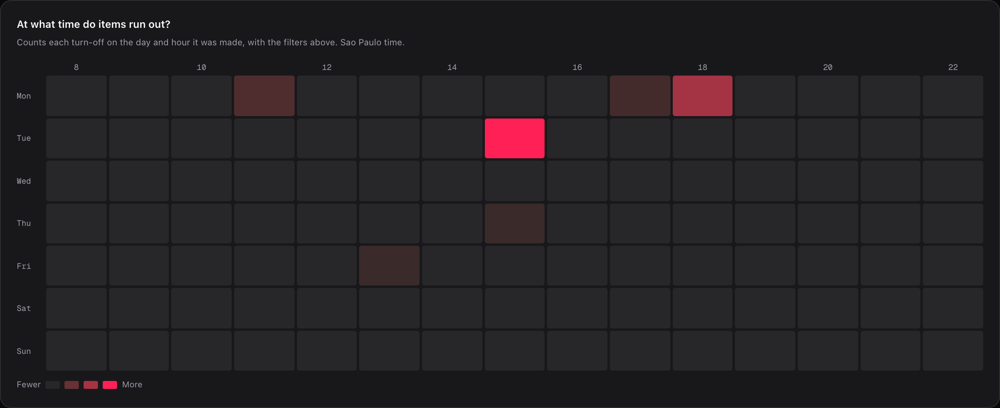
</Frame>

---

## El panel de un producto

<Frame>
  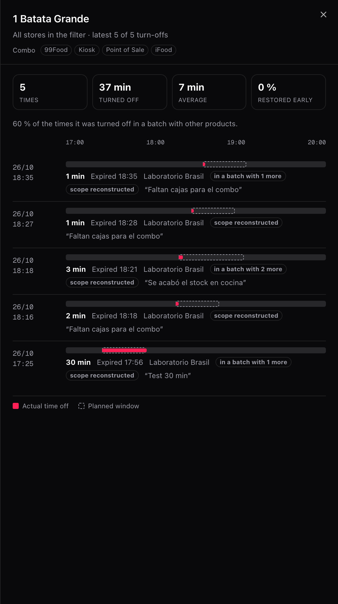
</Frame>

Haz clic en una fila de **Productos más apagados** (o enfócala y presiona Enter). Se abre un panel con:

- **Cuatro mini tarjetas**: **Veces**, **Apagado**, **Promedio** y **Volvió antes**.
- **Una línea por apagado**, del más nuevo al más viejo, de 20 en 20 con **Cargar más**. Cada línea muestra la fecha y hora, una barra de **tiempo real** (llena) sobre la **ventana planeada** (punteada), la duración, cómo terminó, la tienda y el motivo escrito por quien apagó.

Cómo puede terminar un apagado: **Restaurado manualmente**, **Venció**, **Resincronizado** o **Sigue apagado**. **Resincronizado** solo aparece en apagados antiguos: el producto volvió a venderse porque una sincronización del menú lo reactivó. Hoy no ocurre.

Los apagados que se deshicieron porque no se pudo agendar el reencendido nunca existieron para el cliente: no cuentan en esta pantalla.

Etiquetas que puedes ver en una línea:

| Etiqueta | Qué significa |
| --- | --- |
| **Programado** | Es un apagado de varios días, no un incidente. |
| **en lote con N más** | Se apagó en la misma operación que otros N productos. |
| **apagado sin confirmar** | Fire apagó el producto, pero algún canal no confirmó el aviso. |
| **reencendido sin confirmar** | Fire volvió a vender el producto, pero algún canal no confirmó el aviso. |
| **alcance reconstruido** | Es un apagado anterior a esta pantalla: sus canales y menús se completaron después con la asignación del día en que se cargó el histórico. |

<Info>
La línea de tiempo usa un eje de **un solo día**. Un apagado que cruza la medianoche se corta al final del eje.
</Info>

---

## Cuando un canal no se enteró

Cuando se apaga o se reenciende un producto, Fire avisa a cada canal. Si algún aviso no se confirmó, arriba de las tablas aparece una franja ámbar. Solo aparece cuando hay casos.

- **Apagados que no llegaron a todos los canales**: Fire apagó el producto, pero algún canal no confirmó. **El cliente puede pedir algo que no hay.**
- **Reencendidos que no se confirmaron**: Fire volvió a vender el producto, pero algún canal respondió con error o le faltaba configuración. **El producto puede seguir apareciendo apagado cuando ya hay stock.**

<Frame>
  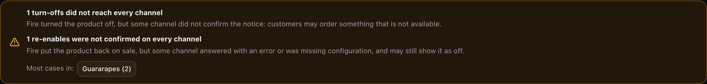
</Frame>

Debajo, **Más casos en:** lista las 5 tiendas con más casos. Cada una es un botón: al hacer clic, toda la pantalla se filtra por esa tienda.

<Note>
No es una falla cuando el aviso no se mandó porque otro apagado ya tenía ese producto apagado. Esos casos no cuentan en la franja.
</Note>

<Note>
La parte de **apagado sin confirmar** solo puede aparecer en apagados creados después del lanzamiento de esta pantalla: antes no se guardaba ese resultado. La de **reencendido sin confirmar** también aplica a apagados anteriores.
</Note>

Para resolver un caso concreto, ve a [Agotados](/es/manuals/backoffice/out-of-stock), sección **Si un canal no se enteró**.

---

## Exportar a Excel

El botón **Exportar Excel** (arriba a la derecha) descarga `agotados_<desde>_<hasta>.xlsx` con los **mismos filtros** que ves. Mientras se genera dice **Generando…**.

| Hoja | Qué trae | Límite |
| --- | --- | --- |
| **Ranking** | Un renglón por producto: tipo, opción en, canales, tiendas, veces, horas sin vender, promedio por vez (h), volvió antes y en lote. | 500 productos |
| **Detalle** | Un renglón por apagado: tienda, apagado, vencía, volvió, cierre, horas sin vender, tipo, productos en el lote, avisos entregados, motivo y alcance. | 20.000 renglones |

- Las horas van como **número con 2 decimales**, para que puedas sumarlas.
- Las fechas van como `AAAA-MM-DD HH:mm`, en la zona horaria de la pantalla.
- Si el detalle pasa el tope, al final aparece una fila que avisa del recorte.
- Las columnas de aviso dicen **Sí**, **No**, **Sin dato** o **No aplica (vigente)**.
- Puedes hacer **10 exportaciones por minuto**, y el límite se comparte con los demás reportes de Fire. Si lo pasas, la pantalla te dice cuántos segundos esperar.

---

## Recetas: cómo se resuelven los casos reales

<AccordionGroup>
  <Accordion title="No veo el apagado que hicimos ayer">
    1. Revisa el filtro **Tipo de apagado**. Si dice **Incidente**, los apagados programados no aparecen.
    2. Cámbialo a **Ambos**.
    3. Revisa que **Período** incluya la fecha **en que se creó** el apagado, no la fecha en que vencía.
    4. Revisa **Tienda**, **Canal** y **Menú**: un apagado sin menú asignado desaparece al elegir cualquiera de los tres.
    5. Recuerda el retraso de unos 5 minutos si el apagado es muy reciente.
  </Accordion>

  <Accordion title="Qué producto se nos acaba siempre">
    1. Deja **Período** en **Últimos 90 días**.
    2. Elige **Ambos** si quieres incluir también los programados.
    3. Mira **Agotados recurrentes**: son los pares tienda × producto con 4 o más apagados.
    4. Compara **Veces** con **Días distintos**. Muchos días distintos significa un hábito, no un mal día.
    5. Llévale esa lista a quien hace los pedidos de reposición de esa tienda.
  </Accordion>

  <Accordion title="Creo que se acabó un insumo compartido">
    1. En **Productos más apagados**, mira la columna **En lote**.
    2. Busca productos con **En lote** muy alto que compartan canales y tiendas.
    3. Abre el panel de uno: las etiquetas **en lote con N más** te dicen cuántos se apagaron juntos y el motivo explica qué faltó.
    4. Si el motivo se repite ("faltan cajas para el combo"), el problema es ese insumo, no cada producto.
  </Accordion>

  <Accordion title="A qué hora conviene reforzar la reposición">
    1. Elige una **tienda** para que el mapa use su propia zona horaria.
    2. Mira **¿A qué hora se agota?**: las celdas más claras son las horas con más apagados.
    3. Cruza el día y la hora con tu calendario de entregas. Un agotado a las 15 h todos los martes suele ser una entrega que llega tarde.
  </Accordion>

  <Accordion title="Un cliente pidió algo que estaba apagado">
    1. Revisa si aparece la franja ámbar de **apagados que no llegaron a todos los canales**.
    2. Haz clic en la tienda del cliente en **Más casos en:**.
    3. Abre el producto: la etiqueta **apagado sin confirmar** marca el apagado exacto.
    4. Resuélvelo desde [Agotados](/es/manuals/backoffice/out-of-stock) y revisa la configuración del canal que no confirmó.
  </Accordion>

  <Accordion title="Necesito el detalle para una reunión">
    1. Aplica los filtros que quieres presentar.
    2. Presiona **Exportar Excel**.
    3. En la hoja **Detalle** tienes cada apagado con su motivo. En **Ranking**, el resumen por producto.
  </Accordion>
</AccordionGroup>

---

## Un ejemplo con números

Dos apagados del **mismo producto en la misma tienda**:

| Apagado | Desde | Hasta | Duración |
| --- | --- | --- | --- |
| A | 12:00 | 14:00 | 2 h |
| B | 13:00 | 15:00 | 2 h |

| Número | Valor | Por qué |
| --- | --- | --- |
| **Veces** | 2 | Hay dos registros. |
| **Promedio** | 2 h | Cada apagado duró 2 h. |
| **Tiempo sin vender** | **3 h** | De 12 a 15 h el producto estuvo apagado. Las 2 h del cruce (13 a 14 h) se cuentan una vez. |

Por eso **Veces × Promedio no es igual a Tiempo sin vender**: no es un error.

Un caso real de la cuenta de ejemplo, **1 Batata Grande**, un combo:

| Dónde | Muestra | Por qué |
| --- | --- | --- |
| Tabla **Productos más apagados** | **1 h** | La tabla redondea a horas enteras. |
| Panel lateral | **37 min** | El panel usa minutos. |
| Excel | **0,62 h** (aprox.) | El Excel usa horas con 2 decimales. |

Son el mismo dato: 5 apagados que sumaron 37 minutos.

---

## Errores que salen caros

<Warning>
**Decidir con la vista por defecto.** Con **Incidente** no ves los apagados programados. Un producto "sin helado hasta el 30" puede no aparecer y parecer que todo está bien. Cambia a **Ambos** antes de sacar conclusiones.
</Warning>

<Warning>
**Comparar tiendas de distintas zonas horarias sin filtrar.** Sin una tienda elegida, toda la pantalla se lee con la zona horaria más común entre tus tiendas. Si tus tiendas están en distintos husos horarios, elige una tienda para ver sus días y horas exactos: las de otras zonas quedan con el día y la hora corridos en el gráfico y en el mapa.
</Warning>

<Warning>
**Contar apagados en varios canales como varios problemas.** Cada canal que apagas cuenta como una vez; si apagas en toda la tienda, cuenta una. Apagarlo en 2 canales puntuales da 2 veces y 100 % **en lote**, aunque fue una sola acción. El tiempo sin vender no se duplica, pero las veces sí.
</Warning>

<Warning>
**Usar esta pantalla como reporte de ventas perdidas.** No hay montos ni cantidades vendidas. Dice cuánto tiempo estuvo apagado el producto, no cuánto dejaste de vender.
</Warning>

<Warning>
**Comparar con Agotados.** **Agotados** muestra lo que está apagado **ahora** en una tienda. Esta pantalla cuenta lo que **se creó** en el período, excluye los apagados deshechos y tiene hasta 5 minutos de retraso. Los números no tienen por qué coincidir.
</Warning>

---

## Qué pasa con los casos raros

- **Producto o tienda que ya no existe**: en vez del nombre aparece su identificador interno.
- **"Todas" con un usuario limitado**: son todas **tus** tiendas. Si tienes tiendas en otro país, no las ves hasta cambiar el país del encabezado.
- **Falla la carga**: la pantalla dice "No se pudo cargar el análisis de agotados". Si ya había datos, los sigue mostrando con el error arriba. Vuelve a intentar cambiando un filtro.
- **Sin cuenta elegida**: la pantalla pide elegir una cuenta y un país en la parte superior.
- **Usuario sin tiendas en esa cuenta y país**: dice "No tiene tiendas asignadas en esta cuenta y país."

<Frame>
  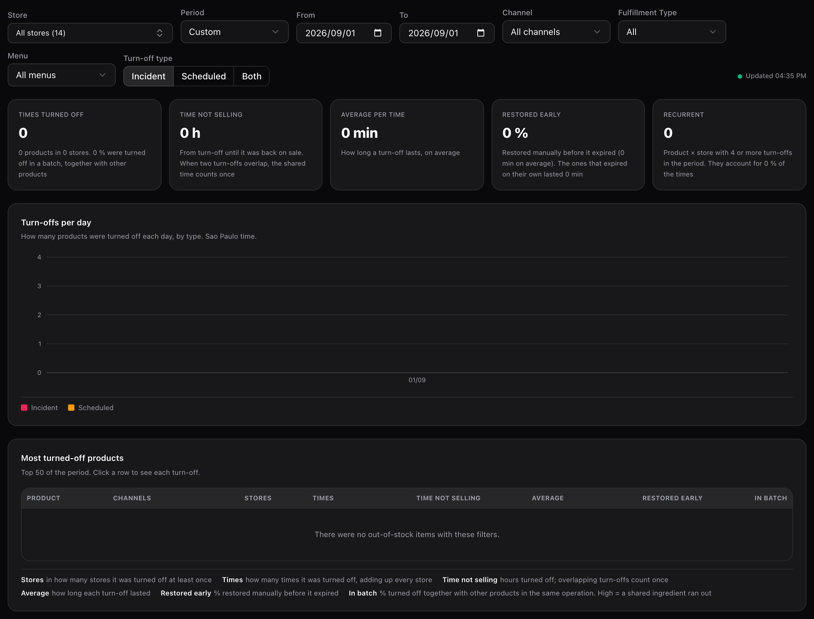
</Frame>

Cuando no hay apagados, las tarjetas muestran ceros y las tablas dicen "No hubo agotados con estos filtros."

<Frame>
  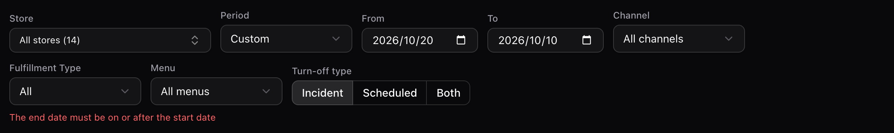
</Frame>

Si el rango está al revés o pasa de 92 días, aparece un error en rojo bajo los filtros y la pantalla no consulta nada hasta que lo corrijas: "La fecha final debe ser igual o posterior a la inicial" o "El período no puede superar 92 días".

---

## La ayuda dentro de la pantalla

<Frame>
  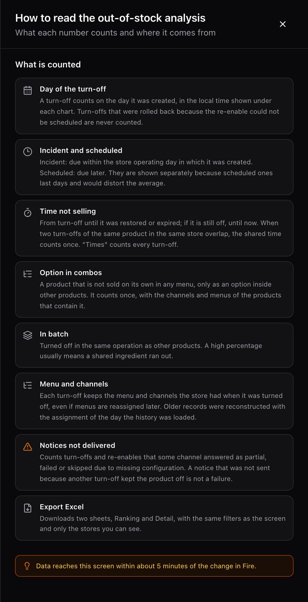
</Frame>

El botón **Ayuda** abre un panel con las definiciones de cada número. Usa las mismas palabras que este manual.

---

## Glosario

| Término | Qué significa |
| --- | --- |
| **Apagado** | Cada vez que alguien saca un producto de la venta en **Agotados**. Es la unidad que cuenta esta pantalla. |
| **Incidente** | Apagado que vence dentro del día operativo de la tienda en que se creó. |
| **Programado** | Apagado que vence después del cierre del día operativo en que se creó. |
| **Tiempo sin vender** | Horas en que el producto estuvo apagado en una tienda. Si dos apagados se cruzan, el tramo en común cuenta una vez. |
| **Volvió antes** | Apagado que alguien restauró a mano antes de que venciera. |
| **En lote** | Apagado hecho junto con otros productos en la misma operación. |
| **Recurrente** | Producto que se apagó 4 o más veces en la misma tienda dentro del período. |
| **Aviso sin confirmar** | Aviso de apagado o de reencendido que algún canal no confirmó. |
| **Alcance reconstruido** | Apagado anterior a esta pantalla, cuyos canales y menús se completaron después. |
| **Día operativo** | El día de trabajo de la tienda, con su horario de cierre. Decide si un apagado es incidente o programado. |
| **Opción en N productos** | Producto que no se vende solo, sino como opción dentro de N productos. |

---

## Preguntas frecuentes

<AccordionGroup>
  <Accordion title="¿Por qué no veo ningún apagado?">
    Casi siempre es el filtro **Tipo de apagado** en **Incidente**. Cámbialo a **Ambos**. Si sigue vacío, revisa que el período, la tienda y los demás filtros incluyan el día en que **se creó** el apagado.
  </Accordion>

  <Accordion title="¿Quién puede ver esta pantalla?">
    La ve quien tiene acceso a **Analítica → Órdenes**, y solo con las tiendas que tiene asignadas, en la pantalla y en el Excel. No tiene un permiso propio. Si no la ves, pídele acceso a tu administrador.
  </Accordion>

  <Accordion title="¿Se actualiza en vivo?">
    No. Los datos llegan unos 5 minutos después del cambio en Fire y la pantalla no se refresca sola: se actualiza al cambiar un filtro o al reabrirla. **Actualizado HH:MM** es la hora en que la pantalla recibió los datos, no la hora del último apagado.
  </Accordion>

  <Accordion title="¿Por qué Veces × Promedio no da el Tiempo sin vender?">
    Porque el tiempo sin vender descuenta los cruces entre apagados del mismo producto y tienda, y el promedio no. Hay un ejemplo con números más arriba.
  </Accordion>

  <Accordion title="¿Qué día cuenta un apagado de varios días?">
    El día en que se creó. Un apagado programado del lunes al viernes suma una vez, el lunes, en el gráfico y en el mapa de horas.
  </Accordion>

  <Accordion title="¿Por qué un producto aparece en un menú que ya cambié?">
    Porque el canal, el Tipo de Fulfillment y el menú de cada apagado quedan congelados en el momento de apagar. Reasignar un menú no cambia el historial.
  </Accordion>

  <Accordion title="¿Hay una API para esto?">
    No una pública. La pantalla usa endpoints internos que no están documentados para integraciones. Si necesitas los datos fuera de Fire, usa **Exportar Excel**.
  </Accordion>
</AccordionGroup>

---

## Lo que viene

Esto **no** existe hoy, y no hay fecha comprometida para ninguno:

- Montos ni **ventas perdidas** por apagado.
- Actualización automática de la pantalla.
- Alertas cuando un producto llega a 4 apagados.
- Exportar más de 500 productos en **Ranking** o más de 20.000 apagados en **Detalle**.
- Una API pública con estos datos.
- Guardar los filtros en el enlace de la pantalla para compartirla.
