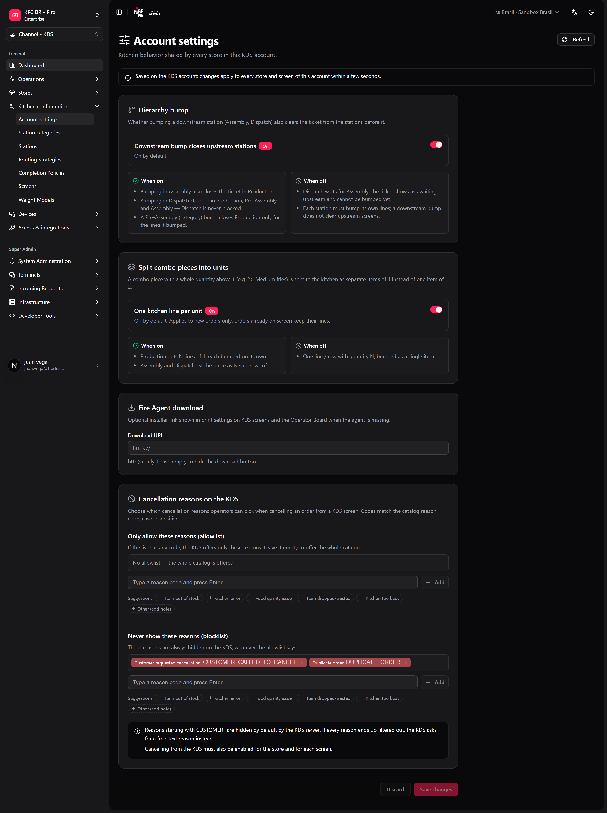

Algunas reglas de cocina no deberían cambiar de una tienda a otra. Si una tienda deja que Despacho cierre un ticket que Armado no terminó y otra no, el mismo pedido se comporta distinto en la cadena — y soporte no puede saber qué regla sigue cada tienda. Estos ajustes viven una sola vez, en la cuenta KDS, y aplican a todas las tiendas y pantallas de esa cuenta.

**Dónde trabajas:** **KDS → Configuración de cuenta** (`/kds/admin/account-settings`) en el backoffice. Los admins de tienda también ven los mismos ajustes en **fire-kds → Configuración → KDS cuenta**.

<Note>
  **Lo mínimo que hay que saber**

  - Guardar aquí cambia **todas las tiendas** de la cuenta en pocos segundos. No hay sobrescritura por tienda (salvo la agrupación de combos en una estación, que configura soporte).
  - El **bump jerárquico** está **activado** por defecto: un bump posterior (Armado, Despacho) también retira el ticket de las estaciones anteriores.
  - Las listas de motivos de cancelación solo filtran lo que los operadores pueden elegir. La cancelación igual tiene que estar habilitada por tienda y por pantalla.
</Note>

## El camino simple

La mayoría de las cuentas deja los defaults y solo configura el link del Agente Fire.

<Steps>
  <Step title="Abre Configuración de cuenta">
    En el backoffice, ve a **KDS → Configuración de cuenta**.
  </Step>
  <Step title="Revisa el bump jerárquico">
    Deja activado **El bump posterior cierra las estaciones anteriores**, salvo que tu cocina necesite que Despacho espere a Armado.
  </Step>
  <Step title="Pega el link de descarga del Agente Fire">
    En **Descarga de Fire Agent**, pega el link del instalador en **URL de descarga** (http o https). Déjalo vacío para ocultar el botón.
  </Step>
  <Step title="Guarda los cambios">
    Haz clic en **Guardar cambios**. La barra de abajo te avisa cuando hay cambios sin guardar; **Descartar** vuelve a lo guardado.
  </Step>
</Steps>

<Frame>
  
</Frame>

<Tip>
  Si tus tiendas usan una sola pantalla de armado y no tienen despacho, los defaults son correctos. Ya terminaste.
</Tip>

## Bump jerárquico

Define si una estación más adelante en el flujo puede cerrar un ticket al que una estación anterior todavía no le hizo bump.

| | Activado (default) | Desactivado |
|---|---|---|
| Bump en **Armado** | También cierra el ticket en Producción. | Producción conserva sus propias líneas. |
| Bump en **Despacho** | Lo cierra en Producción, Pre-armado y Armado. Despacho nunca queda bloqueado. | Despacho espera a Armado: el ticket muestra **esperando estación previa** y no se le puede hacer bump. |
| Bump en **Pre-armado** | Cierra en Producción solo las líneas a las que les hizo bump. | Cada estación hace bump de sus propias líneas. |

El pedido y sus webhooks no cambian: lo que cambia es qué pantallas siguen mostrando el ticket.

## Dividir piezas de combo en unidades

Una pieza de combo con cantidad entera mayor a 1 (por ejemplo, 2× Papas medianas) puede llegar a la cocina como dos ítems de 1 en vez de un ítem de 2.

| | Activado | Desactivado (default) |
|---|---|---|
| Producción | N líneas de 1, cada una con su propio bump. | Una línea con cantidad N. |
| Armado / Despacho | La pieza se lista como N subfilas de 1. | Una subfila con cantidad N. |

Solo cambian los pedidos nuevos. Los pedidos que ya están en pantalla conservan sus líneas.

## Agrupar piezas de combo en pre-armado

En una estación de **pre-armado**, las piezas de un combo se muestran bajo el nombre del combo (`1 Big Box`, con sus piezas como sublíneas azules) en lugar de como líneas sueltas. Está **activado** por defecto.

Este se configura en **fire-kds → Configuración → KDS cuenta** (**Agrupar piezas de combo en pre-ensamble**). Si lo desactivas, pre-armado lista las piezas sueltas, como producción.

## Motivos de cancelación en el KDS

Cuando un operador cancela desde una pantalla de cocina, elige un motivo del catálogo de cancelación de Fire. Aquí acotas esa lista:

- **Permitir solo estos motivos (lista permitida)** — si tiene algún código, el KDS ofrece solo esos. Vacía = todo el catálogo.
- **Nunca mostrar estos motivos (lista bloqueada)** — siempre ocultos, diga lo que diga la lista permitida.

Escribe un código de motivo (letras, dígitos y `_ . : -`, por ejemplo `KITCHEN_ERROR`) y presiona **Enter**, o elige una de las sugerencias. Un código no puede estar en las dos listas.

<Info>
  Los códigos que empiezan con `CUSTOMER_` el KDS los oculta por defecto: un cocinero no debería cancelar en nombre del cliente. Si todos los motivos quedan filtrados, el KDS pide en su lugar un motivo en texto libre.
</Info>

## Descarga de Fire Agent

**URL de descarga** es el link al instalador del Agente Fire que usa tu equipo. Cuando está configurado, la configuración de impresión de las pantallas KDS y del tablero de operador muestra un botón **Descargar Fire Agent**, para que quien configura un PC o tablet nuevo instale la versión correcta sin pedir el archivo.

## Recetas

<AccordionGroup>
  <Accordion title="Despacho no debe cerrar un pedido que Armado no terminó">
    1. Abre **KDS → Configuración de cuenta**.
    2. Desactiva **El bump posterior cierra las estaciones anteriores**.
    3. **Guardar cambios**.
    4. Prueba: un pedido al que Armado no le hizo bump muestra **esperando estación previa** en Despacho.
  </Accordion>
  <Accordion title="Cada porción de papas debe despacharse por separado">
    1. Activa **Una línea de cocina por unidad** en **Dividir piezas de combo en unidades**.
    2. **Guardar cambios**.
    3. Envía un combo nuevo con 2× papas: Producción muestra dos líneas de 1.
  </Accordion>
  <Accordion title="Los cocineros solo deben cancelar por motivos de cocina">
    1. En **Permitir solo estos motivos**, agrega `ITEM_OUT_OF_STOCK`, `KITCHEN_ERROR` y `KITCHEN_TOO_BUSY` (usa los códigos de tu catálogo).
    2. **Guardar cambios**.
    3. Comprueba que la cancelación esté habilitada para la tienda y la pantalla ([Periféricos, impresión y validación](/es/manuals/kds/peripherals-printing#2-cancelación-de-órdenes)).
  </Accordion>
  <Accordion title="Una tienda nueva necesita el Agente Fire">
    1. Pega una vez el link del instalador en **URL de descarga**.
    2. En el dispositivo nuevo, abre la configuración de la impresora en la pantalla KDS y toca **Descargar Fire Agent**.
    3. Sigue [Instalación del Agente Fire](/es/manuals/fire-agent/installation) o [Android](/es/manuals/fire-agent/android).
  </Accordion>
</AccordionGroup>

## Ejemplo práctico

Un combo con 2× Papas medianas, en una cocina con Producción, Armado y Despacho:

| Ajuste | Producción muestra | Bump en Despacho antes que Armado |
|---|---|---|
| Defaults (jerárquico activado, división desactivada) | `2 Papas medianas` (un bump) | Cierra el ticket en todas partes |
| Jerárquico desactivado, división activada | `1 Papas medianas` dos veces (dos bumps) | Bloqueado: **esperando estación previa** |

## Errores que salen caros

<Warning>
  **Desactivar el bump jerárquico en una cocina donde Armado suele atrasarse.** Despacho deja de poder cerrar pedidos y se acumulan mientras el repartidor espera. Desactívalo solo si Armado siempre hace bump.
</Warning>

<Warning>
  **Cambiar un ajuste "para una tienda".** Aplica a todas las tiendas de la cuenta. Acuérdalo con operaciones antes de guardar.
</Warning>

<Warning>
  **Una lista permitida con códigos que no existen en el catálogo.** El KDS no tiene nada que ofrecer y cae a texto libre, así que los reportes pierden el motivo. Copia los códigos del catálogo de cancelación.
</Warning>

## Glosario

| Término | Significado |
|---|---|
| **Bump jerárquico** | Una estación posterior cierra el ticket en las estaciones anteriores. |
| **Anterior / posterior** | Etapas previas / siguientes del flujo: Producción → Pre-armado → Armado → Despacho. |
| **Pieza de combo** | Un producto dentro de un combo que se rutea a la cocina como una línea propia. |
| **Lista permitida / lista bloqueada** | Motivos que son los únicos que se ofrecen / que nunca se ofrecen. |

## Preguntas frecuentes

<AccordionGroup>
  <Accordion title="¿Una tienda puede usar una regla distinta?">
    No. Estos ajustes son por cuenta. El comportamiento a nivel de tienda (display, impresión, turnero, cancelación sí/no) vive en la configuración de cada tienda.
  </Accordion>
  <Accordion title="¿Cuánto tardan las pantallas en tomar el cambio?">
    Unos segundos. No hace falta recargar las pantallas.
  </Accordion>
  <Accordion title="¿El bump jerárquico cambia el estado del pedido que se envía a las integraciones?">
    No. Solo cambia qué pantallas de cocina siguen mostrando el ticket.
  </Accordion>
  <Accordion title="¿Por qué no veo Configuración de cuenta en el menú?">
    Necesita un rol de admin con acceso a la cuenta KDS.
  </Accordion>
</AccordionGroup>

## Lo que esta página no hace

- No activa la cancelación: eso es por tienda y por pantalla.
- No instala el Agente Fire: solo muestra el link.
- No cambia los pedidos que ya están en pantalla.
