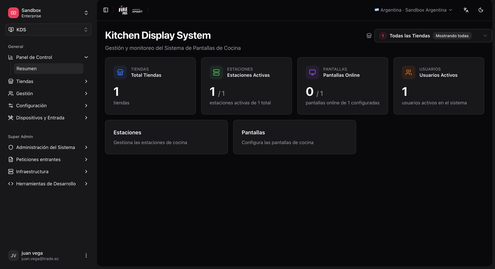
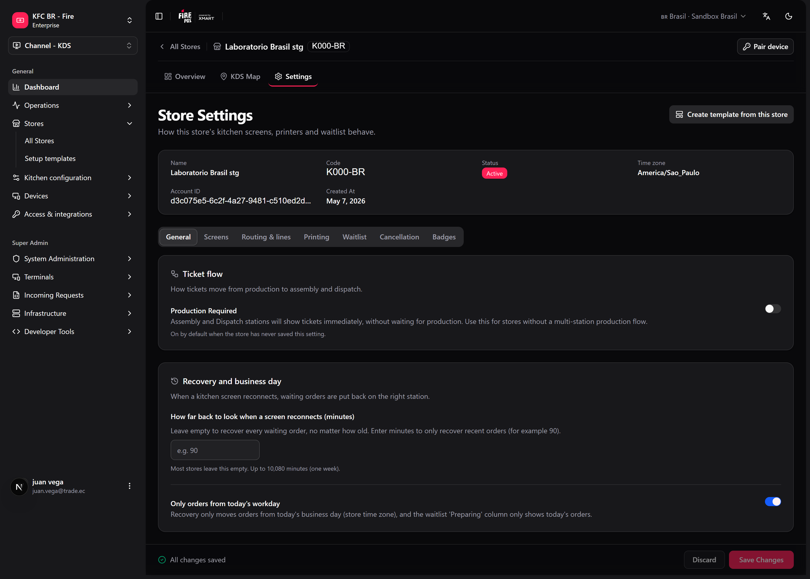
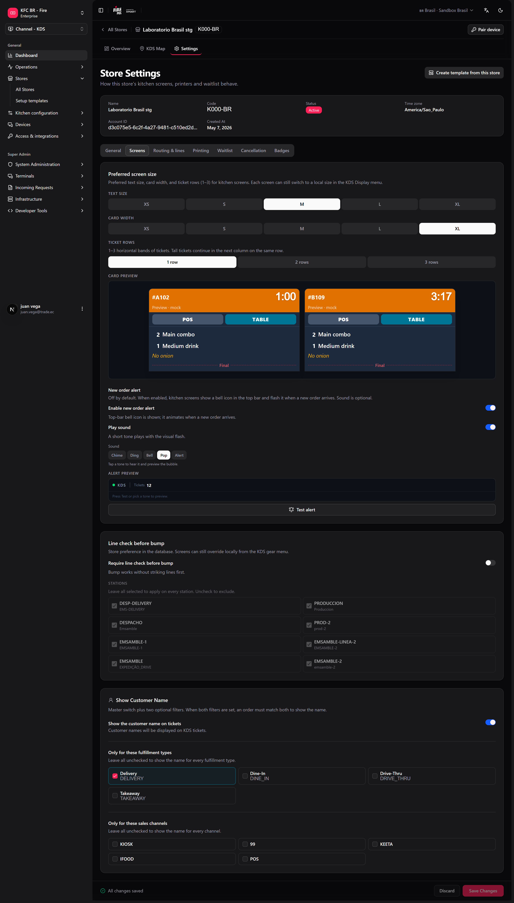

Esta sección explica cómo configurar y administrar una cocina digital (KDS) **desde el backoffice de Fire**, sin entrar en código. Está pensada para operaciones, implementación en tienda y soporte de producto.

**Dónde trabajas:** el menú **KDS**, bajo `/kds/admin`.

Para las acciones diarias del operador en la pantalla de cocina, consulta [Acciones en pantalla](/es/manuals/kds/screen-actions) y [Turnero](/es/manuals/kds/waitlist). Para enrolar TVs de cocina sin correo, consulta [Emparejar un dispositivo](/es/manuals/kds/device-pairing). Los supervisores que monitorean toda la tienda usan el [Tablero de operador](/es/manuals/kds/operator-board).

## Antes de empezar

### Qué necesitas

| Requisito | Detalle |
|---|---|
| Acceso al módulo KDS | Un rol con permisos KDS en la cuenta. |
| Una tienda KDS creada | **KDS → All Stores → Create store**. Al crear una tienda nueva, el sistema puede llevarte al asistente de configuración inicial. |
| Una pantalla física (fire-kds) | Cada TV/tablet de cocina ejecuta **fire-kds**. Prefiere el [emparejamiento de dispositivo](/es/manuals/kds/device-pairing) (código de 6 dígitos) para que el dispositivo entre a la tienda sin invitación por correo. |

Para la mayoría de tiendas alcanza con la **configuración default**: estaciones genéricas, ruteo con fallback a todas las estaciones activas y reglas de estación en "aceptar todo". Los ajustes finos por `item_type`, canal o servicio son opcionales y se explican más adelante.

### Cómo se relacionan las piezas

```text
Tienda
 ├── Estaciones      → "colas" lógicas de cocina (Parrilla, Freidora, Armado, Despacho…)
 ├── Pantallas       → dispositivos físicos que muestran tickets
 │    └── Asignación  → qué estaciones ve cada pantalla (pantalla ↔ estación)
 ├── Estrategia de ruteo → a qué estación va cada línea (por defecto: fallback a todas)
 │    └── Líneas de cocina → opcional; mantiene cada pedido dentro de una línea paralela
 ├── Dispositivo de teclado → teclado USB/BT asociado a una pantalla
 │    └── Layout de teclado → qué tecla ejecuta qué acción (bump, recall, etc.)
 └── Impresión al enviar → opcional; una o más estaciones de impresión
```

A nivel de cuenta (no por tienda):

- **[Credenciales Fire](/es/manuals/kds/fire-credentials)** — host y API key para impresión fiscal y cancelación.
- **[Categorías de estación](/es/manuals/kds/station-categories)** — códigos `item_type` y miniaturas de producto que usan los mapeos de ruteo.
- **[Configuración de cuenta](/es/manuals/kds/account-settings)** — bump jerárquico, piezas de combo, motivos de cancelación y el link de descarga del Agente Fire, compartidos por todas las tiendas.

<Tip>
  Regla mental: el **ruteo** decide *a qué estación de producción* va cada ítem; la **pantalla** decide *qué estaciones* ve el operador en ese monitor.
</Tip>

<Frame>
  
</Frame>

## Dos tipos de estaciones

No todas las estaciones se configuran igual:

| Tipo | Workflow stage | ¿Se elige por item_type en ruteo? | ¿Qué recibe? |
|---|---|---|---|
| **Producción** | `PRODUCTION`, `PRE_ASSEMBLY` | **Sí** — mappings + fallback | Cada **línea** del pedido (ítem a ítem). |
| **Convergencia** | `ASSEMBLY`, `DISPATCH` | **No** — no aparecen en las filas de mapping | El **ticket completo** cuando la producción avanzó (flujo de convergencia). |

En **Routing → Mappings**, el backoffice solo deja elegir estaciones de **producción / pre-assembly**. Armado y despacho **no son ruteables por ítem**: no puedes poner "`BURGER` → ASSEMBLY" en una fila de mapping.

En su lugar:

- **ASSEMBLY / DISPATCH** reciben el **ticket entero**, no línea por línea. Con **Producción requerida = Sí**, eso pasa cuando las líneas de producción se completaron (gates de convergencia). Con **Producción requerida = No** (cocina assembly-only), el ticket aparece **en cuanto entra la orden**.
- En la estrategia configuras la **convergence distribution** (qué estación de armado o despacho recibe el ticket si hay varias).
- En la **estación** de armado/despacho puedes filtrar por **canal de venta** (`POS`, `KIOSK`, `UBER_EATS`…) o **tipo de servicio** (`DINE_IN`, `DELIVERY`, `TAKEOUT`…) — **no** por `item_type`.

## Patrones de cocina

### Cocina simple (una sola cola)

Hay dos patrones válidos para una cocina chica. El que usamos **en producción** hoy es el **B** (assembly-only).

<Tabs>
  <Tab title="Patrón B — una sola estación ASSEMBLY (producción) ⭐">
    Cocina mínima real: **1 estación ASSEMBLY + 1 pantalla + Producción requerida = No**.

    | Paso | Qué hacer |
    |---|---|
    | 1 | **Store settings:** **Producción requerida = No**. |
    | 2 | Crear **una** estación `ASSEMBLY` (convergence activada). |
    | 3 | Crear **una pantalla**; asignar solo `ASSEMBLY`. |
    | 4 | Ruteo activo (mappings vacíos alcanza). |
    | 5 | (Opcional) Impresión listo-retiro en esa pantalla. |
    | 6 | Turnero en `/waitlist/{storeId}`. |

    ```text
    Orden → ASSEMBLY (inmediato) → cocinar → bump ticket → turnero "Listo" + impresión opcional
    ```
  </Tab>
  <Tab title="Patrón A — estación de producción KITCHEN">
    Modelar la cocina como "producción" pura (sin stage ASSEMBLY):

    | Paso | Qué hacer |
    |---|---|
    | 1 | Crear **una estación** con stage `PRODUCTION` (ej. code `KITCHEN`). |
    | 2 | Crear **una pantalla** y asignarle solo esa estación. |
    | 3 | Crear ruteo **sin mappings** y **fallback** apuntando a esa única estación. |
    | 4 | Reglas de estación en **Accept all item types**. |
    | 5 | **Producción requerida = Sí** (default). |

    ```text
    Orden → (sin mapping) → fallback → estación KITCHEN → pantalla única → bump por línea
    ```
  </Tab>
</Tabs>

<Tip>
  Si la cocina crece más adelante, agregas estaciones de producción, activas **Producción requerida = Sí** y mapeas por `item_type`. ASSEMBLY pasa a ser el expo donde converge el ticket cuando producción terminó.
</Tip>

### Flujo operativo (assembly-only)

Este es el setup que usan las tiendas chicas **hoy en producción**: una estación de armado, una pantalla, sin parrilla/freidora/despacho separados.

1. **Entra la orden** — el POS/kiosk envía el pedido al KDS. Se crea un ticket con sus líneas.
2. **Turnero: "Preparando"** — mientras la orden está `SENT_TO_KITCHEN`, su código aparece en la zona de preparación.
3. **Ticket en pantalla** — con **Producción requerida = No**, el ticket entra directo a la columna `ASSEMBLY`.
4. **Operador cocina** — ve el ticket completo: código, canal, servicio, ítems y modificadores. Puede usar **HOLD** si hace falta.
5. **Bump** — en ASSEMBLY es **un bump por pedido** (ticket completo).
6. **Se cierra el ciclo de cocina** — sin estación `DISPATCH`, el bump en armado es el cierre final: orden → **listo para retiro**, ticket KDS → **DONE**.
7. **Snackbar "Enviado"** — aparece hasta 10 segundos con opción **Deshacer**; la tecla `Z` todavía puede hacer recall después de que se oculta.
8. **Turnero: "Listo"** — el mismo código salta a la zona de listo para retirar.
9. **Impresión** (si está configurada) — cupón fiscal y/o ticket de entrega.
10. **El cliente retira** — usando el código en pantalla o el ticket impreso.

Para la experiencia completa del operador en estos pasos, consulta [Acciones en pantalla](/es/manuals/kds/screen-actions).

### Cocina multi-estación (referencia)

Para cocinas con parrilla + armado + despacho, el flujo es más largo:

```text
Orden
  └─► Ruteo por item_type → estaciones PRODUCTION (GRILL, FRY, KITCHEN…)
        └─► Reglas opcionales (canal / servicio / ítem)
              └─► Pantalla producción → bump POR LÍNEA
                    └─► El gate de convergencia se abre cuando producción terminó
                          └─► ASSEMBLY (ticket completo) → bump
                                └─► DISPATCH (opcional) → bump
                                      └─► READY_FOR_PICKUP + turnero + impresión
```

### Configuración de la tienda

El comportamiento de cocina de cada tienda vive en **KDS → Todas las tiendas → [tienda] → Configuración**, en siete pestañas que se guardan juntas:

<Frame>
  
</Frame>

<Frame>
  
</Frame>

| Pestaña | Qué controla |
|---|---|
| **General** | Datos de la tienda, **Producción requerida** y **Recuperación y día de operación** (qué pedidos vuelven cuando una pantalla se reconecta). |
| **Pantallas** | Defaults de display (fuente, tamaño de tarjeta, filas de comandas, alerta de pedido nuevo), **tache de líneas** y el nombre del cliente en los tickets (opcionalmente solo para algunos canales / tipos de entrega). |
| **Ruteo y líneas** | Acceso a las estrategias de ruteo y a las [líneas de cocina](/es/manuals/kds/routing#líneas-de-cocina-opcional). |
| **Impresión** | La [impresión al enviar](/es/manuals/kds/peripherals-printing#1-impresión-al-enviar-tienda), la impresora de cada pantalla y la impresora del tablero de operador. |
| **Lista de espera** | Tiempo en listos, tiempo por página y filtros del [turnero](/es/manuals/kds/waitlist#configuración). |
| **Cancelación** | Si la tienda y cada pantalla pueden cancelar pedidos. |
| **Etiquetas** | Nombres y colores de los canales y tipos de entrega en los tickets. |

Los admins de tienda ven los mismos ajustes en el dispositivo, en **fire-kds → Configuración**, repartidos en **KDS tienda**, **KDS cuenta** y **Líneas y ruteo**. Las pantallas pueden seguir conservando sobrescrituras locales de display.

### Dashboard de la tienda (fire-kds)

Después de emparejar, el dispositivo abre el dashboard de la tienda: las pantallas en el orden de bump con su estado en línea / **En pausa**, los turneros y el tablero de operador. **Abrir** siempre abre una pestaña nueva. Con líneas de cocina en uso, el dashboard dibuja una fila por línea. Si una estación de impresión no tiene una pantalla activa, aparece la alerta **La impresión al bump necesita atención**.

Para consultar pedidos pasados desde el backoffice, usa [Pedidos por tienda](/es/manuals/kds/store-orders).

Siguiente: [Configurar una tienda](/es/manuals/kds/store-setup) · [Configuración de cuenta](/es/manuals/kds/account-settings) · [Credenciales Fire](/es/manuals/kds/fire-credentials) · [Categorías de estación](/es/manuals/kds/station-categories) · [Emparejar un dispositivo](/es/manuals/kds/device-pairing) · [Tablero de operador](/es/manuals/kds/operator-board).
