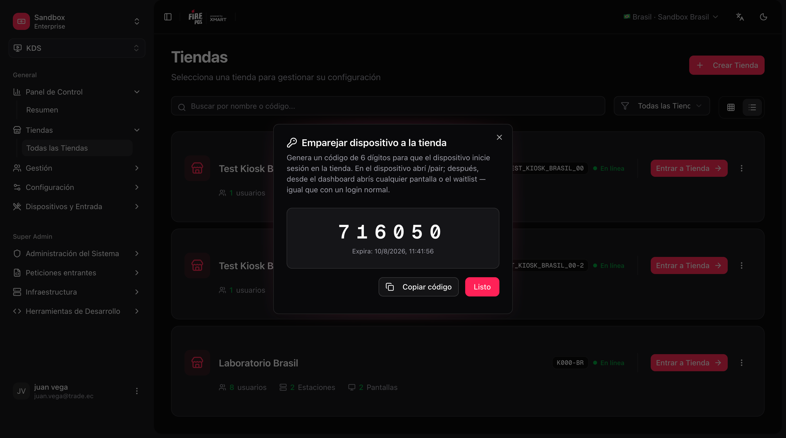
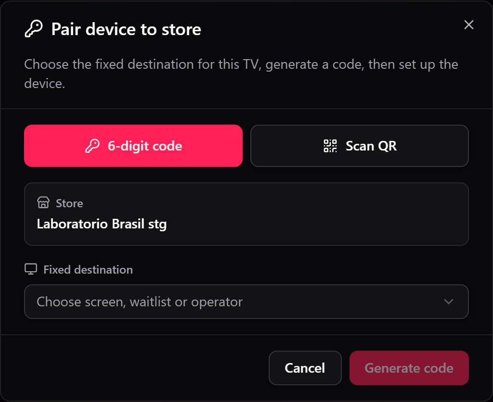
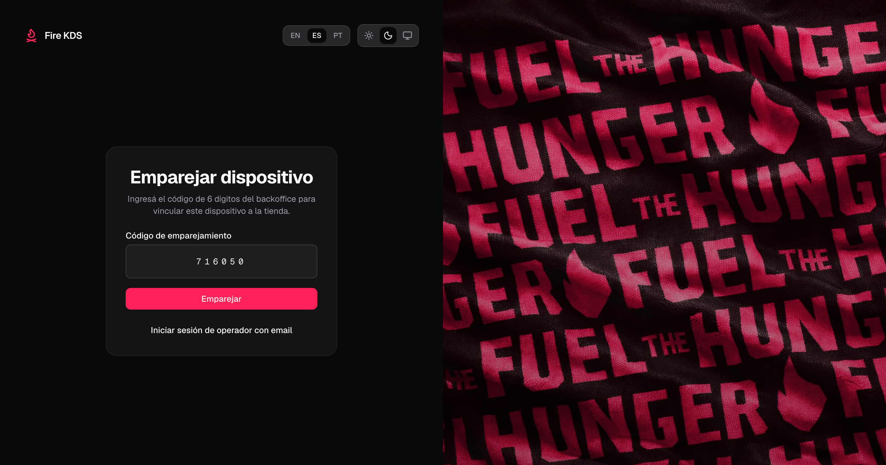
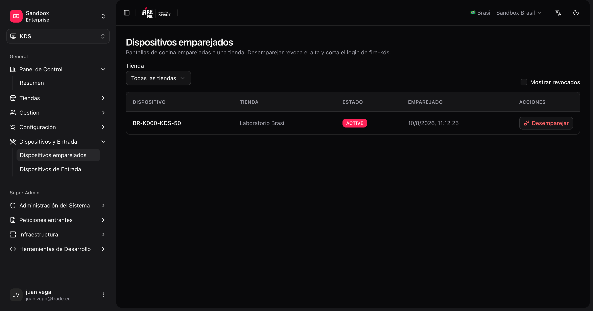

Las pantallas de cocina (TVs / tablets con **fire-kds**) se unen a una tienda **escaneando un QR** o con un **código de emparejamiento** corto, sin invitación por correo. El dispositivo queda como terminal de cocina de esa tienda y abre la pantalla, el turnero o el tablero de operador que elegiste para él.

Este flujo es **solo para dispositivos de cocina**. Los operadores humanos con acceso por correo siguen usando el login normal. Los terminales POS y kioscos tienen sus propios flujos.

## Qué necesitas

| Requisito | Detalle |
|---|---|
| Tienda KDS ya creada | Debe existir en **KDS → Todas las tiendas**. |
| Acceso en el backoffice | Permiso para abrir el menú de la tienda y generar el código. |
| Dispositivo con navegador | Abre fire-kds en la TV o tablet (recomendado a pantalla completa). |

## Dos formas de emparejar

| Método | En el backoffice | En la TV |
|---|---|---|
| **Escanear QR** (recomendado) | **Emparejar dispositivo** → **Escanear QR** con la cámara del teléfono, o pega el **ID del dispositivo** | `/pair` muestra un QR y su ID del dispositivo. Después de escanearlo, toca **Ya vinculé**. |
| **Código de 6 dígitos** | **Emparejar dispositivo** → **Generar código** | `/pair` → **Usar código de 6 dígitos** y escríbelo. |

Los dos métodos dan el mismo resultado. El QR evita escribir en una TV sin teclado.

## Emparejar un dispositivo

<Steps>
  <Step title="Abre Emparejar dispositivo">
    En el backoffice, ve a **KDS → Todas las tiendas**, abre el menú **⋮** de la tienda y elige **Emparejar dispositivo**. También puedes emparejar directo desde **KDS → Pantallas**: cada tarjeta de pantalla tiene una acción de emparejar que ya apunta a esa pantalla.

    <Frame>
      
    </Frame>
  </Step>
  <Step title="Elige el destino fijo">
    En **Destino fijo**, elige qué abrirá este dispositivo cada vez:

    | Destino | Abre |
    |---|---|
    | Una pantalla KDS | Esa pantalla de cocina (`/kds/{screenId}`). |
    | **Turnero** | El turnero de clientes (`/waitlist/{storeId}`). |
    | **Turnero delivery** | El tablero de delivery (`/waitlist/{storeId}/delivery`). |
    | **Operador de tienda** | El [Tablero de operador](/es/manuals/kds/operator-board) (`/operator/{storeId}`). |

    <Frame>
      
    </Frame>
  </Step>
  <Step title="Escanea el QR o genera un código">
    - **Escanear QR:** apunta la cámara al QR de la TV, o pega su **ID del dispositivo**. Luego el diálogo espera a la TV: en la TV, toca **Ya vinculé**.
    - **Código de 6 dígitos:** haz clic en **Generar código**. Caduca en poco tiempo; genera uno nuevo si hace falta. En la TV, toca **Usar código de 6 dígitos** e ingrésalo.

    <Frame>
      
    </Frame>
  </Step>
  <Step title="Confirma que el dispositivo está listo">
    Tras un emparejamiento correcto, el dispositivo abre su destino solo. No recargues la página.
  </Step>
</Steps>

<Tip>
  En `/pair` puedes cambiar a **Iniciar sesión de operador con correo** si una persona necesita la sesión de administración. Desde `/login`, usa **Emparejar un dispositivo de cocina** para volver al emparejamiento.
</Tip>

<Warning>
  Escanear el QR de la TV equivocada empareja esa TV a tu tienda. Revisa el ID del dispositivo en la pantalla que tienes enfrente antes de confirmar.
</Warning>

## Administrar dispositivos emparejados

Abre **KDS → Dispositivos emparejados** (`/kds/admin/paired-terminals`) para ver cada terminal de cocina vinculado a tu cuenta: tienda, nombre del terminal y estado.

Desde esa lista puedes **desvincular** un dispositivo. Tras desvincular, la TV pierde la sesión de cocina y vuelve a `/pair` la próxima vez que cargue.

<Frame>
  
</Frame>

## Cerrar sesión desde el dispositivo

Cerrar sesión desde una **sesión de dispositivo emparejado** revoca el alta del terminal. La TV vuelve a la pantalla de emparejamiento y debe emparejarse de nuevo.

Cerrar sesión de un operador con **correo/contraseña** **no** revoca el dispositivo de cocina.

## Después del emparejamiento

1. Abre cada pantalla de cocina desde el dashboard (o la URL `/kds/{screenId}`). **Abrir** siempre abre una pestaña nueva, así que el dashboard queda detrás.
2. Abre el [turnero / order display](/es/manuals/kds/waitlist) en la TV de retiro, y el tablero de delivery en la TV de los repartidores, si los usas.
3. Opcionalmente abre el [tablero de operador](/es/manuals/kds/operator-board) para supervisores.

<Check>
  Tu dispositivo de cocina está emparejado a la tienda y listo para ejecutar pantallas Fire KDS.
</Check>
