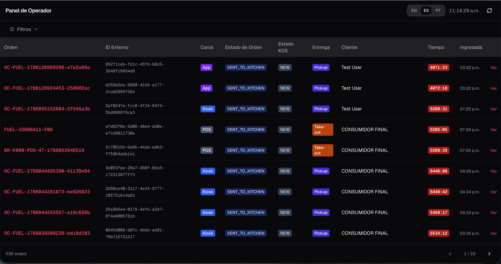
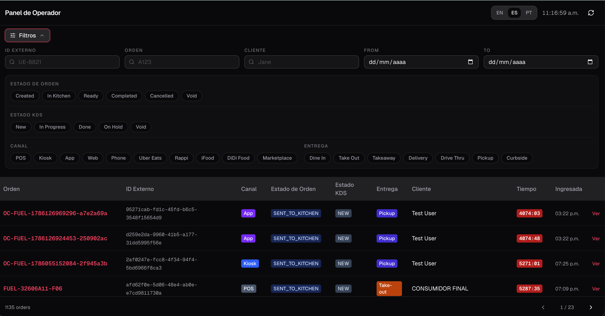
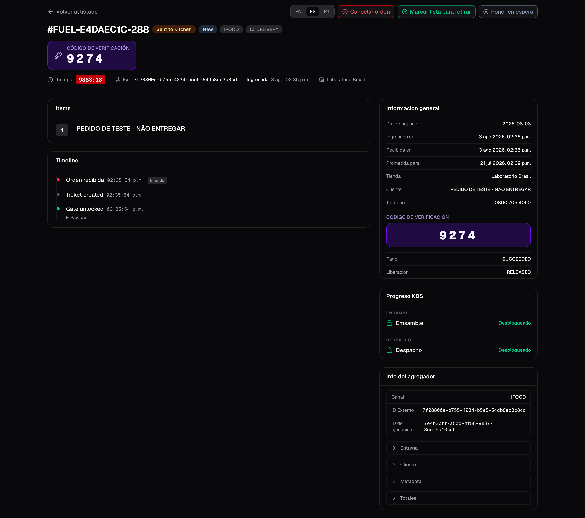
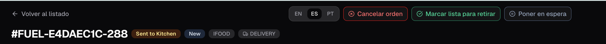
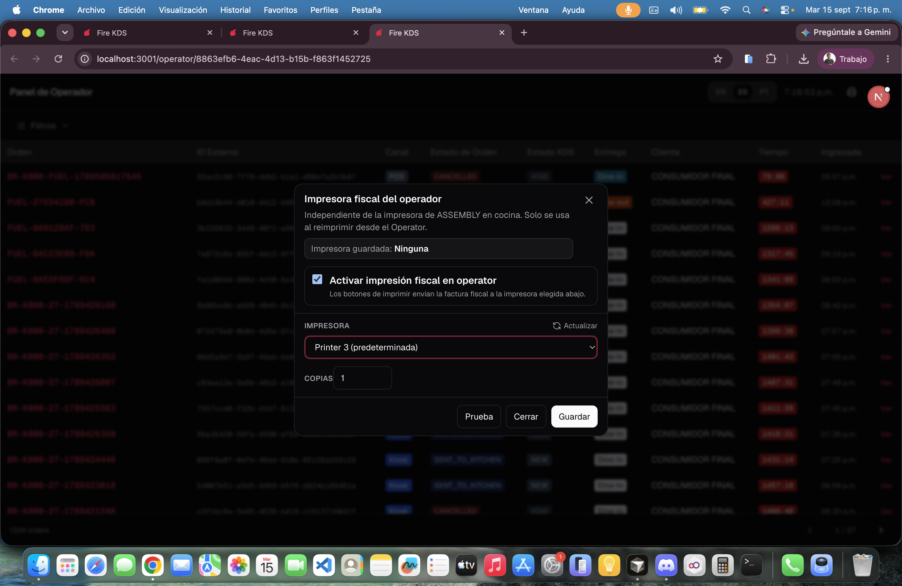

El **tablero de operador** es una vista a pantalla completa para supervisores de una tienda. Lista todos los pedidos con temporizadores en vivo, filtros y una página de detalle donde puedes cancelar un pedido, marcarlo listo para retiro o completar el despacho — incluso cuando el flujo de cocina necesita una intervención manual.

**Dónde abrirlo:** desde el dashboard de la tienda en fire-kds, o directamente en `/operator/{storeId}`. Déjalo corriendo en su propia pestaña.

## Listado de pedidos

El listado muestra pedidos activos y recientes con:

- **Nombre / código** — la misma etiqueta `#…` que muestran las TVs de cocina (buzzer o código corto) y después el código de pedido
- Badges de canal y tipo de entrega con los **colores de la tienda**, estado del pedido y estado de cocina
- Un **temporizador en vivo** (verde → ámbar → rojo) mientras el pedido está en cocina. Cuando ya está listo, despachado o cancelado, el temporizador muestra **—**
- La fecha y hora del pedido, en la **zona horaria de la tienda** (no la del navegador)

**Día operativo** (activado por defecto) muestra solo el día de negocio actual de la tienda. Desactívalo para ver días anteriores. El listado pagina con anterior / siguiente y muestra un indicador de carga mientras llega la página siguiente.

<Frame>
  
</Frame>

Usa el **selector de idioma** del encabezado (EN / ES / PT) igual que en las pantallas KDS.

## Filtros

Abre el panel de filtros para acotar el listado:

- Texto: **Código de orden**, **Código** (el código corto `#…` de la tarjeta de cocina), ID externo, nombre del cliente. Una búsqueda de texto sin fechas mira los últimos 7 días.
- Rango de fechas (día de negocio)
- Chips: estado del pedido, estado KDS, canal, tipo de entrega

Los filtros activos aparecen como chips removibles. Limpiar filtros reinicia la paginación a la página 1.

<Frame>
  
</Frame>

## Detalle del pedido

Haz clic en una fila para abrir el pedido en una ventana sobre el listado, así no pierdes tu lugar. El detalle incluye:

- Encabezado con badges de estado y el **código de verificación / recolección** destacado cuando el agregador lo envía
- Información general (canal, fulfillment, timestamps en zona de la tienda)
- Líneas / ítems del pedido
- **Progreso en cocina**: dónde debería verse cada parte de la comanda y qué estaciones ya la completaron. **Actualizar** lo vuelve a cargar
- Timeline de eventos de cocina y de estado
- Datos extra del agregador cuando existen

<Frame>
  
</Frame>

Qué muestra cada estación en **Progreso en cocina**:

| Estado | Significado |
|---|---|
| **En pantalla** | La estación tiene el pedido ahora. |
| **Esperando** / **Siguiente** | El pedido todavía no llegó a esa estación. |
| **Completado** | La estación hizo bump. Sigue completado aunque su pantalla se apague después. |
| **Pantalla desconectada** | El pedido está en una estación sin pantalla en línea, o se movió porque la pantalla se cayó. |
| **Completado · sin pantalla** | El pedido terminó mientras esa estación no tenía pantalla. |
| **Cancelada** | El pedido se canceló. |

## Acciones de supervisor

Desde el detalle puedes ejecutar sobrescrituras operativas (cada una pide confirmación):

| Acción | Cuándo aplica | Qué hace |
|---|---|---|
| **Cancelar** | Pedido no finalizado / cancelado | Cancela vía Fire con un motivo del catálogo de cancelación |
| **Listo para retiro** | Pedido aún en cocina (`SENT_TO_KITCHEN`) | Pasa el pedido a listo y sincroniza tickets / gates KDS |
| **Despachar** | Pedido ya está listo | Completa el pedido y cierra el ciclo de cocina |
| **Poner en espera / Reanudar** | Según necesidad | El mismo hold global de las pantallas de cocina |
| **Imprimir factura fiscal** | Agente Fire en este PC + **Impresora del Operator Board** de la tienda | Reimprime el comprobante fiscal. No es la impresora de cocina. |
| **Imprimir ticket de delivery** | Pedido delivery con ticket de cocina | Reimprime el ticket del repartidor en la misma impresora. Una copia; no se encola si falla. |

<Frame>
  
</Frame>

## Imprimir desde el tablero de operador

El icono de impresora abre la impresora del tablero de operador. Actívala, elige la impresora del Agente Fire en **este** computador, define las copias y prueba. También se puede configurar en el backoffice, configuración de la tienda → **Impresión** → **Impresora del Operator Board**. La impresión al enviar de cocina es otra impresora, en la tablet o el PC de expo. Si falta el Agente Fire, aparece **Descargar Fire Agent** cuando tu cuenta tiene el [link de descarga](/es/manuals/kds/account-settings#descarga-de-fire-agent).

<Frame>
  
</Frame>

### Impresión automática

**Impresión automática** imprime sola cuando un pedido entra en un estado, para que el supervisor no reimprima pedido por pedido. Elige:

| Opción | Valores |
|---|---|
| **Estado de la orden** | **En cocina**, **Lista para retirar** o **Despachada**. |
| **Qué imprimir** | **Comanda** y/o **Nota fiscal**. Los pedidos delivery siempre imprimen además el ticket de delivery. |
| **Canales** / **Entrega** | **Vacío = todos**. |
| **Solo el día operativo** | No imprime pedidos de días anteriores. |

El encabezado muestra la regla activa; **Configurar** abre la ventana de la impresora. Activar la impresión automática también activa **En vivo**, y apagar **En vivo** apaga la impresión automática. Los trabajos se imprimen uno por uno; un documento que ya se imprimió no se vuelve a imprimir en un reintento. Si un trabajo falla, la impresión automática **sigue activada** y muestra el error. El **Historial** guarda lo que se imprimió.

<Warning>
  La regla de impresión automática se guarda **en este navegador**, no en el servidor. Otro PC, o este mismo después de borrar sus datos, empieza con la impresión automática apagada. La impresora y las copias se guardan para la tienda.
</Warning>

<Warning>
  Si el Agente Fire está fuera de línea en el PC del supervisor, la reimpresión falla aunque la impresora de cocina funcione.
</Warning>

<Warning>
  Listo y despachar desde el tablero de operador **adelantan** el estado de cocina (líneas hechas, gates desbloqueados, ticket cerrado según corresponda). Úsalos cuando el piso necesite una intervención de supervisor — no como sustituto del bump normal en cada pedido.
</Warning>

## Cómo se diferencia de la pantalla de cocina

| | Pantalla de cocina | Tablero de operador |
|---|---|---|
| Audiencia | Cocineros / expo | Supervisores |
| Alcance | Estaciones asignadas a esa pantalla | Toda la tienda |
| Trabajo principal | Bump / hold / tachar líneas | Monitorear + sobrescribir |
| Turnero de clientes | No | No (usa el [order display](/es/manuals/kds/waitlist)) |

## Menú de sesión

El engranaje del encabezado tiene **Apagar encendido automático…** (para un PC que abre el tablero al arrancar) y **Cerrar sesión** / **Desemparejar dispositivo** en un dispositivo emparejado, igual que en las pantallas KDS. Una pestaña abierta mucho tiempo se recarga sola cuando se publica una versión nueva.

<Check>
  Puedes monitorear los pedidos de la tienda en vivo y aplicar cancelar, listo o despachar cuando el servicio lo necesite.
</Check>
