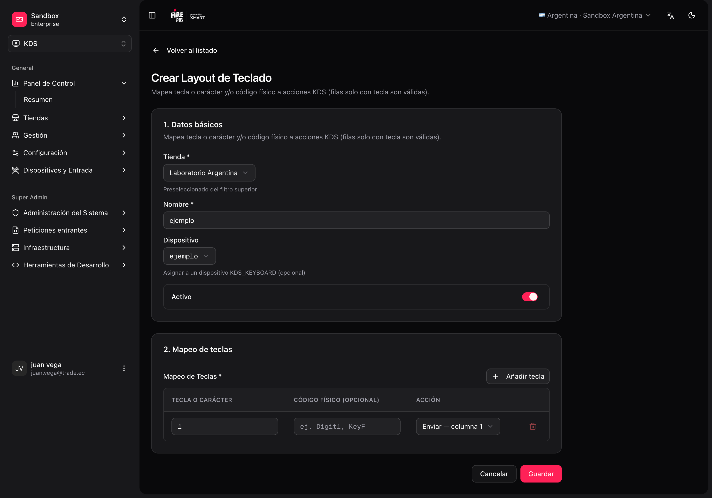
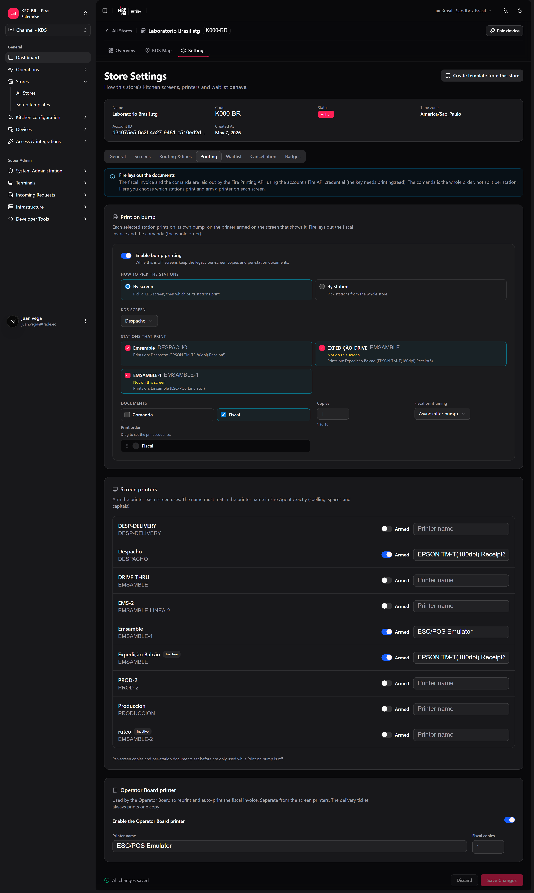
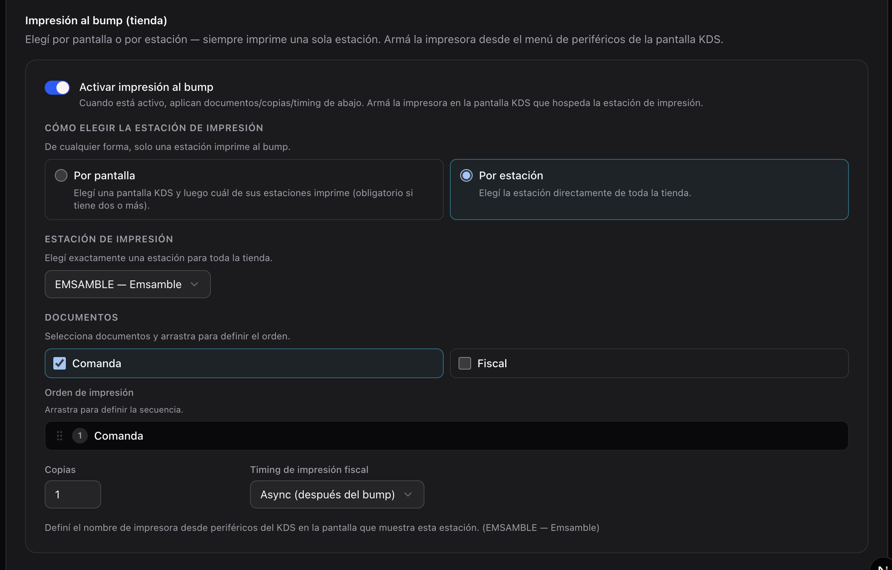
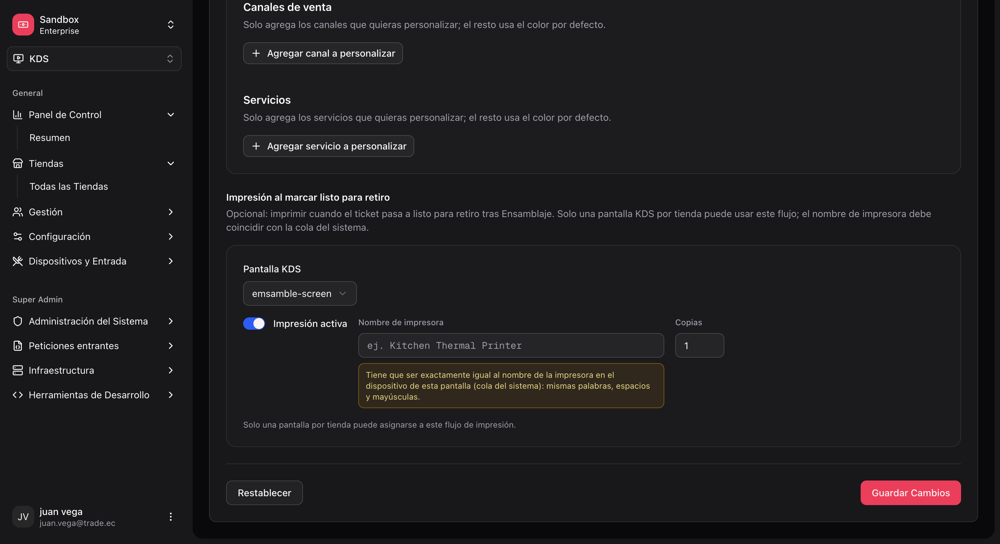
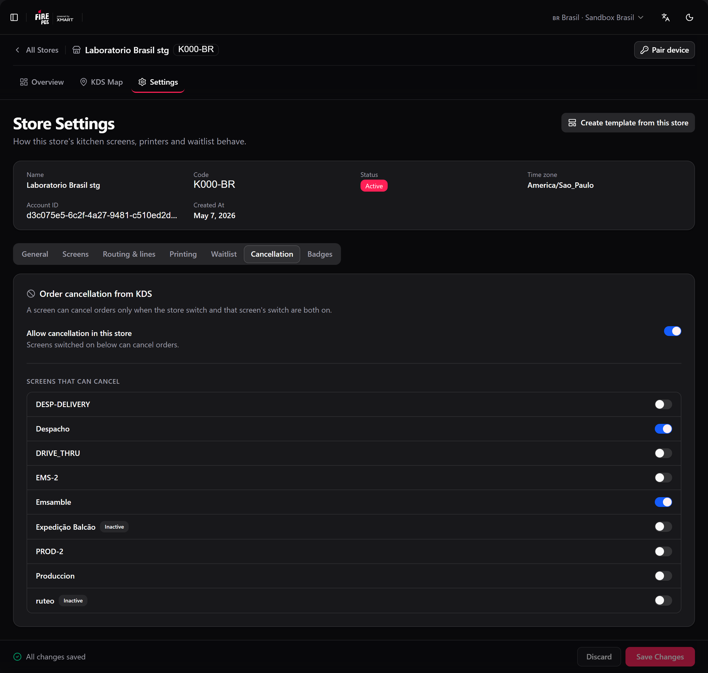
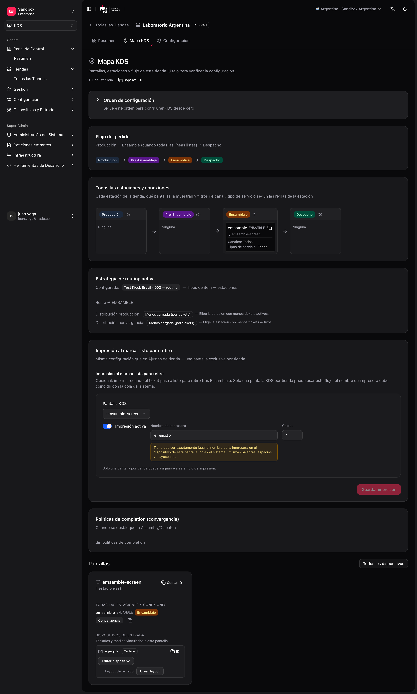

Esta página cubre la configuración restante — teclados, impresión y cancelación — y cómo validar la tienda antes de abrir la cocina.

## Teclados y dispositivos de entrada

Las teclas físicas (bump, cambiar página, recall) permiten al operador trabajar sin tocar la pantalla.

```text
Pantalla
 └── Input device (tipo KDS_KEYBOARD, ligado a la pantalla)
      └── Keyboard layout (mapeo tecla → acción)
```

### Acciones disponibles en el backoffice

Al crear o editar un layout, cada tecla puede disparar acciones como:

| Acción | Uso típico |
|---|---|
| `BUMP_COLUMN_1` … `BUMP_COLUMN_8` | Completar la columna N en la pantalla. |
| `NEXT_PAGE` / `PREV_PAGE` | Paginar tickets. |
| `REFRESH` | Refrescar la cola. |
| `HOLD_TICKET` / `RECALL_TICKET` | Retener / recuperar un ticket. |
| `PRINT_PENDING_FISCAL_INVOICES` | Disparar la impresión fiscal pendiente (según la integración del país). |
| `SELECT_*` / `BUMP_SELECTED` | Mover el resaltado y enviar el ticket resaltado (botonera). |
| `FOCUS_*` / `TOGGLE_STATION_SOLO` | Foco de estación y **zoom** (rastro estación / ticket). |

### Configurar un teclado

<Steps>
  <Step title="Crea el input device">
    **KDS → Input devices → Create** (`/kds/admin/devices/new`). Tipo: teclado KDS. Asócialo a la **pantalla** correcta.
  </Step>
  <Step title="Crea el keyboard layout">
    **KDS → Keyboard layouts → Create** (`/kds/admin/keyboard-layouts/new`). Elige la tienda y el dispositivo, y mapea las teclas a las acciones.
  </Step>
  <Step title="Guarda" />
</Steps>

<Frame>
  
</Frame>

También puedes crear o duplicar un layout desde **Store → KDS Map** (`/kds/admin/stores/{storeId}/kds-map`). Si una plantilla incluye teclado, al aplicarla se puede crear el dispositivo `{deviceIdentifier}-kbd` y el layout automáticamente.

## Impresión y cancelación

La impresión y la cancelación se configuran en la configuración de la tienda: **KDS → Todas las tiendas → [tienda] → Configuración** (`/kds/admin/stores/{storeId}/settings`). La página tiene siete pestañas — **General**, **Pantallas**, **Ruteo y líneas**, **Impresión**, **Lista de espera**, **Cancelación** y **Etiquetas** — y una sola barra de guardado para todas: una pestaña con cambios muestra un punto, y **Guardar configuración** guarda todas las pestañas a la vez. **Descartar** vuelve a lo guardado.

<Warning>
  La barra de guardado no avisa si sales por un link del menú con cambios sin guardar. Guarda antes de pasar a otra página.
</Warning>

### 1. Impresión al enviar (tienda)

**Qué hace:** cuando un cocinero envía en una **estación de impresión**, fire-kds imprime la **Comanda** (ticket de cocina), la **Factura fiscal**, o ambas.

**Dónde vive la regla:** pestaña **Impresión** → **Imprimir al despachar**, o **fire-kds → Configuración → KDS tienda** (solo admins). Elige las estaciones **Por pantalla** (elige una pantalla y luego cuáles de sus estaciones imprimen) o **Por estación** (cualquier estación de la tienda), los documentos, el **Orden de impresión**, las **Copias** (1 a 10) y el **Timing de impresión fiscal** (`Async (bump first)` o `Sync (wait for print)`).

<Frame>
  
</Frame>

Puedes elegir **más de una estación**: cada una imprime con su propio envío. Una tienda puede imprimir la comanda en Armado y la factura fiscal en Despacho, por ejemplo.

<Frame>
  
</Frame>

**Dónde se arma la impresora:** en cada pantalla que muestra una estación de impresión — en la pestaña **Impresión**, **Impresoras de pantalla** (interruptor **Activa** y escribe el nombre de la impresora), o en el propio dispositivo KDS, **Impresora de esta pantalla**. Debajo de cada estación de impresión, la pestaña te dice en qué pantalla **Imprime en**, o avisa **Sin impresora activa en sus pantallas** / **No se muestra en ninguna pantalla**.

<Warning>
  El nombre de la impresora debe coincidir **exactamente** con el del Agente Fire — letras, espacios y mayúsculas. Un nombre distinto no imprime nada, y el envío igual se completa.
</Warning>

**Fire arma los documentos.** La factura fiscal y la comanda llegan ya armadas desde Fire (la [API de impresión de Fire](/es/api-reference/print-order-document)); el KDS solo las envía a la impresora. Eso significa:

- La comanda es el **pedido completo**, no solo las líneas de la estación, y sus etiquetas siguen el **país de la tienda**, no el idioma de la pantalla.
- Un cambio de plantilla o un país nuevo no necesita una actualización del KDS.
- La factura se imprime aunque el documento fiscal todavía esté pendiente.

<Warning>
  La [credencial Fire](/es/manuals/kds/fire-credentials) de la cuenta debe tener el scope **`printing:read`** (se ve como **Impresión Lectura** en Gestión de API). Sin él, Fire responde `403` y **no se imprime nada** — ni comanda ni factura.
</Warning>

<Note>
  Las tiendas que aún corren la regla vieja por pantalla ven **Todavía se usan reglas de impresión anteriores** hasta que actives **Imprimir al despachar**. No asumas que ambas políticas están apagadas.
</Note>

**Qué se necesita para que funcione:**

1. Al menos una estación de impresión y un documento.
2. Una pantalla KDS **activa** que muestre cada estación de impresión, con una impresora armada.
3. Agente Fire corriendo en ese dispositivo — [Windows](/es/manuals/fire-agent/installation) o [Android](/es/manuals/fire-agent/android). fire-kds prueba primero la URL de la plataforma y **cae a la otra**. Si falta el agente, la configuración de impresión muestra **Descargar Fire Agent** cuando la cuenta tiene un [link de descarga](/es/manuals/kds/account-settings#descarga-de-fire-agent).
4. La credencial Fire con `printing:read`.

<Frame>
  
</Frame>

<Info>
  Una pantalla puede quedar **sin impresora**: guarda el campo de impresora vacío y esa pantalla deja de imprimir al enviar. En macOS, el Agente Fire responde "ok" para una impresora que no es una impresora de red real; ahora el KDS lo trata como **no impreso**, así el ticket no parece impreso cuando no salió nada.
</Info>

### 2. Cancelación de órdenes

**Qué hace:** permite al operador cancelar una orden desde el KDS (ícono en el ticket → confirmación).

**Dónde se configura:** pestaña **Cancelación** de la configuración de la tienda, o **fire-kds → Cancelación de órdenes…** en el dispositivo.

<Frame>
  
</Frame>

| Nivel | Config | Efecto |
|---|---|---|
| Tienda | **Permitir cancelación en esta tienda** | Si está off, ninguna pantalla puede cancelar, sin importar su propio interruptor. |
| Pantalla | **Pantallas que pueden cancelar** | Cada pantalla se habilita por separado. |

Varias pantallas pueden cancelar a la vez. Qué **motivos** pueden elegir los operadores se define una sola vez para toda la cuenta, en [Configuración de cuenta](/es/manuals/kds/account-settings#motivos-de-cancelación-en-el-kds). Además la orden necesita su ID externo XMART, y el operador un rol válido en la tienda.

### 3. Facturas fiscales encoladas

Cuando la impresora falla después de un envío, la factura fiscal queda en cola. **Imprimir facturas encoladas** (menú del KDS, o la tecla `PRINT_PENDING_FISCAL_INVOICES`) imprime solo la cola del **día de negocio actual**: lo que quedó de días anteriores sigue guardado pero no se imprime desde ahí. Para reimprimir una factura más vieja, usa el [Tablero de operador](/es/manuals/kds/operator-board).

### 4. Impresora del tablero de operador

La pestaña **Impresión** también tiene la **Impresora del Operator Board**: la impresora que usa el PC del supervisor para reimprimir e imprimir automáticamente la factura fiscal y el ticket de delivery. Es independiente de las impresoras de pantalla. Ver [Tablero de operador](/es/manuals/kds/operator-board#imprimir-desde-el-tablero-de-operador).

## Validar la configuración: KDS Map

Después de configurar (por plantilla o manual), abre:

**KDS → All Stores → [tu tienda] → KDS Map** (`/kds/admin/stores/{storeId}/kds-map`).

El mapa muestra:

- Pantallas y estaciones vinculadas.
- Estaciones sin pantalla (alertas).
- Dispositivos de entrada y layouts de teclado.
- **Impresoras de pantalla**: qué pantallas tienen una impresora armada.
- Salud general de la config.

<Frame>
  
</Frame>

## Checklist antes de producción

- [ ] Tienda KDS creada y activa.
- [ ] Estaciones con **codes** únicos y stages coherentes.
- [ ] Pantallas con el **device identifier** acordado con el hardware.
- [ ] Cada pantalla tiene estaciones asignadas (sort order correcto).
- [ ] **Una** estrategia de ruteo **activa**.
- [ ] **Cocina simple (prod):** estación `ASSEMBLY` + **Producción requerida = No** + una pantalla; probar turnero e impresión bump first.
- [ ] **Cocina simple (alternativa):** una estación `KITCHEN` + fallback; **Producción requerida = Sí**; sin mappings.
- [ ] **Cocina multi-línea:** mappings solo a estaciones **producción**; ASSEMBLY/DISPATCH vía convergencia, no en mappings.
- [ ] (Opcional) Teclado: dispositivo + layout por pantalla que lo use.
- [ ] (Opcional) **Imprimir al despachar:** estaciones de impresión y documentos elegidos, una impresora armada en una pantalla activa para cada una, y la credencial Fire con `printing:read`.
- [ ] (Opcional) Cancelación: habilitada para la tienda y las pantallas que la necesiten (pestaña **Cancelación**).
- [ ] KDS Map sin alertas críticas.
- [ ] Prueba con una orden real o seed: los ítems llegan a la pantalla/estación esperada.

## Rutas de referencia (backoffice)

| Sección | URL base |
|---|---|
| Inicio KDS | `/kds/admin` |
| Tiendas | `/kds/admin/stores` |
| Configuración inicial de tienda | `/kds/admin/stores/initial-setup/{storeId}` |
| Plantillas | `/kds/admin/setup-templates` |
| Estaciones | `/kds/admin/stations` |
| Categorías de estación | `/kds/admin/station-categories` |
| Credenciales Fire | `/kds/admin/fire-credentials` |
| Pantallas | `/kds/admin/screens` |
| Ruteo | `/kds/admin/routing` |
| Dispositivos | `/kds/admin/devices` |
| Layouts de teclado | `/kds/admin/keyboard-layouts` |
| Mapa KDS de la tienda | `/kds/admin/stores/{storeId}/kds-map` |
| Ajustes de tienda | `/kds/admin/stores/{storeId}/settings` |
| Configuración de cuenta | `/kds/admin/account-settings` |
| Pedidos por tienda | `/kds/admin/store-orders` |

<Check>
  Con el KDS Map limpio y el checklist completo, la tienda está lista para abrir fire-kds en la cocina.
</Check>
