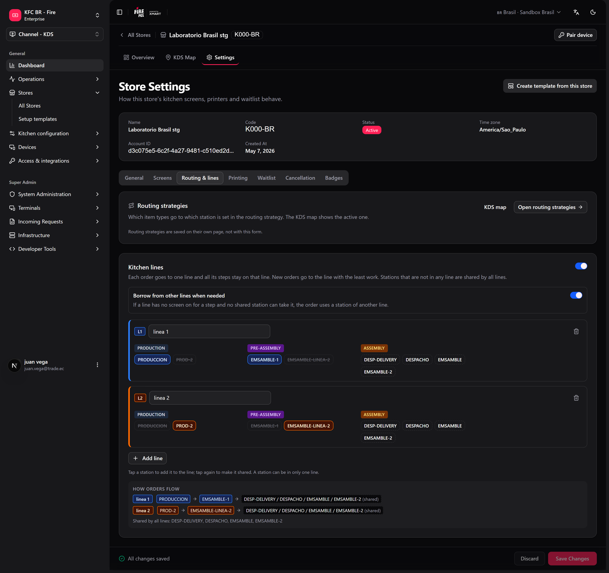
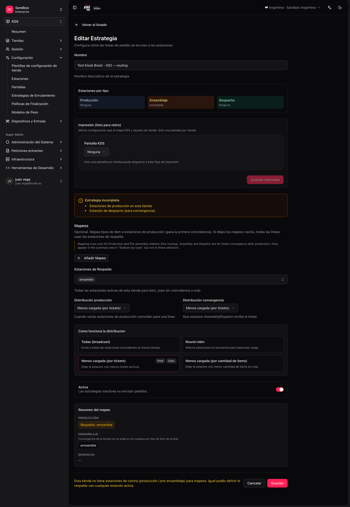

La **estrategia de ruteo** decide, para cada línea del pedido, **a qué estación(es)** va.

<Note>
  Solo puede haber **una estrategia activa** por tienda. Al activar una nueva, las demás de esa tienda se desactivan automáticamente.
</Note>

## Default vs mappings custom

<Tabs>
  <Tab title="Default — assembly-only (producción)">
    - **Producción requerida = No** en Store settings.
    - **Una** estación `ASSEMBLY` + **una** pantalla.
    - Ruteo activo (mappings vacíos); no se usan mappings de ítem porque no hay producción previa.
  </Tab>
  <Tab title="Default — estación KITCHEN">
    - **Una** estación `PRODUCTION` (ej. `KITCHEN`) + **una** pantalla.
    - Ruteo **sin mappings**; **fallback** = esa estación (o "todas las activas" si solo hay una).
    - **Producción requerida = Sí**; todo cae en la estación default.
  </Tab>
  <Tab title="Custom — varias líneas de producción">
    - Varias estaciones `PRODUCTION` / `PRE_ASSEMBLY`.
    - Mappings **item_type → estaciones de cocina** (solo producción).
    - Opcional: estaciones `ASSEMBLY` / `DISPATCH` + **convergence distribution** para expo/despacho.
  </Tab>
</Tabs>

Si no hay mapping para un `item_type`, la línea va a **fallback** (idealmente una estación de producción, no armado).

## Orden de decisión

1. **Ruteo (capa 1):** elige estaciones **de producción** candidatas por `item_type` + fallback.
2. **Reglas de estación (capa 2):** canal y tipo de servicio (`DINE_IN`, `DELIVERY`…) — pueden **rechazar** la línea. Los **item types de la estación se ignoran** (pertenecen solo a la estrategia / [categorías de estación](/es/manuals/kds/station-categories)).
3. **Distribución (capa 3):** si quedan varias candidatas de producción, elige una según el modo.
4. **Convergencia (runtime):** cuando producción avanza, el **ticket** aparece en ASSEMBLY/DISPATCH según gates y **convergence distribution**; ahí aplican los filtros de canal/servicio de la estación.

<Tip>
  Ejemplo de capa 2: el ruteo manda un ítem a `GRILL`, pero la estación tiene **Exclude channels: UBER_EATS** → esa línea no se ve en la parrilla aunque el mapping la incluya.
</Tip>

## Cómo funciona el ruteo de producción

El ruteo de **líneas** (capas 1–3) solo aplica a estaciones de **producción**:

1. Lee el **`item_type`** de la línea.
2. Busca un **mapping** (solo estaciones de cocina en el formulario).
3. Si no hay match → **fallback stations** (tu estación default).
4. Aplica **reglas** de estación (canal, servicio).
5. Si hay varias candidatas → **distribución**.

**Armado y despacho** no participan en estos pasos. Reciben el ticket cuando la producción correspondiente se completó (convergencia), no porque hayas puesto `BURGER` → `ASSEMBLY` en un mapping.

## Modos de distribución (cuando hay 2+ estaciones candidatas)

| Modo | Comportamiento |
|---|---|
| **ALL** | Envía a todas las candidatas (broadcast). |
| **ROUND_ROBIN** | Elige una estación a partir del número de pedido. En muchos pedidos los reparte, pero dos pedidos seguidos pueden caer en la misma estación — no es un turno estricto. |
| **LEAST_LOADED** | Prioriza la estación con menos tickets activos. Úsalo para repartir parejo entre estaciones equivalentes. |
| **LEAST_LOADED_ITEMS** | Prioriza la estación con menos ítems en cola. |

Si el mapping tiene **una sola** estación, el modo de distribución no cambia el resultado.

Cuando una categoría está mapeada a una estación de **producción** y a una de **pre-armado** (por ejemplo, `HAM` → `GRILL` y `PRE-ASSEMBLY-1`), la línea va a **una estación de cada una**: la distribución corre por separado dentro de cada etapa.

En fire-kds estos modos aparecen como **Todas**, **Por turnos**, **Menos pedidos** y **Menos productos**.

## Combos y sus piezas

Un combo se puede dividir en sus piezas para que cada una llegue a su propia estación: la hamburguesa a la parrilla, las papas a la freidora. Una pieza se separa cuando su producto tiene una [categoría de estación](/es/manuals/kds/station-categories) **y** esa categoría está mapeada en la estrategia activa de la tienda. Sin mapping, el combo llega entero.

- **Producción** recibe cada pieza como una línea propia.
- **Armado** y **Despacho** ven el combo como se vendió, con sus piezas como sublíneas que se tachan a medida que Producción las termina.
- El tablero de operador, la factura fiscal y el ticket de delivery muestran el combo como se vendió, no las piezas.

Ver [Acciones en pantalla → Combos en la pantalla](/es/manuals/kds/screen-actions#combos-en-la-pantalla).

## Líneas de cocina (opcional)

En una cocina con dos líneas paralelas (Parrilla 1 → Armado 1, Parrilla 2 → Armado 2), balancear cada etapa por su cuenta puede mandar un pedido hecho en la Parrilla 1 al Armado 2, en la otra punta de la cocina. Las **líneas de cocina** mantienen cada pedido dentro de una línea de principio a fin.

**Dónde:** configuración de la tienda, pestaña **Ruteo y líneas**, o **fire-kds → Configuración → Líneas y ruteo → Líneas de cocina**.

<Frame>
  
</Frame>

<Steps>
  <Step title="Activa Usar líneas de cocina" />
  <Step title="Agrega las líneas">
    **Agregar línea** para cada una. Ponle un nombre (opcional, ej. "Línea 1") y elige sus estaciones por etapa. Una estación puede pertenecer a una sola línea.
  </Step>
  <Step title="Deja las estaciones compartidas fuera de todas las líneas">
    Una estación que no está en ninguna línea es **compartida por todas las líneas** — por ejemplo, un despacho único.
  </Step>
  <Step title="Decide qué pasa si a una línea le falta una estación">
    **Usar otra línea si falta una estación**: activado, el pedido usa la estación de otra línea; desactivado, espera en su línea hasta que la estación vuelva.
  </Step>
  <Step title="Guardar líneas" />
</Steps>

Cómo elige un pedido su línea: primero las líneas cuyas estaciones aceptan el pedido (reglas de canal y servicio) y pueden hacer todos los ítems, después las líneas con todas las etapas en línea, y después la menos cargada. Dentro de la línea, varias estaciones de la misma etapa se balancean con el modo de distribución de la tienda.

Con al menos dos líneas en uso, el dashboard de la tienda en fire-kds dibuja un diagrama: una fila por línea, una columna por etapa y una celda unida donde las líneas se juntan.

<Warning>
  Con menos de dos líneas que tengan estaciones, las líneas de cocina no cambian nada. Una línea sin estaciones se ignora.
</Warning>

## Líneas y ruteo en fire-kds

Los admins de tienda pueden revisar el ruteo en el dispositivo: **fire-kds → Configuración → Líneas y ruteo**. Explica cómo llega un pedido a cada pantalla, muestra el mapa categoría → estación de la estrategia activa (que se sigue editando en el backoffice) y permite cambiar:

- **Reparto entre estaciones de producción** y **Reparto entre ensamble y despacho**.
- **Producción obligatoria**.
- **Líneas de cocina** (ver arriba).

## Cuando una pantalla se desconecta

- Los tickets de una pantalla que se desconecta pasan a otra pantalla **en línea** de la misma etapa, si hay una. Si no hay, se quedan y vuelven cuando la pantalla se reconecta.
- Cuando las pantallas se reconectan en momentos distintos, cada una recupera los pedidos que le faltan; una etapa que ya hizo bump nunca se vuelve a agregar.
- Si Armado hace bump mientras todas las pantallas de Despacho están desconectadas, el pedido se cierra en Armado y no reaparece después en Despacho.
- La recuperación solo mueve pedidos recientes: sigue la configuración de **Recuperación y día de operación** de la tienda (pestaña **General**).
- Una pantalla [en pausa](/es/manuals/kds/screen-actions#pausar-una-pantalla) no libera sus tickets; solo deja de recibir nuevos.

## Ejemplo multi-estación

**Estaciones:**

| Code | Stage | Rol |
|---|---|---|
| `GRILL` | PRODUCTION | Hamburguesas — **ruteable por item_type** |
| `FRY` | PRODUCTION | Papas — **ruteable por item_type** |
| `ASSEMBLY` | ASSEMBLY | Armado — **ticket completo**, sin mapping de ítems |
| `DISPATCH` | DISPATCH | Despacho — **ticket completo**; ej. solo regla `DELIVERY` |

**Pantallas:**

| Pantalla | Estaciones asignadas |
|---|---|
| "Parrilla" | `GRILL`, `FRY` |
| "Armado" | `ASSEMBLY` |
| "Despacho delivery" | `DISPATCH` (rules: fulfillment `DELIVERY`) |

**Estrategia de ruteo — solo producción en mappings:**

| item_type | Estaciones destino | Distribución |
|---|---|---|
| `BURGER` | `GRILL` | — |
| `FRIES` | `FRY`, `GRILL` | `LEAST_LOADED` |
| *(fallback)* | `GRILL` | Tipos no listados → parrilla (estación default de producción) |

**Convergencia (fuera de mappings):** cuando las líneas en `GRILL`/`FRY` se completan, el ticket aparece en `ASSEMBLY` y luego en `DISPATCH` según la **convergence distribution** y las reglas de canal/servicio de esas estaciones.

<Frame>
  
</Frame>

## Crear la estrategia

<Steps>
  <Step title="Abre el formulario de ruteo">
    **KDS → Routing → Create** (`/kds/admin/routing/new`).
  </Step>
  <Step title="Elige tienda y nombre">
    Por ejemplo, "Default routing".
  </Step>
  <Step title="Cocina simple">
    Una estación `KITCHEN`, fallback = `KITCHEN`, sin mappings, **Active**.
  </Step>
  <Step title="Cocina avanzada">
    Mappings solo a estaciones **producción**; **convergence distribution** si hay estaciones ASSEMBLY/DISPATCH; fallback = estación default de producción.
  </Step>
  <Step title="Guarda" />
</Steps>

En el listado de ruteo puedes ver la tarjeta de **estrategia activa** y un mapa conceptual estación ↔ pantalla.

<Warning>
  Un producto sin categoría de estación, o una categoría sin mapping, no se separa de su combo y va al fallback. Revisa [Categorías de estación](/es/manuals/kds/station-categories) antes de culpar al ruteo.
</Warning>

Siguiente: [Periféricos, impresión y validación](/es/manuals/kds/peripherals-printing).
