La pantalla de KDS es el display de cocina donde los operadores ven los pedidos en vivo y los marcan como preparados. Funciona a pantalla completa en un dispositivo táctil y se actualiza en tiempo real, por lo que todas las pantallas de la tienda se mantienen sincronizadas.

Esta guía cubre las acciones que puedes realizar durante el servicio. Para saber cómo se configura y vincula un KDS, consulta con tu administrador.

## La pantalla de un vistazo

Los pedidos se agrupan en **columnas por estación** — una columna por cada estación asignada a la pantalla (por ejemplo, *Freidora* y *Sándwich*). Cada pedido es una **tarjeta** que muestra:

- Un código corto de pedido en el encabezado (por ejemplo, `#A7F2C`).
- Etiquetas de **canal** y **tipo de entrega** (como el canal de venta y si es retiro o delivery).
- La lista de ítems a preparar.
- Un **temporizador** que cambia de color a medida que el pedido envejece: verde, luego ámbar y luego rojo. Pasada una hora se lee `h:mm:ss`.

Cada encabezado de estación muestra las reglas de la estación como chips: **Solo** (por ejemplo, solo `DELIVERY`) o **Excepto**, con los badges de canal y servicio. Sin chips, la estación recibe todos los pedidos.

<Frame>
  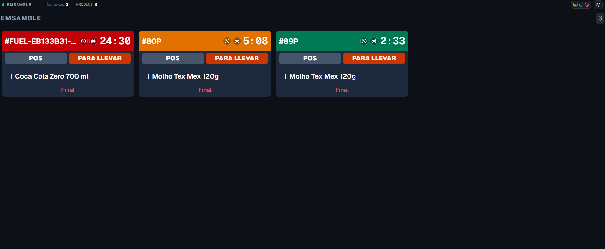
</Frame>

## Enviar un pedido (bump)

Cuando termines de preparar los ítems de una tarjeta, **tócala una vez** para enviarla. El pedido se marca como listo y sale de la cola.

<Frame>
  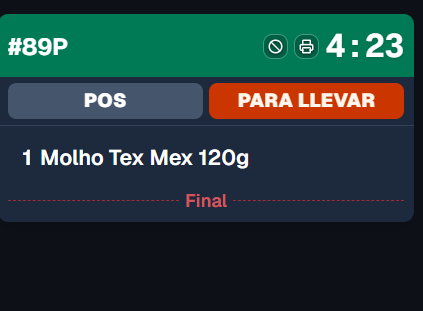
</Frame>

<Note>
  En pantallas con botonera USB o teclado, también puedes enviar el pedido con la tecla asignada en lugar de tocar. Consulta [Teclado y botonera](#teclado-y-botonera).
</Note>

## Combos en la pantalla

Cuando la cocina divide los combos en piezas, cada estación ve lo que tiene que hacer:

- **Producción** recibe cada pieza como una línea propia (por ejemplo, `1 Papas medianas` en la freidora).
- **Armado** y **Despacho** muestran el combo como se vendió (`1 Big Box`), con sus piezas como **sublíneas azules**. Una sublínea se tacha cuando Producción hace bump de esa pieza.
- **Pre-armado** muestra el nombre del combo con solo las piezas ruteadas a esa estación como sublíneas azules. Tachar la línea del combo las tacha todas. Tu administrador puede apagar esta agrupación en [Configuración de cuenta](/es/manuals/kds/account-settings#agrupar-piezas-de-combo-en-pre-armado).

Una pieza de combo llega con la cantidad del pedido: dos combos con 2 sándwiches cada uno muestran `4`, no `8`. Si la cuenta [divide las piezas en unidades](/es/manuals/kds/account-settings#dividir-piezas-de-combo-en-unidades), Producción muestra una línea por unidad.

## Tachar líneas antes de enviar (opcional)

Cuando el **tache de líneas** (line strike) está habilitado para la tienda (o sobrescrito en esta pantalla), debes **tocar cada línea padre** del ticket antes de poder enviarlo. Las líneas tachadas se muestran cruzadas. Cuando todas las líneas requeridas están tachadas, la tarjeta muestra un estado listo (anillo verde) — entonces toca el cuerpo de la tarjeta para hacer bump.

Si aún faltan líneas, tocar el cuerpo de la tarjeta no hace nada. El tache aparece de inmediato en esta pantalla (optimista); las otras pantallas se enteran cuando el servidor confirma. Deshacer / recall tras un bump limpia los taches de ese ticket en la estación.

<Frame>
  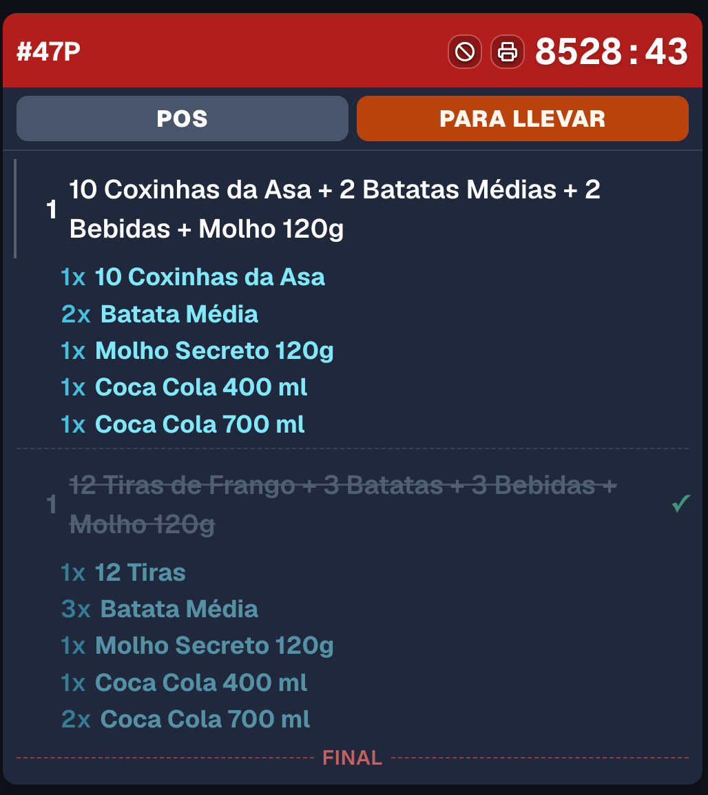
</Frame>

Tu administrador elige qué estaciones exigen tache de líneas. También puedes abrir los ajustes de **line strike** desde la barra superior cuando se permite una sobrescritura local de pantalla.

## Esperando armado (despacho)

En una columna de **DISPATCH**, un ticket puede estar visible mientras el armado (o pre-armado) sigue trabajando. Con el **bump jerárquico** activado (el default), igual puedes hacer bump: cierra el ticket también en Armado y Producción. Con el bump jerárquico desactivado, el bump queda bloqueado y la tarjeta muestra un aviso de **esperando estación previa** hasta que termina el armado. Ver [Configuración de cuenta](/es/manuals/kds/account-settings#bump-jerárquico).

<Frame>
  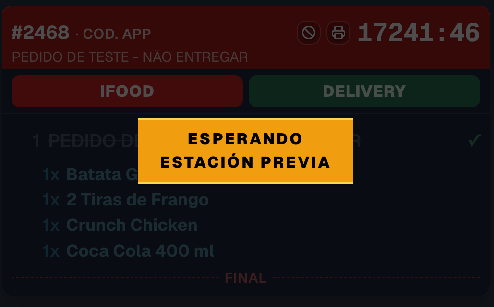
</Frame>

## Poner un pedido en espera y reanudarlo

Si un pedido debe esperar (el cliente no está listo, falta un ítem), **mantén pulsada la tarjeta** hasta que se llene la barra de progreso. La tarjeta se atenúa, muestra la etiqueta **EN ESPERA** y pasa al final de la cola.

Un pedido en espera queda pausado en **todas** las pantallas de la tienda, no solo en la tuya. Para reanudarlo, **mantenlo pulsado de nuevo** — vuelve a su posición normal en la cola.

<Frame>
  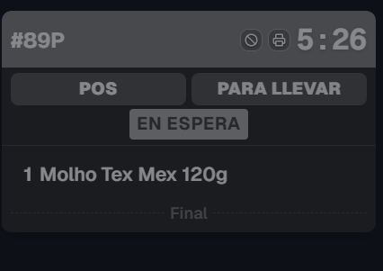
</Frame>

## Deshacer un envío (recall)

¿Enviaste un pedido por error? Justo después de enviarlo aparece una barra de **Deshacer** en la parte inferior de la columna con el código del pedido. Toca **Deshacer** para devolver la tarjeta a la cola.

<Frame>
  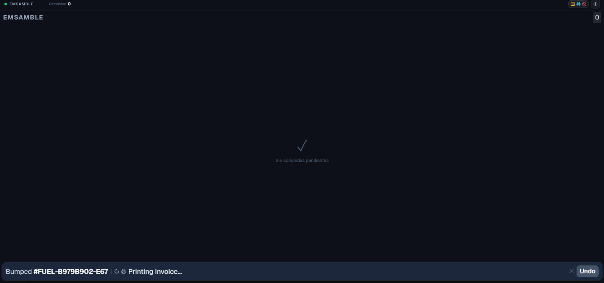
</Frame>

La barra de Deshacer desaparece sola tras **10 segundos** como máximo, o puedes cerrarla con la **✕**. La ventana de recall en el servidor es más larga (configurable por estación): después de que la barra desaparece, la tecla `Z` todavía deshace el último envío de la primera columna.

## Cancelar un pedido

Cuando la cancelación de pedidos está habilitada para la tienda, cada encabezado de tarjeta muestra un icono de **prohibido** (<Icon icon="ban" />). Tócalo para cancelar el pedido y confirma en el diálogo. Una barra de estado en la parte inferior de la columna muestra **Cancelando** y luego **Cancelado**.

<Frame>
  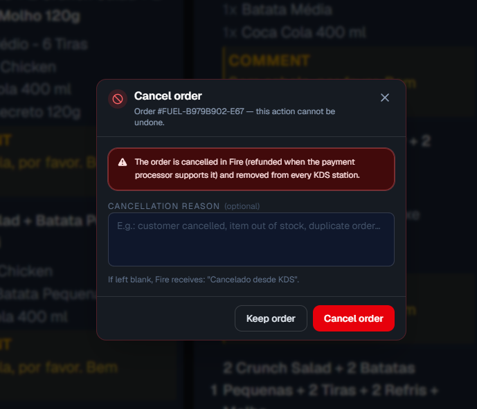
</Frame>

Si Fire rechaza la solicitud, la barra **no** dice **Cancelado**. El operador ve **Fire rechazó la cancelación** más el detalle de policy que devolvió Fire (motivo y, si viene, el umbral de tiempo). El trabajo queda fallido. El ticket sigue en cocina hasta que una cancelación posterior funcione o alguien lo envíe.

<Frame>
  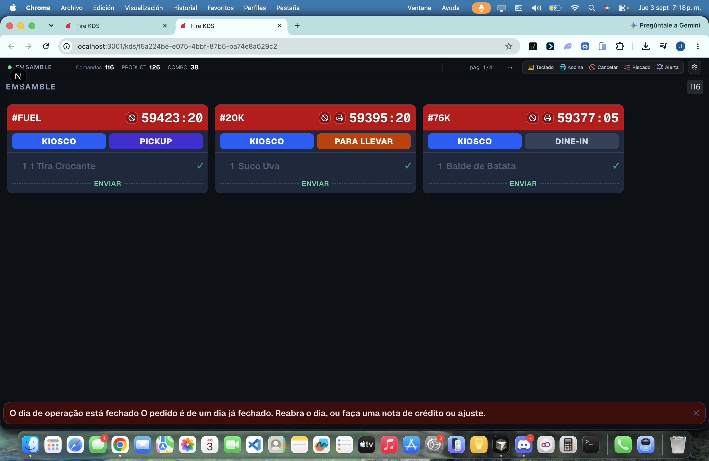
</Frame>

<Warning>
  Cancelar elimina el pedido de la cocina. Verifica el código del pedido antes de continuar. Un rechazo no es una cancelación: el cliente puede seguir esperando ese plato.
</Warning>

## Cambiar de página

Cuando hay más pedidos de los que caben en pantalla, los pedidos se dividen en páginas. Todas las columnas cambian de página a la vez. Puedes moverte entre páginas de tres formas:

- **Flechas de la barra superior:** toca **←** / **→** junto al indicador de página (`pág N/M`).
- **Deslizar:** arrastra a la izquierda o a la derecha sobre una columna para ir a la página siguiente o anterior.
- **Doble toque:** toca dos veces una zona vacía para saltar a la primera o última página.

<Frame>
  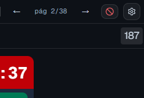
</Frame>

## Alerta de pedido nuevo

Cuando llega un ticket nuevo, la pantalla puede mostrar una **burbuja visual** y opcionalmente reproducir un sonido. Los defaults de display KDS de la tienda controlan esto; cada pantalla puede seguir el default de tienda o mantener una sobrescritura local en **Ajustes → Pantalla**.

<Frame>
  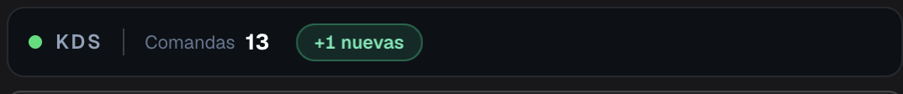
</Frame>

## Menú de ajustes

El botón de engranaje (<Icon icon="gear" />) en la esquina superior derecha abre las herramientas del operador:

- **Pantalla:** tipografía, tamaño de las tarjetas, **Filas de comandas** (1–3), alerta de pedido nuevo y si se muestra el nombre del cliente (opcionalmente limitado por tipo de entrega o canal). Las pantallas pueden seguir los **defaults de tienda** o conservar valores locales. Más filas muestran más tickets; las tarjetas altas (modificadores y **notas**) siguen en la columna siguiente de la misma fila para que la nota no se recorte.
- **Botonera (teclado):** asigna las teclas físicas de una botonera USB a las acciones.
- **Impresora de esta pantalla:** la impresora que usa esta pantalla para la [impresión al enviar](#impresión-al-enviar). Si falta el Agente Fire, aparece **Descargar Fire Agent** cuando tu cuenta tiene el link.
- **Imprimir facturas encoladas:** imprime las facturas fiscales que fallaron hoy (solo el día de negocio actual).
- **Tema:** **Pantalla** (lo que el backoffice definió para esta pantalla), **Oscuro** o **Claro**. Se guarda solo en este dispositivo.
- **Pausar pantalla…:** detiene los pedidos nuevos sin cerrar sesión (ver [Pausar una pantalla](#pausar-una-pantalla)).
- **Idioma:** cambia la interfaz entre inglés, español y portugués. La primera vez, la pantalla sigue el idioma del navegador.
- **Cerrar sesión** (o **Desemparejar dispositivo** en una TV emparejada).

<Frame>
  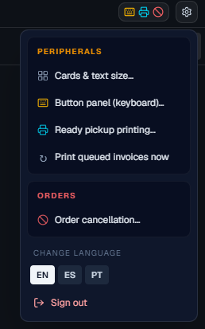
</Frame>

<Frame>
  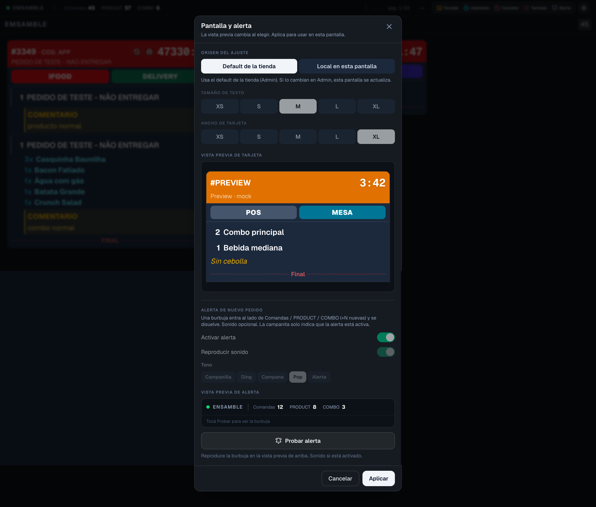
</Frame>

<Frame>
  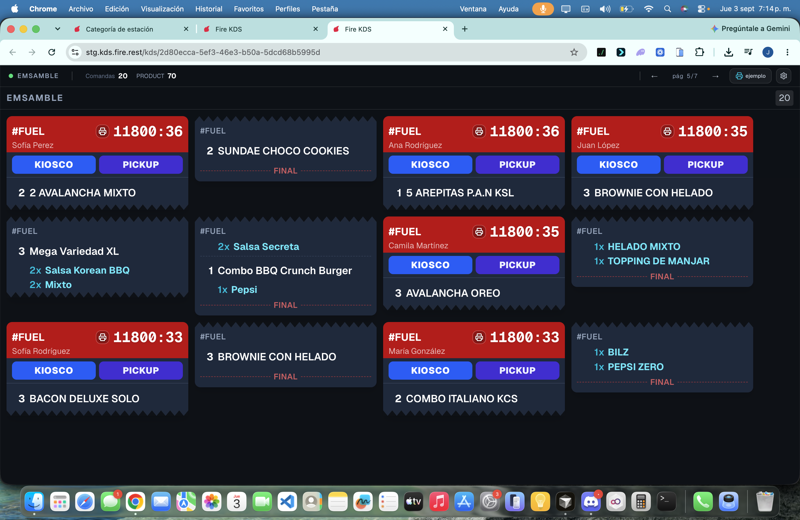
</Frame>

## Pausar una pantalla

Para sacar una pantalla de servicio por un rato (una estación cierra antes, un cocinero se va a descansar), abre el menú del engranaje y elige **Pausar pantalla…**. La pantalla sigue con la sesión abierta y en línea, pero **los pedidos nuevos dejan de llegarle**; los tickets que ya tiene se quedan para que la cocina los termine. Un banner **Pantalla en pausa** muestra cuántos tickets quedan.

Las otras pantallas de la misma estación siguen recibiendo pedidos. Si la pantalla en pausa era la única, los pedidos nuevos esperan una pantalla de esa etapa. Toca **Reanudar** (o la tecla de pausa, si tu botonera tiene una) para volver a estar activa. El dashboard de la tienda muestra las pantallas en pausa con un badge **En pausa**.

<Warning>
  No apagues la TV para detener los pedidos. Una pantalla que se desconecta libera sus tickets a otras pantallas; con la pausa, los tickets se quedan donde están y no necesitas emparejar ni iniciar sesión de nuevo.
</Warning>

## Zoom de estación o de ticket

Toca dos veces el **temporizador del ticket** para hacer zoom a ese ticket. Toca el **encabezado de la estación** (o la tecla de zoom, por defecto **Q**) para hacer zoom a la estación. Un banner **Back** y el rastro **Screen / Station / Ticket** muestran dónde estás. Hold aplica al ticket **resaltado**, no a la primera tarjeta de la página.

<Frame>
  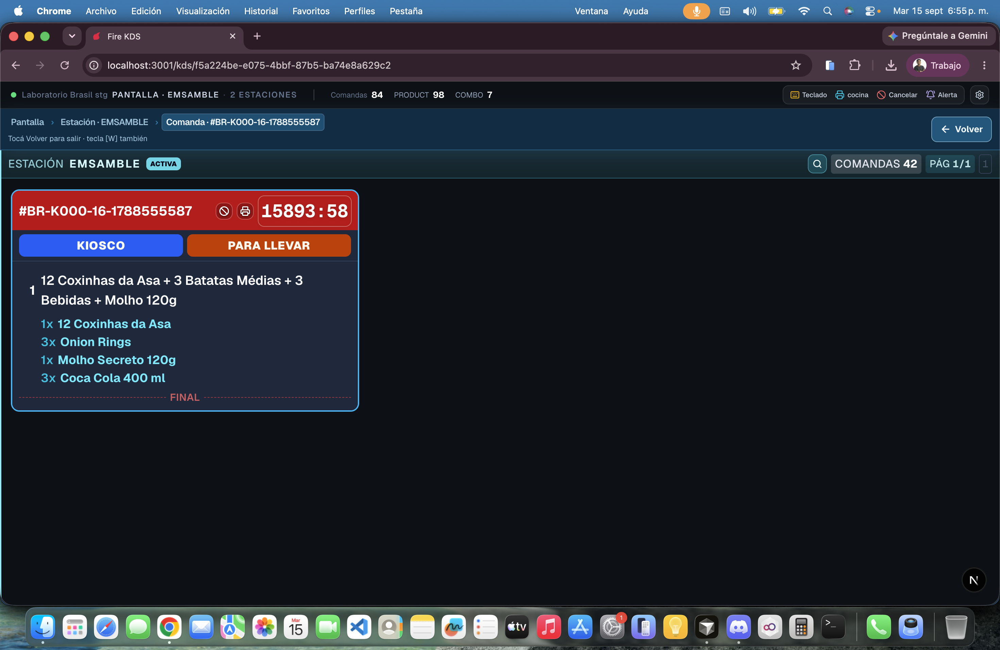
</Frame>

## Impresión al enviar

La regla de tienda **Print on bump** decide si un envío imprime **Comanda**, **Factura fiscal**, o ambas. En esta pantalla solo **armas la impresora** (**Printer for this screen**). Un snackbar muestra **Printing kitchen ticket…** / **Printing fiscal invoice…** o **Print failed**.

Si el payload fiscal está listo pero la impresora falla, el envío igual termina y el ticket muestra **Queued: printer failed. Use “Print queued invoices”.** Los tickets de delivery no se encolan.

El chip **Impresora** de la barra superior muestra si el Agente Fire está **Conectada** o **Desconectada** en este dispositivo, antes de que falle un envío.

<Frame>
  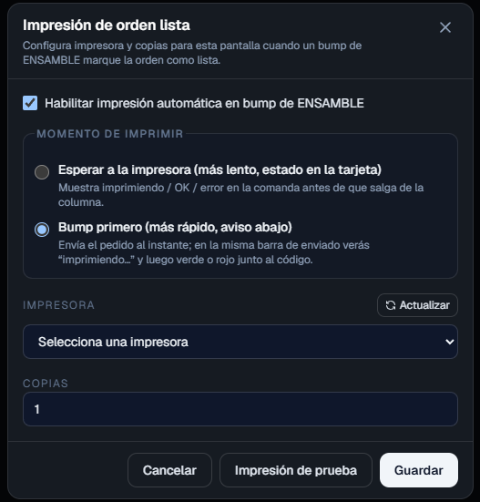
</Frame>

<Frame>
  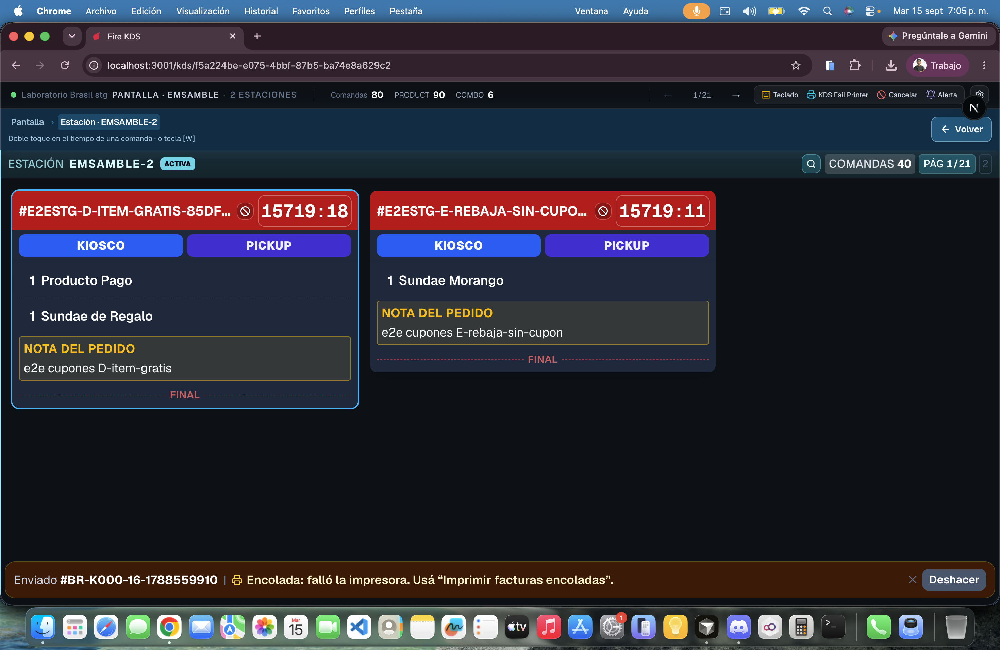
</Frame>

Ver [Periféricos, impresión y validación](/es/manuals/kds/peripherals-printing) y [Agente Fire en Android](/es/manuals/fire-agent/android) si la cocina corre en tablet.

## Teclado y botonera

Las pantallas pueden usar un teclado físico o una botonera USB para operar más rápido y sin tocar. Sin ninguna configuración, funcionan estas teclas por defecto:

| Tecla | Acción |
|---|---|
| `1`–`8` | Enviar el pedido de la columna 1–8 |
| `→` / `←` | Página siguiente / página anterior |
| `Z` | Deshacer el último envío |
| `F5` | Recargar la pantalla |
| `Q` | Zoom de la estación / ticket |

Para personalizar las teclas, abre **Ajustes → Botonera (teclado)**, toca una acción, presiona la tecla que quieras asignar y guarda.

<Frame>
  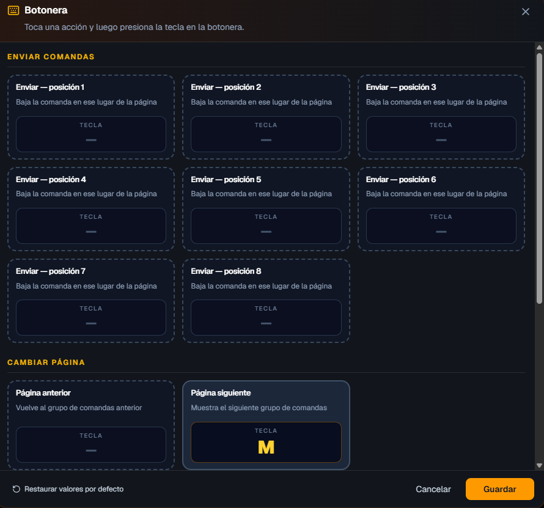
</Frame>

## Actualizaciones y pantallas desactivadas

- **Versión nueva:** cuando se publica una versión nueva de Fire KDS, la pantalla se recarga sola. No hace falta presionar `F5`.
- **Pantalla desactivada:** si un administrador desactiva la pantalla, muestra **Pantalla inactiva** y deja de recibir pedidos; sus tickets pasan a otras pantallas. Cuando se reactiva, vuelve sola.

<Check>
  Ya puedes operar el KDS durante el servicio: enviar, poner en espera, deshacer y cancelar pedidos, moverte entre páginas y ajustar la pantalla a tu cocina.
</Check>
