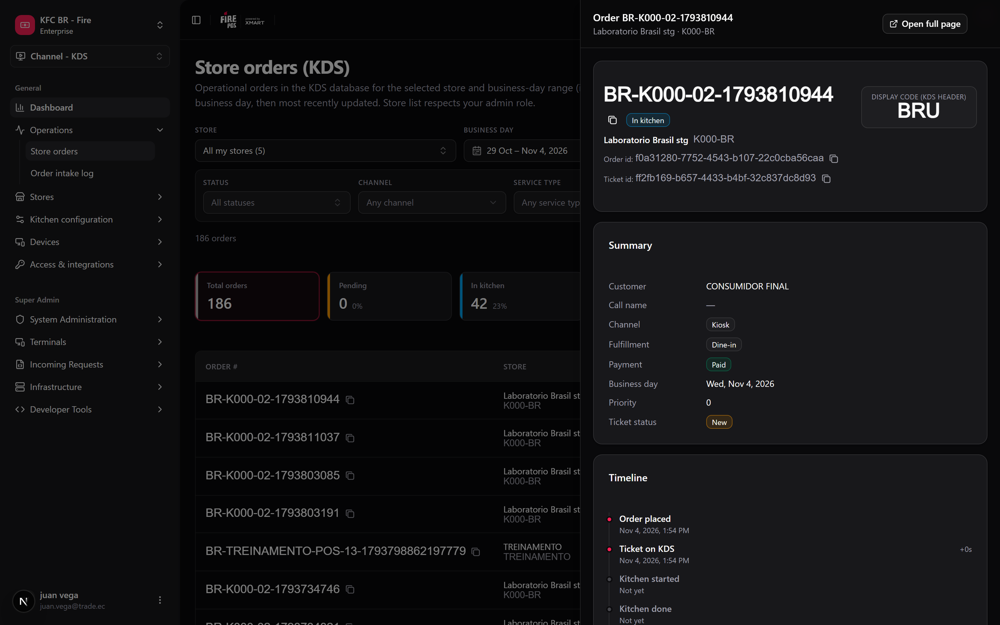
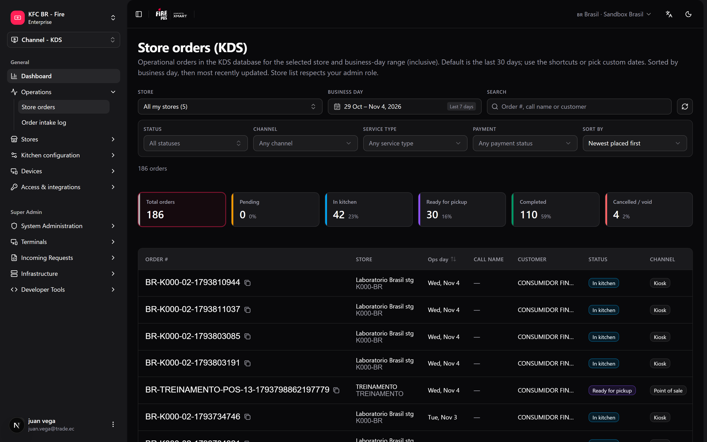

Cuando un cliente dice que su pedido nunca salió, o una tienda pregunta por qué la cocina estuvo lenta el viernes, la respuesta está en los pedidos que recibió el KDS. **Pedidos por tienda** te permite buscarlos desde el backoffice, sin pedirle a la tienda una foto de la TV de cocina. Es de solo lectura: nada de lo que hagas aquí cambia un pedido.

**Dónde trabajas:** **KDS → Pedidos por tienda** (`/kds/admin/store-orders`) en el backoffice.

<Note>
  **Lo mínimo que hay que saber**

  - Las fechas son **días operativos** de la tienda, no días de calendario: un pedido hecho a la 1:00 a. m. puede pertenecer al día anterior.
  - Puedes buscar en una tienda o en **Todas mis tiendas** (hasta 100 tiendas, hasta 93 días).
  - Las tarjetas de KPI también son filtros: haz clic en **En cocina** para ver solo esos pedidos.
</Note>

## El camino simple

<Steps>
  <Step title="Abre Pedidos por tienda">
    Ve a **KDS → Pedidos por tienda**. Abre con los **últimos 7 días**.
  </Step>
  <Step title="Elige la tienda">
    Usa el selector de tienda (tiene buscador). Elige **Todas mis tiendas** para buscar en todas las tiendas que puedes ver; la tabla muestra entonces una columna de tienda.
  </Step>
  <Step title="Encuentra el pedido">
    Escribe el número de pedido, el nombre de llamado / pager o el nombre del cliente en el buscador.
  </Step>
  <Step title="Ábrelo">
    Haz clic en el número de pedido. El detalle se abre en un panel lateral sobre el listado: resumen, línea de tiempo del ticket (en la zona horaria de la tienda), líneas con modificadores y totales. **Abrir en página completa** te da un link para compartir.

    <Frame>
      
    </Frame>
  </Step>
</Steps>

<Tip>
  Toda la vista vive en la barra de direcciones. Copia la URL y quien la abra ve la misma tienda, fechas, filtros y pedido abierto.
</Tip>

## Filtros

| Filtro | Qué hace |
|---|---|
| **Día operativo** | Calendario con atajos (hoy, últimos 7 / 30 días, esta semana, este mes, mes pasado). |
| **Estado** | Uno o varios: Creado, En cocina, Listo para retirar, Completado, Cancelado, Anulado. |
| **Canal**, **Tipo de servicio**, **Pago** | Acotan por de dónde vino el pedido, cómo se sirve y su estado de pago. |
| **Buscar** | Número de pedido, nombre de llamado / pager o cliente. |

Los filtros activos se ven como chips; **Limpiar filtros** los quita todos.

## Qué muestra la tabla

<Frame>
  
</Frame>

| Columna | Significado |
|---|---|
| **Nº pedido** | El código que el equipo ve en los tickets y las pantallas. Haz clic para abrirlo, o cópialo. |
| **Día contable** | El día operativo de la tienda para ese pedido. |
| **Nombre de llamado** | El nombre o número de pager que se le dio al cliente, cuando hay uno. |
| **Estado** | Etapa del pedido en el flujo de cocina. |
| **Canal** / **Tipo de servicio** | Canal de venta y tipo de entrega. |
| **Recibido** / **Último cambio** | Tiempo relativo, con la hora exacta en la zona horaria de la tienda al pasar el mouse. |
| **Tiempo en cocina** | Desde que la cocina empezó (o recibió) el ticket hasta que se le hizo bump como listo. |

Las tarjetas de KPI sobre la tabla (**Pedidos totales**, **Pendientes**, en cocina, listos para retirar, completados, cancelados / anulados) cuentan los pedidos que cumplen todos los filtros excepto el estado, con su porcentaje. Haz clic en una para filtrar por ella.

## Recetas

<AccordionGroup>
  <Accordion title="Un cliente dice que su pedido nunca salió">
    1. Elige la tienda y el día operativo de hoy.
    2. Busca por el nombre del cliente o el nombre de llamado.
    3. Abre el pedido y lee la línea de tiempo: qué estación lo tuvo y cuándo se le hizo bump.
    4. Si sigue **En cocina**, el [Tablero de operador](/es/manuals/kds/operator-board) puede marcarlo como listo.
  </Accordion>
  <Accordion title="Cuántos pedidos se cancelaron esta semana, en toda la cadena">
    1. Elige **Todas mis tiendas** y **Esta semana**.
    2. Haz clic en la tarjeta **Cancelados / anulados**.
    3. La columna de tienda muestra dónde pasaron.
  </Accordion>
  <Accordion title="Pedidos de una tienda que ya cerró">
    Los admins de tienda y de cuenta también ven las tiendas inactivas en el selector, así que el historial de una tienda cerrada sigue ahí.
  </Accordion>
  <Accordion title="Enviarle a un supervisor el pedido exacto">
    1. Abre el pedido.
    2. Haz clic en **Abrir en página completa** y copia el link.
  </Accordion>
</AccordionGroup>

## Errores que salen caros

<Warning>
  **Buscar por fecha de calendario después de medianoche.** Una tienda que cierra a las 2:00 a. m. archiva esos pedidos en el día operativo anterior. Si buscas "hoy" no los vas a encontrar y vas a concluir que se perdieron.
</Warning>

<Warning>
  **Leer "Completado" como "entregado al cliente".** Significa que la cocina cerró el pedido. Si el repartidor lo retiró está en el canal, no aquí.
</Warning>

## Preguntas frecuentes

<AccordionGroup>
  <Accordion title="¿Por qué no puedo elegir un rango de más de 93 días?">
    Para que la búsqueda sea rápida. Haz dos búsquedas si necesitas más.
  </Accordion>
  <Accordion title="¿Por qué Todas mis tiendas da un error?">
    Cubre hasta 100 tiendas. Si tienes acceso a más, elige una tienda o acota el contexto de tiendas en el encabezado.
  </Accordion>
  <Accordion title="¿Puedo cancelar o marcar un pedido como listo desde aquí?">
    No. Esta pantalla es de solo lectura. Usa el [Tablero de operador](/es/manuals/kds/operator-board).
  </Accordion>
</AccordionGroup>

## Lo que esta página no hace

- No cambia pedidos.
- No exporta a un archivo.
- No muestra pedidos que nunca llegaron al KDS.
