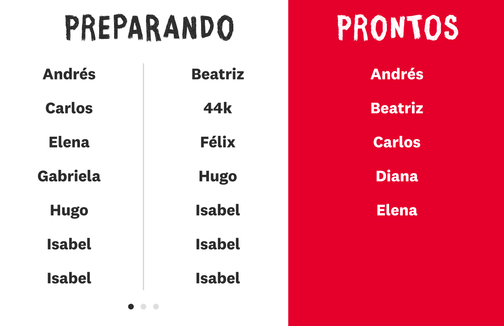
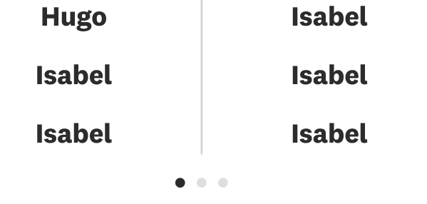
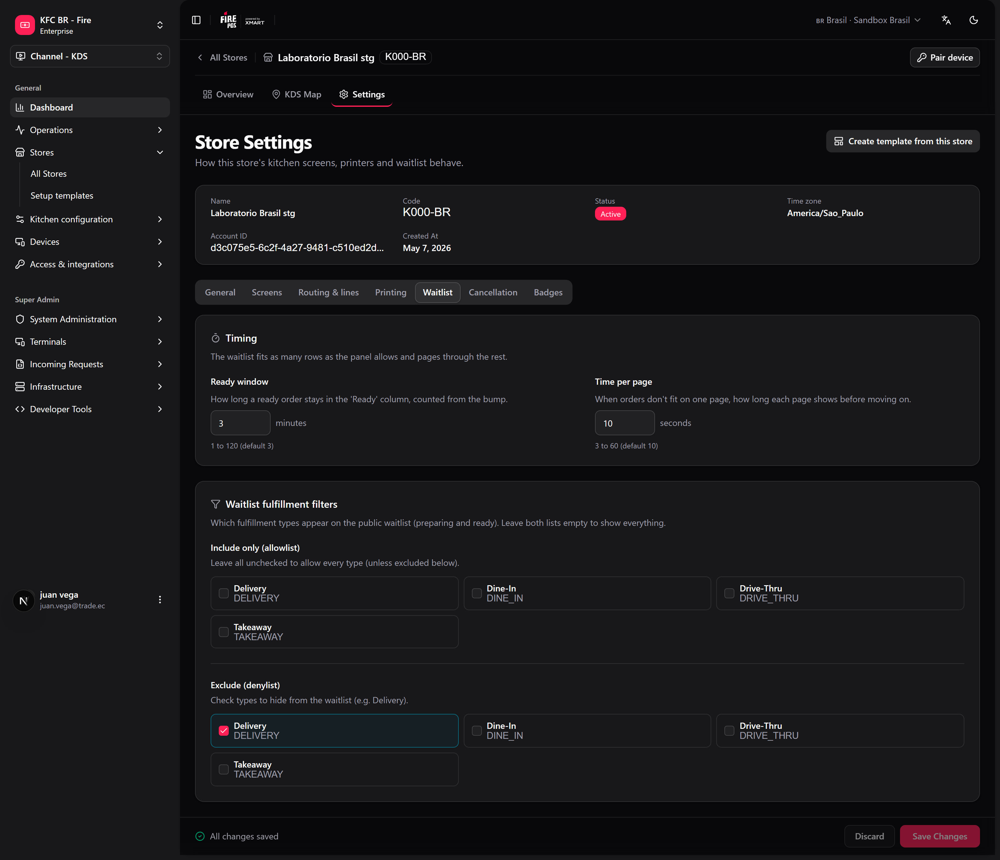
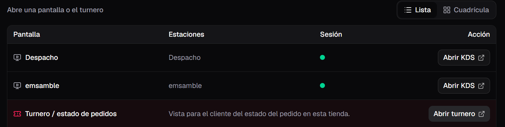

El turnero (también llamado *waitlist* o pantalla de pedidos) es una pantalla orientada al cliente que muestra los números de pedido en dos estados: **en preparación** y **listos para retirar**. Está pensada para funcionar en un televisor o tablet en la zona de retiro, para que los clientes vean cuándo su pedido está listo.

A diferencia de la pantalla de KDS, el turnero no tiene controles para el operador — solo muestra información. Se actualiza en tiempo real a medida que la cocina avanza con los pedidos.

## Qué muestra la pantalla

El turnero se divide en dos zonas:

- **En preparación:** pedidos que la cocina recibió y todavía está preparando, ordenados del más antiguo al más reciente.
- **Listos para retirar:** pedidos terminados que esperan ser recogidos. Cada pedido permanece en esta zona durante el **tiempo en listos** — **3 minutos** por defecto — contado desde el bump que lo dejó listo.

Qué bump deja un pedido "listo" depende de la cocina:

- **Con una pantalla de Despacho en línea:** el pedido pasa a listo cuando Despacho le hace bump. El bump de Armado lo mantiene en preparación mientras siga en Despacho.
- **Sin Despacho:** el bump de Armado lo pasa a listo.

Encender una pantalla de Despacho no devuelve a preparación los pedidos que Armado ya terminó.

El nombre de la tienda o el título de la campaña aparece arriba como un banner.

<Frame>
  
</Frame>

## Cuando un pedido está listo

Cuando un pedido pasa a listo, la pantalla lo resalta para que el cliente lo note: el código del pedido se muestra en grande en un **realce** durante un momento antes de ubicarse en la lista de listos.

<Frame>
  
</Frame>

## Qué código se muestra

Cada pedido muestra una etiqueta corta y pública para que los clientes la asocien con su recibo o buzzer:

1. El **nombre del buzzer o pager** si el pedido tiene uno.
2. Si no, el **código público del pedido**.
3. Como alternativa, los últimos caracteres del código del pedido.

Es la misma etiqueta que aparece en el encabezado de la tarjeta del KDS.

## Paginación y rotación

Cada página muestra solo las filas que caben enteras en la pantalla, y las reparte para llenar el panel — la lista nunca hace scroll y la última fila nunca queda cortada. Cuando hay más pedidos de los que caben, las listas rotan entre páginas solas (**Tiempo por página**, 10 segundos por defecto). Los **puntos de paginación** debajo de las listas indican cuántas páginas hay y cuál se ve.

La pantalla decide cuántos códigos caben a partir de su propia altura: ya no existe un ajuste de "códigos por página".

<Frame>
  
</Frame>

## Qué pedidos aparecen

Por defecto el turnero incluye todos los pedidos en preparación y listos **excepto delivery**: los pedidos delivery siempre van al [tablero de delivery](#tablero-de-delivery). Tu administrador también puede **ocultar otros tipos de entrega** (por ejemplo, mostrar solo dine-in). Los filtros se aplican a las listas de preparación y listos.

Cuando la tienda tiene activada la recuperación por **día de operación**, preparación muestra solo los pedidos de hoy; lo que quedó de días anteriores no se queda en la TV.

## Configuración

En el backoffice, configuración de la tienda → pestaña **Lista de espera** (o **fire-kds → Configuración → KDS tienda**):

<Frame>
  
</Frame>

| Ajuste | Rango | Por defecto |
|---|---|---|
| **Tiempo en listos** | 1–120 minutos | 3 |
| **Tiempo por página** | 3–60 segundos | 10 |
| **Incluir solo** / **Excluir** | Tipos de entrega | Mostrar todo (excepto delivery) |

## Tablero de delivery

El **tablero de delivery** es una pantalla aparte para la zona donde retiran los repartidores. Tiene tres columnas — **Preparando**, **Prontos** y **Entregados** — y muestra solo pedidos delivery. Cada código lleva la abreviatura del canal (por ejemplo, `1234-KE` para un pedido de Keeta), para que el repartidor encuentre los pedidos de su app.

- Ábrelo desde el dashboard de la tienda con **Abrir turnero delivery**, o en `/waitlist/{storeId}/delivery`. También puedes [emparejar una TV](/es/manuals/kds/device-pairing) directo a **Turnero delivery**.
- **Tiempo en prontos (delivery)** (3 minutos por defecto) y **Tiempo en entregados** (10 minutos por defecto) se configuran en **fire-kds → Configuración → KDS tienda → Tiempos del turnero de delivery**.
- Estos tiempos se cuentan desde el cambio de estado del pedido (el mismo momento en que se envían los webhooks), no desde el bump de cocina.

<Warning>
  Si antes mostrabas delivery en el turnero principal, ya no aparece ahí. Pon el tablero de delivery en su propia pantalla, o los repartidores no van a ver sus pedidos.
</Warning>

## Cómo abrirla

El turnero se abre en su propia pestaña del navegador desde el panel de la tienda, separado de las pantallas de operador del KDS. Ábrelo en el dispositivo de la zona de retiro y déjalo funcionando a pantalla completa. Los dispositivos de cocina también pueden [emparejarse](/es/manuals/kds/device-pairing) primero para que el dashboard abra en la tienda correcta.

<Frame>
  
</Frame>

<Info>
  Si el turnero falla, se recarga solo después de 15 segundos. Después de 5 fallas en 10 minutos espera 5 minutos entre intentos, para que una TV con problemas no se quede recargando sin parar.
</Info>

<Check>
  El turnero ya está mostrando el estado de los pedidos en vivo a tus clientes.
</Check>
