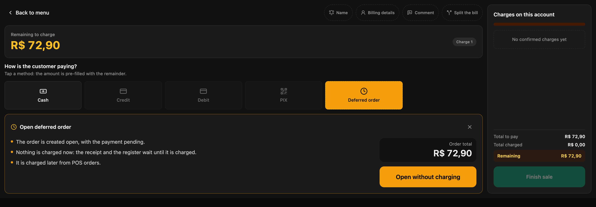
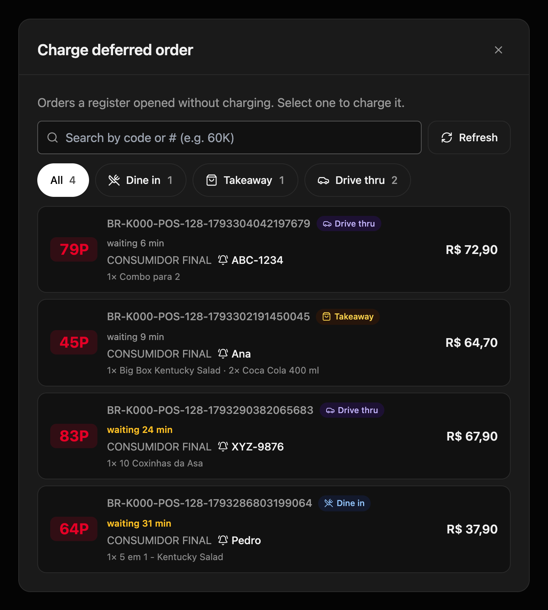
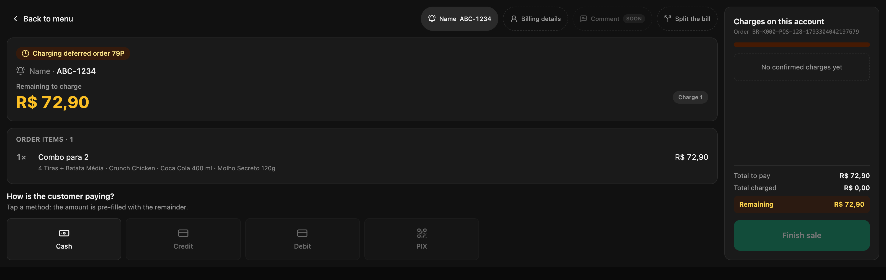

En el drive thru, o cuando el cliente paga al final, el pedido se toma antes de cobrarlo. Si el cajero lo cobra "a cuenta" para registrarlo, o lo anota aparte, la caja queda descuadrada o el pedido se carga dos veces. La **orden diferida** registra el pedido sin cobrarlo y lo deja esperando en **Órdenes POS** hasta que el cliente paga.

<Note>
  **Lo mínimo que hay que saber**

  - Al abrirla no se cobra, no se imprime comprobante y no suma a la caja. Todo eso pasa cuando se cobra.
  - La cocina la prepara antes del cobro solo si la cuenta tiene **Pago diferido** en ese canal; si no, espera a que se cobre.
  - Se cobra desde **Órdenes POS**, con cualquier medio de pago, en cualquier caja de la tienda.
</Note>

## Requisitos previos

- **Orden diferida** prendida en el canal, en el backoffice: **Fire POS → Config por tienda → Canales**, dentro de la tarjeta del canal. Consulta [Configuración por tienda](/es/manuals/pos/store-config).
- Para que la cocina la prepare antes del cobro, **Pago diferido** configurado en la cuenta para ese canal y tipo de servicio. Lo configura el equipo de Fire.
- La caja abierta. Consulta [Abrir caja](/es/manuals/pos/open-register).

## 1. Abre la orden sin cobrar

Arma el pedido como siempre y toca **Cobrar**. En la pantalla de pago, toca **Orden diferida** y después **Abrir sin cobrar**.

<Frame>
  
</Frame>

El POS muestra **Orden diferida abierta**: el pedido queda registrado con su número y su localizador. Entrégale al cliente el número o el buzzer, como en cualquier venta.

## 2. Cóbrala desde Órdenes POS

Cuando el cliente va a pagar, toca **Órdenes POS** (el ícono de reloj) en la barra de la derecha. Cada orden muestra su número corto, el canal, el localizador, los productos y cuántos minutos lleva esperando; desde los 20 minutos, en ámbar. Filtra por canal con los botones de arriba o búscala por su número.

<Frame>
  
</Frame>

Toca la orden: se abre en la pantalla de pago con sus productos. Cóbrala en efectivo, con tarjeta o con varios medios, y toca **Finalizar venta**. Ahí sale el comprobante y la venta suma a tu caja.

<Frame>
  
</Frame>

<Tip>
  Si la orden desapareció de **Órdenes POS**, terminaste: quedó cobrada.
</Tip>

## Si el cliente no vuelve

Cancélala desde **Cancelar pedido**, como cualquier pedido. Como no se cobró, no hay dinero que devolver ni nota de crédito. Consulta [Cancelar un pedido](/es/manuals/pos/cancellations).

## Errores que salen caros

<Warning>
  **Cargar el pedido de nuevo cuando el cliente vuelve a pagar.** La cocina lo prepara dos veces y la orden diferida sigue pendiente. Cóbrala siempre desde **Órdenes POS**.
</Warning>

<Warning>
  **Entregar el pedido sin cobrar la orden.** La orden queda abierta y la venta no entra a la caja. Cóbrala antes de entregar, o en la ventanilla de pago si es drive thru.
</Warning>

## Preguntas frecuentes

<AccordionGroup>
  <Accordion title="No veo «Orden diferida» en la pantalla de pago">
    El canal del pedido no la tiene prendida en la configuración de la tienda. Si el botón dice **Anula los cobros**, ya registraste un cobro en esa cuenta: anúlalo antes de abrir la orden sin cobrar.
  </Accordion>

  <Accordion title="La cocina no recibe la orden hasta que se cobra">
    La cuenta no tiene **Pago diferido** para ese canal y tipo de servicio, así que la orden se trata como prepago. Pídele al equipo de Fire que lo configure.
  </Accordion>

  <Accordion title="No veo el botón Órdenes POS">
    Aparece solo si la tienda tiene la orden diferida prendida en algún canal.
  </Accordion>

  <Accordion title="¿Puedo cambiar los productos de una orden diferida?">
    No. Los productos quedan fijos al abrirla. Si el cliente cambia el pedido, cancela la orden y arma uno nuevo.
  </Accordion>
</AccordionGroup>
