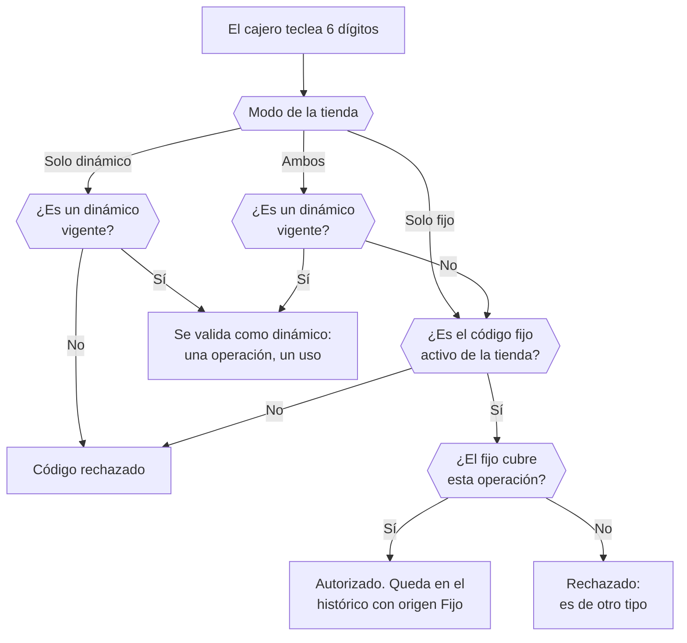
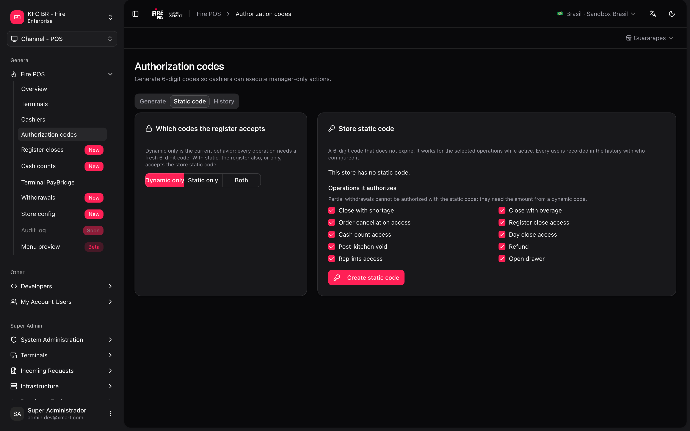
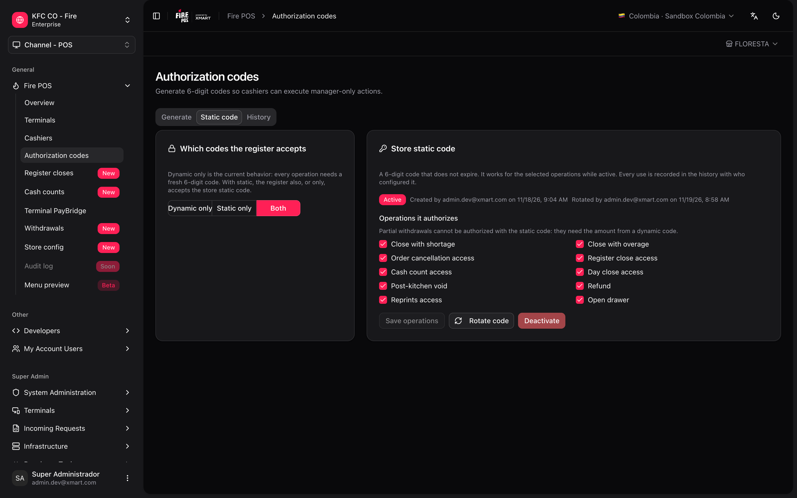
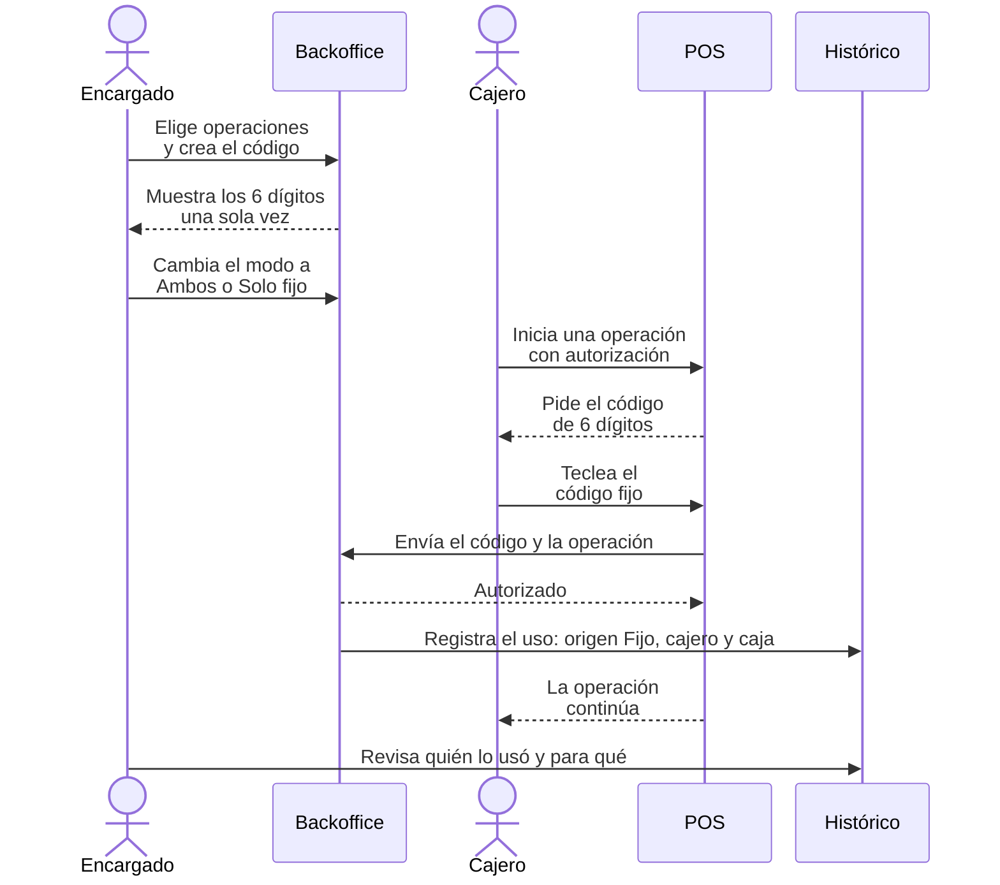
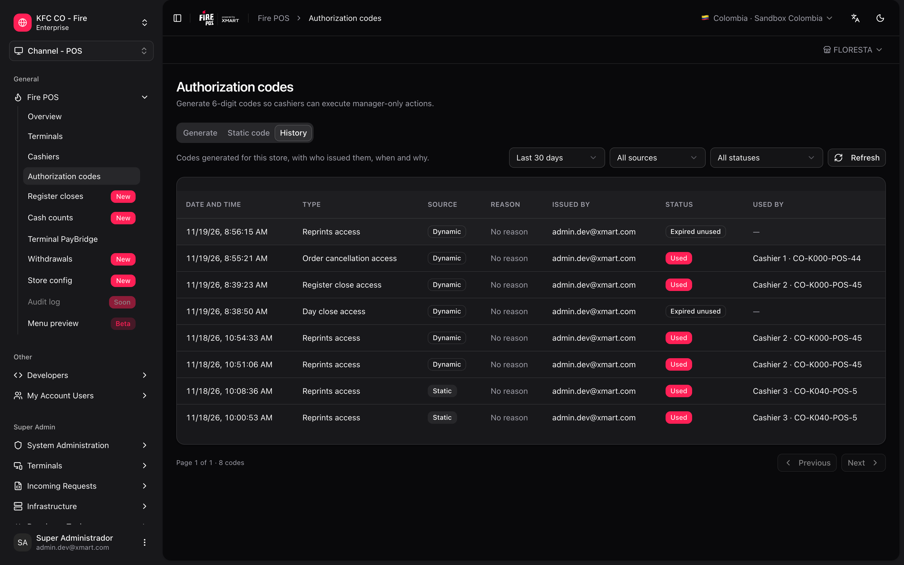

Un código dinámico obliga al encargado a tener el backoffice a mano cada vez que la caja pide autorización. En hora pico, con el encargado en la cocina o sin señal en el teléfono, la fila se detiene por un arqueo o una gaveta que no abre. El **código fijo** resuelve eso: la tienda tiene un único código de 6 dígitos que no vence y que la caja acepta para las operaciones que tú elijas. A cambio, la seguridad pasa a depender de quién conoce ese código, y por eso cada uso queda en el histórico.

<Note>
  **Lo mínimo que hay que saber**

  - Cada tienda tiene **un solo** código fijo. No vence y no se gasta: sirve mientras esté **Activo**.
  - Se muestra **una sola vez**, al crearlo o al rotarlo. Si se pierde, hay que rotarlo.
  - Nada cambia hasta que tú lo decidas: todas las tiendas empiezan en **Solo dinámico**. El **Retiro parcial** siempre pide un código dinámico.
</Note>

## Requisitos previos

- Acceso al backoffice de Fire en **[app.fire.rest](https://app.fire.rest)**, con permisos sobre la tienda.
- **Canal - POS** y la tienda seleccionados en el header. El código fijo se configura tienda por tienda.
- Conocer los códigos dinámicos. Consulta [Códigos de autorización](/es/manuals/pos/authorization-codes).

## Código fijo o código dinámico

| | Código dinámico | Código fijo |
|---|---|---|
| **¿Vence?** | Sí: a los 3 o a los 30 minutos | No. Sirve hasta que lo rotas o lo desactivas |
| **¿Se gasta?** | Sí: se usa una vez | No. Sirve todas las veces que haga falta |
| **¿Quién lo genera?** | El encargado, uno nuevo para cada operación | El encargado, una vez por tienda |
| **¿Para qué operaciones sirve?** | Para una sola, la que eliges al generarlo | Para todas las que marcas en la lista, salvo el retiro parcial |
| **¿Dónde sirve?** | En la cuenta donde se generó | Solo en las cajas de su tienda |
| **¿Qué queda registrado?** | Quién lo generó, el motivo y quién lo usó | Quién configuró el código y quién lo usó, en cada uso |

## Los tres modos de la tienda

La tarjeta **Qué códigos acepta la caja** decide qué teclea el cajero cuando el POS pide autorización.

| Modo | Qué acepta la caja | Cuándo conviene |
|------|--------------------|-----------------|
| **Solo dinámico** | Solo códigos dinámicos. Es el modo inicial y el comportamiento de siempre. | Quieres aprobar cada operación una por una. |
| **Ambos** | Los dos. Primero prueba el código como dinámico; si no hay uno vigente, lo prueba como fijo. | Quieres el fijo para lo cotidiano y el dinámico para lo demás, como los retiros. |
| **Solo fijo** | Solo el código fijo de la tienda. Los dinámicos no se aceptan. | Tiendas donde nadie genera códigos dinámicos. |

Los modos **Ambos** y **Solo fijo** exigen que la tienda tenga un código fijo **Activo**. Sin él, el backoffice responde «Crea y activa un código fijo antes de elegir ese modo.»

<Warning>
  **En Solo fijo no hay retiros parciales.** El retiro parcial necesita un código dinámico, y en ese modo la caja no los acepta. Si tu tienda hace retiros a mitad de turno, usa **Ambos**.
</Warning>

---

## 1. Abre la pestaña Código fijo

En el menú lateral, abre **Fire POS → Códigos de autorización** y elige la pestaña **Código fijo**. A la izquierda está la tarjeta **Qué códigos acepta la caja**; a la derecha, **Código fijo de la tienda**.

Si ves «Elige una tienda para configurar su código fijo.», selecciona la tienda en el header.

<Frame>
  
</Frame>

## 2. Elige las operaciones que autoriza

En **Operaciones que autoriza** vienen todas marcadas. Desmarca las que quieres seguir aprobando una por una con un código dinámico. Tiene que quedar al menos una.

## 3. Crea el código y anótalo

Toca **Crear código fijo**. Se abre una ventana con los 6 dígitos y el aviso «Anótalo ahora: no se vuelve a mostrar. Si se pierde, rótalo.»

Cópialo o anótalo antes de tocar **Cerrar**. Fire no guarda el código legible: después de cerrar la ventana, nadie puede volver a verlo, ni siquiera soporte.

La tarjeta pasa a mostrar el estado **Activo**, quién creó el código y cuándo.

<Frame>
  
</Frame>

<Info>
  Crear el código no cambia nada en la caja. Mientras la tienda siga en **Solo dinámico**, el POS no lo acepta.
</Info>

## 4. Cambia el modo de la tienda

En **Qué códigos acepta la caja**, elige **Ambos** o **Solo fijo**. El cambio se guarda al tocar la opción y aplica desde la siguiente autorización: no hay que reiniciar ni actualizar el POS.

<Tip>
  Si el código está **Activo** y la tienda en **Ambos** o **Solo fijo**, terminaste. La caja ya acepta el código fijo.
</Tip>

---

## Mantén el código al día

### Cambiar las operaciones

Marca o desmarca las casillas y toca **Guardar operaciones**. El botón se habilita solo cuando hay cambios. El código sigue siendo el mismo.

### Rotar el código

Toca **Rotar código** y confirma. Se abre la ventana con el código nuevo, también por única vez. El código anterior deja de servir en el acto; los usos anteriores se conservan en el histórico. La tarjeta muestra quién lo rotó y cuándo.

### Desactivar y reactivar

Toca **Desactivar** y confirma. El estado pasa a **Desactivado** y la caja deja de aceptarlo. Para volver a usarlo, toca **Activar**: es el mismo código de antes, no se muestra de nuevo.

<Warning>
  **Desactivar el código con la tienda en Solo fijo deja la caja sin códigos.** Ninguna operación que pida autorización se puede hacer hasta que lo actives o cambies el modo. Cambia primero el modo a **Solo dinámico**.
</Warning>

---

## Qué operaciones cubre

| Casilla | Qué autoriza en el POS |
|---------|------------------------|
| **Cierre con faltante** | Confirmar un cierre de caja en el que el conteo da menos que el esperado |
| **Cierre con sobrante** | Confirmar un cierre de caja en el que el conteo da más que el esperado |
| **Acceso a cancelación de pedidos** | Entrar al panel de cancelación |
| **Acceso a cierre de caja** | Entrar al cierre y contar la caja |
| **Acceso a arqueo de caja** | Hacer un arqueo |
| **Acceso a cierre de día** | Imprimir el cierre de día |
| **Anulación post-cocina** | Anular un pedido que ya pasó a cocina |
| **Devolución** | Hacer una devolución |
| **Acceso a reimpresiones** | Entrar al listado de reimpresiones |
| **Abrir gaveta** | Abrir la gaveta fuera de una venta |

**El retiro parcial no está en la lista.** El código de un retiro lleva la caja y el monto que autorizó el encargado, y un código fijo no puede llevar un monto distinto en cada uso. Por eso el retiro siempre pide un código dinámico. Consulta [Retiro parcial de efectivo](/es/manuals/pos/cash-withdrawal).

## En el POS: cómo lo usa el cajero

El POS no cambió. Las pantallas que piden autorización son las mismas y el código fijo se teclea igual que uno dinámico: 6 dígitos en el mismo teclado.

1. El cajero inicia la operación, por ejemplo **Configuraciones → Arqueo de caja**.
2. El POS pide el código de autorización.
3. Quien conoce el código fijo teclea los 6 dígitos.
4. La operación continúa. El código sigue sirviendo para la próxima vez.

Un cierre de caja con faltante sigue pidiendo autorización dos veces: al entrar al cierre y al aprobar el faltante. Con el fijo se teclea el mismo código las dos veces, si cubre las dos operaciones.

## Revisa el histórico

Cada uso del código fijo deja una fila en la pestaña **Histórico**, junto a los códigos dinámicos. La columna **Origen** dice **Dinámico** o **Fijo**, y el filtro **Origen** permite ver solo uno de los dos.

<Frame>
  
</Frame>

En una fila de origen **Fijo** se ve:

| Columna | Qué muestra |
|---------|-------------|
| **Fecha y hora** | Cuándo se usó el código |
| **Tipo** | La operación que autorizó |
| **Motivo** | **Sin motivo**. El código fijo no lleva motivo |
| **Origen** | **Fijo** |
| **Generado por** | Quién configuró el código: quien lo creó o quien lo rotó por última vez |
| **Estado** | **Usado** |
| **Usado por** | El cajero y la caja donde se tecleó |

Rotar o desactivar el código no borra nada: las filas de los usos anteriores siguen en el histórico.

## Recetas

<AccordionGroup>
  <Accordion title="Dejar el arqueo y la gaveta con el fijo, y lo demás con dinámico">
    1. Abre **Fire POS → Códigos de autorización → Código fijo**.
    2. Deja marcadas solo **Acceso a arqueo de caja** y **Abrir gaveta**.
    3. Toca **Crear código fijo** y anótalo.
    4. Cambia el modo a **Ambos**.
    5. Para cierres, cancelaciones y retiros, sigue generando códigos dinámicos en la pestaña **Generar**.
  </Accordion>

  <Accordion title="Salió una persona que conocía el código">
    1. Abre la pestaña **Código fijo** de la tienda.
    2. Toca **Rotar código** y confirma.
    3. Anota el código nuevo y entrégaselo solo a quien debe tenerlo.
    4. En **Histórico**, filtra por origen **Fijo** y revisa los usos de los últimos días.
  </Accordion>

  <Accordion title="Dejar de usar el código fijo en una tienda">
    1. En **Qué códigos acepta la caja**, elige **Solo dinámico**.
    2. En **Código fijo de la tienda**, toca **Desactivar** y confirma.
    3. El histórico de usos se conserva.
  </Accordion>

  <Accordion title="Se perdió el código y nadie lo recuerda">
    1. Toca **Rotar código** y confirma.
    2. Anota el código nuevo antes de cerrar la ventana.
    3. El modo y las operaciones marcadas no cambian.
  </Accordion>

  <Accordion title="Auditar para qué se usó el código esta semana">
    1. Abre la pestaña **Histórico** y elige el período.
    2. En el filtro de orígenes, elige **Fijo**.
    3. Revisa **Tipo** y **Usado por**: qué operación, qué cajero y en qué caja.
  </Accordion>
</AccordionGroup>

## Buenas prácticas de seguridad

- **Rótalo cuando sale personal** que lo conocía, y cuando sospeches que se filtró.
- **No lo compartas por chat** ni lo dejes escrito cerca de la caja. Entrégalo en persona.
- **Limita quién lo conoce.** El código reemplaza la aprobación del encargado: quien lo tiene puede autorizar por su cuenta.
- **Marca solo las operaciones que necesitas.** Las que mueven más dinero pueden seguir con código dinámico.
- **Desactívalo si no se usa**, después de pasar la tienda a **Solo dinámico**.
- **Revisa el histórico** por origen **Fijo** con regularidad.

## Errores que salen caros

<Warning>
  **Darle el código fijo a todos los cajeros.** Si el cajero que hace la operación es el mismo que la autoriza, ya no hay una segunda persona que apruebe. Un faltante se puede cerrar o una gaveta abrir sin que nadie más se entere hasta revisar el histórico.
</Warning>

<Warning>
  **Dejar marcado Cierre con faltante por costumbre.** Con un código dinámico eliges el motivo de la discrepancia cada vez. Con el fijo, la fila del histórico queda sin motivo. Si quieres que cada faltante lleve su motivo, desmarca esa casilla.
</Warning>

<Warning>
  **Cerrar la ventana sin anotar el código.** No se vuelve a mostrar. Hay que rotarlo, y el código que alguien ya tenía deja de servir.
</Warning>

<Warning>
  **No rotarlo cuando cambia el equipo.** El código no vence solo. Quien lo aprendió hace seis meses lo sigue teniendo hasta que lo rotes.
</Warning>

## Glosario

| Término | Qué significa |
|---------|---------------|
| **Código dinámico** | Código de 6 dígitos que el encargado genera para una operación. Vence y se usa una vez. |
| **Código fijo** | Código de 6 dígitos de la tienda. No vence y no se gasta. |
| **Modo** | Qué códigos acepta la caja de una tienda: **Solo dinámico**, **Solo fijo** o **Ambos**. |
| **Rotar** | Reemplazar el código fijo por uno nuevo. El anterior deja de servir en el acto. |
| **Desactivar** | Hacer que la caja deje de aceptar el código fijo sin reemplazarlo. Se puede volver a activar. |
| **Origen** | Columna del histórico que dice si una fila viene de un código **Dinámico** o del **Fijo**. |

## Preguntas frecuentes

<AccordionGroup>
  <Accordion title="El POS dice «Código no encontrado. Revisa los 6 dígitos.»">
    La caja no reconoció el código. Revisa, en este orden: que los dígitos estén bien tecleados, que el código esté **Activo**, que la tienda esté en **Ambos** o **Solo fijo**, y que la caja sea de la tienda del código. Si alguien lo rotó, el anterior ya no sirve.
  </Accordion>

  <Accordion title="El POS dice «Ese código es de otro tipo»">
    El código fijo no cubre esa operación. Marca la casilla en **Operaciones que autoriza** y toca **Guardar operaciones**, o genera un código dinámico para esa operación.
  </Accordion>

  <Accordion title="El backoffice dice «Crea y activa un código fijo antes de elegir ese modo.»">
    Elegiste **Ambos** o **Solo fijo** y la tienda no tiene un código fijo **Activo**. Créalo, o tócale **Activar** si está **Desactivado**, y vuelve a elegir el modo.
  </Accordion>

  <Accordion title="¿Puedo ver el código otra vez?">
    No. Se muestra solo al crearlo o al rotarlo. Si se perdió, rótalo.
  </Accordion>

  <Accordion title="¿Puedo tener un código fijo distinto para cada operación?">
    No. Hay un código por tienda, con la lista de operaciones que cubre.
  </Accordion>

  <Accordion title="¿Por qué el retiro parcial no acepta el código fijo?">
    Porque el código del retiro lleva la caja y el monto autorizado. Genera un código dinámico de **Retiro parcial**; la tienda tiene que estar en **Ambos** o **Solo dinámico**.
  </Accordion>

  <Accordion title="En modo Ambos, ¿siguen sirviendo los códigos dinámicos?">
    Sí. La caja prueba primero el dinámico. Si no hay uno vigente con esos dígitos, prueba el fijo.
  </Accordion>

  <Accordion title="¿Qué pasa con el histórico si roto o desactivo el código?">
    Se conserva. Los usos anteriores siguen en la pestaña **Histórico** con origen **Fijo**.
  </Accordion>

  <Accordion title="¿El código fijo de una tienda sirve en otra?">
    No. Cada tienda tiene el suyo y solo lo aceptan sus cajas.
  </Accordion>

  <Accordion title="¿Hay que actualizar el POS?">
    No. El cajero usa las mismas pantallas de siempre.
  </Accordion>
</AccordionGroup>

## Lo que no hace

- No autoriza **retiros parciales**.
- No hay un código fijo por cajero ni por operación: es uno por tienda.
- No vence ni se rota solo: lo rotas tú.
- No se puede elegir el código: Fire genera los 6 dígitos.
