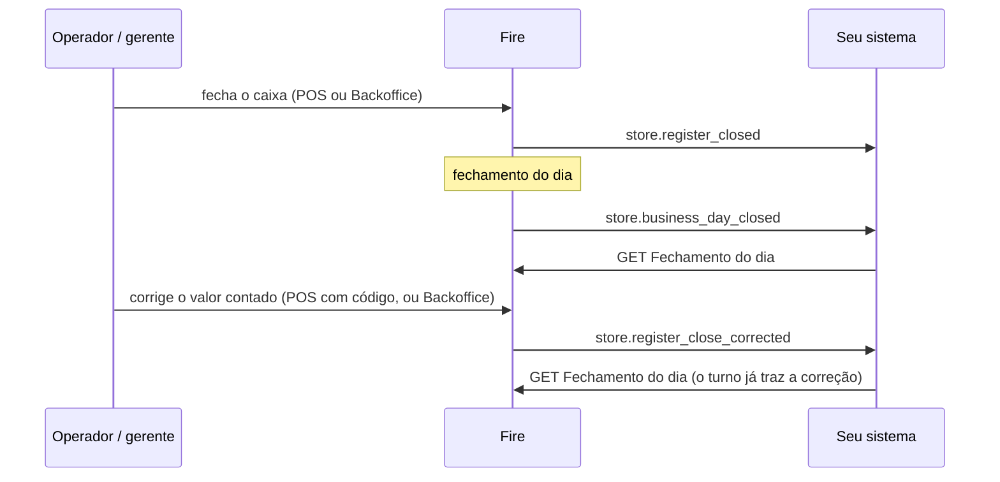

Um caixa do Fire POS passa por dois momentos que interessam a você como integrador: **é fechado**, e às vezes o valor contado nesse fechamento **é corrigido**. Esta página explica o ciclo e onde você vê cada passo. O detalhe dos campos está nas páginas de [`store.register_closed`](/pt/events/store-register-closed), [`store.register_close_corrected`](/pt/events/store-register-close-corrected) e [Fechamento do dia](/pt/api-reference/business-day-close).

## 1. Fechar o caixa

Há duas formas de fechar um caixa:

- **O operador, no POS.** Conta a gaveta e declara o valor contado. Conforme a configuração da loja, pode precisar de um **código do gerente para entrar no fechamento**: o evento informa isso em `closeAuthorization`. Se o fechamento deixa uma falta que exige autorização, o código que a aprovou vem em `cash.authorization`.
- **Um gerente, no Backoffice**, fechando o caixa manualmente. Não usa código: `closeAuthorization` e `cash.authorization` vêm em `null`, e `closedBy.type` é `admin`.

Cada fechamento emite **um** [`store.register_closed`](/pt/events/store-register-closed) com a conferência completa. Os fechamentos forçados —quando um terminal com o caixa aberto é revogado ou apagado— não o emitem, porque ninguém contou a gaveta.

As autorizações nunca trazem o código: trazem seu id (`tokenId`), seu tipo (`one_time` ou `static`), quem o gerou (`approvedBy`) e quando foi usado (`approvedAt`). Veja [Autorizações](/pt/events/store-register-closed#autorizações).

## 2. Fechar o dia

Ao fechar o dia de negócio, o Fire guarda uma foto do dia: os pagamentos e a conferência de caixa de cada turno que já estava reportado. [Fechamento do dia](/pt/api-reference/business-day-close) lê **só essa foto**. Por isso:

- Um turno reportado **depois** do fechamento do dia não aparece na API. Você o recebe em `store.register_closed`, com `postClose: true`.
- A foto não é recalculada a partir dos pedidos: o que o fechamento não guardou não aparece depois.

## 3. Corrigir o valor contado

Se o operador contou errado —por exemplo, contou notas de 10 como de 1—, o fechamento é corrigido **sem reabrir o caixa**. Uma correção muda só **o valor contado** (`declaredCash`) e, com isso, a diferença (`discrepancy`, `discrepancyType`). O esperado (`systemCash`), as vendas, as sangrias e o troco dado fora do caixa ficam como o fechamento deixou.

Há duas vias:

| | No POS | No Backoffice |
|---|---|---|
| Quem | O mesmo operador que fechou o caixa | Um usuário com a permissão **Corrigir fechamento de caixa** e a loja no seu alcance |
| Como se autoriza | Com um **código do gerente** do tipo **Corrigir fechamento**, pedido ao entrar na correção. Se a correção deixa uma falta, esse mesmo código a cobre | Sem código: quem responde é o usuário. Se deixa uma falta, ele precisa escolher o motivo |
| Quais fechamentos | Os fechados pelo operador no POS | Os fechados no POS e os fechados manualmente no Backoffice |
| Prazo desde o fechamento | 24 horas por padrão (de 0 a 168; 0 desativa) | 7 dias por padrão (de 0 a 90; 0 desativa) |
| Limite por fechamento | 3 correções por padrão (de 1 a 10), contando as das duas vias | Sem limite: é a saída quando o operador esgotou suas tentativas |
| No evento | `correction.correctedBy.type: "cashier"`, `correction.authorization` com o código | `correction.correctedBy.type: "admin"`, `correction.authorization: null` |

Por padrão, o código de correção vale por 60 minutos depois de usado (de 5 a 240), para dar tempo à recontagem. Os prazos, o limite e a validade do código são configurados por loja no Fire POS.

As duas vias funcionam **também com o dia já fechado**. Nesse caso a correção fica com `correction.afterDayClose: true` e o Fire atualiza a conferência de caixa desse dia na foto: o turno corrigido, e as contagens e valores de faltas e sobras do dia. As vendas e os pagamentos do dia não mudam, e `store.business_day_closed` **não** é emitido de novo.

Cada correção emite um [`store.register_close_corrected`](/pt/events/store-register-close-corrected).

## Como aparece nos eventos

| | `store.register_closed` | `store.register_close_corrected` |
|---|---|---|
| Quando | Ao fechar o caixa | Toda vez que o valor contado é corrigido |
| Quantas vezes | Uma por caixa | Zero ou mais por caixa |
| Chave de idempotência | `data.registerSessionId` | `data.correction.id` |
| `cash` | O valor contado no fechamento | A conferência vigente, já corrigida |
| O que substituiu | — | `correction.previous` |
| Ordem | — | `correction.sequence` (1, 2, 3…) dentro do mesmo `registerSessionId` |

Os dois eventos compartilham `registerSessionId`: assim você junta um fechamento com suas correções. A conferência vigente de um caixa é a da correção com o `sequence` mais alto que você recebeu ou, se não houve correções, a do fechamento. A ordem de chegada não é garantida: ordene por `sequence`, não pela hora de chegada.

## Como aparece na API de Fechamento do dia

Cada turno de `cash.shifts[]` traz:

- **O valor contado vigente.** `declaredCash`, `discrepancy` e `discrepancyType` já são os corrigidos, e `notes` diz `Corrección N: <motivo>`.
- **`corrections[]`**, da primeira à última, com o mesmo `id` que `correction.id` do evento, o valor contado antes e depois, se foi feita no POS ou no Backoffice e se foi com o dia fechado. `[]` se o turno não foi corrigido.
- **`closeAuthorization`**, o mesmo código com que o operador entrou para fechar que o evento traz.

Uma correção feita antes do fechamento do dia já entra na foto do dia. Uma feita depois a atualiza. Veja o exemplo em [Um turno corrigido](/pt/api-reference/business-day-close#um-turno-corrigido).

## Relacionados

<CardGroup cols={3}>
  <Card title="store.register_closed" icon="cash-register" href="/pt/events/store-register-closed">
    O fechamento de um caixa, com a conferência completa.
  </Card>
  <Card title="store.register_close_corrected" icon="pen-to-square" href="/pt/events/store-register-close-corrected">
    Cada correção do valor contado.
  </Card>
  <Card title="Fechamento do dia" icon="calendar-check" href="/pt/api-reference/business-day-close">
    A conferência de cada turno como ficou no dia.
  </Card>
</CardGroup>
