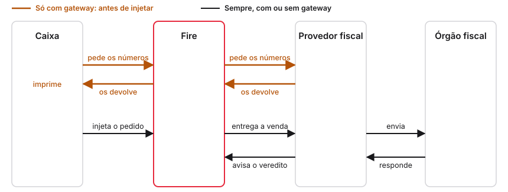
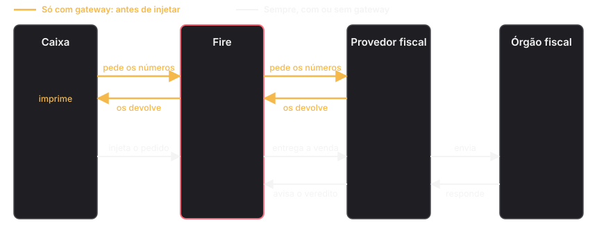

O Fire não fala com o órgão fiscal. Quem emite e obtém o veredito é o seu **provedor fiscal**: o Fire entrega a venda a ele, recebe o resultado e o publica no pedido e nos eventos.

Há duas formas de integrá-lo, e elas diferem em uma única coisa: **se o caixa precisa dos números fiscais antes de injetar o pedido.**

O caixa só fala com o Fire, e o Fire com o provedor. Da injeção em diante, os dois caminhos são iguais.

## Sem gateway: a integração base

O caixa cobra e injeta o pedido. Não precisa saber nada de fiscal.

O Fire entrega a venda ao provedor com um [Integration Flow](/pt/events/integration-flows), e o provedor reporta o resultado com o [callback fiscal](/pt/api-reference/fiscal-callback), repetindo o `event.id` do evento que recebeu.

Ao cobrar, o caixa não tem números fiscais e `data.fiscalRepresentation` viaja como `null`.

**O provedor implementa:** um endpoint que recebe o evento e o envio do callback fiscal.

## Com gateway: o mesmo, mais um passo antes

Quando o comprovante precisa sair impresso com seus identificadores no momento da venda, o caixa pede os números ao Fire e o Fire os pede ao provedor. O caixa os imprime e depois injeta o pedido com o mesmo `orderCode`. Se o pedido já estava aberto porque é cobrado depois, o caixa numera ao cobrar. O caixa nunca fala com o provedor.

<Warning>
  **Numerado não é autorizado.** Os números impressos dizem o que foi impresso. O veredito do órgão chega depois, pelo mesmo callback do caminho sem gateway.
</Warning>

**O provedor implementa também:** o [endpoint síncrono de numeração](/pt/fiscal-providers/contract), por país. Hoje o Fire o suporta no Equador, na Colômbia e na Argentina, e ele é ativado por vendor: em um mesmo país pode haver vendors com e sem gateway.

## Online e offline

O caminho é o mesmo. Muda o modo que o provedor informa em `authorizationMode`:

| | Online | Offline (contingência) |
|---|---|---|
| **O órgão responde** | Normalmente em segundos ou minutos | Mais tarde, até horas, quando a conexão volta |
| **O comprovante** | É impresso normalmente | É válido e pode levar legenda: `printing.reason` é `ISSUED_OFFLINE` |
| **Caixa → Fire → provedor** | Igual | Igual |
| **Como o veredito volta** | Callback fiscal | Callback fiscal |

## O que muda e o que não muda

| | Sem gateway | Com gateway |
|---|---|---|
| **O caixa chama a numeração** | Não é necessário. Se chamar, recebe `NOT_APPLICABLE` e segue | Sim, antes de injetar |
| **Números disponíveis ao cobrar** | Não | Sim |
| **O caixa depende do provedor** | Não | Sim. Se falhar, decide a política da conta: `CONTINUE` ou `REFUND` |
| **`fiscalRepresentation`** | `null` | Com o bloco de numeração |
| **Como o provedor recebe a venda** | Integration Flow | Integration Flow |
| **Como o veredito volta** | Callback fiscal | Callback fiscal |
| **`data.fiscal.authority` e eventos** | Mesma forma | Mesma forma |

## Cancelamento

Também não muda no essencial. O pedido é cancelado no Fire, sai `order.cancelled`, um flow o entrega ao provedor e este confirma com um callback `cancelled`, com seu próprio `eventId`. Isso produz `order.reversed`.

Com gateway, o caixa também pede os números do documento de cancelamento com `operation: "CANCEL"`.

## Os dois blocos do pedido

Um documento fiscal pode deixar dois blocos no pedido, e cada um responde a uma pergunta diferente. A maior parte da confusão vem de misturá-los.

| | `data.fiscalRepresentation` | `data.fiscal.authority` |
|---|---|---|
| **Pergunta que responde** | *O que foi impresso?* | *O que o órgão decidiu?* |
| **Quando aparece** | Só com gateway, quando o caixa numerou | Nos dois caminhos, quando o callback chega |
| **Como chega ao Fire** | Requisição de [numeração fiscal](/pt/api-reference/fiscal-documents-v2) (descontinuada, desligada no fim de dezembro de 2026) ou [numeração na injeção](/pt/api-reference/inject-order-partners#numeração-fiscal-na-injeção) | [Callback fiscal](/pt/api-reference/fiscal-callback) |
| **Muda depois?** | Só quando um novo documento é numerado (uma nota de crédito) | Sim: autorizado, depois cancelado |

<Warning>
  **`fiscalRepresentation` nunca diz que o documento foi autorizado.** Ele guarda os números impressos no caixa. O veredito do órgão é `fiscal.authority`, e o status atual é `fiscal.status` nos eventos fiscais, `lastKnown.fiscal.status` nos demais eventos. Os três podem legitimamente discordar por um tempo.
</Warning>

O que acontece entre o callback e os eventos — qual evento dispara para cada resultado e como cada campo trafega — está em [Do callback aos eventos](/pt/fiscal/callback-to-events).

## Quatro palavras para "status"

O mesmo fato recebe nomes diferentes dependendo de onde você o lê. Eles não são intercambiáveis:

| Onde | Campo | Valores | Descreve |
|---|---|---|---|
| Resposta da numeração fiscal | `numberingStatus` | `GENERATED`, `PENDING`, `FAILED_RETRYABLE`, `FAILED_FINAL`, `NOT_APPLICABLE`, `BLOCKED_BY_POLICY` | Se a **numeração** funcionou |
| Resposta da numeração fiscal | `documentStatus` | `PENDING`, `AUTHORIZED`, `REJECTED`, `CANCELLED` | O documento, como o gateway o conheceu por último |
| Callback fiscal (você o envia) | `eventType` | `fiscal_graphic`, `authorized`, `cancelled`, `rejected`, `denied`, `error` | O que acabou de acontecer no órgão |
| Eventos fiscais (`order.invoiced`, `order.cancelled`, `order.reversed`) | `fiscal.status` | `awaiting_payment`, `not_issued`, `pending`, `processing`, `fiscal_graphic`, `authorized`, `cancelling`, `cancelled`, `rejected`, `denied`, `error` | O estado fiscal do pedido guardado com o documento |
| Todos os demais eventos de pedido | `lastKnown.fiscal.status` | `pending`, `processing`, `fiscal_graphic`, `authorized`, `cancelling`, `cancelled`, `rejected`, `denied`, `error` | O estado fiscal **atual** do pedido |

## Para onde ir agora

<CardGroup cols={2}>
  <Card title="Do callback aos eventos" icon="arrow-right-arrow-left" href="/pt/fiscal/callback-to-events">
    Qual evento dispara para cada callback e onde cada campo cai.
  </Card>
  <Card title="Callback fiscal" icon="arrow-right-to-bracket" href="/pt/api-reference/fiscal-callback">
    O contrato que o seu provedor envia.
  </Card>
  <Card title="Numeração a partir do caixa" icon="cash-register" href="/pt/guides/fiscal-integration">
    O passo do gateway, para pontos de venda e quiosques.
  </Card>
  <Card title="Tornar-se provedor fiscal" icon="plug" href="/pt/fiscal-providers/overview">
    O que um provedor implementa em cada caminho.
  </Card>
</CardGroup>
