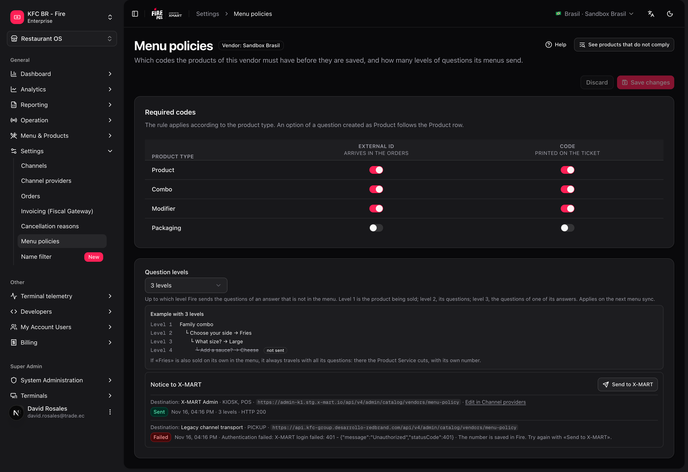
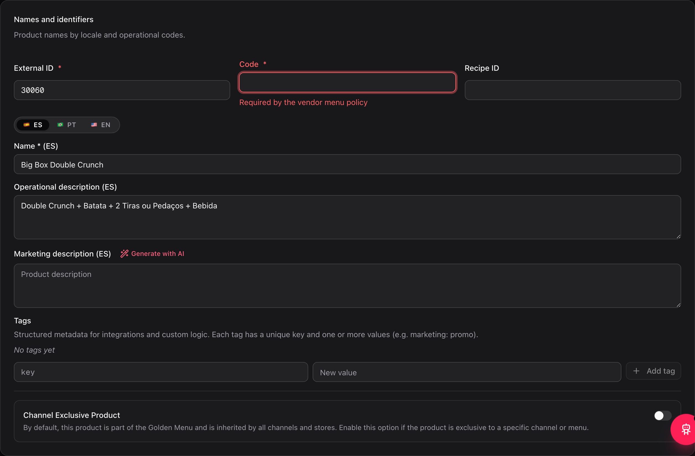
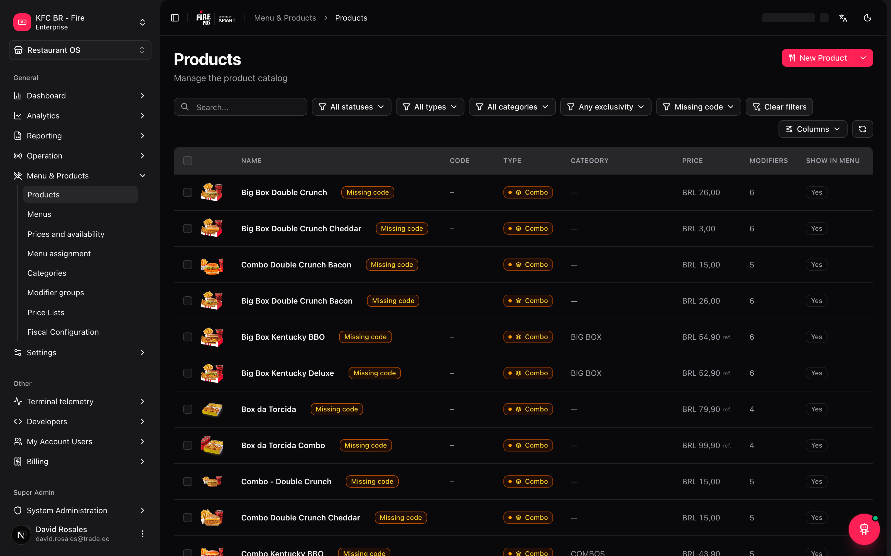
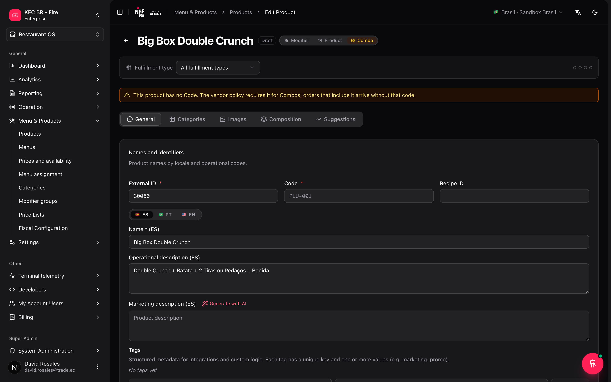
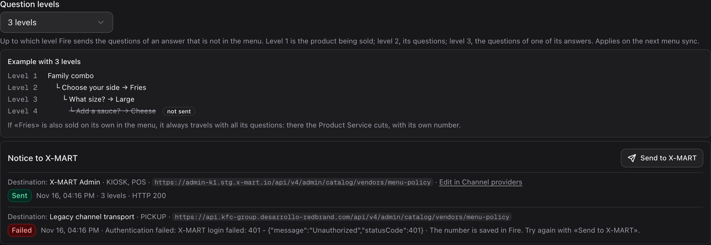
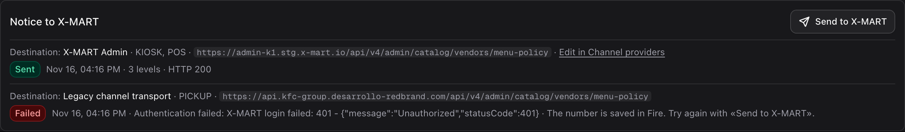
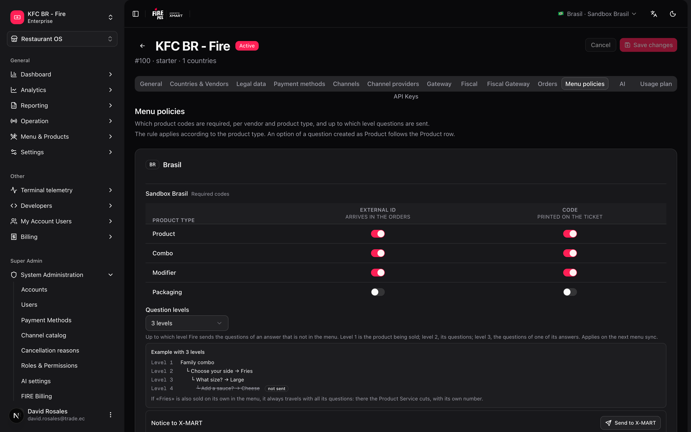

{/* Lacuna anotada: o menu Settings do Restaurant OS também tem Channels, Channel providers, Orders, Invoicing (Fiscal Gateway) e Cancellation reasons. Nenhum deles tem manual ainda. Esta página documenta apenas Menu policies. */}

Um produto viaja para o X-MART com o seu **External ID**, e esse é o código com o qual os pedidos dele voltam identificados. Um produto que não o tem continua vendendo — e os pedidos dele chegam sem esse código, então ninguém mais adiante consegue associar a linha a nada. Isso só é descoberto semanas depois, quando alguém concilia e os números não fecham.

Esta tela existe para que a conta possa dizer **"nenhum produto deste tipo entra no ar sem o seu código"**, e o Fire faz isso valer nos momentos em que consegue.

Ela também decide outra coisa: **quantos níveis de perguntas** os menus da marca enviam. Uma resposta pode ser um produto com perguntas próprias — um sanduíche dentro de um combo que pergunta qual molho — e esse número diz até onde o Fire as segue. Vá em **Restaurant OS → Settings → Menu policies**.

<Frame>
  
</Frame>

---

## O mínimo que você precisa saber

<Note>
**1. Ela vem desligada.** Enquanto ninguém a configurar, nada muda: nenhum produto é obrigado a ter algum código e nenhum é sinalizado.

**2. É uma matriz, e é por vendor.** As linhas são os tipos de produto — **Product**, **Combo**, **Modifier**, **Packaging** — e as colunas são os dois códigos, **External ID** e **Code**. Cada célula é um interruptor: ligado, o código é obrigatório para esse tipo; desligado, não é.

**3. Ela bloqueia o que é novo e sinaliza o que já existe.** Criar um produto ou salvar a ficha dele sem um código obrigatório é recusado. Os produtos que já não têm o código **não** são bloqueados: continuam vendendo e publicando, e recebem um chip **Missing code** para que você os corrija.

**4. Os níveis de perguntas vêm em 2, e em 2 nada muda.** Aumentá-los faz o Fire enviar as perguntas das respostas que não estão no menu. Aplica-se na **próxima sincronização do menu**, e o X-MART tem que receber o número novo **antes** dessa sincronização. Veja [Níveis de perguntas](#níveis-de-perguntas).
</Note>

---

## A tela

No alto, ao lado do título, o selo **Vendor** diz qual vendor você está configurando — aqui, *Sandbox Brasil*. É o vendor escolhido no seletor do alto do backoffice, e a política pertence somente a esse vendor. A descrição diz *"Quais códigos os produtos deste vendor devem ter para poder salvá-los, e quantos níveis de perguntas seus menus enviam."* À direita, **Help** abre um painel lateral que explica a tela, e **See products that do not comply** abre a lista de produtos já filtrada. Esse botão só aparece quando a política que você **salvou** exige algum código.

O cartão **Required codes** contém a matriz. A nota dele diz: *"A regra é aplicada conforme o tipo do produto. Uma opção de uma pergunta criada como Produto segue a linha Produto."*

| Coluna | O que é |
| --- | --- |
| **External ID** — *Chega nos pedidos* | O código com o qual o produto viaja para o X-MART e com o qual os pedidos voltam identificados |
| **Code** — *É impresso no ticket* | O código operacional do ponto de venda (PLU). É o que se imprime |

Você muda os interruptores e depois confirma com **Save changes**. **Discard** descarta o que você mudou. Ao salvar, o Fire confirma com uma mensagem genérica; se não conseguir, mostra a mensagem do servidor tal como vem, em inglês.

<Note>
Para ver **Menu policies**, o seu perfil precisa ter acesso a ela — se o perfil está configurado com submenus explícitos, um administrador precisa concedê-lo. Sem isso, o item não aparece no menu e abrir o endereço leva você a *acesso negado*. Para **salvar**, o acesso não basta: você também precisa de permissão sobre o **vendor inteiro**. Quem está limitado a uma loja pode ler a política, mas não pode alterá-la.
</Note>

<Warning>
**Mudar a política não muda nada nos produtos.** Ela não preenche códigos nem tira nenhum produto de venda. Só muda o que o Fire bloqueia daqui em diante e quais produtos mostram **Missing code**. Os níveis de perguntas, por sua vez, só mudam o menu quando ele é sincronizado de novo.
</Warning>

---

## O caminho simples

Quase toda conta precisa de uma coluna: **External ID**, para os tipos que vende.

1. Abra **Restaurant OS → Settings → Menu policies** e confira o selo **Vendor**.
2. Na coluna **External ID**, ligue **Product**. Faça o mesmo com **Combo** e **Modifier** se eles também viajam nos pedidos.
3. Toque em **Save changes**.
4. Toque em **See products that do not comply** e percorra a lista.

<Tip>
Se o seu único objetivo é que nenhum produto chegue ao X-MART sem o seu identificador, isso é tudo o que você precisa. **Code** é outra questão — veja abaixo.
</Tip>

---

## Os dois códigos não são a mesma coisa

| | **External ID** | **Code** |
| --- | --- | --- |
| Para que serve | É o código com o qual o produto **viaja para o X-MART**, e com o qual os pedidos voltam identificados | O código operacional do ponto de venda (PLU). **É o que o ticket imprime** |
| O que acontece se faltar | Os pedidos chegam sem esse código | O ticket imprime o External ID no lugar dele, se o produto tiver um |
| Onde você o digita | Aba **General** do produto | Aba **General** do produto. No diálogo **Add option** de um grupo de modificadores ele se chama **PLU** |

<Warning>
**Na planilha, a coluna código é o External ID, e a coluna plu é o Code.** Na ficha do produto os nomes são **External ID** e **Code**. É uma confusão real: veja [Importar e exportar](/pt/manuals/backoffice/data-transfers).
</Warning>

---

## O que a política faz e o que não faz

### Qual campo recebe o asterisco

Sem política, **External ID** e **Code** não levam asterisco. Com uma, um campo só recebe o asterisco se o vendor exige esse código **para esse tipo de produto**. Na captura da [ficha do produto](/pt/manuals/backoffice/products#códigos-e-a-política-de-menu), um *Product* mostra os dois asteriscos porque, nesse ambiente, a política exige os dois códigos para **Product**. Com um **Fulfillment type** escolhido na ficha, os códigos são herdados e ficam bloqueados, então não mostram asterisco.

### O que ela bloqueia

O Fire recusa nestes casos, e somente quando o tipo do produto exige um código que ele não tem:

| Quando | O que acontece |
| --- | --- |
| **Criar um produto** | O produto não é criado até que tenha os códigos que o seu tipo exige. |
| **Criar uma opção** com **Add option** em um grupo de modificadores | O mesmo: a opção é um produto novo, nasce como **Product** e segue a linha **Product**. |
| **Salvar a aba General** | O salvamento é recusado. O erro aparece no campo vazio. |
| **Salvar a ficha com uma mudança de tipo pendente** | A exigência do tipo **novo** é conferida no próximo salvamento, **em qualquer aba**: até Pricing ou Categories podem ser recusadas até que o código seja preenchido. |

Um código que só tem espaços conta como vazio. Fora isso, as abas — preços, categorias, imagens, grupos de modificadores, sugestões e disponibilidade — salvam normalmente, com ou sem o código do produto. Preços, categorias e menus não esperam pelo código.

Tocar nas pílulas **Modifier / Product / Combo** da ficha não dispara nada: só muda a tela e marca a ficha como **Unsaved**. Os asteriscos passam a ser os do tipo novo na hora, mas a conferência acontece quando você salva. **Packaging** não tem pílulas (o tipo dele não pode ser mudado), mas a linha dele vale ao criar e ao salvar **General**.

**Como você vê:**

- **Salvar General** marca o campo vazio em vermelho com *Obrigatório pela política de menu do vendor*, e também aparece uma mensagem com o mesmo motivo.

<Frame>
  
</Frame>

- **Criar um produto** marca cada campo que falta da mesma forma.
- **Add option** marca os campos dentro do diálogo — sem mensagem fora dele — e mantém você na aba **General** do diálogo.
- **Salvar outra aba** com uma mudança de tipo pendente mostra a mensagem *"A política de menu do vendor exige {fields} para {type}."*, com a dica *"Preencha na aba Geral."* e um botão **Go to General**.

### O que ela só sinaliza

Os produtos que **já existiam** sem o código não são bloqueados. Continuam vendendo e publicando, e a sincronização dos menus não olha para a política. Eles são marcados em dois lugares:

- **Na lista de produtos**, um chip **Missing code** ao lado do nome. Passe o mouse e o tooltip diz o que falta: *Falta: Código*, *Falta: ID externo* ou *Falta: ID externo e Código*. A lista também ganha um filtro, **Any code status**, com uma única opção, **Missing code**. Ele só aparece quando a política exige algo, e **Clear filters** aparece enquanto houver algum filtro ativo.
- **Na ficha do produto**, um aviso acima das abas, visível em **todas** elas: *"Este produto não tem {fields}. A política do vendor o exige para {type}; os pedidos que o incluírem chegam sem esse código."* Ele se baseia nos dados **salvos**: fica enquanto você digita e some quando você salva. Não aparece ao criar. Com uma mudança de tipo pendente, já usa o tipo novo.

<Frame>
  
</Frame>

<Frame>
  
</Frame>

<Info>
**Por que ela não bloqueia os antigos.** Ligar a política não pode tirar produtos de venda: um restaurante em plena operação perderia pratos. O custo de deixar assim é real, porém — os pedidos desses produtos continuam chegando sem código até alguém corrigi-los. O chip e o aviso são o que mantém isso visível.
</Info>

### O que ela não cobre

- **Grupos de modificadores.** Um grupo é criado sem código e está tudo bem: ele não tem linha na matriz. A política cobre as **opções** (que são produtos), não o grupo.
- **Atribuir um produto existente como opção.** Com **Search and assign product** nada é validado, então um produto que não cumpre é atribuído sem aviso. A regra vale quando um produto é escrito, não quando é atribuído.
- **Restaurar um backup.** Ele não omite nada: veja [Importar e exportar](/pt/manuals/backoffice/data-transfers).

---

## Níveis de perguntas

Uma resposta nem sempre é um item simples. *Kentucky Salad Bacon*, dentro de um combo, é um sanduíche com perguntas próprias: **Deseja adicionar algum item no seu sanduíche?**, **Personalize seu sanduíche**, **Escolha o Refrigerante** e **Escolha seu molho**. Para que essas perguntas cheguem ao cliente dentro do combo, o Fire tem que enviá-las junto com a resposta — e os **Níveis de perguntas** dizem até onde ele desce.

Abaixo da matriz, **Níveis de perguntas** é um seletor de **2 a 6 níveis**, em **2** enquanto ninguém o mudar. Sua nota diz *«Até qual nível o Fire envia as perguntas de uma resposta que não está no menu. O nível 1 é o produto vendido; o 2, suas perguntas; o 3, as perguntas de uma de suas respostas. Aplica-se na próxima sincronização do menu.»*

<Frame>
  
</Frame>

### O que é um nível

Conta-se a partir do produto vendido:

| Nível | O que é | Exemplo real |
| --- | --- | --- |
| **1** | O produto vendido | Combo Kentucky Salad Bacon |
| **2** | Suas perguntas | **Escolha seu sanduíche!**, cuja resposta é Kentucky Salad Bacon |
| **3** | As perguntas de uma de suas respostas | **Escolha seu molho**, dentro de Kentucky Salad Bacon |
| **4 a 6** | E assim por diante, um a mais a cada vez | — |

Sob o seletor, a tela desenha um **exemplo genérico** que muda com o número: *Combo família → Escolha seu acompanhamento → Batata → Qual tamanho? → Grande → …*. Ele marca com **não é enviado** o primeiro nível que fica de fora. Use-o para ver onde o seu número corta.

### O que ele muda

- **Em 2, nada muda.** O menu sai exatamente como antes.
- **Em 3**, o sanduíche do combo envia suas perguntas dentro do combo. Cada nível que você soma desce uma pergunta a mais.
- **Vale para respostas que não estão no menu.** Uma resposta que **também é vendida sozinha** no menu sempre viaja com todas as suas perguntas: ali quem corta é o Product Service, com o seu próprio número.
- **Aplica-se na próxima sincronização do menu.** Salvar não reenvia nenhum menu.

Para ver, por produto, quais perguntas chegam e em que nível, veja [Perguntas dentro de uma resposta](/pt/manuals/backoffice/products#perguntas-dentro-de-uma-resposta). No editor de menus elas aparecem na visão **Table**: veja [Menus](/pt/manuals/backoffice/menus#perguntas-dentro-de-uma-resposta).

---

## Aviso ao X-MART

O número só funciona se o X-MART o tiver **antes** de o menu chegar. Por isso, sob o seletor, o bloco **Aviso ao X-MART** informa o número ao X-MART por você.

<Frame>
  
</Frame>

### Quando é enviado

- **Quando você salva um número diferente.**
- **Quando alguém aperta Enviar ao X-MART**, para a carga inicial e para tentar de novo.

Não há tentativas automáticas: se falhar, a nova tentativa é o botão. O Fire também não envia os menus: o aviso só informa o número ao X-MART.

### Para onde vai e o que o estado diz

Cada **Destino** aparece com o seu endereço: o **provedor X-MART dos canais da marca**, ou **Transporte legado do canal** se a marca só tem esse. Ao lado de cada um, o estado:

| Estado | O que significa |
| --- | --- |
| **Enviado** | O X-MART recebeu. Mostra a data, o número de níveis e o código HTTP: *Nov 16, 04:16 PM · 3 níveis · HTTP 200*. |
| **Falhou** | Não chegou. Mostra a data e o erro, e diz *«O número ficou salvo no Fire. Tente de novo com «Enviar ao X-MART».»* |
| **Incompleto** | Um envio começou e nunca terminou: *Começou em {data} e não terminou. Envie de novo.* |
| **Nunca enviado** | O Fire nunca enviou um número a esse destino: *O X-MART mantém o limite configurado manualmente.* |
| **Sem destino** | *Nenhum canal desta marca vai ao X-MART. Nada é enviado.* |

Na captura, um destino está **Enviado** e o outro **Falhou**: é um ambiente de testes cujo login foi rejeitado (401), mostrado aqui para ilustrar os dois estados. Não é um erro do produto.

Se você muda o número e não salva, o bloco lembra: *«Salve para avisar {n} níveis. «Enviar ao X-MART» envia o número salvo ({saved}).»* Depois de um envio correto, ele diz *«O X-MART já tem {n} níveis. Sincronize os menus desta marca para que as novas perguntas cheguem ao quiosque.»*, com um link **Ir para Atribuição de menus**.

**A rota para a qual é enviado** pode ser mudada por provedor, em **Channel providers → o provedor X-MART → Rota de Políticas de menu**. Se você a deixar vazia, usa-se a rota padrão. Essa tela ainda não tem manual próprio.

<Warning>
**A ordem importa.** Primeiro aumente o número e salve. Depois confira se o X-MART o tem: o destino deve dizer **Enviado**. Só então sincronize os menus da marca em [Atribuição de menus](/pt/manuals/backoffice/menu-assignments). Se você sincronizar antes de o X-MART ter o número, o quiosque não mostra as perguntas novas.
</Warning>

---

## Receitas: como se resolvem os casos reais

<AccordionGroup>
  <Accordion title="Fazer o sanduíche do combo perguntar suas perguntas">
    1. Abra **Menu policies** e confira o selo **Vendor**.
    2. Em **Níveis de perguntas**, escolha **3 níveis**. Use o exemplo para conferir onde corta.
    3. Toque em **Save changes**. O Fire avisa o X-MART sozinho.
    4. Em **Aviso ao X-MART**, confira que cada destino diz **Enviado**. Se algum disser **Falhou**, toque em **Enviar ao X-MART**.
    5. Toque em **Ir para Atribuição de menus** e sincronize os menus da marca.

    Até você sincronizar, o menu continua saindo com o número anterior.
  </Accordion>

  <Accordion title="Os pedidos estão chegando ao X-MART com linhas sem código">
    1. Abra **Menu policies** e ligue **External ID** para **Product** (e **Combo** ou **Modifier** se eles também aparecem nos pedidos).
    2. Toque em **Save changes**.
    3. Toque em **See products that do not comply**.
    4. Abra cada produto e preencha o **External ID** em **General**.
    5. Salve e sincronize os menus que os contêm em [Atribuição de menus](/pt/manuals/backoffice/menu-assignments).

    Até você corrigir um produto, os pedidos dele continuam chegando sem código.
  </Accordion>

  <Accordion title="Não consigo criar ou salvar um produto: 'Obrigatório pela política de menu do vendor'">
    A sua conta exige um código para esse tipo e o campo está vazio. Preencha o campo marcado em vermelho e salve de novo. Se você digitou só espaços, conta como vazio.
  </Accordion>

  <Accordion title="Não consigo salvar Pricing, Categories ou outra aba">
    Confira se você tocou nas pílulas **Modifier / Product / Combo** sem salvar. A ficha ainda carrega essa mudança de tipo e a política do tipo novo é conferida a cada salvamento. Preencha o código em **General** — o botão **Go to General** leva você até lá — ou desfaça a mudança de tipo.
  </Accordion>

  <Accordion title="Um produto mostra Missing code mas está vendendo normal">
    É o esperado. A política não bloqueia produtos que já existiam. O chip avisa que os pedidos dele chegam sem esse código: preencha-o e o chip some.
  </Accordion>

  <Accordion title="Preciso do PLU em todo ticket">
    Ligue **Code** para os tipos que imprimem. **Code** é o que o ticket imprime, então exija-o só onde um ticket precisa dele.
  </Accordion>

  <Accordion title="Encontrar todos os produtos que preciso corrigir">
    Na lista de produtos, abra o filtro **Any code status** e escolha **Missing code**. Ou toque em **See products that do not comply** em **Menu policies**: ele abre a lista já filtrada.
  </Accordion>
</AccordionGroup>

---

## Casos, de ponta a ponta

Com **External ID** ligado para **Product** e **Code** desligado:

| O que você faz | Resultado |
| --- | --- |
| Criar um **Product** sem External ID | Recusado: *Obrigatório pela política de menu do vendor* |
| Criar um **Product** com External ID e sem Code | Criado |
| Editar o preço de um produto existente sem External ID | Salvo: a aba **Pricing** não é validada. O produto continua mostrando **Missing code** |
| Salvar a aba **General** desse mesmo produto sem tocar no External ID | Recusado: a política vale para essa aba |
| Tocar na pílula **Product** de um **Modifier** sem External ID e depois salvar qualquer aba | Recusado nesse salvamento, porque o tipo novo o exige |
| Criar um **Combo** sem External ID | Criado: **External ID** não está ligado para **Combo** |

---

## Erros que saem caros

<Warning>
**Supor que um produto sem o seu código parou de vender.** Ele continua vendendo. O risco é o contrário: os pedidos chegam sem código e nada os detém. Confira a lista depois de ligar a política.
</Warning>

<Warning>
**Exigir Code quando você queria External ID.** **Code** é o que o ticket imprime. Se o objetivo é que o X-MART receba a linha identificada, a coluna é **External ID**.
</Warning>

<Warning>
**Configurar a política no vendor errado.** A matriz é por vendor: confira o selo **Vendor** antes de tocar em **Save changes**.
</Warning>

<Warning>
**Aumentar os níveis de perguntas e sincronizar os menus antes de o X-MART ter o número.** A sincronização passa, mas o quiosque não mostra as perguntas novas. Confira primeiro que o destino diz **Enviado**.
</Warning>

<Warning>
**Supor que salvar os níveis reenvia os menus.** Não reenvia. O número novo vale na próxima sincronização de cada menu, e ninguém sincroniza por você.
</Warning>

<Warning>
**Importar uma planilha e supor que ela corrige os códigos.** Com a política ligada, as linhas que criam um produto sem o código, ou o esvaziam, são deixadas de fora. Veja [Importar e exportar](/pt/manuals/backoffice/data-transfers).
</Warning>

---

## Glossário

| Termo | O que significa |
| --- | --- |
| **Menu policy** | A matriz, por vendor, de quais códigos cada tipo de produto exige |
| **External ID** | O código com o qual o produto viaja para o X-MART e com o qual os pedidos voltam identificados |
| **Code** | O código operacional do ponto de venda (PLU). É o que o ticket imprime |
| **Missing code** (na interface em português: *Falta código*) | Chip num produto que não tem um código que o seu tipo exige |
| **Any code status** (na interface em português: *Qualquer código*) | Filtro da lista de produtos; a opção **Missing code** mostra só os produtos que não têm um código exigido |
| **Vendor** | A marca ou o negócio dentro da conta |
| **Níveis de perguntas** | Quantos níveis de perguntas os menus da marca enviam, de 2 a 6 (2 por padrão). O nível 1 é o produto vendido, o 2 suas perguntas, o 3 as perguntas de uma de suas respostas. |
| **Aviso ao X-MART** | O bloco que informa ao X-MART o número dos níveis de perguntas e mostra se cada destino o recebeu: **Enviado**, **Falhou**, **Incompleto**, **Nunca enviado** ou **Sem destino**. |

---

## Perguntas frequentes

<AccordionGroup>
  <Accordion title="Aumentei os níveis e o quiosque continua sem mostrar as perguntas">
    Costumam faltar duas coisas. Confira que o **Aviso ao X-MART** diz **Enviado** para todos os destinos — se disser **Falhou**, **Incompleto** ou **Nunca enviado**, o X-MART não tem o número. E confira que você sincronizou os menus da marca **depois** disso: salvar os níveis não os reenvia. Confirme também que o número é alto o bastante: em 2, nada muda.
  </Accordion>

  <Accordion title="O que significa Falhou?">
    O Fire salvou o número, mas esse destino não o aceitou. A linha de estado mostra o erro como o destino o devolveu. Nada se perde: *«O número ficou salvo no Fire.»* Corrija a causa — por exemplo, as credenciais desse provedor — e toque em **Enviar ao X-MART** de novo. O Fire não tenta de novo sozinho.
  </Accordion>

  <Accordion title="Aumentar os níveis muda algo para os produtos que estão no menu?">
    Não. Um produto que também é vendido sozinho no menu sempre viaja com todas as suas perguntas. Os níveis de perguntas só decidem até onde o Fire desce nas respostas que **não** estão no menu.
  </Accordion>

  <Accordion title="A política vem ligada por padrão?">
    Não. Ela vem desligada: nada é exigido e nada é sinalizado até que alguém a configure. Um vendor com todos os interruptores desligados é o mesmo que um vendor nunca configurado.
  </Accordion>

  <Accordion title="Ela vale para produtos que já existem?">
    Ela não os bloqueia, mas os sinaliza. Eles continuam vendendo e publicando, com um chip **Missing code** na lista e um aviso na ficha. Só são recusados quando alguém salva a aba **General** deles ou, com uma mudança de tipo pendente, qualquer aba.
  </Accordion>

  <Accordion title="Ela vale também para o ID do grupo de modificadores?">
    Não. Um grupo é criado sem código e não está na matriz. A política vale para os produtos por trás das opções dele.
  </Accordion>

  <Accordion title="Ela vale se eu carrego produtos por planilha?">
    Sim, para as linhas que criam um produto ou esvaziam um código que ele tinha: são deixadas de fora com uma observação. Restaurar um backup não omite nada, só avisa. Veja [Importar e exportar](/pt/manuals/backoffice/data-transfers).
  </Accordion>

  <Accordion title="Por que não vejo Menu policies?">
    O seu perfil não tem acesso a ela. Se ele está configurado com submenus explícitos, um administrador precisa concedê-lo. Abrir o endereço diretamente leva você a *acesso negado*.
  </Accordion>

  <Accordion title="Por que eu vejo a tela mas não consigo salvar?">
    Salvar exige permissão sobre o vendor inteiro, não só acesso à tela. Se você administra apenas algumas lojas, peça a alguém com permissão sobre o vendor inteiro.
  </Accordion>

  <Accordion title="Por que não vejo o filtro Any code status?">
    Ele só aparece quando a política exige algum código. Com tudo desligado não há o que filtrar.
  </Accordion>
</AccordionGroup>

---

## Se você administra várias contas

A mesma configuração também está disponível na administração: **Super Admin → System Administration → Accounts →** o detalhe da conta **→** aba **Menu policies**. É a mesma matriz, mas mostra **todos os países e vendors da conta de uma vez**: um cartão por país e, dentro dele, cada vendor com os seus próprios **Required codes**. Um único **Save changes** salva todos, e **Cancel** descarta o que você mudou. A descrição da aba diz *"Quais códigos do produto são obrigatórios, por vendor e tipo de produto, e até qual nível as perguntas são enviadas."* Diferente do Restaurant OS, ela não depende do acesso de menu do seu perfil: é para superadministradores da plataforma.

Cada vendor também traz os seus próprios **Níveis de perguntas** e o seu próprio **Aviso ao X-MART**, logo abaixo da matriz. Valem as mesmas regras: um número por vendor, e o X-MART tem que tê-lo antes de os menus serem sincronizados.

<Frame>
  
</Frame>

---

## O que ela não faz

- Ela **não preenche códigos** nem tira produtos de venda: bloqueia o que é novo e sinaliza o que já existe.
- Ela **não valida** as outras abas do produto enquanto o tipo não mudou: preços, categorias, imagens, grupos de modificadores, sugestões e disponibilidade salvam normalmente.
- Ela **não exige código no próprio grupo de modificadores** e **não confere** um produto que você atribui a um grupo como opção.
- Ela **não omite nada** ao restaurar um backup: só avisa.
- Salvar os níveis de perguntas **não reenvia os menus**: o número novo vale na próxima sincronização de cada um.
- O **Aviso ao X-MART** **não tenta de novo sozinho**: se falhar, a nova tentativa é o botão **Enviar ao X-MART**.
