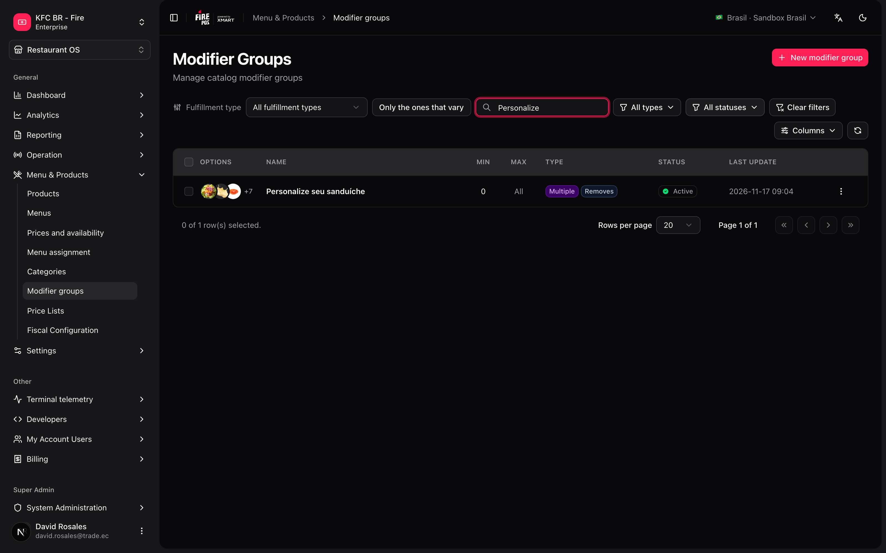
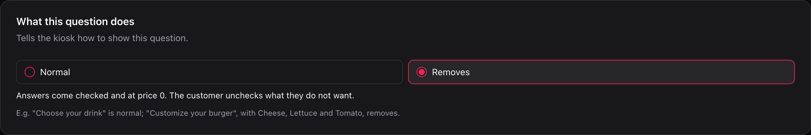
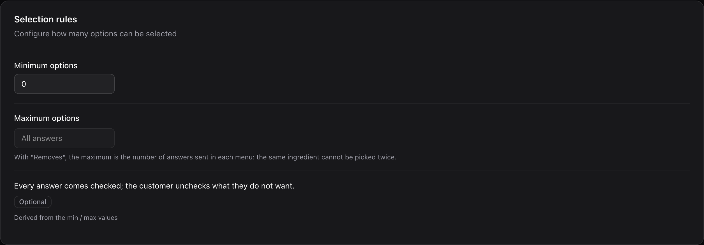
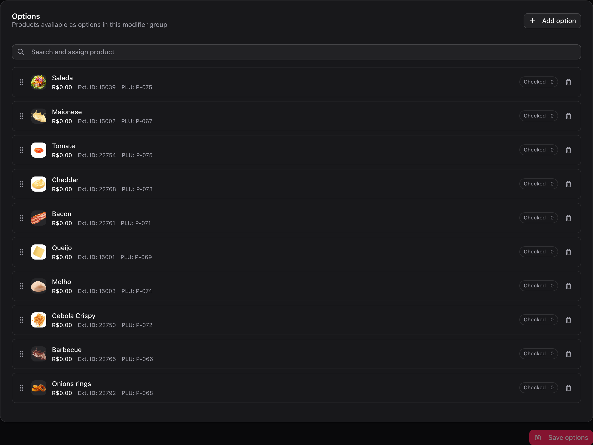
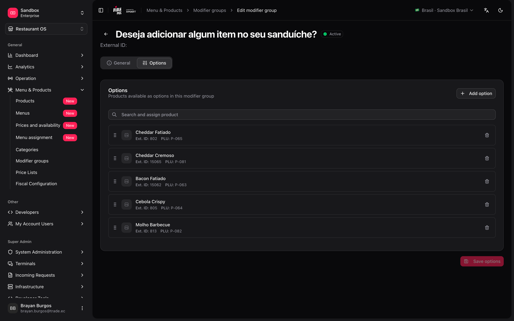
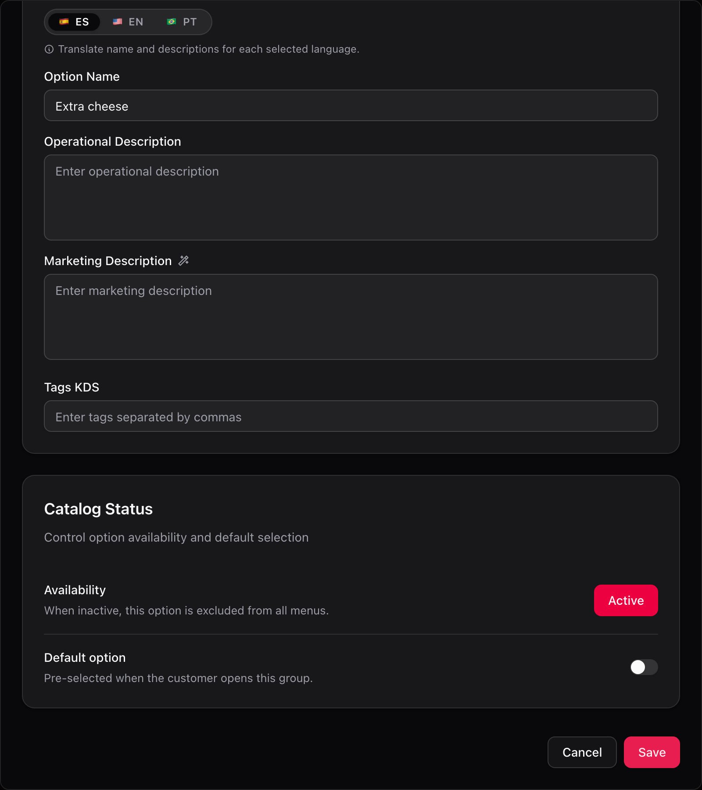
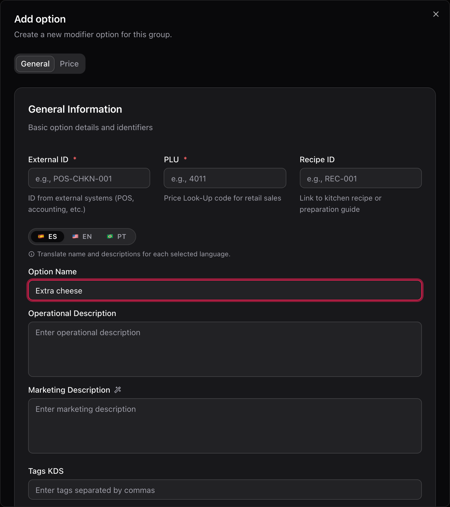

Um grupo de modificadores é uma **pergunta que você faz ao cliente quando ele pede**: *qual molho?*, *que tamanho?*, *quer adicionar algo?*. O grupo define a pergunta, as respostas possíveis e quantas ele pode escolher.

Define-se uma vez e escolhe-se de muitos lugares: o mesmo grupo *Molhos* pode servir para os dez hambúrgueres do cardápio sem que ninguém digite a pergunta dez vezes. Mas adicioná-lo a um produto **tira uma cópia** do grupo como ele está naquele dia — então, no dia em que você adicionar um molho novo ao grupo, os produtos que já o tinham não mudam sozinhos. Vá em **Restaurant OS → Menu e Produtos → Grupos de modificadores**.

<Frame>
  
</Frame>

---

## O mínimo que você precisa saber

<Note>
**1. As opções são produtos do catálogo.** Para oferecer *queijo extra* tem que existir um produto *queijo extra*. Não se escrevem opções soltas.

**2. Você só define dois números: o mínimo e o máximo.** Se o grupo é obrigatório e se é de uma ou de várias opções **não se escolhe** — a tela deduz isso desses dois números.

**3. Adicionar um grupo a um produto o copia.** A partir daí, editar o grupo não muda mais o que aquele produto pergunta. O grupo é o modelo do qual você escolhe, não um pai que os produtos continuam seguindo. **Uma exceção:** se a pergunta é Normal ou Remove **não se copia** — lê-se sempre do grupo.

**4. Uma pergunta é Normal ou Remove.** **Normal** é o que todo grupo sempre foi: as respostas chegam desmarcadas, com seu preço, e o cliente marca o que quer. **Remove** serve para ingredientes que o produto já inclui: toda resposta chega marcada a preço 0 e o cliente desmarca o que não quer. Se você não escolher nada, a pergunta é Normal.
</Note>

---

## O caminho simples

1. **Novo grupo de modificadores**, dê um nome — *Molhos*, *Tamanho*, *Adicionais*.
2. Deixe **O que esta pergunta faz** em **Normal**. Mude só se o cliente remove ingredientes — veja [O que a pergunta faz](#o-que-a-pergunta-faz-normal-ou-remove).
3. Defina o **Minimum options** e o **Maximum options** que ele pode escolher.
4. Salve, e na aba **Options** busque os produtos que serão as opções. Confirme com **Save options**.
5. Vá na ficha de cada produto que usa este grupo e adicione-o pela aba **Modifier Groups** dele (num combo, a aba **Composition**).

<Tip>
Um grupo não faz nada sozinho. Ele começa a funcionar quando um produto o usa. Se a pergunta é a mesma em todos os Tipos de Fulfillment, é uma pergunta normal e você termina o grupo antes de adicioná-lo aos produtos, está pronto.
</Tip>

---

## As regras de seleção

O cartão **Selection rules** tem **apenas dois campos**: **Minimum options** e **Maximum options**. Nada mais.

Abaixo deles, a tela diz em palavras simples o que o cliente vai poder fazer — *"The customer picks exactly one option."*, *"The customer picks between 1 and 10 options."* — e mostra duas etiquetas: **Required** ou **Optional**, e **Single** ou **Multiple**, com a frase *"Derived from the min / max values"*. Não são campos: são o resultado dos dois números que você definiu.

<Info>
**Por que é deduzido em vez de escolhido.** Um grupo marcado como "opcional" com mínimo 1 seria uma contradição, e alguém a descobriria quando um cliente não conseguisse finalizar o pedido. Ao derivá-lo dos números, essa contradição não pode existir. A regra é: um máximo de 1 o torna **Single**, qualquer valor maior **Multiple**; um mínimo de 1 ou mais o torna **Required**.
</Info>

Exemplos que cobrem quase tudo:

| O que você quer | Min | Max | Fica |
| --- | --- | --- | --- |
| Escolher o tamanho, sem escapatória | 1 | 1 | Required · Single |
| Molho, opcional | 0 | 1 | Optional · Single |
| Até três adicionais, opcionais | 0 | 3 | Optional · Multiple |
| Escolher dois acompanhamentos de um combo | 2 | 2 | Required · Multiple |

Os números contam **escolhas**, não opções diferentes: um grupo com duas batatas fritas e mínimo 2 é válido.

<Note>
**Com Remove você não escolhe o máximo.** A caixa diz **Todas as respostas** e não pode ser editada: o máximo é o número de respostas que cada menu envia, para que o mesmo ingrediente não possa ser escolhido duas vezes. O mínimo continua sendo seu, mas muda de sentido — veja [O que a pergunta faz](#o-que-a-pergunta-faz-normal-ou-remove).
</Note>

As etiquetas sempre são deduzidas dos números que **realmente se aplicam** — depois de qualquer ajuste no produto, por Tipo de Fulfillment ou por menu. Se um produto aumenta para 3 o máximo de um grupo *Single*, aquele produto o pergunta como escolha múltipla.

### O máximo não pode ser 0

O mínimo pode ser 0 — é assim que se fazem as perguntas opcionais. O **máximo** não pode ser colocado em 0, e o que acontece quando você tenta depende da tela — sempre sem mensagem:

| Onde | Se você digita ou cola um 0 no máximo | Se você deixa a caixa vazia |
| --- | --- | --- |
| **O grupo** | A caixa o descarta. | Com um **Fulfillment type** escolhido, volta a *herda*. Em **All fulfillment types** não há de onde herdar: a caixa vazia conta como 0 e o salvamento é recusado. |
| **O produto** (aba **Modifier Groups**) | Vira 1. | Volta a *herda*. |
| **O editor de menus** | Vira 1 ou o mínimo, o que for maior. | Nada: a caixa se preenche de novo com o valor atual. Para voltar a herdar ali, use **Voltar à base**, explicado abaixo. |

O mesmo vale por **Fulfillment type** em cada tela.

- **Um 0 salvo antes desta regra é mostrado como está.** No X-MART um máximo de 0 significa *sem limite*, e a tela mostra a dica *Sem limite no X-MART*: no resumo da pergunta no produto (*Seleção: Mín. 0 · Máx. 0 (Sem limite no X-MART)*), abaixo da caixa enquanto você edita o produto, no editor de menus e, no grupo, **somente com um Fulfillment type escolhido**.
- **Com máximo 0 a pergunta é sempre Multiple.** Só o mínimo decide **Required** ou **Optional**. O produto mostra apenas essa última etiqueta.
- **No editor de menus, um máximo novo abaixo do mínimo é recusado** com uma mensagem própria. O grupo e o produto também o recusam, com uma mensagem mais genérica. Um máximo de 0 fica de fora dessa comparação.
- **Uma pergunta criada antes desta regra pode ter o máximo em 0.** Enquanto tiver esse valor na configuração base, a aba **General** do grupo não deixa salvá-la. Para modificá-la, edite-a no editor de menus.

#### Voltar à base, no editor de menus

Para fazer uma pergunta voltar a herdar no editor de menus, use **Voltar à base**. Ao passar o cursor, ele diz: *«Tira o que este Tipo de fulfillment separa; a pergunta volta a seguir a base.»*

- Só aparece quando há um **Tipo de Fulfillment** escolhido **e** essa pergunta já tem ajustes próprios para esse tipo.
- Funciona **por pergunta**, não para a tela inteira.
- Remove **tudo** o que esse tipo separa, não só o máximo. Não serve para voltar a herdar apenas o máximo.

---

## O que a pergunta faz: Normal ou Remove

Nem toda pergunta é uma escolha entre coisas que o cliente *adiciona*. *Personalize seu hambúrguer* não oferece queijo, alface e tomate como adicionais — o hambúrguer já vem com eles, e o que o cliente decide é o que **deixar de fora**. Se essa pergunta fosse configurada como normal, o cliente veria três caixas vazias e teria que marcar os ingredientes que já espera receber.

O cartão **O que esta pergunta faz**, logo abaixo do nome, resolve isso com duas opções. A tela o descreve como *«Diz ao quiosque como mostrar esta pergunta.»* **Ao criar** o grupo, o cartão fica entre **General information** e **Selection rules** e se salva com **Create modifier group**. **Ao editar**, está na aba **General** e se salva com **Save changes**, junto com o nome, o mínimo e o máximo. Com um Tipo de Fulfillment selecionado, o cartão é somente leitura.

<Frame>
  
</Frame>

| | **Normal** | **Remove** |
| --- | --- | --- |
| As respostas chegam | Desmarcadas, com seu preço | **Todas marcadas, a preço 0** |
| O cliente | Marca o que quer | **Desmarca** o que não quer |
| Exemplo típico | *Escolha sua bebida* | *Personalize seu hambúrguer*, com Queijo, Alface e Tomate |
| Máximo | Você o define | **Não se escolhe**: *Todas as respostas* |
| Mínimo | Quantas ele precisa escolher | Quantas precisam **ficar** marcadas |

Se você não escolher nada, a pergunta é **Normal**: tudo o que já existia continua funcionando exatamente igual.

### O que muda quando você escolhe Remove

<Frame>
  
</Frame>

- **O máximo não é seu para definir.** Ele diz **Todas as respostas** e é o número de respostas que cada menu envia. O motivo está na tela: *«o mesmo ingrediente não pode ser escolhido duas vezes.»* Se um combo deixa só 2 dos 3 ingredientes, nesse combo o máximo é 2.
- **O mínimo muda de sentido.** É quantos ingredientes precisam **ficar** marcados — a regra do *"você não pode tirar tudo"*. Com mínimo 1, a frase embaixo dos números diz *«Todas as respostas chegam marcadas; o cliente desmarca o que não quer e mantém pelo menos 1.»* Com 0, o cliente pode desmarcar todas. Se o mínimo é maior que as respostas que um menu realmente envia, esse menu o envia reduzido a esse número, e o sync avisa (veja [Atribuição de menus](/pt/manuals/backoffice/menu-assignments#sincronizou-mas-algo-ficou-de-fora)).
- **O preço das respostas sai em 0**, mesmo que o produto por trás da resposta tenha um. Se alguma resposta tinha preço, o sync avisa que foi enviada a 0.
- **A etiqueta Single / Multiple não é mostrada no cartão Selection rules.** Ela dependeria de quantas respostas cada menu envia. Required ou Optional continua seguindo o mínimo.
- **Cada resposta sai com o padrão ligado**, sem escrever nada no cadastro. O interruptor **Default** aparece marcado e travado só se a pergunta salva é de escolha única; se é múltipla, só aparece o chip **Marcada · 0**. Se a pergunta voltar a Normal, voltam a valer os padrões que estavam salvos.
- **O diálogo Add option não oferece a opção padrão.** Numa pergunta Remove ele diz no lugar *«Com «Remove», todas as respostas saem marcadas e com preço 0.»* e a opção é adicionada sem padrão.
- **É igual em todos os Tipos de Fulfillment.** Com um tipo escolhido, o cartão não deixa mudá-lo e diz *É igual em todos os tipos de fulfillment: altere em «Todos os tipos de fulfillment».*

Na aba **Options**, cada resposta leva um chip **Marcada · 0**, e na lista de grupos a coluna **Type** mostra **só** o chip **Remove** (uma pergunta normal mostra **Single** ou **Multiple**) e a coluna **Max** diz **Todas**. Na captura, **Personalize seu sanduíche** tem dez opções.

<Frame>
  
</Frame>

<Tip>
**Remover nunca muda o preço.** Se você quer cobrar por um adicional — queijo duplo — monte-o como uma pergunta normal ao lado desta.
</Tip>

### Dê às respostas o nome do ingrediente

Com Remove, toda resposta chega marcada. Uma resposta chamada *Retirar alface*, marcada, lê-se como "retirar alface: sim" — o contrário do que você queria. Então as respostas têm que ser o **ingrediente**: *Alface*, não *Retirar alface*.

O Fire avisa, e não bloqueia, quando o nome de uma resposta começa com **Retirar**, **Sem**, **Sin** ou **No**: o cartão diz quais respostas apareceriam já marcadas e sugere renomeá-las ou deixar a pergunta como **Normal**. A regra olha só a **primeira palavra inteira**, sem distinguir maiúsculas de minúsculas mas **distinguindo acentos**: *Nota*, *Nuggets*, *Normal* ou *Semente* não ativam o aviso, e outros verbos (*Quitar*, *Remove*, *Without*) também não. Ela confere o nome do produto em **espanhol** e, se não houver, em inglês e depois em português — não o idioma que você está usando.

O aviso aparece no cartão da aba **General** (com as respostas carregadas ao abrir a página: não se atualiza depois de **Save options**, e ao criar o grupo nunca aparece) e em cima da lista da aba **Options** (aí sim se atualiza). Não aparece no diálogo **Add option**.

Um caso real: no KFC BR, **Deseja retirar algum item do seu sanduíche?** tem as respostas **Retirar Salada** e **Retirar Maionese**. Ela continua sendo uma pergunta **Normal** até que as respostas sejam renomeadas para o ingrediente (**Salada**, **Maionese**). Esse aviso não tem captura porque, com nomes como *Salada*, não há nada a avisar.

<Info>
**O Fire envia; cada canal desenha.** Este manual cobre o que você configura no Fire e o que o Fire envia: cada resposta marcada como selecionada, a preço 0, com o máximo igual ao número de respostas. **Não afirmamos o que nenhum canal faz com isso.** Como um canal mostra — caixas marcadas no quiosque, como o ingrediente removido aparece num ticket ou na tela da cozinha — depende de esse canal ler a marca, e nada disso deve ser prometido a um cliente sem confirmar com o canal.
</Info>

---

## As opções são produtos

Esta é a parte que surpreende: uma opção não é um texto solto. **Atrás de cada opção há um produto do catálogo**, e a aba **Options** oferece dois caminhos para chegar lá.

<Frame>
  
</Frame>

| Caminho | Quando |
| --- | --- |
| **Search and assign product** | O produto já existe. Você o busca pelo nome e ele fica atribuído. |
| **Add option** | Ele ainda não existe. O formulário pede nome, **PLU**, **External ID**, **Recipe ID**, descrições e preço — é a ficha de um produto, e é isso que se cria. Nasce como **Product** e segue a linha **Product** da [política de menu](/pt/manuals/backoffice/menu-policies): se a política exige um código, você não consegue criar a opção sem ele. |

Quando a [política de menu](/pt/manuals/backoffice/menu-policies) exige um código para **Product**, o diálogo o marca com um asterisco — aqui **External ID** e **PLU**, que é como este diálogo chama o **Code** — e a opção não é criada sem eles. Se faltar algum, os campos ficam vermelhos com *Obrigatório pela política de menu do vendor* dentro do diálogo, sem nenhuma mensagem fora dele. O servidor confere de novo, caso a política tenha mudado com o diálogo aberto.

<Frame>
  
</Frame>

Tem uma razão prática: uma opção tem preço, impostos, código de PLU, receita de cozinha e nome em três idiomas. Tudo isso já vive num produto, e duplicar seria manter duas vezes.

<Info>
**É por isso que existe o tipo de produto Modifier.** Em [Produtos](/pt/manuals/backoffice/products) você pode criar um produto do tipo **Modifier** — *queijo extra*, *carne dupla* — que existe para ser opção e não para ser vendido sozinho. Basta desligar o **Show in menu**: o produto não aparece no cardápio mas segue disponível dentro de combos e modificadores.
</Info>

Se você escolhe **Search and assign product**, nada é validado: o produto já existe, e um que não cumpre a política é atribuído sem nenhum aviso. E o próprio **grupo** não precisa de código: um grupo é criado sem ele, e está tudo bem. A política cobre os produtos por trás das opções, não o grupo.

As opções **se reordenam arrastando**, e essa é a ordem em que o cliente as vê.

As opções **não se salvam sozinhas**: ao terminar é preciso confirmar com **Save options**.

Cada linha mostra o preço do produto que está atrás daquela opção, somente leitura. Ao passar o cursor por cima, a tela explica: *"Price of the product behind this option. A product that uses this group can give it its own price."*

### O que se define por opção

<Frame>
  
</Frame>

| Controle | O que faz |
| --- | --- |
| **Availability** | Se desligado, a opção **fica fora de todos os menus**. Define-se ao criar a opção. |
| **Default option** | Marca a opção como a que deveria vir pré-selecionada. O editor de menus a mostra e o Fire **a envia aos canais** junto com a resposta; se e como um canal a pré-seleciona fica a cargo desse canal. Em grupos *Single* também pode ser trocada pela linha da opção (**Default**). Com [Remove](#o-que-a-pergunta-faz-normal-ou-remove) toda opção é o padrão e o interruptor fica travado. |
| **External ID** · **PLU** · **Recipe ID** | Os identificadores para POS, varejo e cozinha. |
| **Tags KDS** | Etiquetas para a tela da cozinha. |

A aba **Price** do diálogo é **somente leitura**: mostra o líquido, o bruto e o sugerido *do produto que você escolheu*. A própria tela diz: *"Values from the selected product (read from product detail)."*

<Warning>
**Para mudar quanto custa uma opção, não é aqui.** Se o adicional de queijo tem que custar diferente em todos os lugares, corrija o preço do produto *queijo extra* na [lista de preços](/pt/manuals/backoffice/price-lists). Se só tiver que custar diferente dentro de um produto ou combo, veja [Preços das opções dentro de um produto](#preços-das-opções-dentro-de-um-produto).
</Warning>

---

## Adicionar um grupo a um produto o copia

Um grupo se define uma vez, mas o que um produto pergunta vive **no produto**. Quando você escolhe um grupo no buscador *«Pesquisar grupos de modificadores...»* da aba **Modifier Groups** de um produto (num combo, **Composition**), a cópia é feita ao adicioná-lo. Quase sempre ele é adicionado na hora, sem diálogo. A tela só para quando há algo a avisar: se o grupo tem configuração própria por Tipo de Fulfillment, um diálogo intitulado *"This group is configured per fulfillment type"* diz *"It is copied to the product as is: from here on, editing the group no longer changes what this product asks."* e você confirma com **Add a copy**. E se o produto tem um Tipo de Fulfillment selecionado, o diálogo pergunta em vez disso *"Where does this question apply?"* (veja mais abaixo). A cópia é feita em todos os casos; o que muda é se aparece um diálogo.

O que é copiado: o título do grupo, seu mínimo e máximo, sua lista de opções e o que o grupo tiver configurado por Tipo de Fulfillment.

O que isso significa na prática:

- **Editar o grupo depois não chega àquele produto.** Renomear *Molhos*, aumentar o máximo ou adicionar um molho novo muda o grupo — não os hambúrgueres que já o tinham.
- **Cada produto pode ser diferente sem afetar os outros.** Mudar a cópia no hambúrguer premium não mexe no grupo nem nos outros hambúrgueres.
- **Uma exceção: Normal / Remove não se copia.** A cópia não guarda esse ajuste: ele é lido sempre do grupo. Se você muda o grupo de Normal para Remove, ou ao contrário, mudam **todos os produtos que o usam, cópias incluídas**, na ficha, no editor de menus e na próxima sincronização, sem nenhum aviso na tela.

Cada grupo na aba do produto mostra uma pequena marca que diz de que tipo ele é:

| Marca | O que significa |
| --- | --- |
| **copy** | *"Copied from the group when it was assigned. Editing the group no longer changes this product, except for the type (Normal / Removes), which always follows the group."* |
| **follows the group** | *"Assigned before groups became a catalog: editing the group still changes what this product asks."* |

Os dois tipos convivem: os produtos que tinham o grupo antes de existir o comportamento de cópia ficaram como estavam, então continuam seguindo o grupo ao vivo.

<Info>
**A tela do grupo diz a quem ainda chega.** Quando há produtos que ainda seguem o grupo, um aviso no topo diz *"N products still follow this group: what you save here reaches them. Products assigned after the change keep their own copy, except for the type (Normal / Removes): it always follows the group."* — com **see which** para listá-los. Sem aviso, editar o grupo não muda nada em nenhum produto — com uma exceção: trocar Normal / Remove sempre chega a todos, cópias incluídas, mesmo quando nenhum aviso aparece.
</Info>

### Levar uma mudança do grupo aos produtos que têm uma cópia

Não há um botão que empurre uma mudança do grupo para as cópias. Faz-se produto por produto, na aba **Modifier Groups** de cada um:

- **Uma opção nova no grupo**: abra o grupo no produto e marque-a (**Applies to this product**). As opções que o grupo oferece mas a cópia não usa aparecem desmarcadas.
- **Um título, mínimo ou máximo novo**: edite-os no produto (**Edit overrides for this product**).

Remover uma opção do grupo é a exceção: isso **chega sim** a todos os produtos, cópias incluídas — a opção deixa de ser oferecida em todos os lugares.

### O que um produto pode mudar

Pela aba **Modifier Groups** de um produto você pode mudar, só para aquele produto:

- o título com que o grupo é exibido (**Title for this product**),
- o **Min.** e o **Max.**,
- quais das opções do grupo se aplicam, e sua ordem (arrastando),
- a ordem dos próprios grupos (arrastando),
- o **preço de cada opção** — veja abaixo.

Quando o título ou os limites diferem do grupo, o resumo fica marcado como **Custom for this product**.

O mesmo grupo pode ser adicionado **mais de uma vez** ao mesmo produto — por exemplo *Escolha sua bebida* duas vezes no *Combo para 2*, uma por pessoa. Cada uma é sua própria cópia, com seus próprios limites e preços.

### Preços das opções dentro de um produto

Na aba do produto, cada opção mostra seu **Modifier price** (o preço do produto que está atrás dela). Para cobrar outro valor dentro deste produto, ligue **Custom price** e digite o **Price for this product**; a linha mostra o **Effective price** e uma etiqueta **Custom**. Esse preço é salvo na lista de preços base, como preço contextual para este produto — o mesmo preço que você vê na visão **By combo** da lista de preços.

Com **Custom price** ligado, uma opção também pode ter sua própria oferta: **Sale price in this combo**. Ela tem que ser menor que o preço (*"Must be lower than the price. It will not be saved."*). Sem preço próprio, a opção herda a oferta do produto avulso.

<Info>
Os preços contextuais — incluindo os por Tipo de Fulfillment e os de listas de preços filhas — são explicados em [Listas de preços](/pt/manuals/backoffice/price-lists). Esta aba edita os mesmos dados; ela não guarda um preço separado.
</Info>

---

## Diferente por Tipo de Fulfillment

A mesma pergunta pode mudar por **Fulfillment type** — ser feita de outro jeito no delivery do que na loja. Tanto na tela do grupo quanto na aba do produto há um seletor **Fulfillment type**: em **All fulfillment types** você edita a base; escolha um tipo e você edita só o que é diferente ali. Os tipos que têm algo próprio mostram um ponto no seletor.

O que você não definir para um tipo é herdado de **All fulfillment types**. Cada campo mostra se é **custom**, **inherited** ou **unsaved**, e **revert to inherited** o devolve.

| Onde | O que pode variar por tipo |
| --- | --- |
| **O grupo** | O nome, o mínimo e o máximo, e quais opções se aplicam naquele tipo e em que ordem (*"Pick which options apply in Delivery and drag to set their order."*). Adicionar ou remover opções só se faz em **All fulfillment types**, porque afeta todos os tipos. |
| **O produto** | O título, o mínimo e o máximo, quais opções se aplicam e sua ordem, o preço de cada opção (**Price in Delivery**), a ordem das perguntas e **se a pergunta é feita ou não** naquele tipo. |
| **O menu** | O nome do grupo, o mínimo, o máximo e as opções para aquele produto dentro de um menu — veja [Menus](/pt/manuals/backoffice/menus). |

As etiquetas seguem o tipo: com um tipo selecionado, o cartão de regras diz *"In Delivery: The customer picks exactly one option."* e a dica diz *"Derived from the min / max that apply in Delivery"*. Baixar o máximo para 1 só no delivery torna a pergunta **Single** ali e **Multiple** em todos os outros.

### Fazer uma pergunta em um só tipo

- **Num produto que já a tem**: selecione o tipo e use **Remove group**. A pergunta não é apagada — fica marcada **not asked in Delivery** (*"This question is not sent for this fulfillment type."*), e **Ask it again** a traz de volta.
- **Ao adicioná-la**: com um tipo selecionado, ao escolher o grupo no buscador *«Pesquisar grupos de modificadores...»* abre-se um diálogo que pergunta *"Where does this question apply?"* — **In every fulfillment type** ou **Only in Delivery**. A segunda a adiciona e a deixa fora de todos os outros tipos.

<Note>
Quando o grupo tem sua própria configuração por tipo, essa configuração também é copiada para o produto. A partir daí, os ajustes por tipo do produto são os que valem — mudar a configuração por tipo do grupo não chega mais a ele.
</Note>

---

## Receitas: como os casos reais se resolvem

<AccordionGroup>
  <Accordion title="Oferecer molhos à escolha, sem custo">
    1. Crie os produtos dos molhos em [Produtos](/pt/manuals/backoffice/products), tipo **Modifier**, com **Show in menu** desligado e preço 0.
    2. **Novo grupo de modificadores**, nome *Molhos*.
    3. Mínimo **0**, máximo **1**. O grupo fica **Optional · Single** sozinho.
    4. Aba **Options**: adicione os molhos, ordene-os arrastando e **Save options**.
    5. Em cada produto que os leve, abra a aba **Modifier Groups** (num combo, **Composition**) e escolha cada grupo no buscador *«Pesquisar grupos de modificadores...»*: ele é adicionado na hora. Salve com **Salvar grupos** (num combo, **Salvar composição**).
  </Accordion>

  <Accordion title="Obrigar a escolher o tamanho">
    1. Crie os produtos *Pequeno*, *Médio*, *Grande* como **Modifier**, cada um com seu preço.
    2. Grupo *Tamanho*, mínimo **1**, máximo **1**. Fica **Required · Single**.

    Com mínimo 1 o cliente não consegue avançar sem escolher, que é exatamente o que você quer quando o preço depende do tamanho.
  </Accordion>

  <Accordion title="Cobrar o mesmo adicional mais caro num produto premium">
    Não duplique o grupo. Vá na ficha do produto premium, aba **Modifier Groups**, abra o grupo, ligue **Custom price** naquela opção e digite o **Price for this product**.

    Os demais produtos seguem com o preço normal da opção.
  </Accordion>

  <Accordion title="Adicionei uma opção nova ao grupo e os produtos não a mostram">
    É a cópia funcionando. Na tela do grupo, o aviso no topo diz quais produtos ainda seguem o grupo — esses já a têm. Para cada um dos outros produtos, abra a aba **Modifier Groups**, abra o grupo e marque a opção nova (**Applies to this product**), depois salve.
  </Accordion>

  <Accordion title="Menos bebidas para escolher no delivery">
    1. No produto — digamos *Combo para 2* — abra a aba **Composition** e coloque **Fulfillment type** em *Delivery*.
    2. Abra *Escolha sua bebida* e desmarque as bebidas que você não oferece no delivery, ou arraste-as para outra ordem.
    3. Salve. Na loja, o combo mantém todas as bebidas.
  </Accordion>

  <Accordion title="Deixar o cliente remover ingredientes">
    1. Os ingredientes são produtos do catálogo, de tipo **Product** ou **Modifier**, com o nome do ingrediente — *Salada*, *Maionese*, *Bacon*. **Show in menu** não influencia o envio: o que evita que o ingrediente seja vendido solto é não colocá-lo numa categoria do menu.
    2. **Novo grupo de modificadores**, nome *Personalize seu sanduíche*.
    3. Em **O que esta pergunta faz**, escolha **Remove**. O máximo fica travado em **Todas as respostas**. Defina **Minimum options**: **0** se o cliente pode remover tudo, ou um número se alguns ingredientes precisam ficar. Toque em **Create modifier group**.
    4. Aba **Options**: para ingredientes que já existem, use **Search and assign product** (**Add option** CRIA um produto novo, de tipo Product). Cada um mostra **Marcada · 0**. Confirme com **Save options**.
    5. Em cada produto que o leve, aba **Modifier Groups** (num combo, **Composition**): o buscador *«Pesquisar grupos de modificadores...»* adiciona o grupo direto. O diálogo *Adicionar cópia* só aparece se o grupo tem configuração por Tipo de Fulfillment.
    6. Salve com **Save modifier groups** (num combo, **Save composition**).

    O cliente recebe todos os ingredientes marcados e desmarca o que não quer.
  </Accordion>

  <Accordion title="Minha pergunta diz Retirar Salada">
    Respostas que nomeiam a ação saem já marcadas, o que se lê ao contrário. Você tem duas saídas:

    - **Renomear as respostas para o ingrediente** — *Salada*, *Maionese* — e depois escolher **Remove**. A resposta não tem um nome próprio dentro do grupo, da cópia nem do menu: renomear é **editar o produto** por trás da opção, e isso o muda em todo lugar onde esse produto é usado. O produto pode ter um nome por Tipo de Fulfillment, que nesse tipo vale mais que o geral. O título que você edita no produto renomeia a **pergunta**, não a resposta. Se o produto também é usado em outro lugar, atribua um que já tenha o nome do ingrediente.
    - **Deixar a pergunta como Normal.** Ela continua funcionando como antes: o cliente marca o que quer remover, com cada resposta ao seu próprio preço.
  </Accordion>

  <Accordion title="Acabou um adicional: tirá-lo de todos os lugares">
    Se for por um tempo, não mexa nisto: use [Esgotados](/pt/manuals/backoffice/out-of-stock), que o devolve sozinho na data e hora que você escolher.

    Se for definitivo, remova a opção do grupo (aba **Options** → **Remove** → **Save options**). Isso sim chega a todos os produtos que usam o grupo, cópias incluídas.
  </Accordion>
</AccordionGroup>

---

## Erros que saem caro

<Warning>
**Colocar mínimo 1 num grupo que você queria opcional.** O grupo passa a ser obrigatório e o cliente não consegue finalizar o pedido sem responder. Não existe um interruptor de "opcional" que contradiga isso: olhe a frase e as etiquetas embaixo dos números antes de salvar.
</Warning>

<Warning>
**Tentar limitar um grupo com um máximo de 0.** As telas não o aceitam: descartam ou o transformam em 1, sem mensagem. Um máximo de 0 só existe onde foi salvo antes, e no X-MART significa *sem limite*. Para limitar as escolhas, digite o número que você quer, no mínimo 1.
</Warning>

<Warning>
**Editar um grupo e supor que todos os produtos mudaram.** Os produtos que tiraram uma cópia continuam fazendo a pergunta antiga. Se você adicionou uma opção para uma promoção ou mudou os limites, os menus mantêm a versão antiga até você atualizar cada produto que tem uma cópia. O aviso na tela do grupo diz a quais produtos a mudança chegou.
</Warning>

<Warning>
**Trocar um grupo entre Normal e Remove e supor que só os produtos novos mudam.** Essa opção não se copia: lê-se sempre do grupo, então a troca chega a **todos os produtos que o usam, cópias incluídas**, na ficha, no editor de menus e na próxima sincronização, sem aviso na hora da troca. As duas frases da própria tela sobre a cópia citam essa exceção — *«…ficam com sua cópia, exceto o tipo (Normal / Remove): esse sempre segue o grupo.»* e *«…Editar o grupo já não muda este produto, exceto o tipo (Normal / Remove), que sempre segue o grupo.»* Antes de trocar, confira quais produtos usam o grupo.
</Warning>

<Warning>
**Criar as opções como produtos vendáveis.** Se um produto do tipo **Modifier** ficar com **Show in menu** ligado, *queijo extra* aparece no cardápio como se fosse um prato. Desligue: ele continua funcionando como opção.
</Warning>

<Warning>
**Procurar o preço da opção nesta tela.** Aqui é somente leitura. Corrige-se na lista de preços — ou, só para um produto, com **Custom price** na aba **Modifier Groups** daquele produto.
</Warning>

<Warning>
**Marcar Remove numa pergunta cujas respostas nomeiam a ação.** Com *Retirar Salada* a resposta chega marcada, então o cliente lê "retirar salada: sim" antes de tocar em qualquer coisa. O Fire avisa, mas não bloqueia. Renomeie as respostas para o ingrediente, ou deixe a pergunta como Normal.
</Warning>

<Warning>
**Esperar cobrar por remover algo.** Com Remove, toda resposta sai a preço 0, mesmo que o produto por trás dela tenha preço. Não há o que cobrar por tirar um ingrediente. Para cobrar um adicional, use uma pergunta normal.
</Warning>

<Warning>
**Contar com o Default option para garantir uma resposta.** Uma opção pré-selecionada ainda pode ser desmarcada, e cada canal decide como a mostra. Se o cliente tem que terminar com uma escolha, torne o grupo obrigatório (mínimo 1).
</Warning>

<Warning>
**Apagar um grupo que produtos ainda usam.** Os produtos deixam de fazer aquela pergunta, sem aviso e sem erro. Antes de apagar, remova o grupo dos produtos que o usam.
</Warning>

---

## Glossário

| Termo | O que significa |
| --- | --- |
| **Grupo de modificadores** | A pergunta feita ao cliente ao pedir, com suas respostas possíveis. |
| **Opção** | Uma resposta possível. Sempre é um produto do catálogo. |
| **Normal** | A pergunta de sempre: as respostas chegam desmarcadas, com seu preço, e o cliente marca o que quer. É o que uma pergunta é se você não escolher nada. |
| **Remove** | Uma pergunta cujas respostas são ingredientes que o produto já inclui: chegam marcadas a preço 0 e o cliente desmarca o que não quer. |
| **Todas as respostas** | O máximo de uma pergunta Remove. Não se digita: é o número de respostas que cada menu envia. Aparece como **Todas** na lista e **todas** no editor de menus. |
| **Marcada · 0** | Chip em toda opção de uma pergunta Remove: sai marcada e a preço 0. |
| **Min / Max** | Os dois únicos números que se configuram: quantas opções podem ser escolhidas. Com Remove só o mínimo é seu, e significa quantas precisam ficar marcadas. |
| **Single / Multiple** | Se o cliente escolhe uma ou várias. Deduz-se do máximo; não se escolhe. |
| **Required / Optional** | Deduz-se do mínimo: 1 ou mais o torna obrigatório. Também não se escolhe. |
| **Modifier** | O tipo de produto que existe para ser opção e não para ser vendido sozinho. |
| **copy** | Um grupo adicionado a um produto que não segue mais o grupo: editar o grupo não o muda. |
| **follows the group** | Um grupo adicionado antes de existirem as cópias: editar o grupo ainda muda o que o produto pergunta. |
| **Custom for this product** | A marca de um grupo cujo título ou limites naquele produto diferem do grupo. |
| **Tipo de Fulfillment** | Loja, delivery, retirada… Uma pergunta pode ser feita de forma diferente em cada um. |

---

## Perguntas frequentes

<AccordionGroup>
  <Accordion title="Mudei o grupo e o produto continua fazendo a pergunta antiga">
    O produto tem uma **copy** do grupo. Adicionar um grupo a um produto o copia, e a partir daí editar o grupo não o muda. Atualize o produto pela aba **Modifier Groups** dele. Só os produtos marcados **follows the group** recebem as mudanças do grupo sozinhos.
  </Accordion>

  <Accordion title="Não encontro o produto que quero colocar como opção">
    Com **Search and assign product** só aparecem os que já existem. Se não estiver, você tem duas saídas: criá-lo em [Produtos](/pt/manuals/backoffice/products) — normalmente do tipo **Modifier** — e buscar de novo, ou usar **Add option** e cadastrá-lo daqui com os dados dele.
  </Accordion>

  <Accordion title="Onde mudo o preço de uma opção?">
    Na [lista de preços](/pt/manuals/backoffice/price-lists) que aquele destino usa, no produto que está atrás daquela opção. Se só tiver que mudar dentro de um produto ou combo específico, use **Custom price** na aba **Modifier Groups** daquele produto, ou a visão **By combo** da lista de preços — as duas editam o mesmo preço.
  </Accordion>

  <Accordion title="Uma opção pode ter preço promocional dentro de um combo?">
    Sim. Com **Custom price** ligado, preencha **Sale price in this combo**; ele tem que ser menor que o preço. Se você não der à opção um preço próprio no combo, ela herda a oferta do produto avulso.
  </Accordion>

  <Accordion title="Adicionei o grupo e o cliente não vê">
    Um grupo não chega ao menu sozinho. Ele tem que estar adicionado ao produto (aba **Modifier Groups** da ficha), não pode estar marcado **not asked** para aquele Tipo de Fulfillment, e esse produto tem que estar num menu que tenha sido sincronizado em [Atribuição de menus](/pt/manuals/backoffice/menu-assignments).
  </Accordion>

  <Accordion title="Converti um produto para Modifier e ele perdeu os grupos">
    É o esperado e a tela avisa antes: *"A modifier cannot have modifier groups."* Um modificador é uma resposta, não uma pergunta, então não pode ter grupos pendurados. Uma resposta que precisa de perguntas próprias tem que ser um produto que não seja **Modifier**: veja [Perguntas dentro de uma resposta](/pt/manuals/backoffice/products#perguntas-dentro-de-uma-resposta).
  </Accordion>

  <Accordion title="Por que não consigo digitar o máximo nesta pergunta?">
    Porque é uma pergunta **Remove**: o máximo é o número de respostas que cada menu envia, para que o mesmo ingrediente não possa ser escolhido duas vezes. Mude a pergunta para **Normal** se precisar definir o máximo você mesmo.
  </Accordion>
</AccordionGroup>

---

## O que vem por aí

- **Editar as perguntas de uma resposta a partir do grupo ou do combo**: uma resposta que é um produto com perguntas próprias já viaja com elas (veja [Produtos](/pt/manuals/backoffice/products#perguntas-dentro-de-uma-resposta) e [Políticas de menu](/pt/manuals/backoffice/menu-policies#níveis-de-perguntas)), mas elas são editadas na página do próprio produto.
- **Levar uma mudança do grupo a todas as cópias de uma vez**: hoje isso se faz produto por produto.
- **Comportamento dos canais com Remove**: o Fire envia as respostas marcadas e a preço 0; como cada canal as mostra depende de o canal ler essa marca.
