Desligar um produto que acabou é fácil, e isso está resolvido em [Em falta](/pt/manuals/backoffice/out-of-stock). O que custa caro é ele acabar **de novo**: a mesma batata, na mesma loja, toda sexta às seis. Enquanto cada desligamento for visto isolado, ninguém percebe o padrão.

Esta tela reúne todos os desligamentos de um período e responde o que **Em falta** não consegue: quanto tempo você deixou de vender, quais produtos se repetem, se acabou um insumo compartilhado e se algum canal não ficou sabendo. Vá em **Restaurant OS → Análise → Análise de itens em falta**.

<Frame>
  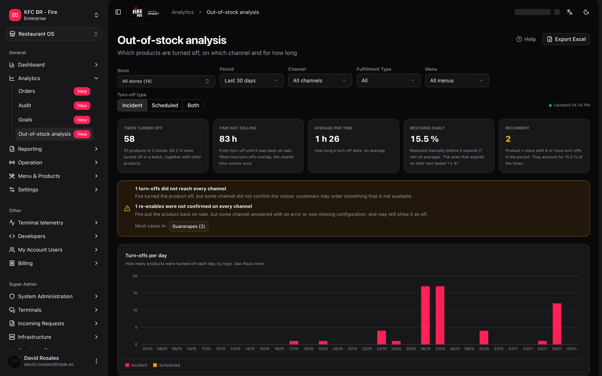
</Frame>

---

## O mínimo que você precisa saber

<Note>
**1. Conta desligamentos, não vendas.** Cada vez que alguém desliga um produto em **Em falta**, um registro é criado, e esta tela conta esses registros. Não há valores, moeda, impostos nem vendas perdidas em nenhum número.

**2. Por padrão você só vê os incidentes.** O filtro **Tipo de desligamento** começa em **Incidente**: desligamentos longos ou programados (por exemplo, "sem sorvete até o dia 30") não aparecem até você escolher **Programado** ou **Ambos**. É a causa número um de "não vejo o meu desligamento".

**3. O desligamento conta no dia em que foi criado.** Um desligamento que começou na segunda e dura até a quarta conta uma vez, na segunda.

**4. Os dados chegam com cerca de 5 minutos de atraso** e a tela não se atualiza sozinha. Mude um filtro ou reabra a tela para ver o mais recente.

**5. Você só vê as suas lojas.** Se o seu usuário está limitado a algumas lojas, "Todas" significa "todas as suas", na tela e no Excel.
</Note>

---

## O caminho simples

Você quer saber como as suas lojas foram neste mês:

1. Escolha a conta e o país no cabeçalho do Backoffice.
2. Deixe **Período** em **Últimos 30 dias** e **Tipo de desligamento** em **Incidente**.
3. Olhe os cinco cartões do topo e a tabela **Produtos mais desligados**.
4. Para ver cada desligamento de um produto, clique na linha dele.

<Tip>
Se você só queria saber **o que mais é desligado**, terminou: o primeiro produto da tabela é a resposta. O que vem a seguir serve para saber **por quê** e **onde agir**.
</Tip>

---

## Os filtros

<Frame>
  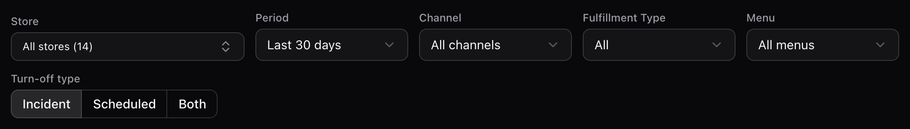
</Frame>

| Filtro | Opções | Padrão |
| --- | --- | --- |
| **Loja** | Todas, ou uma das suas lojas na conta e no país do cabeçalho | **Todas** (se você só tem uma, ela já vem escolhida) |
| **Período** | **Últimos 7 dias**, **Últimos 30 dias**, **Últimos 90 dias** ou **Personalizado** | **Últimos 30 dias** |
| **Canal** | Todos os canais, ou um | Todos |
| **Tipo de Fulfillment** | Todos, ou um | Todos |
| **Cardápio** | Todos os cardápios, ou um | Todos |
| **Tipo de desligamento** | **Incidente**, **Programado** ou **Ambos** | **Incidente** |

- Os períodos fixos terminam **hoje** e incluem hoje. "Hoje" é o dia da loja escolhida ou, se não houver uma, o do fuso horário mais comum entre as suas lojas. Com **Personalizado** aparecem **De** e **Até**.
- O intervalo máximo é de **92 dias**, contando as duas pontas.
- Tudo o que você vê (cartões, gráfico, tabelas, painel lateral e Excel) usa **exatamente os mesmos filtros**.
- Ao trocar de conta ou de país, **Loja**, **Canal** e **Cardápio** são limpos. **Período**, **Tipo de Fulfillment** e **Tipo de desligamento** **não** são.

### Incidente, Programado e Ambos

Quando um desligamento é criado, o Fire o classifica pelo momento em que vence:

- **Incidente**: vence dentro da **jornada operacional** da loja em que foi criado. Algo acabou no meio do serviço e foi resolvido no mesmo dia.
- **Programado**: vence depois do fechamento desse dia. É um desligamento planejado de vários dias.

A jornada operacional sai do horário de funcionamento da loja. Se a loja não tem horário, vale até as 23:59 do dia da loja.

**Ambos** também inclui os desligamentos sem classificação.

Eles são mostrados separados porque os programados duram dias e distorceriam a média.

### Canal, Tipo de Fulfillment e Cardápio

Esses três filtros usam o que a loja tinha atribuído **no momento do desligamento**, não a atribuição de hoje. Se você reatribuiu um cardápio na semana passada, os desligamentos antigos continuam sob o cardápio anterior.

<Warning>
Ao escolher um canal, um Tipo de Fulfillment ou um cardápio, **somem os desligamentos que não tinham nenhum cardápio atribuído** (na tabela aparecem com o chip **sem cardápio atribuído**). Para vê-los, deixe **Canal**, **Tipo de Fulfillment** e **Cardápio** em "Todos". Se o total despenca ao filtrar, revise isso primeiro.
</Warning>

---

## Os cinco cartões

<Frame>
  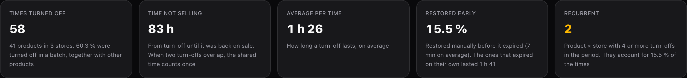
</Frame>

| Cartão | O que mede |
| --- | --- |
| **Vezes desligado** | Quantos registros de desligamento há no período. Embaixo diz quantos produtos e lojas, e qual porcentagem foi desligada **em lote** (junto com outros produtos na mesma operação). |
| **Tempo sem vender** | Horas em que o produto esteve desligado. Se dois desligamentos do mesmo produto na mesma loja se cruzam, o trecho em comum conta **uma vez só**. Aparece em horas inteiras. |
| **Média por vez** | Quanto dura um desligamento, em média. Aqui os cruzamentos **não** são descontados. |
| **Voltaram antes** | Porcentagem de desligamentos que alguém **restaurou à mão** antes de vencerem. Embaixo diz quanto isso levou em média e quanto duraram os que venceram sozinhos. |
| **Recorrentes** | Pares **produto × loja** com **4 ou mais** desligamentos no período. Fica âmbar quando é maior que 0. |

Se um desligamento ainda está vigente, ele é contado **até agora**: o mesmo filtro dá mais horas um tempo depois.

---

## Desligamentos por dia

<Frame>
  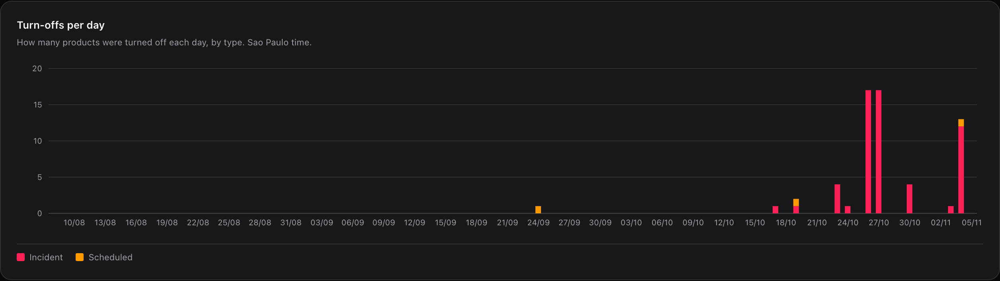
</Frame>

Uma barra por dia do intervalo, empilhada por tipo (**Incidente** e **Programado**). Dias sem desligamentos aparecem em zero. **Sem classificação** só aparece se há registros sem tipo, o que você só vê com **Ambos**.

Ao passar o mouse sobre uma barra, você vê a data e a contagem por tipo.

Embaixo do gráfico diz qual fuso horário está em uso (por exemplo, "Horário de São Paulo"). Leia: é o horário usado para repartir os desligamentos por dia.

---

## Produtos mais desligados

<Frame>
  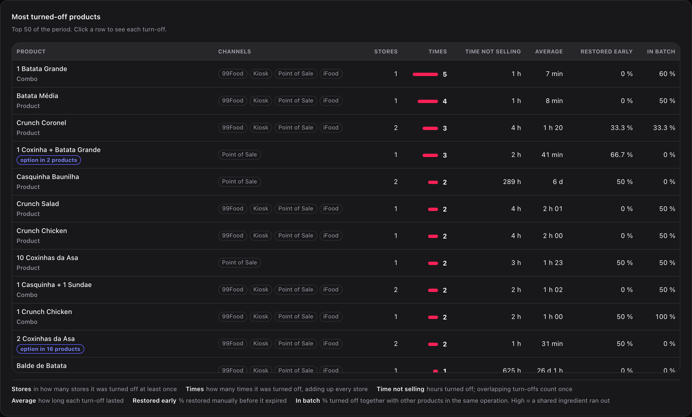
</Frame>

A tabela mostra os **50** produtos mais desligados, ordenados por **Vezes** e, em caso de empate, por **Tempo sem vender**.

| Coluna | O que é |
| --- | --- |
| **Produto** | Nome do catálogo. Embaixo diz **Produto**, **Combo** ou **opção em N produtos**. |
| **Canais** | Canais que o desligamento alcançou. Sem canais, aparece **sem cardápio atribuído**. |
| **Lojas** | Em quantas lojas foi desligado ao menos uma vez. |
| **Vezes** | Quantas vezes foi desligado, somando todas as lojas. |
| **Tempo sem vender** | Horas desligado. Desligamentos que se cruzam contam uma vez. |
| **Média** | Quanto durou cada desligamento. |
| **Voltou antes** | Porcentagem restaurada à mão antes de vencer. |
| **Em lote** | Porcentagem desligada junto com outros produtos na mesma operação. |

**Como ler Em lote.** Um valor alto quase sempre significa que acabou um **insumo compartilhado**: quando as caixas do combo acabam, todos os produtos que as usam são desligados. O problema, então, é o insumo, não cada produto.

**O que é "opção em N produtos".** O produto não é vendido sozinho em nenhum cardápio: só aparece como opção dentro de combos ou de outros produtos. N é em quantos produtos distintos ele aparece.

---

## Itens em falta recorrentes: a lista para agir

<Frame>
  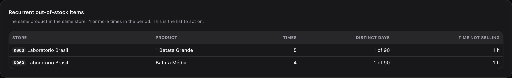
</Frame>

Mostra até **20** pares produto × loja com **4 ou mais** desligamentos no período, com as colunas **Loja**, **Produto**, **Vezes**, **Dias distintos** (por exemplo, "1 de 90") e **Tempo sem vender**.

Leia **Dias distintos** junto com **Vezes**: 5 desligamentos em 1 só dia é um dia ruim (uma entrega que não chegou). 5 desligamentos em 5 dias distintos é um hábito: o pedido de reposição está mal calculado.

Se não houver nenhum, a tela diz: "Nenhum produto chegou a 4 desligamentos na mesma loja."

---

## Lojas que mais desligam e mapa de horários

<Frame>
  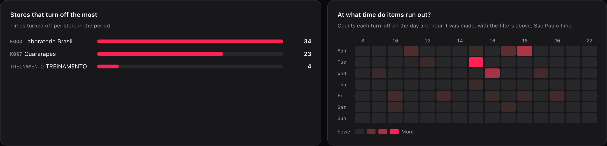
</Frame>

- **Lojas que mais desligam**: vezes desligado por loja. As **10** primeiras são mostradas.
- **A que horas falta?**: um mapa de calor de dia da semana por hora (segunda em cima). Conta cada desligamento no dia e na hora em que foi **criado**. As colunas vão das 8 às 22 h e se ampliam se houver desligamentos fora dessa faixa.

Com uma **loja** escolhida, a lista de lojas desaparece e o mapa ocupa a largura toda.

<Frame>
  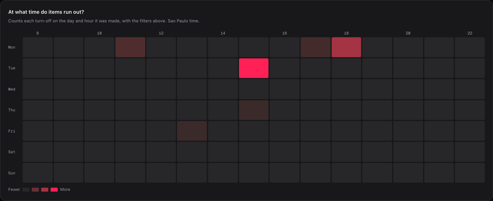
</Frame>

---

## O painel de um produto

<Frame>
  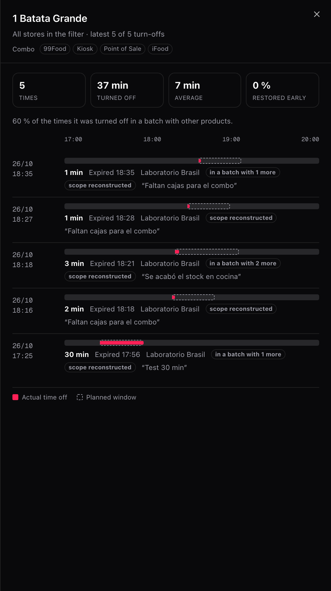
</Frame>

Clique em uma linha de **Produtos mais desligados** (ou foque nela e pressione Enter). Abre-se um painel com:

- **Quatro mini cartões**: **Vezes**, **Desligado**, **Média** e **Voltou antes**.
- **Uma linha por desligamento**, do mais novo ao mais antigo, de 20 em 20 com **Carregar mais**. Cada linha mostra a data e a hora, uma barra de **tempo real** (cheia) sobre a **janela planejada** (tracejada), a duração, como terminou, a loja e o motivo escrito por quem desligou.

Como um desligamento pode terminar: **Restaurado manualmente**, **Venceu**, **Ressincronizado** ou **Continua desligado**. **Ressincronizado** só aparece em desligamentos antigos: o produto voltou a ser vendido porque uma sincronização do cardápio o reativou. Hoje isso não acontece.

Os desligamentos desfeitos porque não foi possível agendar o religamento nunca existiram para o cliente: não contam nesta tela.

Etiquetas que você pode ver em uma linha:

| Etiqueta | O que significa |
| --- | --- |
| **Programado** | É um desligamento de vários dias, não um incidente. |
| **em lote com mais N** | Foi desligado na mesma operação que outros N produtos. |
| **desligamento não confirmado** | O Fire desligou o produto, mas algum canal não confirmou o aviso. |
| **religamento não confirmado** | O Fire voltou a vender o produto, mas algum canal não confirmou o aviso. |
| **alcance reconstruído** | É um desligamento anterior a esta tela: os canais e cardápios dele foram completados depois com a atribuição do dia em que o histórico foi carregado. |

<Info>
A linha do tempo usa um eixo de **um único dia**. Um desligamento que cruza a meia-noite é cortado no fim do eixo.
</Info>

---

## Quando um canal não ficou sabendo

Quando um produto é desligado ou religado, o Fire avisa cada canal. Se algum aviso não foi confirmado, aparece uma faixa âmbar acima das tabelas. Ela só aparece quando há casos.

- **Desligamentos que não chegaram a todos os canais**: o Fire desligou o produto, mas algum canal não confirmou. **O cliente pode pedir algo que não existe.**
- **Religamentos que não foram confirmados**: o Fire voltou a vender o produto, mas algum canal respondeu com erro ou estava sem configuração. **O produto pode continuar aparecendo desligado quando já há estoque.**

<Frame>
  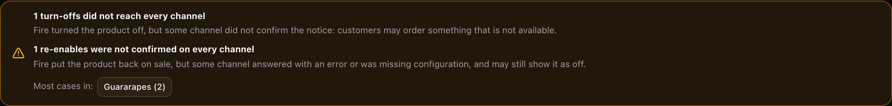
</Frame>

Embaixo, **Mais casos em:** lista as 5 lojas com mais casos. Cada uma é um botão: ao clicar, a tela inteira é filtrada por essa loja.

<Note>
Não é uma falha quando o aviso não foi enviado porque outro desligamento já mantinha o produto desligado. Esses casos não contam na faixa.
</Note>

<Note>
A parte de **desligamento não confirmado** só pode aparecer em desligamentos criados depois do lançamento desta tela: antes esse resultado não era guardado. A de **religamento não confirmado** também vale para desligamentos anteriores.
</Note>

Para resolver um caso concreto, vá em [Em falta](/pt/manuals/backoffice/out-of-stock), seção **Se um canal não ficou sabendo**.

---

## Exportar para Excel

O botão **Exportar Excel** (no alto, à direita) baixa `agotados_<de>_<até>.xlsx` com os **mesmos filtros** que você vê. Enquanto gera, diz **Gerando…**.

| Planilha | O que traz | Limite |
| --- | --- | --- |
| **Ranking** | Uma linha por produto: tipo, opção em, canais, lojas, vezes, horas sem vender, média por vez (h), voltou antes e em lote. | 500 produtos |
| **Detalhe** | Uma linha por desligamento: loja, desligado, vencia, voltou, fechamento, horas sem vender, tipo, produtos no lote, avisos entregues, motivo e alcance. | 20.000 linhas |

- As horas vão como **número com 2 casas decimais**, para você poder somá-las.
- As datas vão como `AAAA-MM-DD HH:mm`, no fuso horário da tela.
- Se o detalhe passa do teto, uma linha no final avisa do corte.
- As colunas de aviso dizem Sim, Não, Sem dado ou Não se aplica (vigente).
- Você pode fazer **10 exportações por minuto**, e o limite é compartilhado com os outros relatórios do Fire. Se passar, a tela diz quantos segundos esperar.

---

## Receitas: como os casos reais se resolvem

<AccordionGroup>
  <Accordion title="Não vejo o desligamento que fizemos ontem">
    1. Revise o filtro **Tipo de desligamento**. Se diz **Incidente**, os desligamentos programados não aparecem.
    2. Mude para **Ambos**.
    3. Confira se **Período** inclui a data **em que o desligamento foi criado**, não a data em que venceu.
    4. Revise **Loja**, **Canal** e **Cardápio**: um desligamento sem cardápio atribuído some ao escolher qualquer um dos três.
    5. Lembre do atraso de cerca de 5 minutos se o desligamento for muito recente.
  </Accordion>

  <Accordion title="Qual produto sempre acaba">
    1. Deixe **Período** em **Últimos 90 dias**.
    2. Escolha **Ambos** se quiser incluir também os programados.
    3. Olhe **Itens em falta recorrentes**: são os pares loja × produto com 4 ou mais desligamentos.
    4. Compare **Vezes** com **Dias distintos**. Muitos dias distintos indicam um hábito, não um dia ruim.
    5. Leve essa lista a quem faz os pedidos de reposição dessa loja.
  </Accordion>

  <Accordion title="Acho que acabou um insumo compartilhado">
    1. Em **Produtos mais desligados**, olhe a coluna **Em lote**.
    2. Procure produtos com **Em lote** muito alto que compartilhem canais e lojas.
    3. Abra o painel de um: as etiquetas **em lote com mais N** dizem quantos foram desligados juntos e o motivo explica o que faltou.
    4. Se o motivo se repete ("faltam caixas para o combo"), o problema é esse insumo, não cada produto.
  </Accordion>

  <Accordion title="Em que horário convém reforçar a reposição">
    1. Escolha uma **loja** para que o mapa use o fuso horário dela.
    2. Olhe **A que horas falta?**: as células mais claras são os horários com mais desligamentos.
    3. Cruze o dia e a hora com o seu calendário de entregas. Acabar às 15 h toda terça costuma ser uma entrega que chega tarde.
  </Accordion>

  <Accordion title="Um cliente pediu algo que estava desligado">
    1. Veja se aparece a faixa âmbar de **desligamentos que não chegaram a todos os canais**.
    2. Clique na loja do cliente em **Mais casos em:**.
    3. Abra o produto: a etiqueta **desligamento não confirmado** marca o desligamento exato.
    4. Resolva em [Em falta](/pt/manuals/backoffice/out-of-stock) e revise a configuração do canal que não confirmou.
  </Accordion>

  <Accordion title="Preciso do detalhe para uma reunião">
    1. Aplique os filtros que quer apresentar.
    2. Pressione **Exportar Excel**.
    3. A planilha **Detalhe** tem cada desligamento com o motivo. **Ranking** tem o resumo por produto.
  </Accordion>
</AccordionGroup>

---

## Um exemplo com números

Dois desligamentos do **mesmo produto na mesma loja**:

| Desligamento | De | Até | Duração |
| --- | --- | --- | --- |
| A | 12:00 | 14:00 | 2 h |
| B | 13:00 | 15:00 | 2 h |

| Número | Valor | Por quê |
| --- | --- | --- |
| **Vezes** | 2 | Há dois registros. |
| **Média** | 2 h | Cada desligamento durou 2 h. |
| **Tempo sem vender** | **3 h** | Das 12 às 15 h o produto esteve desligado. As 2 h do cruzamento (13 às 14 h) contam uma vez. |

Por isso **Vezes × Média não é igual a Tempo sem vender**: não é um erro.

Um caso real da conta de exemplo, **1 Batata Grande**, um combo:

| Onde | Mostra | Por quê |
| --- | --- | --- |
| Tabela **Produtos mais desligados** | **1 h** | A tabela arredonda para horas inteiras. |
| Painel lateral | **37 min** | O painel usa minutos. |
| Excel | **0,62 h** (aprox.) | O Excel usa horas com 2 casas decimais. |

É o mesmo dado: 5 desligamentos que somaram 37 minutos.

---

## Erros que saem caro

<Warning>
**Decidir pela visão padrão.** Com **Incidente** você não vê os desligamentos programados. Um produto "sem sorvete até o dia 30" pode não aparecer e tudo parecer bem. Mude para **Ambos** antes de tirar conclusões.
</Warning>

<Warning>
**Comparar lojas de fusos horários diferentes sem filtrar.** Sem uma loja escolhida, a tela inteira é lida no fuso horário mais comum entre as suas lojas. Se as suas lojas estão em fusos horários diferentes, escolha uma loja para ver os dias e horários exatos dela: as dos outros fusos ficam com o dia e a hora deslocados no gráfico e no mapa.
</Warning>

<Warning>
**Contar um desligamento em vários canais como vários problemas.** Cada canal que você desliga conta como uma vez; se você desliga a loja toda, conta uma. Desligá-lo em 2 canais específicos dá 2 vezes e 100 % **em lote**, embora tenha sido uma única ação. O tempo sem vender não duplica, mas as vezes sim.
</Warning>

<Warning>
**Usar esta tela como relatório de vendas perdidas.** Não há valores nem quantidades vendidas. Ela diz quanto tempo o produto ficou desligado, não quanto você deixou de vender.
</Warning>

<Warning>
**Comparar com Em falta.** **Em falta** mostra o que está desligado **agora** em uma loja. Esta tela conta o que **foi criado** no período, exclui os desligamentos desfeitos e tem até 5 minutos de atraso. Os números não precisam coincidir.
</Warning>

---

## O que acontece nos casos raros

- **Produto ou loja que não existe mais**: no lugar do nome aparece o identificador interno.
- **"Todas" com um usuário limitado**: são todas as **suas** lojas. Se você tem lojas em outro país, não as vê até trocar o país do cabeçalho.
- **A carga falha**: a tela diz "Não foi possível carregar a análise de itens em falta". Se já havia dados, ela continua mostrando-os com o erro em cima. Tente de novo mudando um filtro.
- **Sem conta escolhida**: a tela pede para escolher uma conta e um país no topo.
- **Usuário sem lojas nessa conta e país**: diz "Você não tem lojas atribuídas nesta conta e país."

<Frame>
  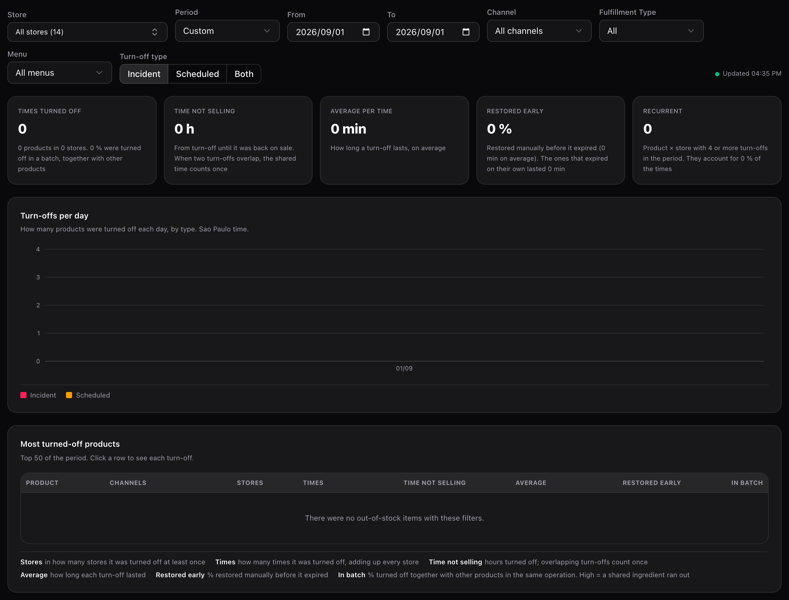
</Frame>

Quando não há desligamentos, os cartões mostram zeros e as tabelas dizem "Não houve itens em falta com estes filtros."

<Frame>
  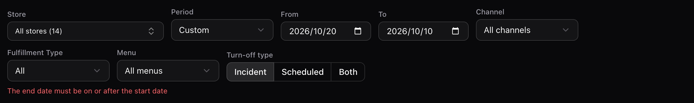
</Frame>

Se o intervalo está invertido ou passa de 92 dias, aparece um erro em vermelho sob os filtros e a tela não consulta nada até você corrigir: "A data final deve ser igual ou posterior à inicial" ou "O período não pode passar de 92 dias".

---

## A ajuda dentro da tela

<Frame>
  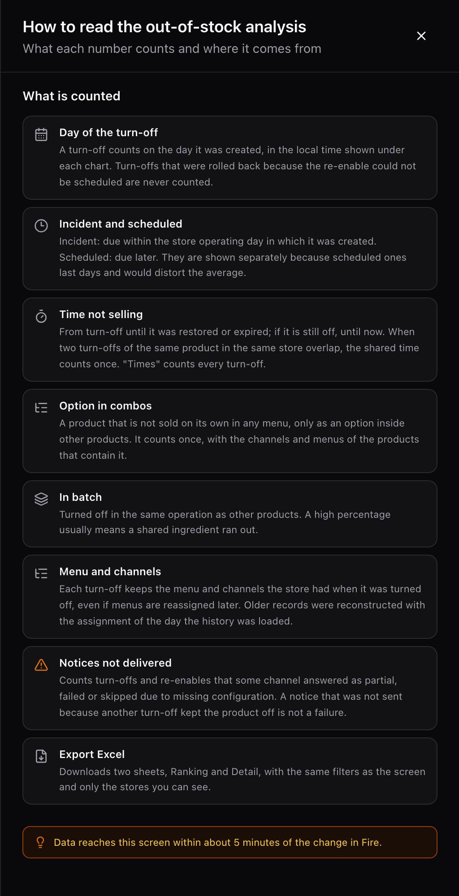
</Frame>

O botão **Ajuda** abre um painel com a definição de cada número. Usa as mesmas palavras deste manual.

---

## Glossário

| Termo | O que significa |
| --- | --- |
| **Desligamento** | Cada vez que alguém tira um produto de venda em **Em falta**. É a unidade que esta tela conta. |
| **Incidente** | Desligamento que vence dentro da jornada operacional da loja em que foi criado. |
| **Programado** | Desligamento que vence depois do fechamento da jornada operacional em que foi criado. |
| **Tempo sem vender** | Horas em que o produto esteve desligado em uma loja. Se dois desligamentos se cruzam, o trecho em comum conta uma vez. |
| **Voltou antes** | Desligamento que alguém restaurou à mão antes de vencer. |
| **Em lote** | Desligamento feito junto com outros produtos na mesma operação. |
| **Recorrente** | Produto desligado 4 ou mais vezes na mesma loja dentro do período. |
| **Aviso não confirmado** | Aviso de desligamento ou de religamento que algum canal não confirmou. |
| **Alcance reconstruído** | Desligamento anterior a esta tela, cujos canais e cardápios foram completados depois. |
| **Jornada operacional** | O dia de trabalho da loja, com o horário de fechamento. Decide se um desligamento é incidente ou programado. |
| **Opção em N produtos** | Produto que não é vendido sozinho, só como opção dentro de N produtos. |

---

## Perguntas frequentes

<AccordionGroup>
  <Accordion title="Por que não vejo nenhum desligamento?">
    Quase sempre é o filtro **Tipo de desligamento** em **Incidente**. Mude para **Ambos**. Se continuar vazio, confira se o período, a loja e os demais filtros incluem o dia em que o desligamento **foi criado**.
  </Accordion>

  <Accordion title="Quem pode ver esta tela?">
    Quem tem acesso a **Análise → Pedidos**, e só com as lojas atribuídas a essa pessoa, na tela e no Excel. Ela não tem permissão própria. Se você não a vê, peça acesso ao seu administrador.
  </Accordion>

  <Accordion title="Atualiza ao vivo?">
    Não. Os dados chegam cerca de 5 minutos depois da mudança no Fire e a tela não se atualiza sozinha: atualiza ao mudar um filtro ou ao reabrir. **Atualizado HH:MM** é a hora em que a tela recebeu os dados, não a hora do último desligamento.
  </Accordion>

  <Accordion title="Por que Vezes × Média não dá o Tempo sem vender?">
    Porque o tempo sem vender desconta os cruzamentos entre desligamentos do mesmo produto e loja, e a média não. Há um exemplo com números mais acima.
  </Accordion>

  <Accordion title="Em que dia conta um desligamento de vários dias?">
    No dia em que foi criado. Um desligamento programado de segunda a sexta conta uma vez, na segunda, no gráfico e no mapa de horários.
  </Accordion>

  <Accordion title="Por que um produto aparece em um cardápio que eu já mudei?">
    Porque o canal, o Tipo de Fulfillment e o cardápio de cada desligamento ficam congelados no momento do desligamento. Reatribuir um cardápio não muda o histórico.
  </Accordion>

  <Accordion title="Existe uma API para isso?">
    Não uma pública. A tela usa endpoints internos que não estão documentados para integrações. Se você precisa dos dados fora do Fire, use **Exportar Excel**.
  </Accordion>
</AccordionGroup>

---

## O que vem por aí

Isto **não** existe hoje, e não há data comprometida para nada disso:

- Valores ou **vendas perdidas** por desligamento.
- Atualização automática da tela.
- Alertas quando um produto chega a 4 desligamentos.
- Exportar mais de 500 produtos em **Ranking** ou mais de 20.000 desligamentos em **Detalhe**.
- Uma API pública com estes dados.
- Salvar os filtros no link da tela para compartilhá-la.
