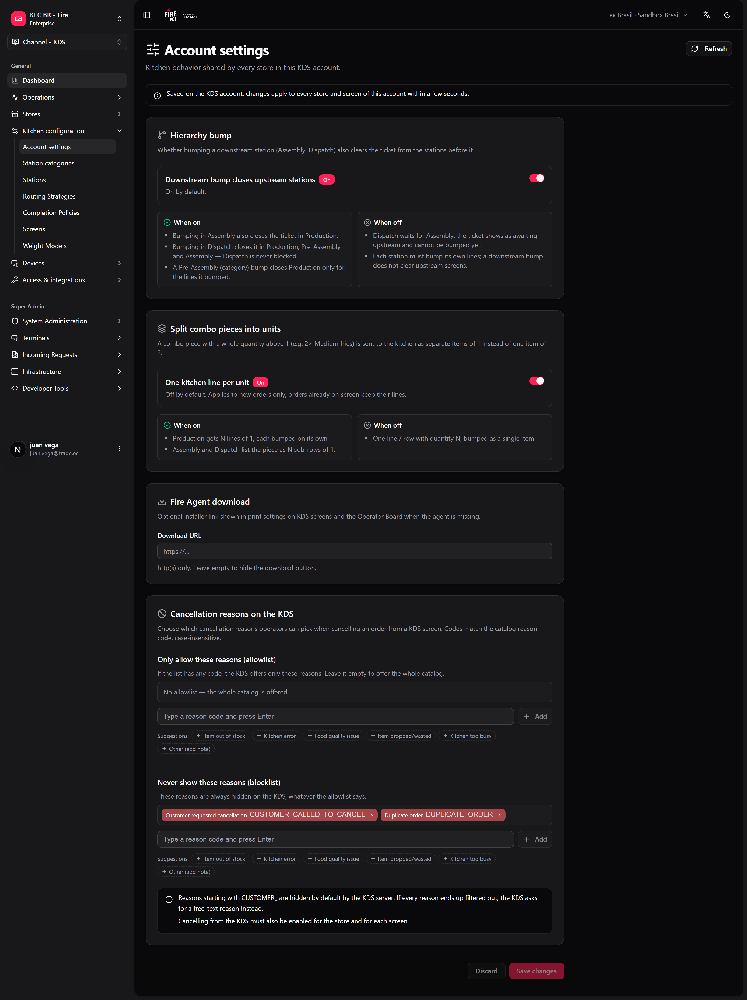

Algumas regras de cozinha não deveriam mudar de uma loja para outra. Se uma loja deixa o Despacho fechar um ticket que a Montagem ainda não terminou e outra não, o mesmo pedido se comporta de forma diferente na rede — e o suporte não consegue saber qual regra cada loja segue. Estas configurações ficam uma única vez, na conta KDS, e valem para todas as lojas e telas dessa conta.

**Onde você trabalha:** **KDS → Configurações da conta** (`/kds/admin/account-settings`) no backoffice. Os admins da loja também veem as mesmas configurações em **fire-kds → Configurações → KDS conta**.

<Note>
  **O mínimo que você precisa saber**

  - Salvar aqui muda **todas as lojas** da conta em poucos segundos. Não existe sobrescrita por loja (exceto o agrupamento de combos numa estação, definido pelo suporte).
  - O **bump hierárquico** vem **ligado** por padrão: um bump posterior (Montagem, Despacho) também tira o ticket das estações anteriores.
  - As listas de motivos de cancelamento só filtram o que os operadores podem escolher. O cancelamento continua tendo de ser habilitado por loja e por tela.
</Note>

## O caminho simples

A maioria das contas mantém os padrões e só define o link do Agente Fire.

<Steps>
  <Step title="Abra Configurações da conta">
    No backoffice, vá em **KDS → Configurações da conta**.
  </Step>
  <Step title="Revise o Bump hierárquico">
    Deixe **O bump posterior fecha as estações anteriores** ligado, a menos que a sua cozinha precise que o Despacho espere a Montagem.
  </Step>
  <Step title="Cole o link de download do Agente Fire">
    Em **Download do Fire Agent**, cole o link do instalador em **URL de download** (http ou https). Deixe vazio para ocultar o botão.
  </Step>
  <Step title="Salve as alterações">
    Clique em **Salvar alterações**. A barra na parte de baixo avisa quando há alterações não salvas; **Descartar** volta ao que está salvo.
  </Step>
</Steps>

<Frame>
  
</Frame>

<Tip>
  Se as suas lojas usam uma única tela de montagem e nenhum despacho, os padrões estão certos. Você terminou.
</Tip>

## Bump hierárquico

Decide se uma estação mais adiante no fluxo pode fechar um ticket que uma estação anterior ainda não enviou.

| | Ligado (padrão) | Desligado |
|---|---|---|
| Bump na **Montagem** | Também fecha o ticket na Produção. | A Produção mantém as suas próprias linhas. |
| Bump no **Despacho** | Fecha na Produção, na Pré-montagem e na Montagem. O Despacho nunca fica bloqueado. | O Despacho espera a Montagem: o ticket mostra **aguardando estação anterior** e não pode receber bump. |
| Bump na **Pré-montagem** | Fecha na Produção só as linhas que ela enviou. | Cada estação dá bump nas suas próprias linhas. |

O pedido e os seus webhooks não mudam: o que muda é quais telas ainda mostram o ticket.

## Dividir itens de combo em unidades

Um item de combo com quantidade inteira maior que 1 (por exemplo, 2× Batata média) pode chegar à cozinha como dois itens de 1 em vez de um item de 2.

| | Ligado | Desligado (padrão) |
|---|---|---|
| Produção | N linhas de 1, cada uma concluída separadamente. | Uma linha com quantidade N. |
| Montagem / Despacho | O item aparece como N sublinhas de 1. | Uma sublinha com quantidade N. |

Só os pedidos novos mudam. Os pedidos que já estão na tela mantêm as suas linhas.

## Agrupar itens de combo na pré-montagem

Numa estação de **pré-montagem**, os itens de um combo aparecem sob o nome do combo (`1 Big Box`, com seus itens como sublinhas azuis) em vez de linhas soltas. Vem **ligado** por padrão.

Este se define em **fire-kds → Configurações → KDS conta** (**Agrupar itens de combo na pré-montagem**). Desligue e a pré-montagem lista os itens soltos, como a produção.

## Motivos de cancelamento no KDS

Quando um operador cancela numa tela de cozinha, ele escolhe um motivo do catálogo de cancelamento da Fire. Aqui você restringe essa lista:

- **Permitir apenas estes motivos (lista permitida)** — se tiver algum código, o KDS oferece só esses. Vazia = o catálogo inteiro.
- **Nunca mostrar estes motivos (lista bloqueada)** — sempre ocultos, independentemente da lista permitida.

Digite um código de motivo (letras, dígitos e `_ . : -`, por exemplo `KITCHEN_ERROR`) e pressione **Enter**, ou escolha uma das sugestões. Um código não pode estar nas duas listas.

<Info>
  Os códigos que começam com `CUSTOMER_` ficam ocultos por padrão no KDS: um cozinheiro não deveria cancelar em nome do cliente. Se todos os motivos acabarem filtrados, o KDS pede um motivo em texto livre.
</Info>

## Download do Fire Agent

**URL de download** é o link do instalador do Agente Fire que a sua equipe usa. Quando está definido, as configurações de impressão das telas KDS e do board do operador mostram um botão **Baixar Fire Agent**, para que quem configura um PC ou tablet novo instale a versão certa sem pedir o arquivo.

## Receitas

<AccordionGroup>
  <Accordion title="O Despacho não pode fechar um pedido que a Montagem não terminou">
    1. Abra **KDS → Configurações da conta**.
    2. Desligue **O bump posterior fecha as estações anteriores**.
    3. **Salvar alterações**.
    4. Teste: um pedido em que a Montagem não deu bump mostra **aguardando estação anterior** no Despacho.
  </Accordion>
  <Accordion title="Cada porção de batata precisa de bump separado">
    1. Ligue **Uma linha de cozinha por unidade** em **Dividir itens de combo em unidades**.
    2. **Salvar alterações**.
    3. Envie um combo novo com 2× batata: a Produção mostra duas linhas de 1.
  </Accordion>
  <Accordion title="Os cozinheiros só devem cancelar por motivos de cozinha">
    1. Em **Permitir apenas estes motivos**, adicione `ITEM_OUT_OF_STOCK`, `KITCHEN_ERROR` e `KITCHEN_TOO_BUSY` (use os códigos do seu catálogo).
    2. **Salvar alterações**.
    3. Confira que o cancelamento está habilitado para a loja e a tela ([Periféricos, impressão e validação](/pt/manuals/kds/peripherals-printing#2-cancelamento-de-pedidos)).
  </Accordion>
  <Accordion title="Uma loja nova precisa do Agente Fire">
    1. Cole o link do instalador em **URL de download** uma vez.
    2. No dispositivo novo, abra as configurações da impressora na tela KDS e toque em **Baixar Fire Agent**.
    3. Siga a [instalação do Agente Fire](/pt/manuals/fire-agent/installation) ou [Android](/pt/manuals/fire-agent/android).
  </Accordion>
</AccordionGroup>

## Exemplo com números

Um combo com 2× Batata média, numa cozinha com Produção, Montagem e Despacho:

| Configuração | A Produção mostra | Bump no Despacho antes da Montagem |
|---|---|---|
| Padrões (hierarquia ligada, divisão desligada) | `2 Batata média` (um bump) | Fecha o ticket em todas as estações |
| Hierarquia desligada, divisão ligada | `1 Batata média` duas vezes (dois bumps) | Bloqueado: **aguardando estação anterior** |

## Erros que saem caro

<Warning>
  **Desligar o bump hierárquico numa cozinha em que a Montagem costuma atrasar.** O Despacho deixa de conseguir fechar pedidos e eles se acumulam enquanto o entregador espera. Desligue só se a Montagem sempre der bump.
</Warning>

<Warning>
  **Mudar uma configuração "para uma loja".** Ela vale para todas as lojas da conta. Combine com operações antes de salvar.
</Warning>

<Warning>
  **Uma lista permitida com códigos que não existem no catálogo.** O KDS não tem nada para oferecer e cai no texto livre, então os relatórios perdem o motivo. Copie os códigos do catálogo de cancelamento.
</Warning>

## Glossário

| Termo | Significado |
|---|---|
| **Bump hierárquico** | Uma estação posterior fecha o ticket nas estações anteriores a ela. |
| **Anterior / posterior** | Etapas anteriores / seguintes do fluxo: Produção → Pré-montagem → Montagem → Despacho. |
| **Item de combo** | Um produto dentro de um combo que é roteado para a cozinha como uma linha própria. |
| **Lista permitida / lista bloqueada** | Motivos que são os únicos oferecidos / nunca oferecidos. |

## Perguntas frequentes

<AccordionGroup>
  <Accordion title="Uma loja pode usar uma regra diferente?">
    Não. Estas configurações são por conta. O comportamento de cada loja (display, impressão, painel de senhas, cancelamento ligado/desligado) fica nas configurações de cada loja.
  </Accordion>
  <Accordion title="Quanto tempo até as telas pegarem a mudança?">
    Poucos segundos. Não é preciso recarregar as telas.
  </Accordion>
  <Accordion title="O bump hierárquico muda o status do pedido enviado às integrações?">
    Não. Só muda quais telas de cozinha ainda mostram o ticket.
  </Accordion>
  <Accordion title="Por que não vejo Configurações da conta no menu?">
    É preciso um papel de admin com acesso à conta KDS.
  </Accordion>
</AccordionGroup>

## O que esta página não faz

- Não liga o cancelamento: isso é por loja e por tela.
- Não instala o Agente Fire: só mostra o link.
- Não muda os pedidos que já estão na tela.
