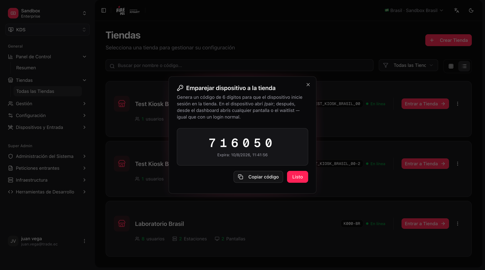
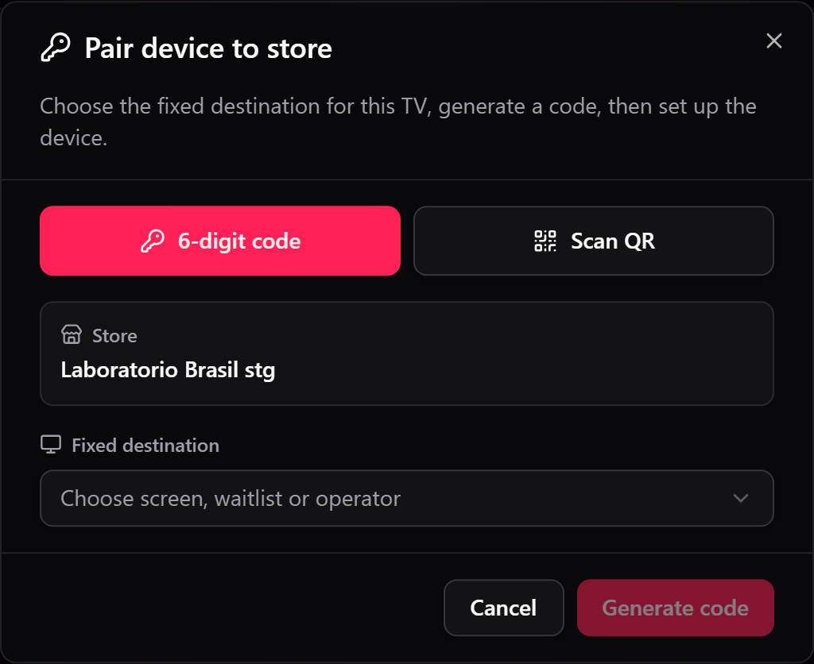
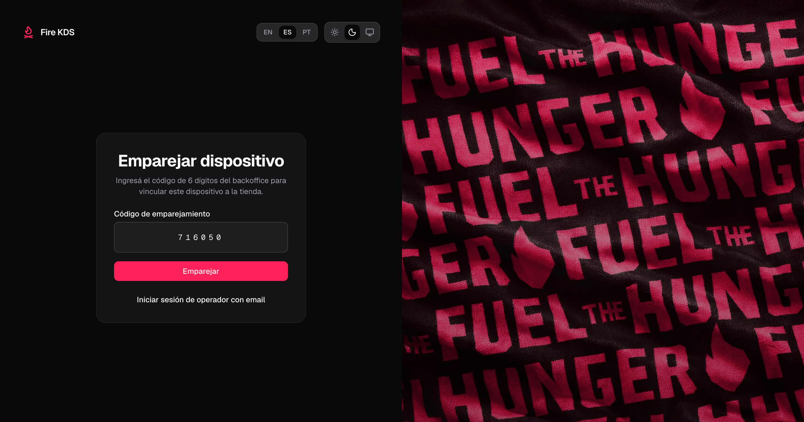
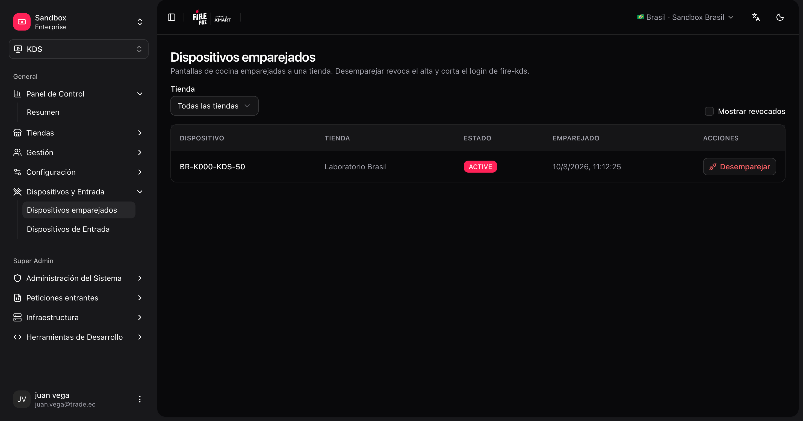

As telas de cozinha (TVs / tablets com **fire-kds**) entram em uma loja **escaneando um QR** ou com um **código de emparelhamento** curto, sem convite por e-mail. O dispositivo vira um terminal de cozinha dessa loja e abre a tela, o painel de senhas ou o board do operador que você escolheu para ele.

Este fluxo é **apenas para dispositivos de cozinha**. Operadores humanos com acesso por e-mail continuam usando o login normal. Terminais POS e quiosques têm seus próprios fluxos.

## O que você precisa

| Requisito | Detalhe |
|---|---|
| Loja KDS já criada | Deve existir em **KDS → Todas as lojas**. |
| Acesso no backoffice | Permissão para abrir o menu da loja e gerar o código. |
| Dispositivo com navegador | Abra o fire-kds na TV ou tablet (recomendado em tela cheia). |

## Duas formas de emparelhar

| Método | No backoffice | Na TV |
|---|---|---|
| **Escanear QR** (recomendado) | **Parear dispositivo** → **Escanear QR** com a câmera do celular, ou cole o **ID do dispositivo** | `/pair` mostra um QR e o seu ID do Dispositivo. Depois de escaneá-lo, toque em **Já vinculei**. |
| **Código de 6 dígitos** | **Parear dispositivo** → **Gerar código** | `/pair` → **Usar código de 6 dígitos** e digite-o. |

Os dois métodos dão o mesmo resultado. O QR evita digitar numa TV sem teclado.

## Emparelhar um dispositivo

<Steps>
  <Step title="Abra Parear dispositivo">
    No backoffice, vá em **KDS → Todas as Lojas**, abra o menu **⋮** da loja e escolha **Parear dispositivo**. Você também pode emparelhar direto de **KDS → Telas**: cada cartão de tela tem uma ação de emparelhar que já aponta para aquela tela.

    <Frame>
      
    </Frame>
  </Step>
  <Step title="Escolha o destino fixo">
    Em **Destino fixo**, escolha o que este dispositivo vai abrir sempre:

    | Destino | Abre |
    |---|---|
    | Uma tela KDS | Essa tela de cozinha (`/kds/{screenId}`). |
    | **Fila pública** | O painel de senhas para o cliente (`/waitlist/{storeId}`). |
    | **Fila delivery** | O painel de delivery (`/waitlist/{storeId}/delivery`). |
    | **Operador da loja** | O [Board do operador](/pt/manuals/kds/operator-board) (`/operator/{storeId}`). |

    <Frame>
      
    </Frame>
  </Step>
  <Step title="Escaneie o QR ou gere um código">
    - **Escanear QR:** aponte a câmera para o QR da TV, ou cole o seu **ID do dispositivo**. Depois o diálogo espera pela TV: na TV, toque em **Já vinculei**.
    - **Código de 6 dígitos:** clique em **Gerar código**. Ele expira em pouco tempo; gere outro se precisar. Na TV, toque em **Usar código de 6 dígitos** e digite-o.

    <Frame>
      
    </Frame>
  </Step>
  <Step title="Confirme que o dispositivo está pronto">
    Após um emparelhamento bem-sucedido, o dispositivo abre o seu destino sozinho. Você não recarrega a página.
  </Step>
</Steps>

<Tip>
  Em `/pair` você pode mudar para **Entrar como operador com e-mail** se uma pessoa precisar da sessão de administração. Em `/login`, use **Parear um dispositivo de cozinha** para voltar ao emparelhamento.
</Tip>

<Warning>
  Escanear o QR da TV errada emparelha essa TV à sua loja. Confira o ID do dispositivo na tela à sua frente antes de confirmar.
</Warning>

## Gerenciar dispositivos emparelhados

Abra **KDS → Dispositivos emparelhados** (`/kds/admin/paired-terminals`) para ver cada terminal de cozinha vinculado à sua conta: loja, nome do terminal e status.

Nessa lista você pode **desvincular** um dispositivo. Após desvincular, a TV perde a sessão de cozinha e volta para `/pair` na próxima carga.

<Frame>
  
</Frame>

## Sair da sessão no dispositivo

Sair de uma **sessão de dispositivo emparelhado** revoga o cadastro do terminal. A TV volta para a tela de emparelhamento e precisa ser emparelhada de novo.

Sair de uma sessão de operador com **e-mail/senha** **não** revoga o dispositivo de cozinha.

## Depois do emparelhamento

1. Abra cada tela de cozinha pelo dashboard (ou pela URL `/kds/{screenId}`). **Abrir** sempre abre uma aba nova, então o dashboard fica atrás.
2. Abra o [painel de pedidos / order display](/pt/manuals/kds/waitlist) na TV de retirada, e o painel de delivery na TV dos entregadores, se você os usar.
3. Opcionalmente abra o [board do operador](/pt/manuals/kds/operator-board) para supervisores.

<Check>
  Seu dispositivo de cozinha está emparelhado à loja e pronto para executar as telas Fire KDS.
</Check>
