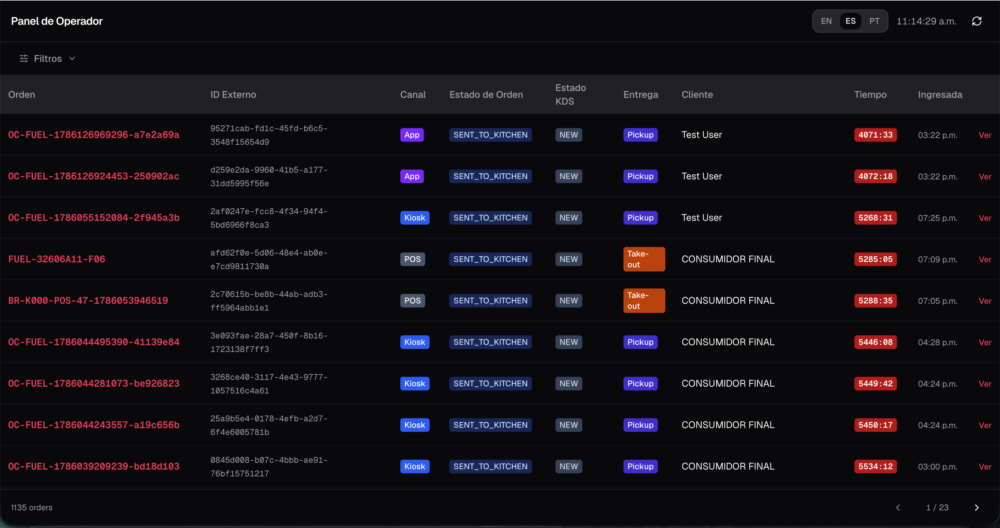
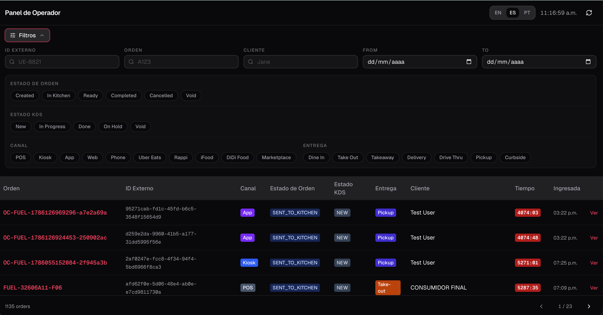
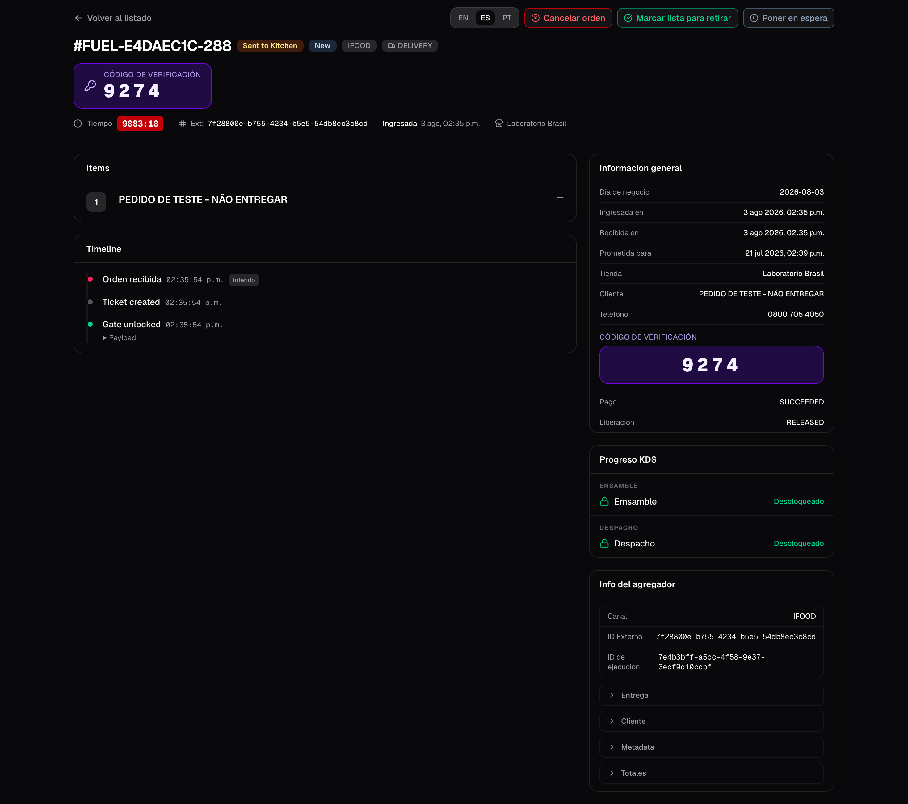
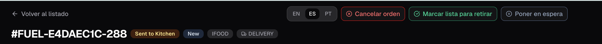
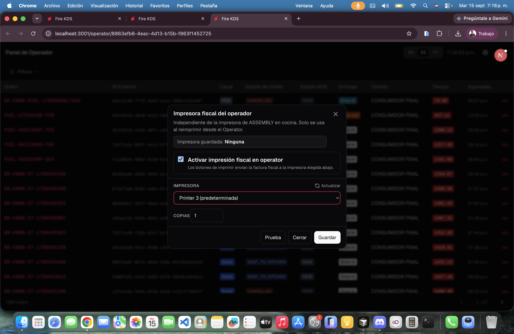

O **board do operador** é uma visão em tela cheia para supervisores de uma loja. Lista todos os pedidos com temporizadores ao vivo, filtros e uma página de detalhe onde você pode cancelar um pedido, marcá-lo pronto para retirada ou concluir o despacho — mesmo quando o fluxo da cozinha precisa de uma intervenção manual.

**Onde abrir:** pelo dashboard da loja no fire-kds, ou diretamente em `/operator/{storeId}`. Deixe rodando em uma aba própria.

## Lista de pedidos

A lista mostra pedidos ativos e recentes com:

- **Nome / código** — a mesma etiqueta `#…` que as TVs da cozinha mostram (pager ou código curto), seguida do código do pedido
- Badges de canal e tipo de entrega com as **cores da loja**, status do pedido e status da cozinha
- Um **temporizador ao vivo** (verde → âmbar → vermelho) enquanto o pedido está na cozinha. Quando fica pronto, despachado ou cancelado, o temporizador mostra **—**
- A data e a hora do pedido, no **fuso horário da loja** (não o do navegador)

**Dia operacional** (ligado por padrão) mostra só o dia de negócio atual da loja. Desligue para ver dias anteriores. A lista pagina com anterior / próxima e mostra um indicador de carregamento enquanto a próxima página carrega.

<Frame>
  
</Frame>

Use o **seletor de idioma** do cabeçalho (EN / ES / PT) da mesma forma que nas telas KDS.

## Filtros

Abra o painel de filtros para restringir a lista:

- Texto: **Código do pedido**, **Código** (o código curto `#…` do cartão da cozinha), ID externo, nome do cliente. Uma busca por texto sem datas olha os últimos 7 dias.
- Intervalo de datas (dia de negócio)
- Chips: status do pedido, status KDS, canal, tipo de entrega

Os filtros ativos aparecem como chips removíveis. Limpar filtros reinicia a paginação para a página 1.

<Frame>
  
</Frame>

## Detalhe do pedido

Clique em uma linha para abrir o pedido em uma janela sobre a lista, sem perder o seu lugar. O detalhe inclui:

- Cabeçalho com badges de status e o **código de verificação / coleta** em destaque quando o agregador envia
- Informações gerais (canal, fulfillment, timestamps no fuso da loja)
- Linhas / itens do pedido
- **Progresso na cozinha**: onde cada parte do ticket deve aparecer e quais estações já a concluíram. **Atualizar** recarrega
- Timeline de eventos de cozinha e de status
- Dados extras do agregador quando existirem

<Frame>
  
</Frame>

O que cada estação mostra em **Progresso na cozinha**:

| Status | Significado |
|---|---|
| **Na tela** | A estação está com o pedido agora. |
| **Aguardando** / **Próximo** | O pedido ainda não chegou a essa estação. |
| **Concluído** | A estação deu bump nele. Continua concluído mesmo que a tela dela desligue depois. |
| **Tela desconectada** | O pedido está numa estação sem tela online, ou foi movido porque a tela caiu. |
| **Concluído · sem tela** | O pedido terminou enquanto essa estação não tinha tela. |
| **Cancelada** | O pedido foi cancelado. |

## Ações de supervisor

No detalhe você pode executar sobrescritas operacionais (cada uma pede confirmação):

| Ação | Quando se aplica | O que faz |
|---|---|---|
| **Cancelar** | Pedido não finalizado / cancelado | Cancela via Fire com um motivo do catálogo de cancelamento |
| **Pronto para retirada** | Pedido ainda na cozinha (`SENT_TO_KITCHEN`) | Avança o pedido para pronto e sincroniza tickets / gates KDS |
| **Despachar** | Pedido já está pronto | Conclui o pedido e fecha o ciclo da cozinha |
| **Colocar em espera / Retomar** | Conforme necessário | O mesmo hold global das telas de cozinha |
| **Imprimir fatura fiscal** | Agente Fire neste PC + **Impressora do Operator Board** da loja | Reimprime o comprovante fiscal. Não é a impressora da cozinha. |
| **Imprimir coleta de delivery** | Pedido de delivery com ticket de cozinha | Reimprime o ticket do entregador na mesma impressora. Uma cópia; não entra na fila se falhar. |

<Frame>
  
</Frame>

## Impressão pelo board do operador

O ícone de impressora abre a impressora do board do operador. Ative, escolha a impressora do Agente Fire **neste** computador, defina as cópias e teste. Ela também pode ser configurada no backoffice, configurações da loja → **Impressão** → **Impressora do Operator Board**. A impressão no envio da cozinha é outra impressora, no tablet ou no PC de expo. Se o Agente Fire não estiver instalado, aparece **Baixar Fire Agent** quando a sua conta tem o [link de download](/pt/manuals/kds/account-settings#download-do-fire-agent).

<Frame>
  
</Frame>

### Impressão automática

A **Impressão automática** imprime sozinha quando um pedido entra em um status, para o supervisor não reimprimir pedido por pedido. Escolha:

| Opção | Valores |
|---|---|
| **Status do pedido** | **Na cozinha**, **Pronta para retirada** ou **Despachada**. |
| **O que imprimir** | **Comanda** e/ou **Nota fiscal**. Pedidos de delivery sempre imprimem também o ticket de delivery. |
| **Canais** / **Entrega** | Vazio = todos. |
| **Somente o dia operacional** | Pula pedidos de dias anteriores. |

O cabeçalho mostra a regra ativa; **Configurar** abre a janela da impressora. Ligar a impressão automática também liga **Ao vivo**, e desligar **Ao vivo** desliga a impressão automática. Os trabalhos imprimem um de cada vez; um documento que já foi impresso não é impresso de novo numa nova tentativa. Se um trabalho falhar, a impressão automática **continua ligada** e mostra o erro. O **Histórico** guarda o registro do que foi impresso.

<Warning>
  A regra de impressão automática é salva **neste navegador**, não no servidor. Outro PC, ou este depois de limpar os dados, começa com a impressão automática desligada. A impressora e as cópias ficam salvas para a loja.
</Warning>

<Warning>
  Se o Agente Fire estiver offline no PC do supervisor, a reimpressão falha mesmo com a impressora da cozinha funcionando.
</Warning>

<Warning>
  Pronto e despachar pelo board do operador **adiantam** o estado da cozinha (linhas concluídas, gates desbloqueados, ticket fechado conforme o caso). Use quando o piso precisar de intervenção de supervisor — não como substituto do bump normal em cada pedido.
</Warning>

## Como difere da tela de cozinha

| | Tela de cozinha | Board do operador |
|---|---|---|
| Público | Cozinheiros / expo | Supervisores |
| Escopo | Estações atribuídas àquela tela | Toda a loja |
| Trabalho principal | Bump / hold / riscar linhas | Monitorar + sobrescrever |
| Painel do cliente | Não | Não (use o [order display](/pt/manuals/kds/waitlist)) |

## Menu da sessão

A engrenagem do cabeçalho tem **Desligar inicialização automática…** (para um PC que abre o board ao ligar) e **Sair** / **Desparear dispositivo** num dispositivo emparelhado, igual às telas KDS. Uma aba aberta há muito tempo recarrega sozinha quando uma nova versão é publicada.

<Check>
  Você pode monitorar os pedidos da loja ao vivo e aplicar cancelar, pronto ou despachar quando o serviço precisar.
</Check>
