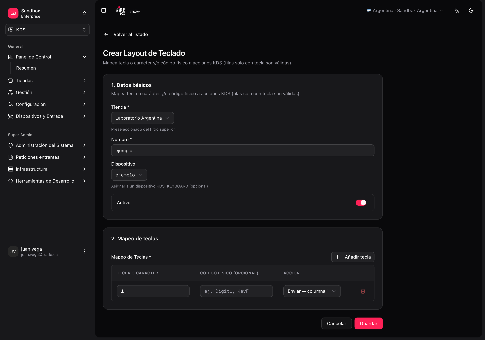
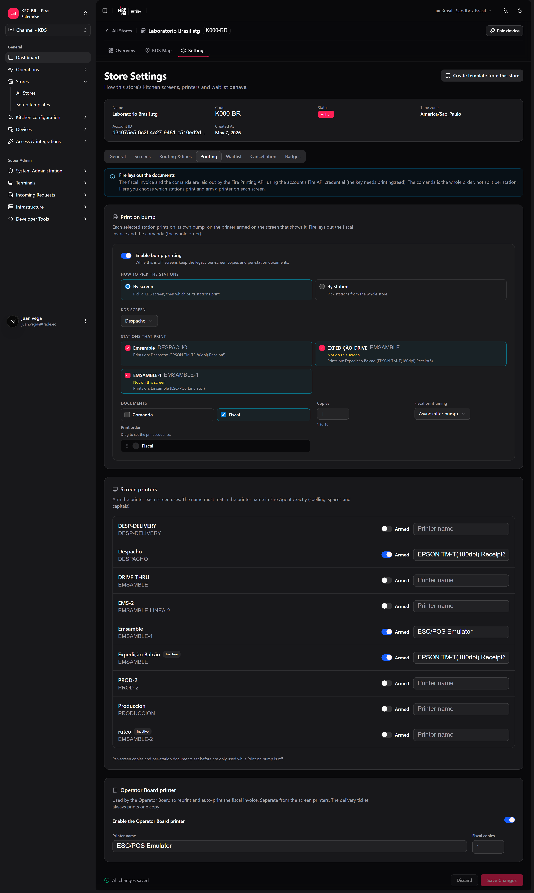
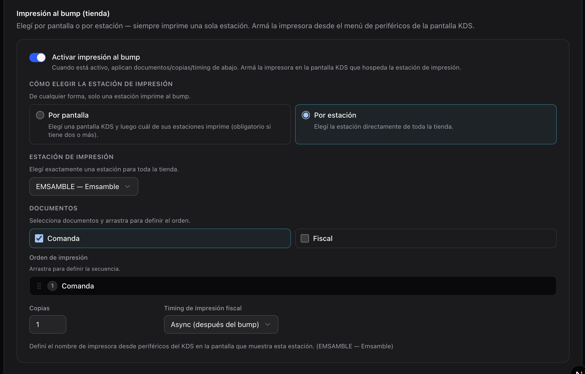
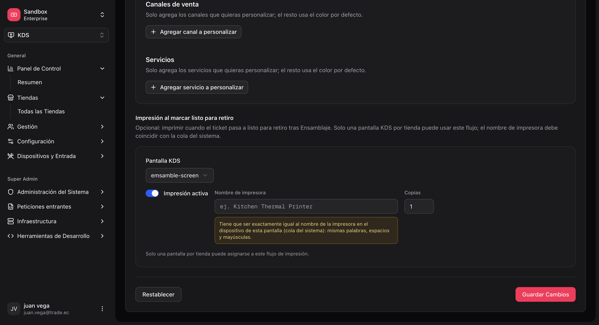
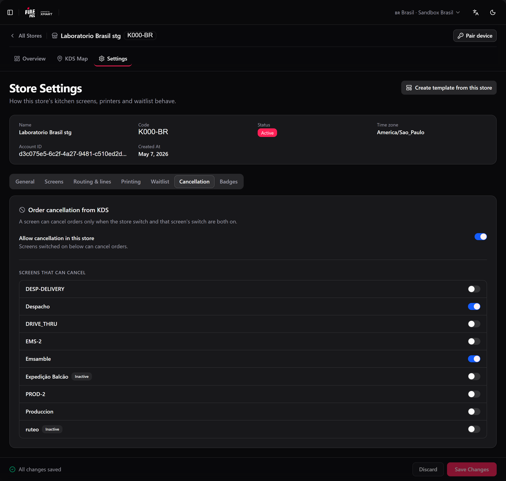
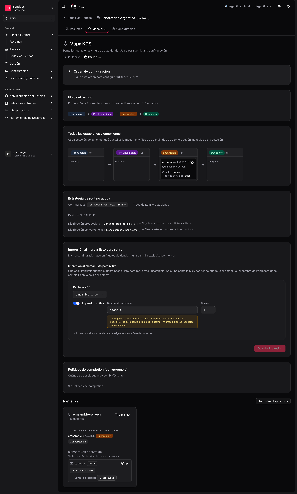

Esta página cobre a configuração restante — teclados, impressão e cancelamento — e como validar a loja antes de abrir a cozinha.

## Teclados e dispositivos de entrada

As teclas físicas (bump, mudar de página, recall) permitem ao operador trabalhar sem tocar na tela.

```text
Tela
 └── Input device (tipo KDS_KEYBOARD, ligado à tela)
      └── Keyboard layout (mapeamento tecla → ação)
```

### Ações disponíveis no backoffice

Ao criar ou editar um layout, cada tecla pode disparar ações como:

| Ação | Uso típico |
|---|---|
| `BUMP_COLUMN_1` … `BUMP_COLUMN_8` | Completar a coluna N na tela. |
| `NEXT_PAGE` / `PREV_PAGE` | Paginar tickets. |
| `REFRESH` | Atualizar a fila. |
| `HOLD_TICKET` / `RECALL_TICKET` | Reter / recuperar um ticket. |
| `PRINT_PENDING_FISCAL_INVOICES` | Disparar a impressão fiscal pendente (conforme a integração do país). |
| `SELECT_*` / `BUMP_SELECTED` | Mover o destaque e enviar o ticket destacado (botoeira). |
| `FOCUS_*` / `TOGGLE_STATION_SOLO` | Foco de estação e **zoom** (trilha estação / ticket). |

### Configurar um teclado

<Steps>
  <Step title="Crie o input device">
    **KDS → Input devices → Create** (`/kds/admin/devices/new`). Tipo: teclado KDS. Associe-o à **tela** correta.
  </Step>
  <Step title="Crie o keyboard layout">
    **KDS → Keyboard layouts → Create** (`/kds/admin/keyboard-layouts/new`). Escolha a loja e o dispositivo, e mapeie as teclas às ações.
  </Step>
  <Step title="Salve" />
</Steps>

<Frame>
  
</Frame>

Você também pode criar ou duplicar um layout em **Store → KDS Map** (`/kds/admin/stores/{storeId}/kds-map`). Se um modelo incluir teclado, ao aplicá-lo pode criar o dispositivo `{deviceIdentifier}-kbd` e o layout automaticamente.

## Impressão e cancelamento

A impressão e o cancelamento são configurados nas configurações da loja: **KDS → All Stores → [loja] → Settings** (`/kds/admin/stores/{storeId}/settings`). A página tem sete abas — **Geral**, **Telas**, **Roteamento e linhas**, **Impressão**, **Fila de espera**, **Cancelamento** e **Etiquetas** — e uma única barra de salvar para todas: uma aba com alterações mostra um ponto, e **Salvar configurações** salva todas as abas de uma vez. **Descartar** volta ao que está salvo.

<Warning>
  A barra de salvar não avisa se você sair por um link do menu com alterações não salvas. Salve antes de ir para outra página.
</Warning>

### 1. Impressão no envio (loja)

**O que faz:** quando um cozinheiro envia numa **estação de impressão**, o fire-kds imprime a **Comanda** (ticket de cozinha), a **Nota fiscal**, ou as duas.

**Onde mora a regra:** aba **Impressão** → **Imprimir no despacho**, ou **fire-kds → Configurações → KDS loja** (só admins). Escolha as estações **Por tela** (escolha uma tela e depois quais estações dela imprimem) ou **Por estação** (qualquer estação da loja), os documentos, a **Ordem de impressão**, as **Cópias** (1 a 10) e o **Timing da impressão fiscal** (`Async (bump first)` ou `Sync (wait for print)`).

<Frame>
  
</Frame>

Você pode escolher **mais de uma estação**: cada uma imprime no próprio envio. Uma loja pode imprimir a comanda na Montagem e a nota fiscal no Despacho, por exemplo.

<Frame>
  
</Frame>

**Onde a impressora é armada:** em cada tela que mostra uma estação de impressão — na aba **Impressão**, **Impressoras das telas** (ligue **Armada** e digite o nome da impressora), ou no próprio dispositivo KDS, **Impressora desta tela**. Abaixo de cada estação de impressão, a aba diz em qual tela ela **Imprime em**, ou avisa **Nenhuma impressora armada nas telas dela** / **Não aparece em nenhuma tela**.

<Warning>
  O nome da impressora precisa ser **exatamente** igual ao do Agente Fire — grafia, espaços e maiúsculas. Um nome diferente não imprime nada, e o envio acontece mesmo assim.
</Warning>

**A Fire monta os documentos.** A nota fiscal e a comanda já chegam montadas pela Fire (a [API de impressão da Fire](/pt/api-reference/print-order-document)); o KDS só as envia para a impressora. Isso significa que:

- A comanda é o **pedido inteiro**, não só as linhas da estação, e seus rótulos seguem o **país da loja**, não o idioma da tela.
- Uma mudança de modelo ou um país novo não exige atualizar o KDS.
- A nota fiscal imprime mesmo enquanto o documento fiscal ainda está pendente.

<Warning>
  A [credencial Fire](/pt/manuals/kds/fire-credentials) da conta precisa do escopo **`printing:read`** (aparece como **Impressão Leitura** na gestão de API). Sem ele a Fire responde `403` e **nada é impresso** — nem comanda nem nota fiscal.
</Warning>

<Note>
  Lojas que ainda rodam a regra antiga por tela veem **Regras de impressão antigas ainda em uso** até você ligar **Imprimir no despacho**. Não assuma que as duas políticas estão desligadas.
</Note>

**O que é necessário para funcionar:**

1. Pelo menos uma estação de impressão e um documento.
2. Uma tela KDS **ativa** que mostre cada estação de impressão, com uma impressora armada.
3. Agente Fire rodando nesse dispositivo — [Windows](/pt/manuals/fire-agent/installation) ou [Android](/pt/manuals/fire-agent/android). O fire-kds tenta primeiro a URL da plataforma e **cai na outra**. Se o agente não estiver instalado, as configurações de impressão mostram **Baixar Fire Agent** quando a conta tem um [link de download](/pt/manuals/kds/account-settings#download-do-fire-agent).
4. A credencial Fire com `printing:read`.

<Frame>
  
</Frame>

<Info>
  Uma tela pode ficar **sem impressora**: salve o campo da impressora vazio e essa tela deixa de imprimir no envio. No macOS, o Agente Fire responde "ok" para uma impressora que não é uma impressora de rede real; o KDS agora trata isso como **não impresso**, para o ticket não parecer impresso quando nada saiu.
</Info>

### 2. Cancelamento de pedidos

**O que faz:** permite ao operador cancelar um pedido a partir do KDS (ícone no ticket → confirmação).

**Onde se configura:** aba **Cancelamento** nas configurações da loja, ou **fire-kds → Cancelamento de pedidos…** no dispositivo.

<Frame>
  
</Frame>

| Nível | Config | Efeito |
|---|---|---|
| Loja | **Permitir cancelamento nesta loja** | Se off, nenhuma tela pode cancelar, independentemente da própria chave. |
| Tela | **Telas que podem cancelar** | Cada tela é habilitada separadamente. |

Várias telas podem cancelar ao mesmo tempo. Quais **motivos** os operadores podem escolher é definido uma vez para toda a conta, em [Configurações da conta](/pt/manuals/kds/account-settings#motivos-de-cancelamento-no-kds). O pedido também precisa do seu ID externo XMART, e o operador de um papel válido na loja.

### 3. Notas fiscais na fila

Quando a impressora falha depois de um envio, a nota fiscal entra na fila. **Imprimir faturas enfileiradas** (menu do KDS, ou a tecla `PRINT_PENDING_FISCAL_INVOICES`) imprime a fila só do **dia de negócio atual**: as sobras de dias anteriores ficam guardadas, mas não são impressas por ali. Para reimprimir uma nota mais antiga, use o [Board do operador](/pt/manuals/kds/operator-board).

### 4. Impressora do board do operador

A aba **Impressão** também tem a **Impressora do Operator Board**: a impressora que o PC do supervisor usa para reimprimir e imprimir automaticamente a nota fiscal e o ticket de delivery. É separada das impressoras das telas. Veja [Board do operador](/pt/manuals/kds/operator-board#impressão-pelo-board-do-operador).

## Validar a configuração: KDS Map

Depois de configurar (por modelo ou manualmente), abra:

**KDS → All Stores → [sua loja] → KDS Map** (`/kds/admin/stores/{storeId}/kds-map`).

O mapa mostra:

- Telas e estações vinculadas.
- Estações sem tela (alertas).
- Dispositivos de entrada e layouts de teclado.
- **Impressoras das telas**: quais telas têm uma impressora armada.
- Saúde geral da config.

<Frame>
  
</Frame>

## Checklist antes da produção

- [ ] Loja KDS criada e ativa.
- [ ] Estações com **codes** únicos e stages coerentes.
- [ ] Telas com o **device identifier** combinado com o hardware.
- [ ] Cada tela tem estações atribuídas (sort order correto).
- [ ] **Uma** estratégia de roteamento **ativa**.
- [ ] **Cozinha simples (prod):** estação `ASSEMBLY` + **Produção obrigatória = Não** + uma tela; testar painel de senhas e impressão bump first.
- [ ] **Cozinha simples (alternativa):** uma estação `KITCHEN` + fallback; **Produção obrigatória = Sim**; sem mappings.
- [ ] **Cozinha multi-linha:** mappings só para estações de **produção**; ASSEMBLY/DISPATCH via convergência, não em mappings.
- [ ] (Opcional) Teclado: dispositivo + layout por tela que o use.
- [ ] (Opcional) **Print on bump:** estações de impressão e documentos escolhidos, uma impressora armada numa tela ativa para cada uma, e a credencial Fire com `printing:read`.
- [ ] (Opcional) Cancelamento: habilitado para a loja e as telas que precisem (aba **Cancelamento**).
- [ ] KDS Map sem alertas críticos.
- [ ] Teste com um pedido real ou seed: os itens chegam à tela/estação esperada.

## Rotas de referência (backoffice)

| Seção | URL base |
|---|---|
| Início KDS | `/kds/admin` |
| Lojas | `/kds/admin/stores` |
| Configuração inicial da loja | `/kds/admin/stores/initial-setup/{storeId}` |
| Modelos | `/kds/admin/setup-templates` |
| Estações | `/kds/admin/stations` |
| Categorias de estação | `/kds/admin/station-categories` |
| Credenciais Fire | `/kds/admin/fire-credentials` |
| Telas | `/kds/admin/screens` |
| Roteamento | `/kds/admin/routing` |
| Dispositivos | `/kds/admin/devices` |
| Layouts de teclado | `/kds/admin/keyboard-layouts` |
| Mapa KDS da loja | `/kds/admin/stores/{storeId}/kds-map` |
| Configurações da loja | `/kds/admin/stores/{storeId}/settings` |
| Configurações da conta | `/kds/admin/account-settings` |
| Pedidos por loja | `/kds/admin/store-orders` |

<Check>
  Com o KDS Map limpo e o checklist completo, a loja está pronta para abrir o fire-kds na cozinha.
</Check>
