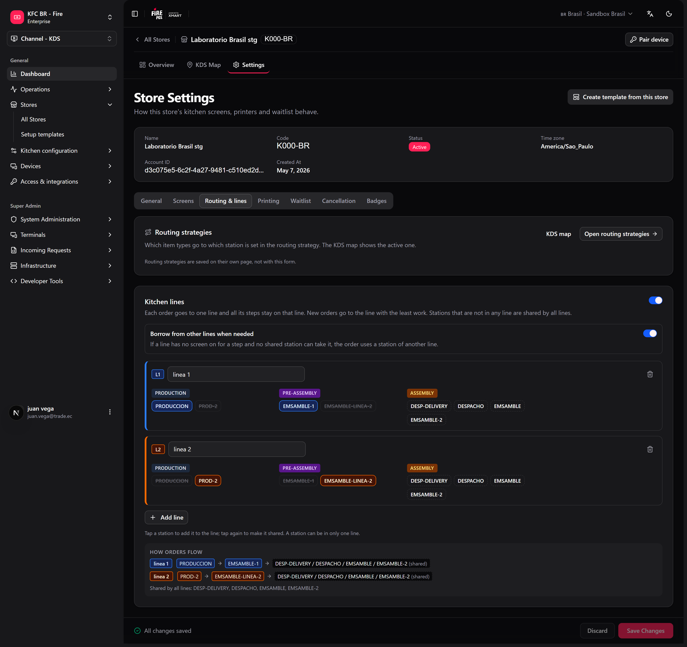
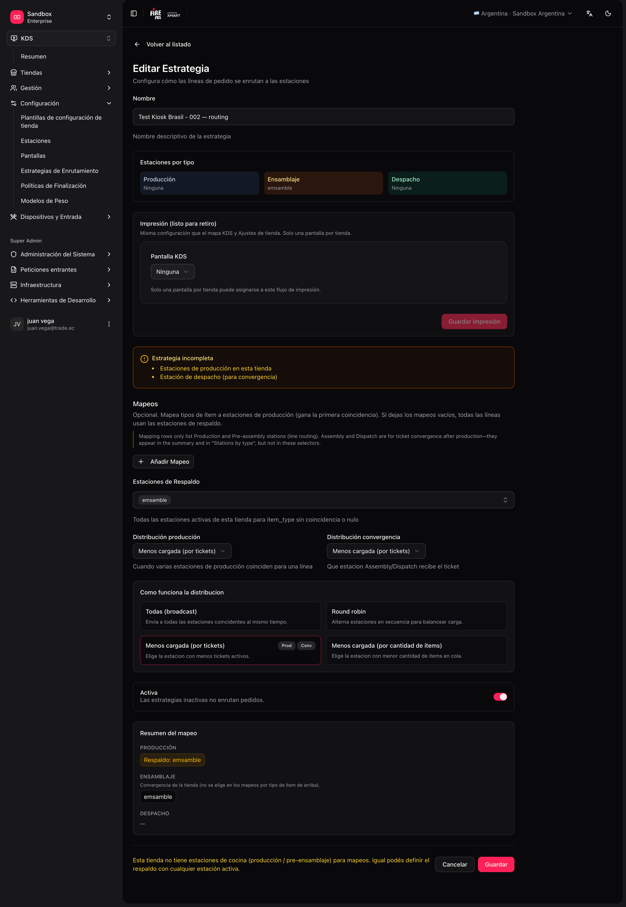

A **estratégia de roteamento** decide, para cada linha do pedido, **para qual(is) estação(ões)** ela vai.

<Note>
  Só pode haver **uma estratégia ativa** por loja. Ao ativar uma nova, as demais dessa loja são desativadas automaticamente.
</Note>

## Padrão vs mappings customizados

<Tabs>
  <Tab title="Padrão — assembly-only (produção)">
    - **Produção obrigatória = Não** em Store settings.
    - **Uma** estação `ASSEMBLY` + **uma** tela.
    - Roteamento ativo (mappings vazios); mappings de item não são usados porque não há produção prévia.
  </Tab>
  <Tab title="Padrão — estação KITCHEN">
    - **Uma** estação `PRODUCTION` (ex. `KITCHEN`) + **uma** tela.
    - Roteamento **sem mappings**; **fallback** = essa estação (ou "todas as ativas" se houver só uma).
    - **Produção obrigatória = Sim**; tudo cai na estação padrão.
  </Tab>
  <Tab title="Custom — várias linhas de produção">
    - Várias estações `PRODUCTION` / `PRE_ASSEMBLY`.
    - Mappings **item_type → estações de cozinha** (só produção).
    - Opcional: estações `ASSEMBLY` / `DISPATCH` + **convergence distribution** para expo/despacho.
  </Tab>
</Tabs>

Se não houver mapping para um `item_type`, a linha vai para o **fallback** (idealmente uma estação de produção, não montagem).

## Ordem de decisão

1. **Roteamento (camada 1):** escolhe estações **de produção** candidatas por `item_type` + fallback.
2. **Regras de estação (camada 2):** canal e tipo de serviço (`DINE_IN`, `DELIVERY`…) — podem **rejeitar** a linha. Os **item types da estação são ignorados** (pertencem só à estratégia / [categorias de estação](/pt/manuals/kds/station-categories)).
3. **Distribuição (camada 3):** se sobrarem várias candidatas de produção, escolhe uma conforme o modo.
4. **Convergência (runtime):** quando a produção avança, o **ticket** aparece em ASSEMBLY/DISPATCH conforme gates e **convergence distribution**; ali aplicam-se os filtros de canal/serviço da estação.

<Tip>
  Exemplo de camada 2: o roteamento manda um item para `GRILL`, mas a estação tem **Exclude channels: UBER_EATS** → essa linha não aparece na grelha mesmo que o mapping a inclua.
</Tip>

## Como funciona o roteamento de produção

O roteamento de **linhas** (camadas 1–3) só se aplica a estações de **produção**:

1. Lê o **`item_type`** da linha.
2. Procura um **mapping** (só estações de cozinha no formulário).
3. Se não houver match → **fallback stations** (sua estação padrão).
4. Aplica as **regras** de estação (canal, serviço).
5. Se houver várias candidatas → **distribuição**.

**Montagem e despacho** não participam desses passos. Recebem o ticket quando a produção correspondente é concluída (convergência), não porque você colocou `BURGER` → `ASSEMBLY` em um mapping.

## Modos de distribuição (quando há 2+ estações candidatas)

| Modo | Comportamento |
|---|---|
| **ALL** | Envia para todas as candidatas (broadcast). |
| **ROUND_ROBIN** | Escolhe uma estação a partir do número do pedido. Ao longo de muitos pedidos ele os distribui, mas dois pedidos seguidos podem cair na mesma estação — não é um revezamento estrito. |
| **LEAST_LOADED** | Prioriza a estação com menos tickets ativos. Use para dividir por igual entre estações equivalentes. |
| **LEAST_LOADED_ITEMS** | Prioriza a estação com menos itens na fila. |

Se o mapping tem **uma única** estação, o modo de distribuição não muda o resultado.

Quando uma categoria está mapeada para uma estação de **produção** e uma de **pré-montagem** (por exemplo, `HAM` → `GRILL` e `PRE-ASSEMBLY-1`), a linha vai para **uma estação de cada**: a distribuição roda separadamente dentro de cada etapa.

No fire-kds esses modos aparecem como **Todas**, **Revezamento**, **Menos pedidos** e **Menos produtos**.

## Combos e seus itens

Um combo pode ser dividido em seus itens para que cada um chegue à sua estação: o hambúrguer à grelha, a batata à fritadeira. Um item é separado quando o seu produto tem uma [categoria de estação](/pt/manuals/kds/station-categories) **e** essa categoria está mapeada na estratégia ativa da loja. Sem mapping, o combo chega inteiro.

- A **Produção** recebe cada item como uma linha própria.
- A **Montagem** e o **Despacho** veem o combo como foi vendido, com seus itens como sublinhas que são riscadas conforme a Produção os conclui.
- O board do operador, a nota fiscal e o ticket de delivery mostram o combo como foi vendido, não os itens.

Veja [Ações na tela → Combos na tela](/pt/manuals/kds/screen-actions#combos-na-tela).

## Linhas de cozinha (opcional)

Numa cozinha com duas linhas paralelas (Grelha 1 → Montagem 1, Grelha 2 → Montagem 2), equilibrar cada etapa por conta própria pode mandar um pedido feito na Grelha 1 para a Montagem 2, do outro lado da cozinha. As **Linhas de cozinha** mantêm cada pedido dentro de uma linha do começo ao fim.

**Onde:** configurações da loja, aba **Roteamento e linhas**, ou **fire-kds → Configurações → Linhas e roteamento → Linhas de cozinha**.

<Frame>
  
</Frame>

<Steps>
  <Step title="Ligue Usar linhas de cozinha" />
  <Step title="Adicione as linhas">
    **Adicionar linha** para cada uma. Dê um nome (opcional, ex. "Linha 1") e escolha as estações por etapa. Uma estação só pode pertencer a uma linha.
  </Step>
  <Step title="Deixe as estações compartilhadas fora de todas as linhas">
    Uma estação que não está em nenhuma linha é **compartilhada por todas as linhas** — por exemplo, um despacho único.
  </Step>
  <Step title="Decida o que acontece se faltar uma estação numa linha">
    **Usar outra linha se faltar uma estação**: ligado, o pedido usa a estação da outra linha; desligado, ele espera na sua linha até a estação voltar.
  </Step>
  <Step title="Salvar linhas" />
</Steps>

Como um pedido escolhe a sua linha: primeiro as linhas cujas estações aceitam o pedido (regras de canal e serviço) e conseguem fazer todos os itens, depois as linhas com todas as etapas online, depois a menos carregada. Dentro da linha, várias estações da mesma etapa são equilibradas com o modo de distribuição da loja.

Com pelo menos duas linhas em uso, o dashboard da loja no fire-kds desenha um diagrama: uma fila por linha, uma coluna por etapa e uma célula mesclada onde as linhas se juntam.

<Warning>
  Com menos de duas linhas que tenham estações, as linhas de cozinha não mudam nada. Uma linha sem estações é ignorada.
</Warning>

## Linhas e roteamento no fire-kds

Os admins da loja podem revisar o roteamento no dispositivo: **fire-kds → Configurações → Linhas e roteamento**. A página explica como um pedido chega a cada tela, mostra o mapa categoria → estação da estratégia ativa (que continua sendo editado no backoffice) e permite mudar:

- **Distribuição entre estações de produção** e **Distribuição entre montagem e expedição**.
- **Produção obrigatória**.
- **Linhas de cozinha** (veja acima).

## Quando uma tela fica offline

- Os tickets de uma tela que fica offline passam para outra tela **online** da mesma etapa, se houver. Se não houver, eles ficam e voltam quando a tela reconecta.
- Quando as telas reconectam em momentos diferentes, cada uma recebe de volta os pedidos que lhe faltam; uma etapa que já deu bump nunca é adicionada de novo.
- Se a Montagem der bump enquanto todas as telas de Despacho estão offline, o pedido fecha na Montagem e não reaparece no Despacho depois.
- A recuperação só move pedidos recentes: segue as configurações de **Recuperação e dia de operação** da loja (aba **Geral**).
- Uma tela [pausada](/pt/manuals/kds/screen-actions#pausar-uma-tela) não libera os seus tickets; ela só deixa de receber novos.

## Exemplo multi-estação

**Estações:**

| Code | Stage | Papel |
|---|---|---|
| `GRILL` | PRODUCTION | Hambúrgueres — **roteável por item_type** |
| `FRY` | PRODUCTION | Batatas — **roteável por item_type** |
| `ASSEMBLY` | ASSEMBLY | Montagem — **ticket inteiro**, sem mapping de itens |
| `DISPATCH` | DISPATCH | Despacho — **ticket inteiro**; ex. só regra `DELIVERY` |

**Telas:**

| Tela | Estações atribuídas |
|---|---|
| "Grelha" | `GRILL`, `FRY` |
| "Montagem" | `ASSEMBLY` |
| "Despacho delivery" | `DISPATCH` (rules: fulfillment `DELIVERY`) |

**Estratégia de roteamento — só produção nos mappings:**

| item_type | Estações destino | Distribuição |
|---|---|---|
| `BURGER` | `GRILL` | — |
| `FRIES` | `FRY`, `GRILL` | `LEAST_LOADED` |
| *(fallback)* | `GRILL` | Tipos não listados → grelha (estação padrão de produção) |

**Convergência (fora dos mappings):** quando as linhas em `GRILL`/`FRY` são concluídas, o ticket aparece em `ASSEMBLY` e depois em `DISPATCH` conforme a **convergence distribution** e as regras de canal/serviço dessas estações.

<Frame>
  
</Frame>

## Criar a estratégia

<Steps>
  <Step title="Abra o formulário de roteamento">
    **KDS → Routing → Create** (`/kds/admin/routing/new`).
  </Step>
  <Step title="Escolha loja e nome">
    Por exemplo, "Default routing".
  </Step>
  <Step title="Cozinha simples">
    Uma estação `KITCHEN`, fallback = `KITCHEN`, sem mappings, **Active**.
  </Step>
  <Step title="Cozinha avançada">
    Mappings só para estações de **produção**; **convergence distribution** se houver estações ASSEMBLY/DISPATCH; fallback = estação padrão de produção.
  </Step>
  <Step title="Salve" />
</Steps>

Na lista de roteamento você pode ver o cartão de **estratégia ativa** e um mapa conceitual estação ↔ tela.

<Warning>
  Um produto sem categoria de estação, ou uma categoria sem mapping, não é separado do seu combo e vai para o fallback. Confira as [Categorias de estação](/pt/manuals/kds/station-categories) antes de culpar o roteamento.
</Warning>

Próximo: [Periféricos, impressão e validação](/pt/manuals/kds/peripherals-printing).
