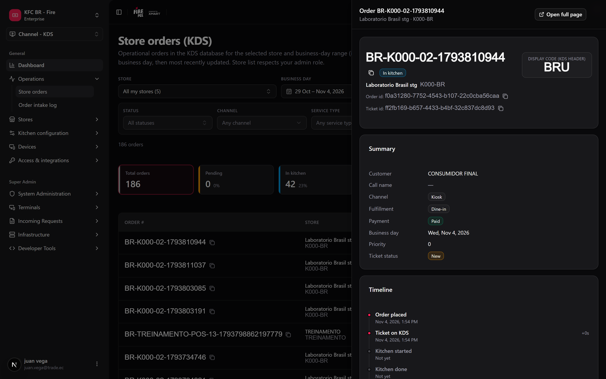
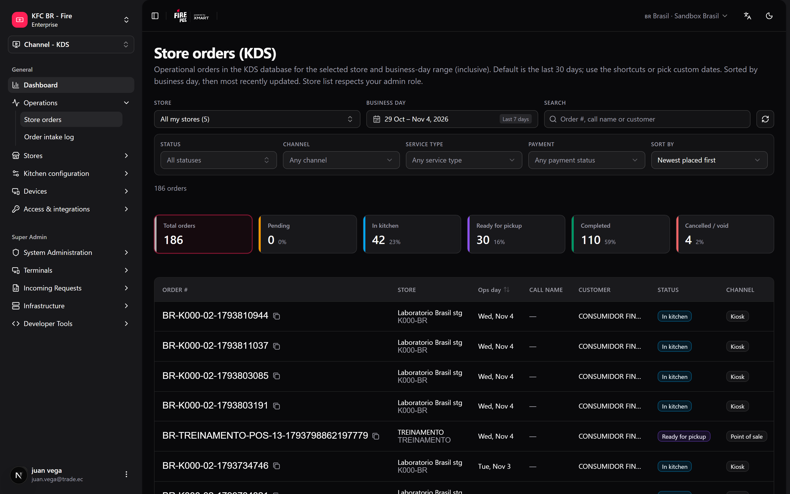

Quando um cliente diz que o pedido nunca saiu, ou uma loja pergunta por que a cozinha estava lenta na sexta, a resposta está nos pedidos que o KDS recebeu. **Pedidos por loja** permite consultá-los pelo backoffice, sem pedir à loja uma foto da TV da cozinha. É só leitura: nada do que você faz aqui altera um pedido.

**Onde você trabalha:** **KDS → Pedidos por loja** (`/kds/admin/store-orders`) no backoffice.

<Note>
  **O mínimo que você precisa saber**

  - As datas são **dias operacionais** da loja, não dias do calendário: um pedido feito à 1:00 da manhã pode pertencer ao dia anterior.
  - Você pode buscar em uma loja ou em **Todas as minhas lojas** (até 100 lojas, até 93 dias).
  - Os cartões de KPI também são filtros: clique em **Na cozinha** para ver só esses pedidos.
</Note>

## O caminho simples

<Steps>
  <Step title="Abra Pedidos por loja">
    Vá em **KDS → Pedidos por loja**. A tela abre com os **últimos 7 dias**.
  </Step>
  <Step title="Escolha a loja">
    Use o seletor de loja (ele tem busca). Escolha **Todas as minhas lojas** para buscar em todas as lojas que você vê; a tabela passa a mostrar uma coluna de loja.
  </Step>
  <Step title="Encontre o pedido">
    Digite o número do pedido, o nome de chamada / pager ou o nome do cliente na caixa de busca.
  </Step>
  <Step title="Abra o pedido">
    Clique no número do pedido. O detalhe abre num painel lateral sobre a lista: resumo, linha do tempo do ticket (no fuso horário da loja), linhas com modificadores e totais. **Abrir em página inteira** dá um link para compartilhar.

    <Frame>
      
    </Frame>
  </Step>
</Steps>

<Tip>
  A tela inteira fica na barra de endereço. Copie a URL e quem abri-la vê a mesma loja, datas, filtros e pedido aberto.
</Tip>

## Filtros

| Filtro | O que faz |
|---|---|
| **Dia operacional** | Calendário com atalhos (hoje, últimos 7 / 30 dias, esta semana, este mês, mês passado). |
| **Status** | Um ou vários: Criado, Na cozinha, Pronto para retirada, Concluído, Cancelado, Anulado. |
| **Canal**, **Tipo de atendimento**, **Pagamento** | Restringem por onde o pedido veio, como é atendido e o status do pagamento. |
| **Buscar** | Número do pedido, nome de chamada / pager ou cliente. |

Os filtros ativos aparecem como chips; **Limpar filtros** remove todos.

## O que a tabela mostra

<Frame>
  
</Frame>

| Coluna | Significado |
|---|---|
| **Nº do pedido** | O código que a equipe vê nos tickets e nas telas. Clique para abrir, ou copie. |
| **Dia contábil** | O dia operacional da loja para esse pedido. |
| **Nome de chamada** | O nome ou o número de pager dado ao cliente, quando houver. |
| **Status** | Etapa do pedido no fluxo da cozinha. |
| **Canal** / **Tipo de atendimento** | Canal de venda e tipo de atendimento. |
| **Recebido** / **Última alteração** | Tempo relativo, com a hora exata no fuso horário da loja ao passar o mouse. |
| **Tempo de cozinha** | Desde que a cozinha iniciou (ou recebeu) o ticket até ele ser marcado como pronto. |

Os cartões de KPI acima da tabela (**Total de pedidos**, **Pendentes**, na cozinha, pronto para retirada, concluídos, cancelados / anulados) contam os pedidos que atendem a todos os filtros exceto o status, com a sua porcentagem. Clique em um para filtrar por ele.

## Receitas

<AccordionGroup>
  <Accordion title="Um cliente diz que o pedido nunca saiu">
    1. Escolha a loja e o dia operacional de hoje.
    2. Busque pelo nome do cliente ou pelo nome de chamada.
    3. Abra o pedido e leia a linha do tempo: qual estação estava com ele e quando recebeu bump.
    4. Se ainda estiver **Na cozinha**, o [Board do operador](/pt/manuals/kds/operator-board) pode marcá-lo como pronto.
  </Accordion>
  <Accordion title="Quantos pedidos foram cancelados nesta semana, em toda a rede">
    1. Escolha **Todas as minhas lojas** e **Esta semana**.
    2. Clique no cartão **Cancelados / anulados**.
    3. A coluna de loja mostra onde aconteceram.
  </Accordion>
  <Accordion title="Pedidos de uma loja que já fechou">
    Os admins de loja e de conta também veem as lojas inativas no seletor, então o histórico de uma loja fechada continua lá.
  </Accordion>
  <Accordion title="Mandar a um supervisor o pedido exato">
    1. Abra o pedido.
    2. Clique em **Abrir em página inteira** e copie o link.
  </Accordion>
</AccordionGroup>

## Erros que saem caro

<Warning>
  **Buscar pela data do calendário depois da meia-noite.** Uma loja que fecha às 2:00 da manhã registra esses pedidos no dia operacional anterior. Se você buscar "hoje", não vai encontrá-los e vai concluir que se perderam.
</Warning>

<Warning>
  **Ler "Concluído" como "entregue ao cliente".** Significa que a cozinha fechou o pedido. Se o entregador o retirou, isso está no canal, não aqui.
</Warning>

## Perguntas frequentes

<AccordionGroup>
  <Accordion title="Por que não posso escolher um período maior que 93 dias?">
    Para a busca continuar rápida. Faça duas buscas se precisar de mais.
  </Accordion>
  <Accordion title="Por que Todas as minhas lojas dá erro?">
    Cobre até 100 lojas. Se você tem acesso a mais, escolha uma loja ou restrinja o contexto de lojas no cabeçalho.
  </Accordion>
  <Accordion title="Posso cancelar ou marcar um pedido como pronto daqui?">
    Não. Esta tela é só leitura. Use o [Board do operador](/pt/manuals/kds/operator-board).
  </Accordion>
</AccordionGroup>

## O que esta página não faz

- Não altera pedidos.
- Não exporta para arquivo.
- Não mostra pedidos que nunca chegaram ao KDS.
