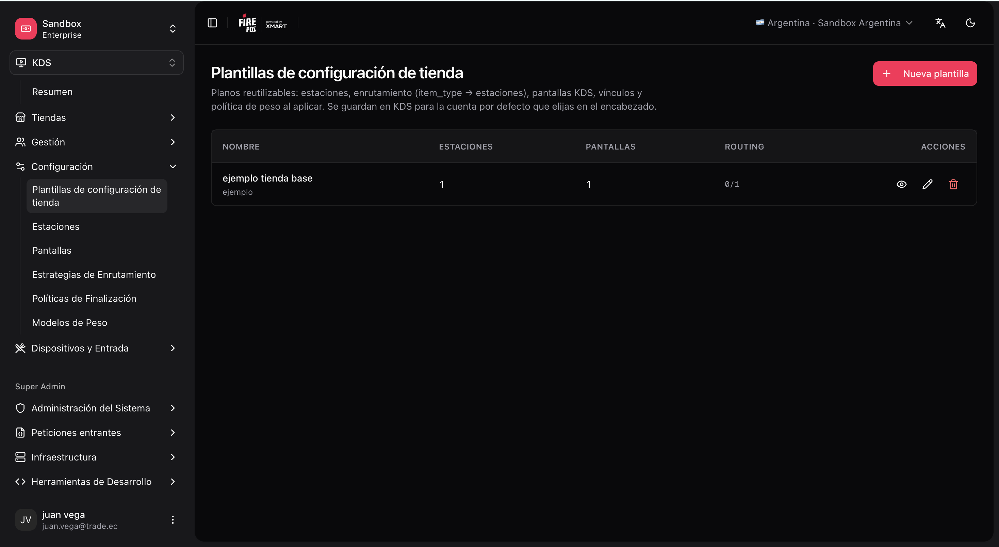
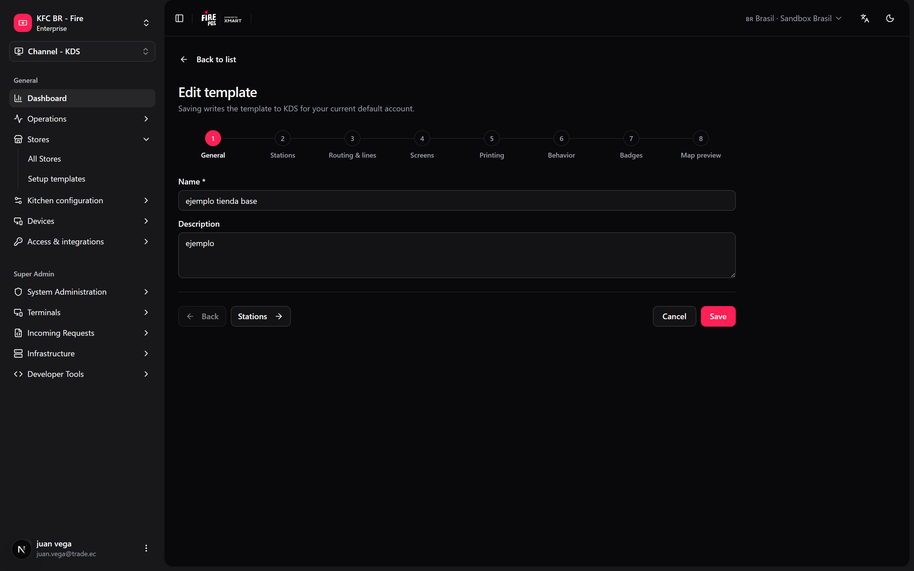
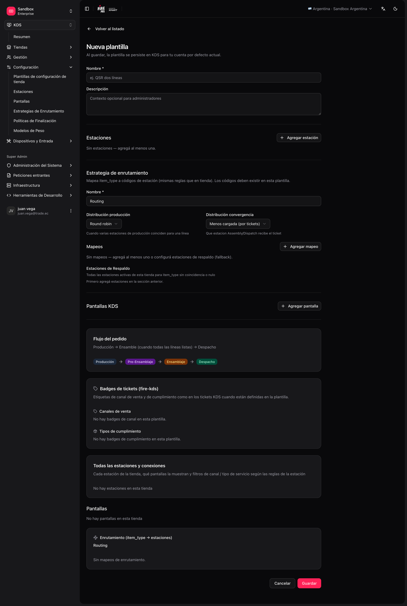

Há duas formas de configurar uma loja KDS: aplicar um **modelo** (recomendado quando você repete o mesmo layout) ou configurar tudo **do zero**.

## Opção A — Usar um modelo

Ideal quando você já tem um layout testado (mesma rede, mesmo tipo de cozinha).

<Steps>
  <Step title="Abra Setup templates">
    Vá em **KDS → Setup templates** (`/kds/admin/setup-templates`).
  </Step>
  <Step title="Crie um modelo">
    Escolha um **modelo vazio** ou **Seed from store** (copiar a config de uma loja que já funciona).

    <Frame>
      
    </Frame>
  </Step>
  <Step title="Percorra os passos">
    O editor é um assistente por passos: **Geral → Estações → Roteamento e linhas → Telas → Impressão → Comportamento → Etiquetas → Prévia do mapa**.

    <Frame>
      
    </Frame>

    - **Estações**, **Roteamento e linhas** e **Telas**: o layout da cozinha, os vínculos tela ↔ estação e, se você as usar, as [linhas de cozinha](/pt/manuals/kds/routing#linhas-de-cozinha-opcional).
    - **Impressão**: impressão no envio (estações, documentos, cópias, timing fiscal) e a impressora armada em cada tela.
    - **Comportamento**: os padrões da loja — produção obrigatória, nome do cliente, painel de senhas, display, riscar linhas, recuperação, cancelamento e a impressora do Operator Board.
    - **Prévia do mapa**: revise tudo antes de salvar.
  </Step>
  <Step title="Salve o modelo" />
</Steps>

### Aplicar um modelo a uma loja nova (assistente inicial)

<Steps>
  <Step title="Crie a loja">
    **KDS → All Stores → Create**.
  </Step>
  <Step title="Abra a configuração inicial">
    Se a loja estiver vazia (sem estações, telas ou roteamento), abra `/kds/admin/stores/initial-setup/{storeId}`.
  </Step>
  <Step title="Use um blueprint">
    Escolha **Use a blueprint** → selecione o modelo → revise/edite → **Apply to store**.

    <Frame>
      
    </Frame>
  </Step>
  <Step title="Revise o progresso">
    O assistente mostra o progresso por fases (estações, telas, vínculos, roteamento, configurações da loja, linhas de cozinha, impressão, teclados). Só rodam as fases que o modelo usa.
  </Step>
</Steps>

<Tip>
  Você também pode **salvar uma loja existente como modelo** em **Store settings** dessa loja ("Save as template"). O modelo agora leva também o comportamento da loja, as linhas de cozinha e a impressão no envio, então uma loja nova já sai pronta para imprimir.
</Tip>

<Note>
  Os modelos salvos antes desta mudança continuam abrindo: o editor os atualiza e preenche os passos novos com valores padrão. Revise **Impressão** e **Comportamento** antes de aplicar um modelo antigo.
</Note>

## Opção B — Configurar manualmente (do zero)

Ordem recomendada se você não usa modelo:

| Passo | Menu do backoffice | Rota |
|---|---|---|
| 1 | All Stores → criar loja | `/kds/admin/stores/new` |
| 2 | Stations → criar estações | `/kds/admin/stations/new` |
| 3 | Screens → criar telas | `/kds/admin/screens/new` |
| 4 | Atribuir estações a cada tela | `/kds/admin/screens/{id}/assign-stations` |
| 5 | Routing → estratégia ativa | `/kds/admin/routing/new` |
| 6 | (Opcional) Input devices + Keyboard layouts | `/kds/admin/devices`, `/kds/admin/keyboard-layouts` |
| 7 | Validar no **KDS Map** da loja | `/kds/admin/stores/{storeId}/kds-map` |

O assistente de **configuração inicial** também oferece **Create from scratch**: abre o mesmo editor dos modelos, mas aplicado direto à loja vazia.

<Note>
  Cada passo tem sua própria página nesta seção: [Estações](/pt/manuals/kds/stations), [Telas](/pt/manuals/kds/screens), [Roteamento](/pt/manuals/kds/routing) e [Periféricos, impressão e validação](/pt/manuals/kds/peripherals-printing).
</Note>
