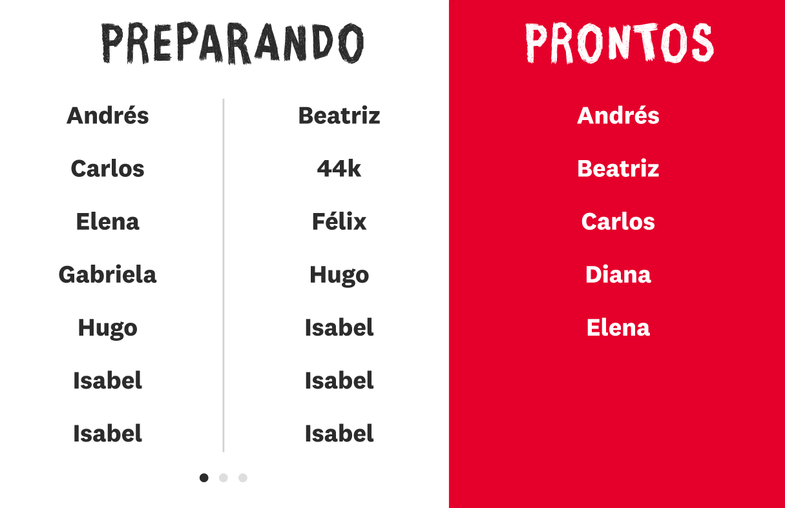
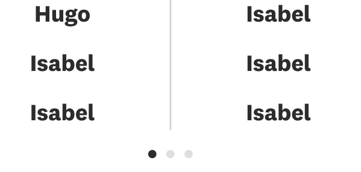
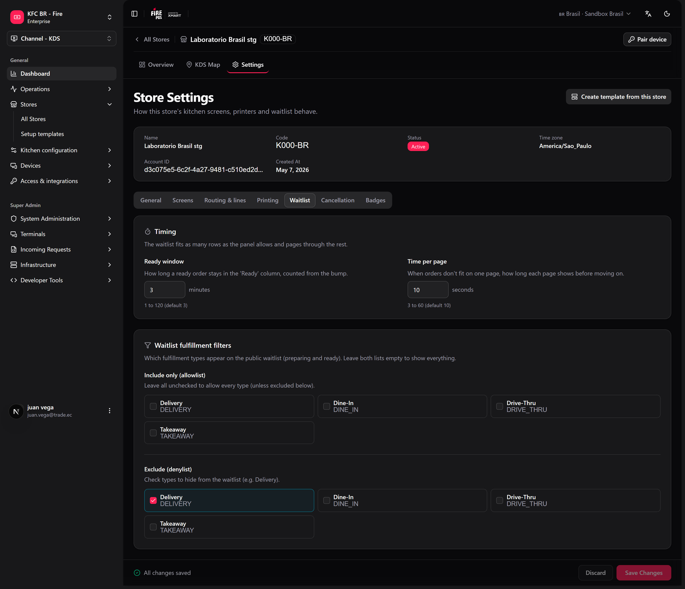
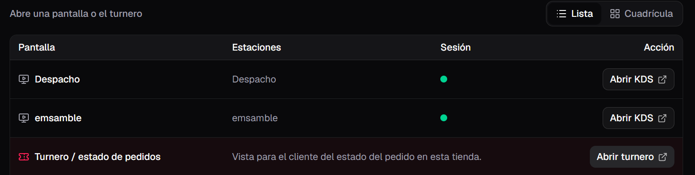

O painel de senhas (também chamado de *waitlist* ou turnero) é uma tela voltada ao cliente que mostra os números dos pedidos em dois estados: **em preparo** e **prontos para retirada**. Ele foi pensado para funcionar em uma TV ou tablet na área de retirada, para que os clientes vejam quando o pedido está pronto.

Diferente da tela do KDS, o painel de senhas não tem controles para o operador — apenas exibe informações. Ele é atualizado em tempo real conforme a cozinha avança com os pedidos.

## O que a tela mostra

O painel é dividido em duas áreas:

- **Em preparo:** pedidos que a cozinha recebeu e ainda está preparando, ordenados do mais antigo para o mais recente.
- **Prontos para retirada:** pedidos finalizados que aguardam ser retirados. Cada pedido permanece nesta área durante o **tempo em prontos** — **3 minutos** por padrão — contado a partir do bump que o deixou pronto.

Qual bump deixa um pedido "pronto" depende da cozinha:

- **Com uma tela de Despacho online:** o pedido passa a pronto quando o Despacho dá bump nele. O bump da Montagem o mantém em preparo enquanto ele ainda está no Despacho.
- **Sem Despacho:** o bump da Montagem o passa a pronto.

Ligar uma tela de Despacho não devolve para preparo os pedidos que a Montagem já terminou.

O nome da loja ou o título da campanha aparece no topo como um banner.

<Frame>
  
</Frame>

## Quando um pedido fica pronto

Quando um pedido passa a pronto, a tela o destaca para que o cliente perceba: o código do pedido é mostrado em tamanho grande em um **destaque** por um momento antes de se acomodar na lista de prontos.

<Frame>
  
</Frame>

## Qual código é exibido

Cada pedido mostra uma etiqueta curta e pública para que os clientes a associem ao seu recibo ou pager:

1. O **nome do pager ou senha** se o pedido tiver um.
2. Caso contrário, o **código público do pedido**.
3. Como alternativa, os últimos caracteres do código do pedido.

É a mesma etiqueta que aparece no cabeçalho do cartão do KDS.

## Paginação e rotação

Cada página mostra só as linhas que cabem inteiras na tela e as distribui para preencher o painel — a lista nunca rola e a última linha nunca fica cortada. Quando há mais pedidos do que cabem, as listas alternam entre páginas sozinhas (**Tempo por página**, 10 segundos por padrão). Os **pontos de paginação** abaixo das listas indicam quantas páginas existem e qual está visível.

A tela decide quantos códigos cabem pela própria altura: não existe mais uma configuração de "códigos por página".

<Frame>
  
</Frame>

## Quais pedidos aparecem

Por padrão o painel inclui todos os pedidos em preparo e prontos **exceto delivery**: os pedidos de delivery sempre vão para o [painel de delivery](#painel-de-delivery). Seu administrador também pode **ocultar outros tipos de entrega** (por exemplo, mostrar só dine-in). Os filtros se aplicam às listas de preparo e prontos.

Quando a loja tem a recuperação por **dia de operação** ligada, o preparo mostra só os pedidos de hoje; as sobras de dias anteriores não ficam na TV.

## Configurações

No backoffice, configurações da loja → aba **Fila de espera** (ou **fire-kds → Configurações → KDS loja**):

<Frame>
  
</Frame>

| Configuração | Intervalo | Padrão |
|---|---|---|
| **Tempo em prontos** | 1–120 minutos | 3 |
| **Tempo por página** | 3–60 segundos | 10 |
| **Incluir apenas** / **Excluir** | Tipos de atendimento | Mostrar tudo (exceto delivery) |

## Painel de delivery

O **painel de delivery** é uma tela separada para a área onde os entregadores retiram. Tem três colunas — **Preparando**, **PRONTOS** e **Entregues** — e mostra só pedidos de delivery. Cada código leva a abreviação do canal (por exemplo, `1234-KE` para um pedido do Keeta), para o entregador identificar os pedidos do seu app.

- Abra-o pelo dashboard da loja com **Abrir fila de delivery**, ou em `/waitlist/{storeId}/delivery`. Você também pode [emparelhar uma TV](/pt/manuals/kds/device-pairing) direto em **Fila delivery**.
- **Tempo em prontos (delivery)** (padrão 3 minutos) e **Tempo em entregues** (padrão 10 minutos) são definidos em **fire-kds → Configurações → KDS loja → Tempos do painel de delivery**.
- Esses tempos contam a partir da mudança de status do pedido (o mesmo momento em que os webhooks são enviados), não do bump da cozinha.

<Warning>
  Se você mostrava delivery no painel principal, ele não está mais lá. Coloque o painel de delivery em uma tela própria, ou os entregadores não vão ver os seus pedidos.
</Warning>

## Como abri-lo

O painel de senhas abre em sua própria aba do navegador a partir do painel da loja, separado das telas de operador do KDS. Abra-o no dispositivo da área de retirada e deixe-o funcionando em tela cheia. Os dispositivos de cozinha também podem ser [emparelhados](/pt/manuals/kds/device-pairing) primeiro para que o dashboard abra na loja correta.

<Frame>
  
</Frame>

<Info>
  Se o painel falhar, ele recarrega sozinho depois de 15 segundos. Depois de 5 falhas em 10 minutos, ele espera 5 minutos entre as tentativas, para uma TV com problema não ficar recarregando sem parar.
</Info>

<Check>
  O painel de senhas já está mostrando o status dos pedidos ao vivo para os seus clientes.
</Check>
