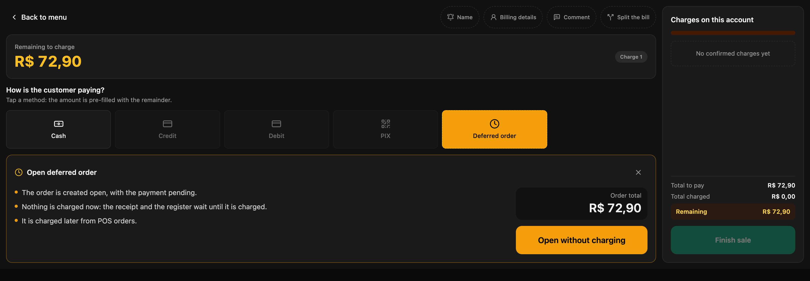
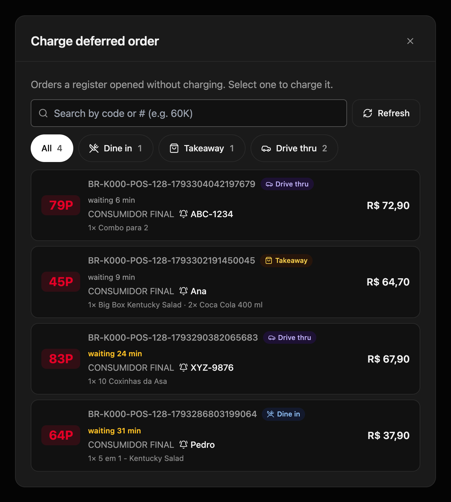
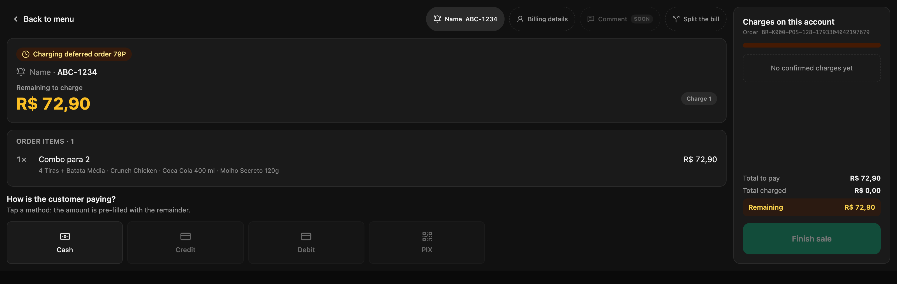

No drive thru, ou quando o cliente paga no final, o pedido é feito antes de ser cobrado. Se o caixa cobra "por conta" para registrá-lo, ou anota à parte, o caixa fecha com diferença ou o pedido é lançado duas vezes. O **pedido diferido** registra o pedido sem cobrá-lo e o deixa esperando em **Pedidos POS** até o cliente pagar.

<Note>
  **O mínimo que você precisa saber**

  - Ao abri-lo nada é cobrado, nenhum comprovante é impresso e nada soma ao caixa. Tudo isso acontece quando ele é cobrado.
  - A cozinha o prepara antes da cobrança só se a conta tiver **Pagamento diferido** nesse canal; se não, espera até ser cobrado.
  - É cobrado em **Pedidos POS**, com qualquer forma de pagamento, em qualquer caixa da loja.
</Note>

## Pré-requisitos

- **Pedido diferido** ativado no canal, no backoffice: **Fire POS → Config por loja → Canais**, dentro do cartão do canal. Consulte [Configuração por loja](/pt/manuals/pos/store-config).
- Para a cozinha prepará-lo antes da cobrança, **Pagamento diferido** configurado na conta para esse canal e tipo de serviço. Quem configura é a equipe do Fire.
- O caixa aberto. Consulte [Abrir o caixa](/pt/manuals/pos/open-register).

## 1. Abra o pedido sem cobrar

Monte o pedido como sempre e toque em **Cobrar**. Na tela de pagamento, toque em **Pedido diferido** e depois em **Abrir sem cobrar**.

<Frame>
  
</Frame>

O POS mostra **Pedido diferido aberto**: o pedido fica registrado com seu número e seu localizador. Entregue ao cliente o número ou o buzzer, como em qualquer venda.

## 2. Cobre em Pedidos POS

Quando o cliente for pagar, toque em **Pedidos POS** (o ícone de relógio) na barra da direita. Cada pedido mostra seu número curto, o canal, o localizador, os produtos e há quantos minutos está esperando; a partir de 20 minutos, em âmbar. Filtre por canal com os botões de cima ou busque pelo número.

<Frame>
  
</Frame>

Toque no pedido: ele abre na tela de pagamento com seus produtos. Cobre em dinheiro, com cartão ou com várias formas, e toque em **Finalizar venda**. É aí que sai o comprovante e a venda soma ao seu caixa.

<Frame>
  
</Frame>

<Tip>
  Se o pedido sumiu de **Pedidos POS**, terminou: ficou cobrado.
</Tip>

## Se o cliente não voltar

Cancele em **Cancelar pedido**, como qualquer pedido. Como não foi cobrado, não há dinheiro a devolver nem nota de crédito. Consulte [Cancelar um pedido](/pt/manuals/pos/cancellations).

## Erros que custam caro

<Warning>
  **Lançar o pedido de novo quando o cliente volta para pagar.** A cozinha prepara duas vezes e o pedido diferido continua pendente. Cobre sempre em **Pedidos POS**.
</Warning>

<Warning>
  **Entregar o pedido sem cobrá-lo.** O pedido fica aberto e a venda não entra no caixa. Cobre antes de entregar, ou na janela de pagamento no drive thru.
</Warning>

## Perguntas frequentes

<AccordionGroup>
  <Accordion title="Não vejo «Pedido diferido» na tela de pagamento">
    O canal do pedido não está com ele ativado na configuração da loja. Se o botão diz **Anule as cobranças**, você já registrou uma cobrança nessa conta: anule-a antes de abrir o pedido sem cobrar.
  </Accordion>

  <Accordion title="A cozinha não recebe o pedido até ele ser cobrado">
    A conta não tem **Pagamento diferido** para esse canal e tipo de serviço, então o pedido é tratado como pré-pago. Peça à equipe do Fire para configurá-lo.
  </Accordion>

  <Accordion title="Não vejo o botão Pedidos POS">
    Ele só aparece se a loja tiver o pedido diferido ativado em algum canal.
  </Accordion>

  <Accordion title="Posso mudar os produtos de um pedido diferido?">
    Não. Os produtos ficam fixos ao abri-lo. Se o cliente mudar o pedido, cancele-o e monte um novo.
  </Accordion>
</AccordionGroup>
