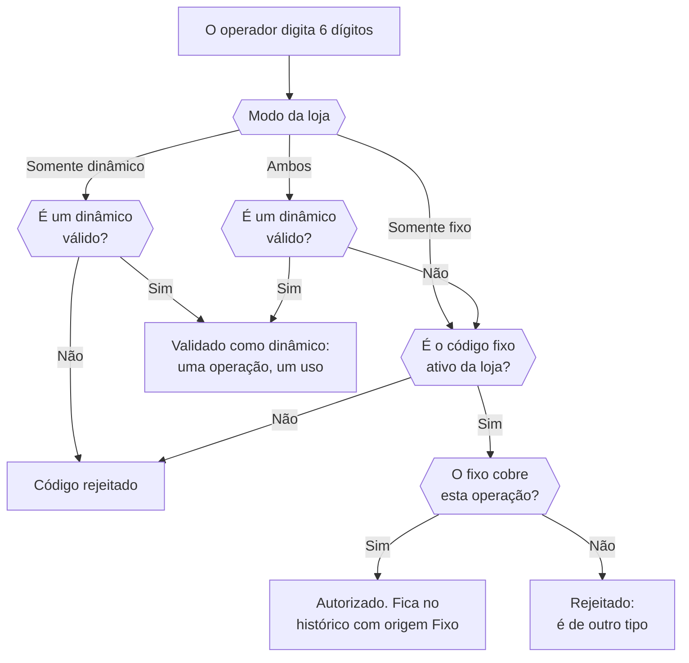
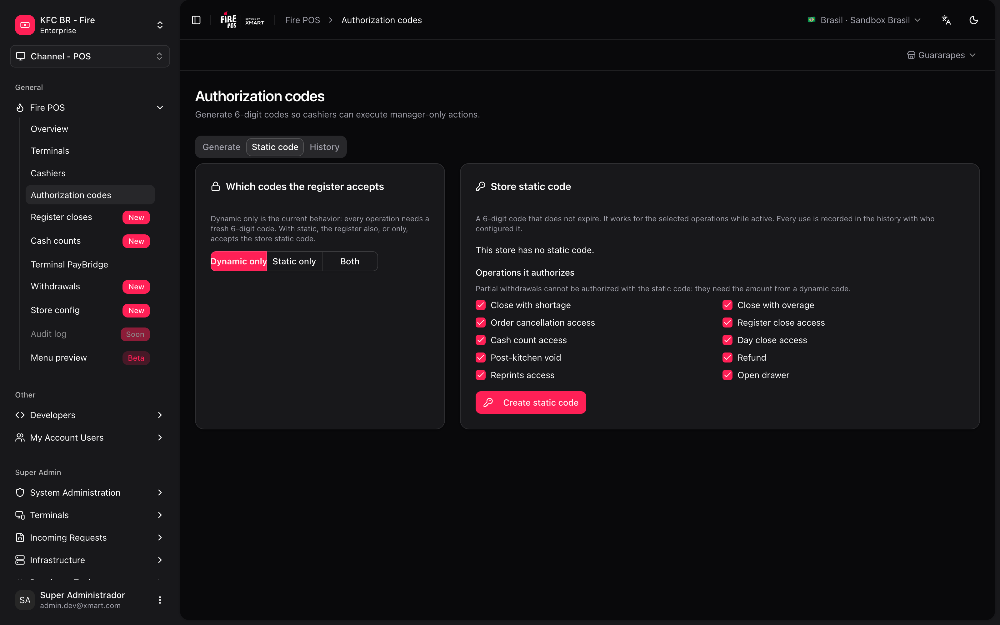
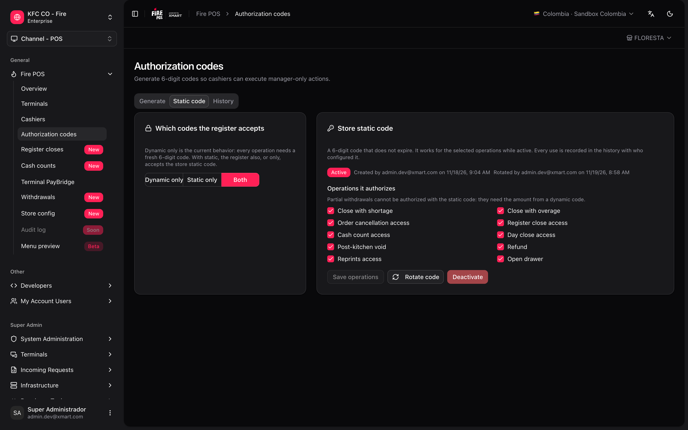
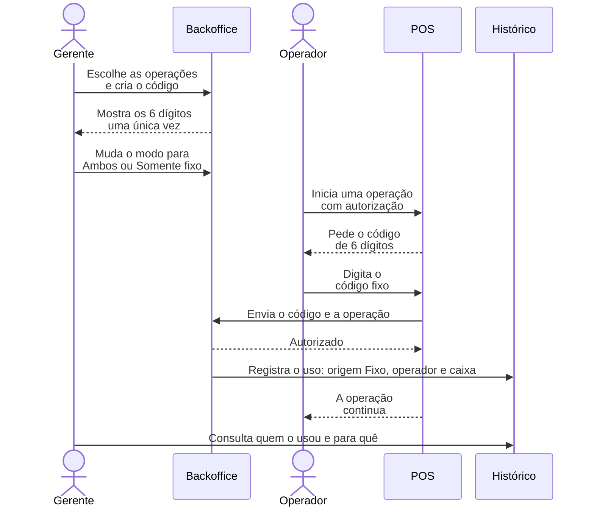
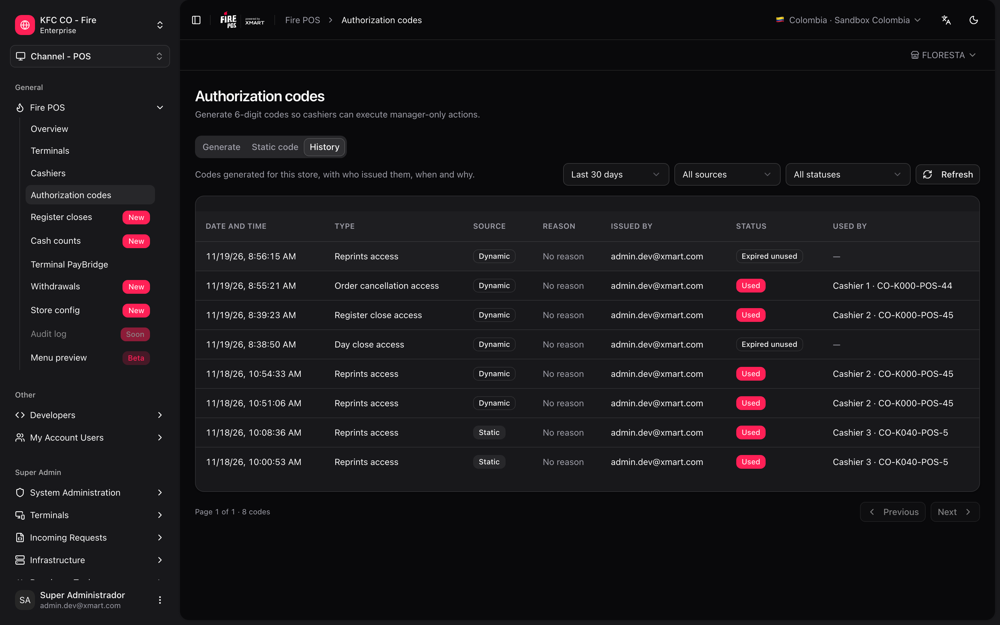

Um código dinâmico obriga o gerente a ter o backoffice à mão toda vez que o caixa pede autorização. No horário de pico, com o gerente na cozinha ou sem sinal no celular, a fila para por causa de uma conferência ou de uma gaveta que não abre. O **código fixo** resolve isso: a loja tem um único código de 6 dígitos que não vence e que o caixa aceita para as operações que você escolher. Em troca, a segurança passa a depender de quem conhece esse código, e por isso cada uso fica no histórico.

<Note>
  **O mínimo que você precisa saber**

  - Cada loja tem **um único** código fixo. Ele não vence e não se gasta: vale enquanto estiver **Ativo**.
  - Ele é mostrado **uma única vez**, ao ser criado ou trocado. Se for perdido, é preciso trocá-lo.
  - Nada muda até você decidir: todas as lojas começam em **Somente dinâmico**. A **Retirada parcial** sempre pede um código dinâmico.
</Note>

## Pré-requisitos

- Acesso ao backoffice da Fire em **[app.fire.rest](https://app.fire.rest)**, com permissões sobre a loja.
- **Canal - POS** e a loja selecionados no cabeçalho. O código fixo é configurado loja por loja.
- Conhecer os códigos dinâmicos. Consulte [Códigos de autorização](/pt/manuals/pos/authorization-codes).

## Código fixo ou código dinâmico

| | Código dinâmico | Código fixo |
|---|---|---|
| **Vence?** | Sim: em 3 ou em 30 minutos | Não. Vale até você trocá-lo ou desativá-lo |
| **Gasta-se?** | Sim: é usado uma vez | Não. Vale quantas vezes for preciso |
| **Quem gera?** | O gerente, um novo para cada operação | O gerente, uma vez por loja |
| **Para quais operações serve?** | Para uma só, a que você escolhe ao gerar | Para todas as que você marca na lista, exceto a retirada parcial |
| **Onde vale?** | Na conta onde foi gerado | Somente nos caixas da loja dele |
| **O que fica registrado?** | Quem gerou, o motivo e quem usou | Quem configurou o código e quem o usou, a cada uso |

## Os três modos da loja

O cartão **Quais códigos o caixa aceita** decide o que o operador digita quando o POS pede autorização.

| Modo | O que o caixa aceita | Quando convém |
|------|----------------------|---------------|
| **Somente dinâmico** | Somente códigos dinâmicos. É o modo inicial e o comportamento de sempre. | Você quer aprovar cada operação uma por uma. |
| **Ambos** | Os dois. Primeiro testa o código como dinâmico; se não houver um válido, testa como fixo. | Você quer o fixo para o dia a dia e o dinâmico para o resto, como as retiradas. |
| **Somente fixo** | Somente o código fixo da loja. Os dinâmicos não são aceitos. | Lojas onde ninguém gera códigos dinâmicos. |

Os modos **Ambos** e **Somente fixo** exigem que a loja tenha um código fixo **Ativo**. Sem ele, o backoffice responde "Crie e ative um código fixo antes de escolher esse modo."

<Warning>
  **Em Somente fixo não há retiradas parciais.** A retirada parcial precisa de um código dinâmico, e nesse modo o caixa não os aceita. Se a sua loja faz retiradas no meio do turno, use **Ambos**.
</Warning>

---

## 1. Abra a aba Código fixo

No menu lateral, abra **Fire POS → Códigos de autorização** e escolha a aba **Código fixo**. À esquerda fica o cartão **Quais códigos o caixa aceita**; à direita, **Código fixo da loja**.

Se aparecer "Escolha uma loja para configurar o código fixo dela.", selecione a loja no cabeçalho.

<Frame>
  
</Frame>

## 2. Escolha as operações que ele autoriza

Em **Operações que ele autoriza** todas vêm marcadas. Desmarque as que você quer continuar aprovando uma por uma com um código dinâmico. Pelo menos uma precisa ficar marcada.

## 3. Crie o código e anote-o

Toque em **Criar código fixo**. Abre-se uma janela com os 6 dígitos e o aviso "Anote agora: ele não será mostrado de novo. Se for perdido, troque-o."

Copie ou anote o código antes de tocar em **Fechar**. A Fire não guarda o código legível: depois de fechar a janela, ninguém consegue vê-lo de novo, nem o suporte.

O cartão passa a mostrar o status **Ativo**, quem criou o código e quando.

<Frame>
  
</Frame>

<Info>
  Criar o código não muda nada no caixa. Enquanto a loja continuar em **Somente dinâmico**, o POS não o aceita.
</Info>

## 4. Mude o modo da loja

Em **Quais códigos o caixa aceita**, escolha **Ambos** ou **Somente fixo**. A mudança é salva ao tocar na opção e vale a partir da próxima autorização: não é preciso reiniciar nem atualizar o POS.

<Tip>
  Se o código está **Ativo** e a loja em **Ambos** ou **Somente fixo**, você terminou. O caixa já aceita o código fixo.
</Tip>

---

## Mantenha o código em dia

### Mudar as operações

Marque ou desmarque as caixas e toque em **Salvar operações**. O botão só fica habilitado quando há mudanças. O código continua o mesmo.

### Trocar o código

Toque em **Trocar código** e confirme. Abre-se a janela com o código novo, também uma única vez. O código anterior deixa de valer na hora; os usos anteriores continuam no histórico. O cartão mostra quem o trocou e quando.

### Desativar e reativar

Toque em **Desativar** e confirme. O status passa a **Desativado** e o caixa deixa de aceitá-lo. Para voltar a usá-lo, toque em **Ativar**: é o mesmo código de antes, e ele não é mostrado de novo.

<Warning>
  **Desativar o código com a loja em Somente fixo deixa o caixa sem códigos.** Nenhuma operação que peça autorização pode ser feita até você ativá-lo de novo ou mudar o modo. Mude primeiro o modo para **Somente dinâmico**.
</Warning>

---

## Quais operações ele cobre

| Caixa de seleção | O que autoriza no POS |
|------------------|-----------------------|
| **Fechamento com falta** | Confirmar um fechamento de caixa em que a contagem dá menos que o esperado |
| **Fechamento com sobra** | Confirmar um fechamento de caixa em que a contagem dá mais que o esperado |
| **Acesso ao cancelamento de pedidos** | Entrar no painel de cancelamento |
| **Acesso ao fechamento de caixa** | Entrar no fechamento e contar o caixa |
| **Acesso à conferência de caixa** | Fazer uma conferência de caixa |
| **Acesso ao fechamento do dia** | Imprimir o fechamento do dia |
| **Anulação pós-cozinha** | Anular um pedido que já foi para a cozinha |
| **Devolução** | Fazer uma devolução |
| **Acesso a reimpressões** | Entrar na lista de reimpressões |
| **Abrir gaveta** | Abrir a gaveta fora de uma venda |

**A retirada parcial não está na lista.** O código de uma retirada leva o caixa e o valor que o gerente autorizou, e um código fixo não pode levar um valor diferente a cada uso. Por isso a retirada sempre pede um código dinâmico. Consulte [Retirada parcial de dinheiro](/pt/manuals/pos/cash-withdrawal).

## No POS: como o operador usa

O POS não mudou. As telas que pedem autorização são as mesmas, e o código fixo é digitado igual a um dinâmico: 6 dígitos no mesmo teclado.

1. O operador inicia a operação, por exemplo **Configurações → Conferência de caixa**.
2. O POS pede o código de autorização.
3. Quem conhece o código fixo digita os 6 dígitos.
4. A operação continua. O código continua valendo para a próxima vez.

Um fechamento de caixa com falta continua pedindo autorização duas vezes: ao entrar no fechamento e ao aprovar a falta. Com o fixo, digita-se o mesmo código nas duas vezes, se ele cobrir as duas operações.

## Consulte o histórico

Cada uso do código fixo deixa uma linha na aba **Histórico**, junto com os códigos dinâmicos. A coluna **Origem** diz **Dinâmico** ou **Fixo**, e o filtro **Origem** permite ver só um dos dois.

<Frame>
  
</Frame>

Em uma linha de origem **Fixo** aparece:

| Coluna | O que mostra |
|--------|--------------|
| **Data e hora** | Quando o código foi usado |
| **Tipo** | A operação que ele autorizou |
| **Motivo** | **Sem motivo**. O código fixo não leva motivo |
| **Origem** | **Fixo** |
| **Gerado por** | Quem configurou o código: quem o criou ou quem o trocou por último |
| **Status** | **Usado** |
| **Usado por** | O operador e o caixa onde foi digitado |

Trocar ou desativar o código não apaga nada: as linhas dos usos anteriores continuam no histórico.

## Receitas

<AccordionGroup>
  <Accordion title="Deixar a conferência e a gaveta com o fixo, e o resto com dinâmico">
    1. Abra **Fire POS → Códigos de autorização → Código fixo**.
    2. Deixe marcadas apenas **Acesso à conferência de caixa** e **Abrir gaveta**.
    3. Toque em **Criar código fixo** e anote-o.
    4. Mude o modo para **Ambos**.
    5. Para fechamentos, cancelamentos e retiradas, continue gerando códigos dinâmicos na aba **Gerar**.
  </Accordion>

  <Accordion title="Saiu uma pessoa que conhecia o código">
    1. Abra a aba **Código fixo** da loja.
    2. Toque em **Trocar código** e confirme.
    3. Anote o código novo e entregue-o só a quem deve tê-lo.
    4. Em **Histórico**, filtre por origem **Fixo** e consulte os usos dos últimos dias.
  </Accordion>

  <Accordion title="Parar de usar o código fixo em uma loja">
    1. Em **Quais códigos o caixa aceita**, escolha **Somente dinâmico**.
    2. Em **Código fixo da loja**, toque em **Desativar** e confirme.
    3. O histórico de usos é mantido.
  </Accordion>

  <Accordion title="O código foi perdido e ninguém se lembra dele">
    1. Toque em **Trocar código** e confirme.
    2. Anote o código novo antes de fechar a janela.
    3. O modo e as operações marcadas não mudam.
  </Accordion>

  <Accordion title="Auditar para que o código foi usado nesta semana">
    1. Abra a aba **Histórico** e escolha o período.
    2. No filtro de origens, escolha **Fixo**.
    3. Consulte **Tipo** e **Usado por**: qual operação, qual operador e em qual caixa.
  </Accordion>
</AccordionGroup>

## Boas práticas de segurança

- **Troque-o quando sair alguém da equipe** que o conhecia, e quando suspeitar que ele vazou.
- **Não o compartilhe por chat** nem o deixe anotado perto do caixa. Entregue-o pessoalmente.
- **Limite quem o conhece.** O código substitui a aprovação do gerente: quem o tem pode autorizar por conta própria.
- **Marque só as operações de que você precisa.** As que movimentam mais dinheiro podem continuar com código dinâmico.
- **Desative-o se não for usado**, depois de passar a loja para **Somente dinâmico**.
- **Consulte o histórico** por origem **Fixo** com regularidade.

## Erros que custam caro

<Warning>
  **Dar o código fixo a todos os operadores.** Se o operador que faz a operação é o mesmo que a autoriza, não há mais uma segunda pessoa aprovando. Uma falta pode ser fechada ou uma gaveta aberta sem que mais ninguém fique sabendo até consultar o histórico.
</Warning>

<Warning>
  **Deixar Fechamento com falta marcado por costume.** Com um código dinâmico você escolhe o motivo da discrepância a cada vez. Com o fixo, a linha do histórico fica sem motivo. Se você quer que cada falta leve o seu motivo, desmarque essa caixa.
</Warning>

<Warning>
  **Fechar a janela sem anotar o código.** Ele não é mostrado de novo. É preciso trocá-lo, e o código que alguém já tinha deixa de valer.
</Warning>

<Warning>
  **Não trocá-lo quando a equipe muda.** O código não vence sozinho. Quem o aprendeu há seis meses continua com ele até você trocá-lo.
</Warning>

## Glossário

| Termo | O que significa |
|-------|-----------------|
| **Código dinâmico** | Código de 6 dígitos que o gerente gera para uma operação. Vence e é usado uma vez. |
| **Código fixo** | Código de 6 dígitos da loja. Não vence e não se gasta. |
| **Modo** | Quais códigos o caixa de uma loja aceita: **Somente dinâmico**, **Somente fixo** ou **Ambos**. |
| **Trocar** | Substituir o código fixo por um novo. O anterior deixa de valer na hora. |
| **Desativar** | Fazer o caixa deixar de aceitar o código fixo sem substituí-lo. Pode ser ativado de novo. |
| **Origem** | Coluna do histórico que diz se uma linha vem de um código **Dinâmico** ou do **Fixo**. |

## Perguntas frequentes

<AccordionGroup>
  <Accordion title='O POS diz "Código não encontrado. Confira os 6 dígitos."'>
    O caixa não reconheceu o código. Confira, nesta ordem: se os dígitos foram digitados corretamente, se o código está **Ativo**, se a loja está em **Ambos** ou **Somente fixo**, e se o caixa é da loja do código. Se alguém o trocou, o anterior não vale mais.
  </Accordion>

  <Accordion title='O POS diz "Esse código é de outro tipo"'>
    O código fixo não cobre essa operação. Marque a caixa em **Operações que ele autoriza** e toque em **Salvar operações**, ou gere um código dinâmico para essa operação.
  </Accordion>

  <Accordion title='O backoffice diz "Crie e ative um código fixo antes de escolher esse modo."'>
    Você escolheu **Ambos** ou **Somente fixo** e a loja não tem um código fixo **Ativo**. Crie-o, ou toque em **Ativar** se ele estiver **Desativado**, e escolha o modo de novo.
  </Accordion>

  <Accordion title="Posso ver o código de novo?">
    Não. Ele é mostrado só ao ser criado ou trocado. Se foi perdido, troque-o.
  </Accordion>

  <Accordion title="Posso ter um código fixo diferente para cada operação?">
    Não. Há um código por loja, com a lista de operações que ele cobre.
  </Accordion>

  <Accordion title="Por que a retirada parcial não aceita o código fixo?">
    Porque o código da retirada leva o caixa e o valor autorizado. Gere um código dinâmico de **Retirada parcial**; a loja precisa estar em **Ambos** ou **Somente dinâmico**.
  </Accordion>

  <Accordion title="No modo Ambos, os códigos dinâmicos continuam valendo?">
    Sim. O caixa testa primeiro o dinâmico. Se não houver um válido com esses dígitos, testa o fixo.
  </Accordion>

  <Accordion title="O que acontece com o histórico se eu trocar ou desativar o código?">
    Ele é mantido. Os usos anteriores continuam na aba **Histórico** com origem **Fixo**.
  </Accordion>

  <Accordion title="O código fixo de uma loja vale em outra?">
    Não. Cada loja tem o seu e só os caixas dela o aceitam.
  </Accordion>

  <Accordion title="É preciso atualizar o POS?">
    Não. O operador usa as mesmas telas de sempre.
  </Accordion>
</AccordionGroup>

## O que ele não faz

- Não autoriza **retiradas parciais**.
- Não há um código fixo por operador nem por operação: é um por loja.
- Não vence nem é trocado sozinho: quem troca é você.
- Não é possível escolher o código: a Fire gera os 6 dígitos.
